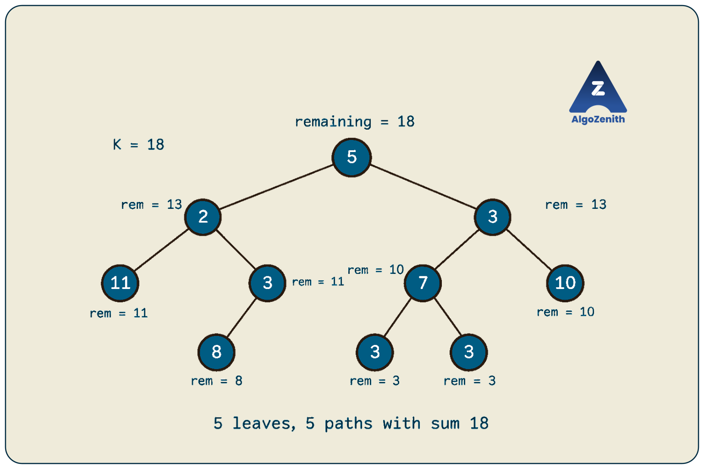
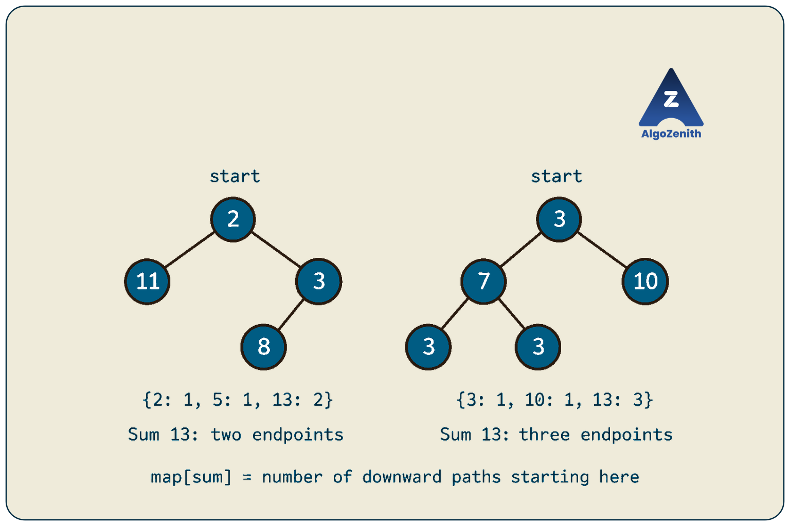
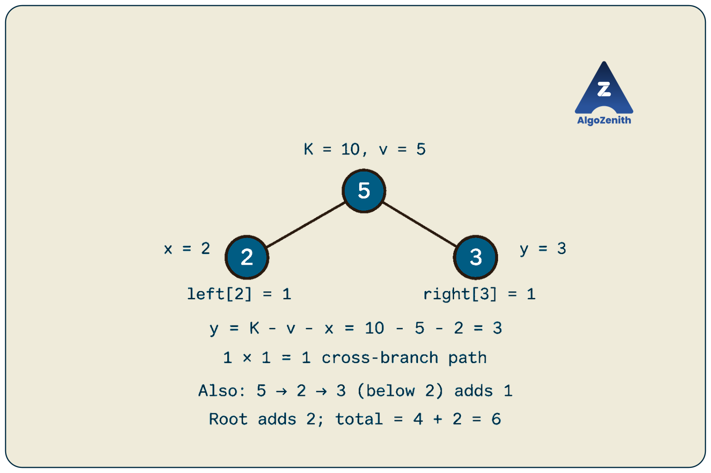

<VIDEO_WIDGET>

<VIDEO_ID></VIDEO_ID>

</VIDEO_WIDGET>

<READING_WIDGET>

# KSum Path in a Binary Tree

Given a binary tree whose nodes store numbers, how many paths have a sum equal to `K`?

Before choosing an algorithm, we must decide which paths are allowed. A path that must start at the root and end at a leaf is much more restricted than one whose endpoints can be anywhere in the tree.

Following the lecture, we will solve two variants. First, we will count **root-to-leaf paths** by carrying a remaining sum through recursion. Then, we will count **all simple paths** by combining sum-frequency maps from the two child subtrees.

## 1. Problem Statement and Conventions

Given the root of a binary tree and a target sum `K`, count valid paths whose **node values**, including both endpoints, add up to `K`.

| Variant | Allowed endpoints | Allowed shape |
| --- | --- | --- |
| 1: Root to leaf | Start at the root and end at a leaf | Only moves downward |
| 2: Any simple path | Both endpoints may be any nodes | May move upward to a common ancestor and then downward |

A **simple path** follows tree edges without repeating a node. In Variant 2, a single node is a valid path, and traversing the same path in reverse does not create a second path.

Assume that:

- The input is a finite binary tree with no cycles or shared child nodes.
- The tree may be empty, and node values may repeat or be negative or zero.
- Paths are nonempty. An empty tree has answer `0`, including when `K == 0`.
- Different paths are distinguished by their nodes, even if their value sequences are identical.
- The tree must remain unchanged.

Let `n` be the number of nodes and `h` the height measured in nodes. An empty tree has height `0`, and a leaf has height `1`.

### Running Example from the Lecture

We will use the same node values and structure throughout:

```text
                 5
               /   \
              2     3
             / \   / \
            11  3 7  10
               / / \
              8 3   3
```

There are several nodes containing `3`. When necessary, we will identify them by position: the root's right child, the node below `2`, and the two leaves below `7`.

## 2. Variant 1: Count Root-to-Leaf Paths with Sum K

A valid path must include the root and finish at a **leaf**, meaning a node with no children.

For `K = 18`, the complete list of root-to-leaf paths is:

| Path | Sum | Counted? |
| --- | --- | --- |
| `5 -> 2 -> 11` | `18` | Yes |
| `5 -> 2 -> 3 -> 8` | `18` | Yes |
| `5 -> 3 -> 7 -> 3` using the left leaf of `7` | `18` | Yes |
| `5 -> 3 -> 7 -> 3` using the right leaf of `7` | `18` | Yes |
| `5 -> 3 -> 10` | `18` | Yes |

The answer is **`5`**. The two paths through `7` count separately because they end at different nodes.

For the node values shown in the lecture, all five paths sum to `18`; the handwritten total of `4` is an arithmetic slip. We will use the corrected total in the dry run and code output.

### Define the Recursive State

Let:

```text
countRootToLeaf(cur, remaining)
```

mean:

> Count paths that start at `cur`, end at a leaf in its subtree, and have node-value sum equal to `remaining`.

On entry, `remaining` still includes the contribution required from `cur`. Initially, call the function with `(root, K)`.

There are three cases:

1. **Empty subtree:** Return `0`. There is no nonempty path to a leaf.
2. **Leaf:** Return `1` if `cur->data == remaining`; otherwise return `0`.
3. **Internal node:** Subtract `cur->data` and add the results from both children.

The recurrence is:

```text
count(cur, remaining)
    = count(cur->left,  remaining - cur->data)
    + count(cur->right, remaining - cur->data)
```

This recurrence applies after the null and leaf cases have been handled.

### Shared C++ Definitions

All code in this lesson uses C++17. Combine the following headers and node definition with the implementations below:

```cpp
#include <iostream>
#include <unordered_map>
using namespace std;

using int64 = long long;
using Frequency = unordered_map<int64, int64>;

struct Node {
    int data;
    Node* left;
    Node* right;

    Node(int value)
        : data(value), left(nullptr), right(nullptr) {}
};
```

We use `long long` for sums, frequencies, and answers. The code assumes all sums, complement calculations, and counts fit in that type.

### C++ Implementation

```cpp
int64 countRootToLeaf(Node* cur, int64 remaining) {
    if (cur == nullptr) return 0;

    if (cur->left == nullptr && cur->right == nullptr) {
        return cur->data == remaining ? 1 : 0;
    }

    int64 nextRemaining = remaining - cur->data;

    return countRootToLeaf(cur->left, nextRemaining)
         + countRootToLeaf(cur->right, nextRemaining);
}
```

Each call receives its own copy of `remaining`. Subtracting a value for one branch does not change the target passed to another branch, so no explicit restoration is needed.

### Dry Run for K = 18



| Current node or position | Remaining sum on entry | Action or return value |
| --- | --- | --- |
| Root `5` | `18` | Pass `13` to both children |
| Node `2` | `13` | Pass `11` to both children |
| Leaf `11` | `11` | Return `1` |
| Node `3` below `2` | `11` | Pass `8` to its child |
| Leaf `8` | `8` | Return `1` |
| Root's right child `3` | `13` | Pass `10` to both children |
| Node `7` | `10` | Pass `3` to both children |
| Each leaf `3` below `7` | `3` | Return `1` each |
| Leaf `10` | `10` | Return `1` |

The subtree rooted at `2` returns `2`. The subtree rooted at the root's right child returns `3`. The root therefore returns `2 + 3 = 5`.

### Why Is the Algorithm Correct?

At a leaf, there is exactly one candidate path: that leaf itself. Checking its value against the remaining target is sufficient.

At an internal node, every path to a leaf continues into exactly one child subtree. After including the current value, the child path must supply `remaining - cur->data`. The left and right groups are disjoint, so their counts add without duplication.

### Complexity

Every node is visited once, giving **`O(n)` time**. The active recursion follows a root-to-leaf path, giving **`O(h)` auxiliary space**: `O(log n)` for a balanced tree and `O(n)` for a chain.

### Why Must We Check for a Leaf?

Reaching the target at an internal node does not finish a root-to-leaf path. In the running example, `5 -> 2 -> 3` sums to `10`, but the final node has child `8`, so it is not a valid Variant 1 path.

Also, a null child is not a leaf. Returning `1` whenever a null call receives a remaining sum of zero can count missing child positions or count a completed leaf path twice.

Do not prune just because the remaining target becomes negative. Negative node values may bring the final sum back to the target.

## 3. Variant 2: Count Any Simple Path with Sum K

Now remove the root and leaf restrictions. Either endpoint may be anywhere, and the path may pass from one branch into another through their common ancestor.

For `K = 10`, the running tree has these **six** paths:

| Path | Description |
| --- | --- |
| `10` | A single-node path |
| `5 -> 2 -> 3` | Root to an internal descendant |
| `3 -> 7` | Root's right child to its left child |
| `7 -> 3` using its left leaf | Parent to leaf |
| `7 -> 3` using its right leaf | A different parent-to-leaf path |
| `2 -> 5 -> 3` | Crosses between the root's two child subtrees |

The last path is particularly important: it goes **up from `2` to `5`, then down to the root's right child `3`**. A downward-only algorithm would miss it.


### A Direct Baseline

One baseline is to treat the tree as an undirected graph by building parent links or an adjacency list. Starting from every node, traverse all possible endpoints while carrying the path sum and avoiding the edge just used.

This takes `O(n^2)` time. To avoid counting a path and its reverse twice, assign node IDs and accept an endpoint only when its ID is at least the starting ID. Single-node paths are then counted once as well.

The lecture takes a more structured approach: **assign each path to its highest node and combine information returned by that node's children**.

## 4. The Key Observation: Every Path Has One Highest Node

For endpoints `a` and `b`, the highest node on their connecting path is their **lowest common ancestor** in the rooted tree.

At a current node `cur`, every path contained in its subtree belongs to exactly one of these groups:

1. Entirely inside the left subtree.
2. Entirely inside the right subtree.
3. Has `cur` as its highest node.

The recursive calls handle the first two groups. We only need to count the third group at `cur`.

A path whose highest node is `cur` has one of four forms:

- `cur` alone.
- `cur` followed by a downward path in the left subtree.
- `cur` followed by a downward path in the right subtree.
- A downward branch in the left subtree, then `cur`, then a downward branch in the right subtree.

For the last form, let the two branch sums be `x` and `y`, and let `v` be the value at `cur`. Neither branch sum includes `cur`, so:

$$
x + v + y = K,
$$

or equivalently:

$$
y = K - v - x.
$$

This is the complement lookup shown in the lecture. We need to know how many child branches have each possible sum.

## 5. What Should DFS Return? A Sum-Frequency Map

Define the returned map as:

```text
down[cur][s] = number of nonempty downward paths
               that start exactly at cur and have sum s.
```

These paths may end at **any descendant**, including `cur` itself. They do not need to reach a leaf.

The returned map contains only paths that can be extended upward through the parent. A path already joining two child branches cannot be extended through the parent without branching or revisiting a node, so it must not be returned as a downward path.

### Maps in the Lecture's Tree

For the subtree rooted at `2`:

| Downward path starting at `2` | Sum |
| --- | --- |
| `2` | `2` |
| `2 -> 11` | `13` |
| `2 -> 3` | `5` |
| `2 -> 3 -> 8` | `13` |

Its returned map is:

```text
{2: 1, 5: 1, 13: 2}
```

For the subtree rooted at the root's right child `3`:

| Downward path starting at that `3` | Sum |
| --- | --- |
| `3` | `3` |
| `3 -> 7` | `10` |
| `3 -> 10` | `13` |
| `3 -> 7 -> 3` using the left leaf | `13` |
| `3 -> 7 -> 3` using the right leaf | `13` |

Its returned map is:

```text
{3: 1, 10: 1, 13: 3}
```

The map stores **frequencies**, not just distinct sums. For example, three different endpoints give sum `13` in the second map.



### Counting Paths at the Current Node

Let `left` and `right` be the maps returned by the children, and let `v = cur->data`.

| Path form | Contribution to the answer |
| --- | --- |
| Current node alone | `1` if `v == K`, otherwise `0` |
| Current node and a left branch | `left[K - v]` |
| Current node and a right branch | `right[K - v]` |
| Both branches through current node | Sum of `left[x] * right[K - v - x]` over left sums `x` |

Missing keys contribute zero. If there are `a` left branches and `b` right branches with complementary sums, they form `a * b` different endpoint pairs.

### Constructing the Map to Return

Start with the single-node path:

```text
down[v] = 1
```

Then extend every child path by placing `cur` in front of it:

```text
For each (sum, frequency) in left:
    down[sum + v] += frequency

For each (sum, frequency) in right:
    down[sum + v] += frequency
```

Use addition rather than assignment because different paths may produce the same sum.

## 6. C++ Implementation for All Simple Paths

The helper updates an answer passed by reference and returns the downward-path map for its subtree. The wrapper starts a fresh answer for every query.

```cpp
int64 frequencyOf(const Frequency& frequencies, int64 sum) {
    auto it = frequencies.find(sum);
    return it == frequencies.end() ? 0 : it->second;
}

Frequency collectDownwardSums(Node* cur, int64 k, int64& answer) {
    if (cur == nullptr) return {};

    Frequency left = collectDownwardSums(cur->left, k, answer);
    Frequency right = collectDownwardSums(cur->right, k, answer);
    int64 value = cur->data;

    // Paths with cur as the highest node and as an endpoint.
    if (value == k) ++answer;
    answer += frequencyOf(left, k - value);
    answer += frequencyOf(right, k - value);

    // Paths with one endpoint in each child subtree.
    for (const auto& [leftSum, leftCount] : left) {
        int64 needed = k - value - leftSum;
        answer += leftCount * frequencyOf(right, needed);
    }

    // Only downward paths starting at cur can extend to its parent.
    Frequency down;
    down[value] = 1;

    for (const auto& [sum, count] : left) {
        down[sum + value] += count;
    }
    for (const auto& [sum, count] : right) {
        down[sum + value] += count;
    }

    return down;
}

int64 countAllKSumPaths(Node* root, int64 k) {
    int64 answer = 0;
    collectDownwardSums(root, k, answer);
    return answer;
}
```

`frequencyOf` uses `find` so a failed lookup does not insert an unnecessary zero-frequency entry. We use `operator[]` only while deliberately constructing the returned map.

The child maps are passed to lookups by reference, and the returned map is eligible for copy elision or a move in C++17. We do not keep a separate permanent map for every node.

### Empty Branches and Zero-Sum Branches Are Different

An empty child returns an empty map, not `{0: 1}`. Single-node and one-sided paths are counted explicitly in this implementation.

A map entry with key `0`, if present, represents a **real nonempty path** whose values sum to zero. It must be retained. For example, a child with value `0` contributes a real branch even though extending by it does not change the sum.

## 7. Dry Run of the Map Approach for K = 10

DFS processes children before their parent. The following table shows only the new paths counted at each node; paths counted in descendants remain in the shared answer.

| Current node or position | New paths with this highest node | Added count |
| --- | --- | --- |
| Leaves `11`, `8`, and the two leaves `3` | None | `0` |
| Node `3` below `2` | None | `0` |
| Node `2` | None | `0` |
| Node `7` | `7 -> 3` for each of its two leaves | `2` |
| Leaf `10` | `10` | `1` |
| Root's right child `3` | `3 -> 7` | `1` |
| Root `5` | `5 -> 2 -> 3` and `2 -> 5 -> 3` | `2` |

The total is `2 + 1 + 1 + 2 = 6`.

### The Merge at the Root

At root `5`, the child maps are:

```text
left  = {2: 1, 5: 1, 13: 2}
right = {3: 1, 10: 1, 13: 3}
```

For a one-sided path, the needed child sum is `10 - 5 = 5`. The left map has one such path, `2 -> 3`, giving `5 -> 2 -> 3`. The right map has none.

For a path using both sides, we need `x + y = 5`:

| Left sum `x` | Needed right sum `10 - 5 - x` | Contribution |
| --- | --- | --- |
| `2` | `3` | `1 * 1 = 1` |
| `5` | `0` | `0` |
| `13` | `-8` | `0` |

The match is `2 -> 5 -> 3`. The root adds two paths to the four already counted below it.



Its returned downward map is:

```text
{5: 1, 7: 1, 8: 1, 10: 1, 15: 1, 18: 5}
```

The frequency `5` at sum `18` also agrees with our earlier list of five root-to-leaf paths. This agreement is specific to this example: downward maps generally include paths ending at internal nodes too.

## 8. Why Does the Map Algorithm Count Every Path Exactly Once?

There are two claims to establish.

**The returned map has the promised meaning.** A downward path starting at `cur` is either `cur` alone or `cur` followed by a downward path starting at exactly one child. The construction includes all these choices, adds their frequencies when sums match, and returns no other path shapes.

**Each valid path contributes once to the answer.** Every simple path has a unique highest node. At that node, it is either a singleton, a one-sided path, or a path joining the two child subtrees. These cases do not overlap. The corresponding checks count it there, and no other node can count it as a path with that highest node.

For a two-sided path, choosing the left endpoint from the left map and the right endpoint from the right map fixes its orientation for counting. We never repeat the pairing with the sides reversed, so no division by two is required.

## 9. Complexity of the Map Approach

Visiting every node once does **not** make this algorithm linear: each visit processes maps that may contain many entries.

### Expected Time: O(nh), Up to O(n²)

If a subtree has `s` nodes, there are exactly `s` downward paths starting at its root, one for each endpoint. Its map therefore has at most `s` distinct keys.

At each node, the implementation scans the child maps for complement lookups and for constructing the returned map. With average constant-time hash operations, the work is bounded by the size of that subtree.

Across the whole tree:

```text
Total expected work = O(sum of subtree sizes) = O(nh)
```

Each node belongs to at most `h` ancestor subtrees, which explains the last bound.

- **Balanced tree:** `O(n log n)` expected time as an upper bound.
- **Skewed tree:** `O(n^2)` expected time in the worst shape. A positive-valued chain can have distinct downward sums and require maps of sizes `1, 2, ..., n`.
- **Repeated sums:** Maps may be smaller, reducing the actual work.

These bounds assume average constant-time `unordered_map` operations. They are not guarantees against pathological hash collisions.

### Auxiliary Space: O(n)

This implementation retains only maps needed by active recursive calls. While one subtree is being processed, saved maps from completed sibling subtrees describe disjoint sets of nodes, so their total entry count is `O(n)`.

During a merge, the two child maps and the newly built map coexist, still using `O(n)` entries in total as an upper bound. The recursion adds `O(h)` space, which is also at most `O(n)`.

Thus, peak auxiliary space is **`O(n)`**, although the cumulative work of building maps may be quadratic. If we instead saved every node's full map permanently, storage could grow to `O(nh)`, or `O(n^2)` on a chain.

## 10. Building and Running the Lecture Example

Combine the shared definitions and both implementations with this `main` to form a complete C++17 program:

```cpp
int main() {
    Node root(5), left2(2), right3(3);
    Node leaf11(11), left3(3), node7(7), leaf10(10);
    Node leaf8(8), leaf3a(3), leaf3b(3);

    root.left = &left2;
    root.right = &right3;
    left2.left = &leaf11;
    left2.right = &left3;
    left3.left = &leaf8;
    right3.left = &node7;
    right3.right = &leaf10;
    node7.left = &leaf3a;
    node7.right = &leaf3b;

    cout << "Root-to-leaf paths with sum 18: "
         << countRootToLeaf(&root, 18) << '\n';
    cout << "All simple paths with sum 10: "
         << countAllKSumPaths(&root, 10) << '\n';
}
```

Output:

```text
Root-to-leaf paths with sum 18: 5
All simple paths with sum 10: 6
```

Each variable represents a different node, even when several store `3`. These are local objects, so they remain alive while `main` runs and are destroyed automatically afterward. Do not call `delete` on them.

## 11. Edge Cases and Common Mistakes

| Case | Root-to-leaf variant | Any-simple-path variant |
| --- | --- | --- |
| Empty tree | `0` | `0` |
| Single node equal to `K` | `1` | `1` |
| Single node different from `K` | `0` | `0` |
| Root matches `K` but has children | Root alone is not eligible | Root alone contributes `1` |
| Different nodes have the same value | Count different valid leaf endpoints | Preserve frequencies for different endpoints |
| Three-node chain of zeros, `K = 0` | `1` | `6` |
| Negative values | Continue to leaves without sign-based pruning | Preserve negative sums and complement lookups |

Watch for these mistakes:

- **Solving only downward paths for Variant 2.** The cross-branch path `2 -> 5 -> 3` must also count.
- **Using a set of sums.** It discards multiplicity; matching frequencies must be multiplied for cross-branch paths.
- **Forgetting the current node's value.** Child maps exclude it, so the complement is `K - value - leftSum`.
- **Returning arbitrary paths in the map.** Only downward paths starting at the current node can be extended to its parent.
- **Using assignment when combining frequencies.** `down[sum + value] += count` preserves paths that share a sum.
- **Discarding sums above `K`.** With negative values, a large branch sum can still have a valid complement.
- **Keeping a global answer across queries.** Reset it before every call; the wrapper handles this automatically.
- **Calling the map solution O(n) because it uses one DFS.** Count the work inside each visit, including map construction.

## 12. Interview and Competitive Programming Insights

**Clarify the path definition first.** Root-to-leaf, downward ancestor-to-descendant, and arbitrary simple paths are three different specifications. The lecture's second variant is the third kind. State whether single nodes count and whether reversal creates a new path before coding.

**Prefix sums solve the downward-only variation efficiently.** For paths that can start at any ancestor but must move downward, a DFS can maintain frequencies of prefix sums on the active root-to-current path. If the current prefix sum is `S`, earlier prefixes equal to `S - K` identify valid starts. Initialize the empty prefix with frequency `1`, query before inserting the current prefix, and remove it when backtracking. This gives `O(n)` expected time and `O(h)` auxiliary space, but does not count paths joining separate branches.

**Use the highest node to organize counting.** Assigning every path to its LCA makes the cases disjoint. This is a useful tree-DP pattern whenever an answer combines one contribution from each child subtree.

**Size the answer type for the number of paths.** A tree with `n` nodes has `n(n + 1) / 2` nonempty simple paths when reversal is treated as the same path. An all-zero tree with `K = 0` makes every one of them valid. This is why both frequencies and their products use `long long`, even when individual values fit in `int`.

**Match the method to the constraints.** The lecture's map approach can be quadratic on a chain. For large arbitrary trees, centroid decomposition is an advanced extension: count paths through a centroid using sum frequencies, process each component separately, and recurse. With suitable hash maps, it can count fixed-sum paths in `O(n log n)` expected time. That is a separate technique; the map implementation above does not have that guarantee on every shape.

**Account for recursion depth.** Both implementations can reach depth `n`. For very deep trees, an explicit traversal stack may be necessary. The map approach requires postorder processing so that child results exist before the parent is handled.

## Quick Recap

- For root-to-leaf paths, subtract the current value and check for equality only at a leaf: **`O(n)` time and `O(h)` space**.
- For arbitrary simple paths, every path has a unique highest node, its endpoints' LCA.
- Return frequencies of downward sums starting at each subtree root.
- Count singletons, one-sided paths, and complementary left/right branches separately.
- The cross-branch condition is **`leftSum + currentValue + rightSum = K`**.
- The map implementation uses **`O(nh)` expected time, up to `O(n^2)`, and `O(n)` peak auxiliary space**.
- In the lecture tree, the corrected answers are **`5` root-to-leaf paths for `K = 18`** and **`6` arbitrary simple paths for `K = 10`**.

</READING_WIDGET>
