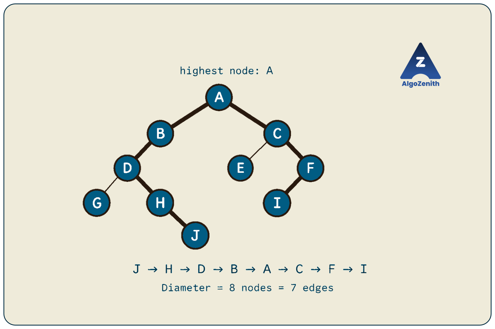
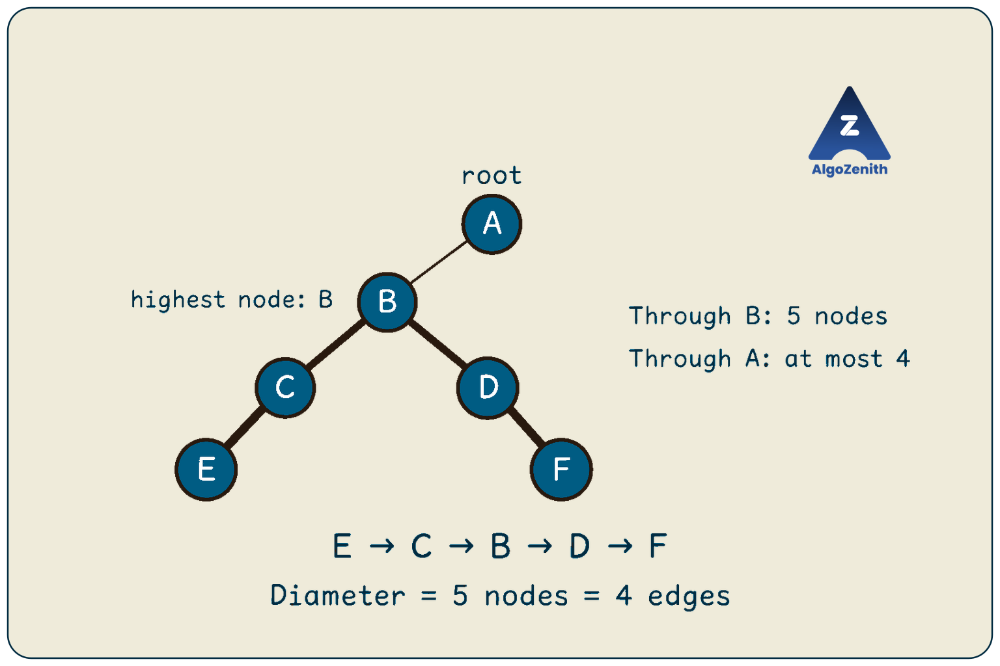
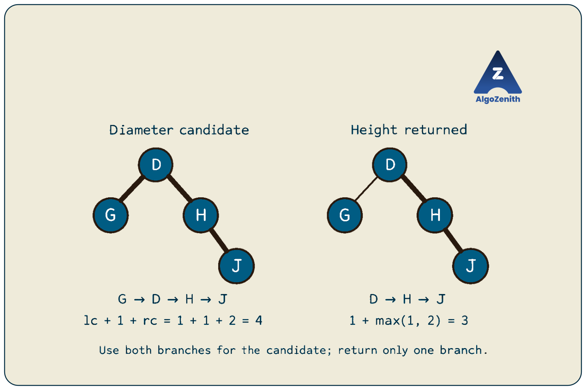

<VIDEO_WIDGET>

<VIDEO_ID></VIDEO_ID>

</VIDEO_WIDGET>

<READING_WIDGET>

# Diameter of a Binary Tree

The height of a binary tree tells us how far we can travel downward from its root. But what if we can start and finish at **any two nodes**?

The longest path may climb from one branch to a common ancestor and then descend into another branch. Finding its length is the **diameter problem**.

Following the lecture, we will assign each path to its lowest common ancestor, find the best path for every such ancestor, and take the maximum. A single depth-first search can do this by returning subtree heights while maintaining the best diameter found so far.

## 1. Problem Statement and Conventions

Given the root of a binary tree, find the **maximum distance between any pair of nodes**.

A path follows tree edges without repeating a node. Although child pointers point downward, a path may travel upward to an ancestor and then downward into another branch. We are measuring distance in the underlying tree, not restricting movement to the direction of the pointers.

Assume that:

- The input is a finite binary tree with no cycles or shared child nodes.
- The tree may be empty.
- Node values may repeat; they do not affect path lengths.
- Every edge contributes one unit of distance.
- The tree must remain unchanged.

Let `n` be the number of nodes and `h` the height **measured in nodes**. An empty subtree has height `0`, and a leaf has height `1`.

### Diameter in Edges or in Nodes?

These are two common ways to report the same longest path:

| Convention | What is counted? | Single-node tree | Empty tree in this lesson |
| --- | --- | --- | --- |
| Diameter in edges | Links between consecutive nodes | `0` | `0` |
| Diameter in nodes | Nodes on the path, including both endpoints | `1` | `0` |

For every nonempty path:

```text
Number of edges = number of nodes - 1
```

The lecture describes the problem as a distance, but its code uses:

```cpp
ans = max(ans, lc + 1 + rc);
```

With heights measured in nodes, this computes the **diameter in nodes**. We will retain that convention in the main implementation and provide a wrapper for the edge-count answer. Always check which convention a problem expects before submitting.

## 2. Running Example from the Lecture

The lecture's nodes are unlabeled. We will assign letters to the same structure so that the paths and recursive returns are easy to follow:



The letters identify nodes; their stored values are irrelevant to this problem.

The highlighted longest path in the lecture connects the deepest endpoint in the left branch to the deepest endpoint in the right branch:

```text
J -> H -> D -> B -> A -> C -> F -> I
```

It contains **8 nodes and 7 edges**. Its highest node is `A`, the lowest common ancestor of `J` and `I`.

Compare this with the longest downward path starting at the root:

```text
A -> B -> D -> H -> J
```

That path contains `5` nodes. Therefore, the tree's height is `5`, while its diameter is `8` nodes or `7` edges. **Height and diameter measure different kinds of paths.**

## 3. The Key Observation: Every Path Has One Highest Node

For any endpoints `u` and `v`, their unique connecting path goes upward to `LCA(u, v)` and then downward to the other endpoint. Either of these portions can have zero edges if one endpoint is the ancestor itself.

This LCA is the **highest node on that path**. We can therefore organize all candidate paths by their highest node.

At a current node `cur`, every path contained in its subtree belongs to one of three groups:

1. Entirely inside the left subtree.
2. Entirely inside the right subtree.
3. Has `cur` as its highest node.

The recursive calls handle the first two groups. At `cur`, we only need to compute the best path in the third group.

### The Best Path Whose Highest Node Is cur

Let:

```text
lc = height of cur's left subtree, measured in nodes
rc = height of cur's right subtree, measured in nodes
```

The longest path with `cur` as its highest node combines:

- A deepest downward branch in the left subtree, containing `lc` nodes.
- The current node itself.
- A deepest downward branch in the right subtree, containing `rc` nodes.

Thus:

```text
Best path with highest node cur, in nodes = lc + 1 + rc
Best path with highest node cur, in edges = lc + rc
```

The left and right branches lie in disjoint subtrees, so joining them through `cur` gives a valid simple path.

These formulas also cover missing children. If the right subtree is empty, `rc = 0`, and the path ends at `cur` on that side. At a leaf, both heights are zero, giving a path of `1` node or `0` edges.

### Why Must We Consider Every Node?

The diameter need not pass through the root. For example:



The longest path is:

```text
E -> C -> B -> D -> F
```

It has `5` nodes, and its highest node is `B`. Any path containing root `A` has at most `4` nodes.

Computing the candidate only at the root would miss this answer. We must evaluate **every possible highest node** and keep the maximum.

We do not need to run a separate LCA algorithm for pairs of endpoints. Visiting every node as a possible LCA is enough.

## 4. A Direct Approach: Recompute Heights at Every Node

A straightforward recursive solution is:

1. Compute the left and right subtree heights.
2. Form the candidate `leftHeight + 1 + rightHeight`.
3. Recursively find the diameters of the two child subtrees.
4. Return the largest of these three answers.

In recurrence form:

```text
diameterNodes(cur) = max(
    diameterNodes(cur->left),
    diameterNodes(cur->right),
    height(cur->left) + 1 + height(cur->right)
)
```

For an empty subtree, both height and diameter are zero.

This is correct, but repeatedly traverses the same subtrees to calculate heights. On a chain of `n` nodes, the height computations examine approximately:

```text
(n - 1) + (n - 2) + ... + 1 = O(n^2) nodes in total
```

The worst-case time is **`O(n^2)`**, with **`O(h)` auxiliary space** for recursion. The optimization is to compute each height once and return it to the parent during the same traversal that updates the diameter.

## 5. One DFS: Return Height, Update Diameter

This is the strategy shown in the lecture:

1. Perform DFS on the binary tree.
2. Find the best path for each possible LCA.
3. Take the maximum answer.

The important implementation detail is that the helper has **two separate responsibilities**:

| Information | Meaning | How it is passed |
| --- | --- | --- |
| Subtree height | Longest downward path starting at the current node, measured in nodes | Return value |
| Best diameter so far | Longest candidate path found among processed nodes, measured in nodes | Shared answer passed by reference |

### Define the Recursive State

```text
dfsHeight(cur, answer)
```

returns the height of the subtree rooted at `cur` and updates `answer` with diameter candidates from that subtree.

The steps are:

```text
If cur is null:
    return 0

lc = dfsHeight(cur->left, answer)
rc = dfsHeight(cur->right, answer)

answer = max(answer, lc + 1 + rc)
return 1 + max(lc, rc)
```

We process the children before combining their results at the parent. This is **postorder DFS**.

### Why Return max(lc, rc) + 1 Instead of lc + rc + 1?

A downward path starting at `cur` can continue into **only one child**. Its parent needs a single branch that it can extend through `cur`.

A path already joining both child branches cannot also extend upward to the parent without branching at `cur` or revisiting it. It is a valid diameter candidate, but not a valid downward contribution to return.

For node `D` in the running example:

```text
Left height:  1, from G
Right height: 2, from H -> J

Diameter candidate: 1 + 1 + 2 = 4 nodes
Height returned:    1 + max(1, 2) = 3 nodes
```

The candidate is `G -> D -> H -> J`. The branch that can extend upward through `B` is `D -> H -> J`.



This distinction between **a complete path considered for the answer** and **one branch returned to the parent** is the central idea of the algorithm.

## 6. C++ Implementation

All code in this lesson uses C++17. Combine the following definitions, functions, and the later `main` to form a complete program.

### Headers and Node Definition

```cpp
#include <algorithm>
#include <iostream>
using namespace std;

struct Node {
    int data;
    Node* left;
    Node* right;

    Node(int value)
        : data(value), left(nullptr), right(nullptr) {}
};
```

### Diameter in Nodes: The Lecture's Convention

```cpp
int dfsHeight(Node* cur, int& answer) {
    if (cur == nullptr) return 0;

    int lc = dfsHeight(cur->left, answer);
    int rc = dfsHeight(cur->right, answer);

    // Best path whose highest node is cur.
    answer = max(answer, lc + 1 + rc);

    // One downward branch that the parent can extend.
    return max(lc, rc) + 1;
}

int diameterInNodes(Node* root) {
    int answer = 0;
    dfsHeight(root, answer);
    return answer;
}
```

`int& answer` is a reference: every recursive call updates the same answer variable. The wrapper initializes it to zero for each query, so results from earlier calls cannot carry over.

The wrapper deliberately ignores the helper's return value. That return value is the tree's **height**; the diameter is stored in `answer`.

The code assumes the number of nodes fits in an `int`. It reads child pointers but does not modify the tree.

### Diameter in Edges

For a nonempty tree, subtract one from the node-count diameter. Handle an empty tree separately so that it returns zero:

```cpp
int diameterInEdges(Node* root) {
    if (root == nullptr) return 0;
    return diameterInNodes(root) - 1;
}
```

Alternatively, to accumulate an edge-count answer directly inside DFS, change only the update to:

```cpp
answer = max(answer, lc + rc);
```

Keep the null return `0` and the height return `max(lc, rc) + 1` unchanged. In that version, the returned heights still count nodes, while `answer` counts edges. Use either the direct edge-count update **or** the subtraction wrapper, not both.

## 7. Dry Run on the Lecture's Tree

For a DFS that visits the left child before the right child, non-null nodes finish in this order:

```text
G, J, H, D, B, E, I, F, C, A
```

The table uses the lecture's **node-count diameter**. Null calls return `0` and are omitted.

| Node | `lc` | `rc` | Candidate `lc + 1 + rc` | Height returned | `answer` after update |
| --- | --- | --- | --- | --- | --- |
| `G` | `0` | `0` | `1` | `1` | `1` |
| `J` | `0` | `0` | `1` | `1` | `1` |
| `H` | `0` | `1` | `2` | `2` | `2` |
| `D` | `1` | `2` | `4` | `3` | `4` |
| `B` | `3` | `0` | `4` | `4` | `4` |
| `E` | `0` | `0` | `1` | `1` | `4` |
| `I` | `0` | `0` | `1` | `1` | `4` |
| `F` | `1` | `0` | `2` | `2` | `4` |
| `C` | `1` | `2` | `4` | `3` | `4` |
| `A` | `4` | `3` | `8` | `5` | `8` |

At the root:

```text
Left subtree height  = 4, along B -> D -> H -> J
Right subtree height = 3, along C -> F -> I

Diameter candidate = 4 + 1 + 3 = 8 nodes
Height returned    = 1 + max(4, 3) = 5 nodes
```

The final result is **8 nodes or 7 edges**, matching the highlighted endpoint-to-endpoint path.

Notice that processing leaf `E` does not reset the answer from `4` to `1`. The `max` operation preserves the best candidate found anywhere earlier in the traversal.

## 8. Why Is the Algorithm Correct?

We need to justify both the returned heights and the accumulated diameter.

### The Helper Returns the Correct Height

An empty subtree has height zero. For a nonempty subtree, every downward path starting at its root either stops there or continues through one child.

Once the recursive calls have returned the correct child heights, the longest such path contains the current node followed by the taller child branch. Its length is:

```text
1 + max(lc, rc)
```

Thus, each call returns the correct height.

### The Answer Contains the Longest Path

Take any longest path and let `x` be its highest node, the LCA of its endpoints.

If both endpoints lie below `x`, they must lie in different child subtrees; otherwise, their LCA would be below `x`. If one endpoint is `x`, the path uses only one child branch. The singleton case uses neither branch.

At `x`, the expression `lc + 1 + rc` selects the longest available branch on each side. It constructs a valid path at least as long as the chosen path with highest node `x`.

DFS evaluates this candidate at every node. Therefore, it considers the highest node of a globally longest path. Since every candidate is itself a valid path, taking their maximum gives exactly the diameter.

For an empty tree, no candidate is evaluated, and the initialized answer remains zero.

## 9. Time and Space Complexity

Each node is visited once. After receiving its child heights, it performs only constant work: one candidate calculation, a maximum update, and a height calculation.

- **Time:** `O(n)`.
- **Auxiliary space:** `O(h)` for the active recursion stack.

The two child calls run one after the other; their entire stacks are not active simultaneously. The maximum stack depth follows a root-to-leaf path.

| Tree shape | Height | DFS auxiliary space |
| --- | --- | --- |
| Balanced tree | `O(log n)` | `O(log n)` |
| Skewed tree or chain | `O(n)` | `O(n)` |

A few local integers per call do not make the whole algorithm constant-space. All active recursive calls must be included in the space analysis.

The edge-count wrapper performs one traversal, so it has the same bounds.

## 10. Building and Running the Lecture Example

The following `main` recreates the labeled lecture tree. The numbers stored in the nodes are only sample data; changing them would not change the diameter.

```cpp
int main() {
    Node a(1), b(2), c(3), d(4), e(5);
    Node f(6), g(7), h(8), i(9), j(10);

    a.left = &b;
    a.right = &c;
    b.left = &d;
    c.left = &e;
    c.right = &f;
    d.left = &g;
    d.right = &h;
    f.left = &i;
    h.right = &j;

    cout << "Diameter in nodes: " << diameterInNodes(&a) << '\n';
    cout << "Diameter in edges: " << diameterInEdges(&a) << '\n';

    return 0;
}
```

Output:

```text
Diameter in nodes: 8
Diameter in edges: 7
```

This demonstration calls the algorithm twice to show both interfaces. If both results are needed in an application, compute the node-count result once and convert it to edges, treating zero as the empty-tree case.

The nodes are local objects that remain alive while `main` runs. They are destroyed automatically; do not call `delete` on them.

## 11. Edge Cases and Common Mistakes

| Case | Diameter in nodes | Diameter in edges |
| --- | --- | --- |
| Empty tree | `0` | `0` |
| Single node | `1` | `0` |
| Root with one leaf child | `2` | `1` |
| Root with two leaf children | `3` | `2` |
| Chain of `n >= 1` nodes | `n` | `n - 1` |
| Six-node example with diameter below the root | `5` | `4` |
| Lecture's ten-node tree | `8` | `7` |

Common mistakes include:

- **Checking only the root's candidate.** The longest path may lie completely inside a child subtree.
- **Returning the diameter as the helper's height.** The parent needs one downward branch, so return `1 + max(lc, rc)`.
- **Returning the root's height as the final answer.** In the lecture tree, that would return `5` instead of the node-count diameter `8`.
- **Mixing node and edge conventions.** With null height `0`, `lc + rc + 1` counts nodes and `lc + rc` counts edges.
- **Subtracting one for an empty tree.** This produces `-1`; the edge-count wrapper returns `0` explicitly.
- **Passing the answer by value.** Changes inside a recursive call would not update the caller's answer.
- **Overwriting the answer with each candidate.** Use `max` so that a smaller later candidate cannot erase an earlier result.
- **Recomputing heights from scratch.** Returning heights from the same DFS avoids quadratic work on a chain.
- **Keeping an answer from a previous query.** Initialize it for each tree, as the wrapper does.

## 12. Interview and Competitive Programming Insights

**State the two meanings before writing code.** A clear explanation is: “My DFS returns height in nodes. At every node, I combine both child heights to update the best complete path.” This makes the different uses of `max(lc, rc)` and `lc + rc` easy to justify.

**Use LCA as a reasoning tool.** The earlier LCA distance formula can compute the distance of a chosen pair, but trying every pair introduces `O(n^2)` pairs. Here, grouping paths by their highest node lets one local calculation cover all endpoint pairs whose LCA is that node.

**Recognize the tree-DP pattern.** The parent receives a result it can extend; the answer may use a larger structure completed at the current node. The same separation appears in maximum path-sum problems, though those require node values and additional handling for negative contributions.

**Extend to a general rooted tree using the two largest child heights.** A simple path can use at most two child branches at its highest node. For a node with many children, retain its two largest child heights, treating missing branches as zero. Their sum gives the edge-count candidate; one plus the largest gives the returned node-count height.

**Recovering the actual path requires more information.** The implementation returns only a length. To recover endpoints, return a deepest descendant along with each height and save the endpoint pair whenever the diameter improves. Parent links can then reconstruct the path between those endpoints through their LCA. Use node identities rather than values when values may repeat.

**Plan for a deep tree.** A long chain gives recursion depth `n` and may exhaust the call stack. An iterative postorder traversal can compute the same recurrence. A straightforward version stores an explicit traversal stack and a height table keyed by node pointers, using `O(n)` auxiliary space.

## Quick Recap

- The diameter is the longest simple path between any two nodes; it need not pass through the root.
- Every path has a unique highest node: its endpoints' LCA.
- Measure subtree heights in nodes, with null height `0` and leaf height `1`.
- At each node, the best candidate is **`lc + 1 + rc` nodes**, or **`lc + rc` edges**.
- Return **`1 + max(lc, rc)`** so the parent receives one extendable branch.
- A postorder DFS computes the diameter in **`O(n)` time and `O(h)` auxiliary space**.
- The lecture tree has diameter **8 nodes or 7 edges**, while its height is **5 nodes**.

</READING_WIDGET>
