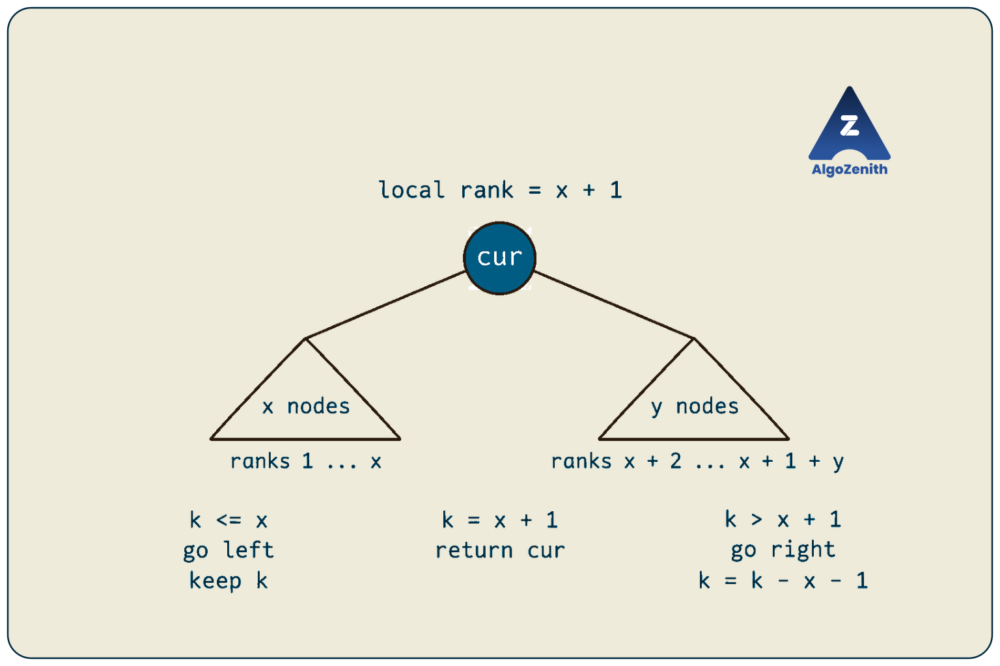
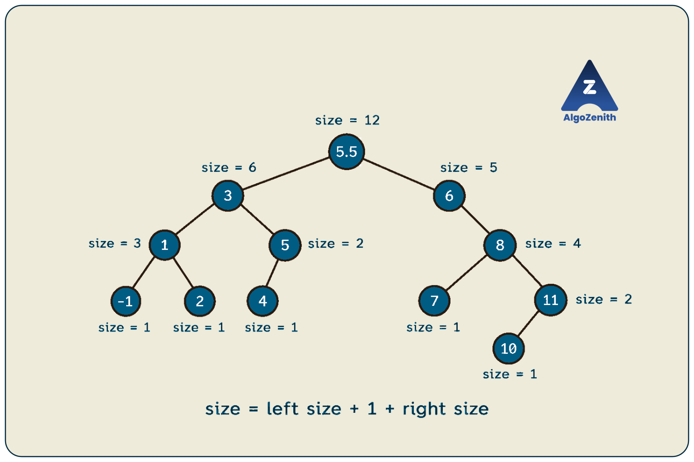
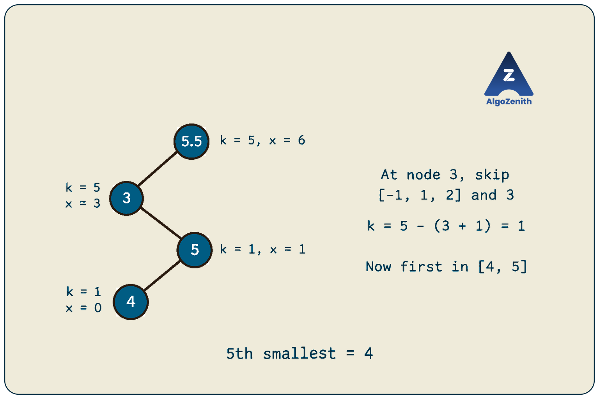
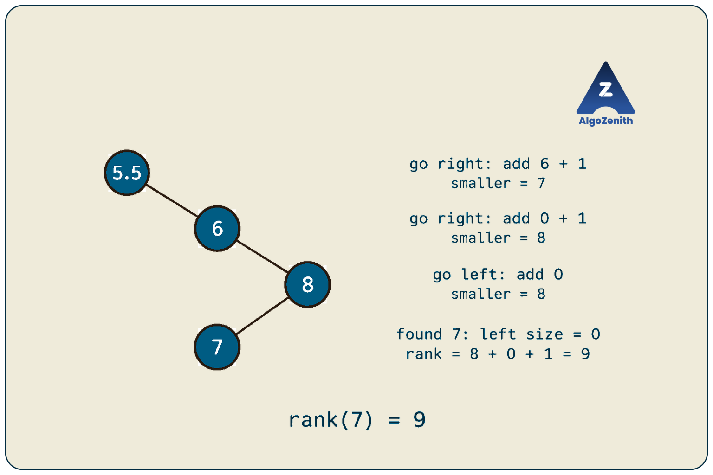

<VIDEO_WIDGET>

<VIDEO_ID></VIDEO_ID>

</VIDEO_WIDGET>

<READING_WIDGET>

# Kth Element in a BST or Balanced BST

A binary search tree arranges its values so that an inorder traversal visits them in sorted order. This immediately gives us a way to find the kth smallest element: visit nodes in inorder and stop at the kth visit.

But can we reach that element without visiting all the smaller ones?

The lecture's key idea is to store the **number of nodes in each subtree**. At any node, the left-subtree size tells us the current node's position in sorted order. We can then choose one child and skip an entire group of elements.

We will develop this idea for an ordinary BST, explain when a balanced BST gives logarithmic queries, and compare ways to answer `Q` queries.

## 1. Problem Statement and Conventions

Consider three versions of the problem:

1. Given a **binary search tree**, find its kth smallest element.
2. Given a **balanced binary search tree (BBST)**, find its kth smallest element efficiently.
3. Given a tree and **`Q` queries**, answer each query asking for the kth smallest element.

Here, “kth element” means **kth smallest**, with **1-based indexing**. The first element is the minimum, and the nth element is the maximum.

Assume that:

- The input satisfies the BST ordering property and initially contains distinct keys.
- The tree is finite, with no cycles or shared child nodes.
- An empty tree or an out-of-range rank has no answer.
- Queries do not change keys or child pointers. Preprocessing may fill a subtree-size field.
- Unless updates are explicitly mentioned, all queries refer to the same unchanged tree.

Let `n` be the number of nodes and `h` the height measured in nodes. A valid rank satisfies `1 <= k <= n`. We will return a pointer to the selected node, or `nullptr` when no such node exists.

For a balanced tree, `h = O(log n)`; an ordinary BST may have height `O(n)`. Handling duplicate values requires an explicit counting policy, discussed later.

## 2. Running Example from the Lecture

The screenshots reuse the same tree while adding subtree counts and query paths. The root label is overwritten; we use **`5.5`** for that key so that it lies strictly between `5` and `6`, preserving the pictured BST ordering. The later annotated frames identify the left child of `8` as `7`.

```text
                   5.5
                 /     \
                3       6
              /   \      \
             1     5      8
            / \   /      / \
          -1   2 4      7  11
                           /
                          10
```

Its inorder sequence is:

```text
Rank:   1   2   3   4   5   6    7   8   9  10  11  12
Value: -1   1   2   3   4   5   5.5  6   7   8  10  11
```

Therefore:

- The **5th smallest element is `4`**.
- The **7th smallest element is `5.5`**, the root.
- The **9th smallest element is `7`**.

We will use the fifth-smallest query from the annotated lecture frames as our main dry run.

The pictured shape illustrates selection by subtree size; it is **not AVL-balanced**. At node `6`, the left subtree is empty while the right subtree has height `3`. The selection algorithm works on this shape too; its logarithmic guarantee requires a tree whose height is actually kept logarithmic.

## 3. Approach 1: Count Visits During Inorder Traversal

Inorder traversal processes:

```text
Left subtree -> Current node -> Right subtree
```

For a BST with distinct keys, this visits values in strictly increasing order. Consequently, the kth node visited is exactly the kth smallest element.

For `k = 5`, the running example visits:

```text
-1 -> 1 -> 2 -> 3 -> 4
```

The fifth visit gives the answer `4`. We can stop at that point without visiting the rest of the tree.

### Headers and Node Definition

All implementations in this lesson use C++17. Combine these definitions with the functions and the later `main` to form a complete program.

```cpp
#include <iostream>
#include <stack>
#include <vector>
using namespace std;

struct Node {
    double data;
    Node* left;
    Node* right;
    int subtreeSize;

    Node(double value)
        : data(value), left(nullptr), right(nullptr), subtreeSize(1) {}
};
```

`double` accommodates the example's key `5.5`; for an integer-key problem, use the required integer type instead. All ranks and subtree counts here are integers, and we assume `n` fits in an `int`. The traversal approach does not use `subtreeSize`.

### C++ Implementation

```cpp
Node* kthByInorder(Node* root, int k) {
    if (k <= 0) return nullptr;

    stack<Node*> pending;
    Node* cur = root;

    while (cur != nullptr || !pending.empty()) {
        while (cur != nullptr) {
            pending.push(cur);
            cur = cur->left;
        }

        cur = pending.top();
        pending.pop();

        // Popping a node is its inorder visit.
        --k;
        if (k == 0) return cur;

        cur = cur->right;
    }

    return nullptr; // Fewer than the requested number of nodes.
}
```

The explicit stack remembers ancestors whose inorder visits are still pending. We decrement `k` when visiting a node, not when first pushing it: pushing occurs before processing its left subtree.

### Complexity

For a valid query, the time is **`O(h + k)`**, bounded by `O(n)` overall. There are `k` popped nodes, and at most `h` additional pushed nodes remain on the stack when we stop. The auxiliary space is **`O(h)`**.

An invalid query with `k > n` traverses the whole tree and takes `O(n)` time.

Balancing alone does not make this method logarithmic. Even in a balanced tree, finding the largest element by counting inorder visits processes all `n` nodes. Its valid-query bound is `O(log n + k)`, with a worst case of `O(n)`.

## 4. The Key Idea: Count a Subtree Once, Then Skip It

When searching for a known key, we compare that key with the current node's value. For a rank query, we do not know the answer's value yet. Instead, we need to know **how many elements come before the current node**.

At a current node `cur`, let:

```text
x = number of nodes in cur's left subtree
y = number of nodes in cur's right subtree
```

Within this subtree's sorted order:

```text
Left subtree:    ranks 1 through x
Current node:    rank x + 1
Right subtree:   ranks x + 2 through x + 1 + y
```

This gives the three decisions shown in the lecture:

| Condition | Where is the answer? | Rank to use next |
| --- | --- | --- |
| `k <= x` | Left subtree | `k` |
| `k == x + 1` | Current node | Return it |
| `k > x + 1` | Right subtree | `k - x - 1` |

When moving right, we skip **all `x` left-subtree nodes and the current node**. That is why we subtract `x + 1`, not just `x`.

When moving left, we skip nothing before the answer within the current ordering, so `k` stays unchanged.



### k Becomes a Rank Within the Current Subtree

The current node's rank `x + 1` is local to its subtree, not necessarily its rank in the entire tree.

For example, node `5` has one node in its left subtree, so it is second within its own subtree `[4, 5]`. It is sixth in the whole tree. After descending, we must compare the **adjusted local rank** against the new left-subtree size.

### Store Subtree Size, Not Height

We augment each node with:

```text
size(null) = 0
size(cur) = size(cur->left) + 1 + size(cur->right)
```

Height measures the longest downward path. Size counts every node in the subtree. Rank selection needs **size**.

Computing the size by traversing the left subtree during every query would lose the intended speedup. Even at a balanced root, counting its left subtree from scratch may inspect a linear number of nodes.

## 5. Preprocessing: Compute All Subtree Sizes

The recurrence depends on both children, so compute sizes with a **postorder traversal**.

```cpp
int sizeOf(Node* node) {
    return node == nullptr ? 0 : node->subtreeSize;
}

int buildSubtreeSizes(Node* root) {
    if (root == nullptr) return 0;

    int leftSize = buildSubtreeSizes(root->left);
    int rightSize = buildSubtreeSizes(root->right);

    root->subtreeSize = leftSize + 1 + rightSize;
    return root->subtreeSize;
}
```

For the running example:

| Node | Left-subtree size | Right-subtree size | Stored subtree size |
| --- | --- | --- | --- |
| `-1`, `2`, `4`, `7`, `10` | `0` | `0` | `1` each |
| `1` | `1` | `1` | `3` |
| `5` | `1` | `0` | `2` |
| `3` | `3` | `2` | `6` |
| `11` | `1` | `0` | `2` |
| `8` | `1` | `2` | `4` |
| `6` | `0` | `4` | `5` |
| `5.5` | `6` | `5` | `12` |

These are the counts highlighted around the nodes in the lecture. A leaf contributes `1`, an empty child contributes `0`, and the root's count is the total number of nodes.



Preprocessing takes **`O(n)` time** and **`O(h)` recursion space**. The stored metadata uses one integer per node, or **`O(n)` additional storage** overall. If nodes cannot be modified, the same counts can be kept in an external table keyed by node identity, with lookup costs accounted for separately.

## 6. Approach 2: Select Using Subtree Sizes

Once the counts are ready, each decision takes constant time and chooses at most one child.

### C++ Implementation

```cpp
Node* kthBySize(Node* root, int k) {
    // Requires correct subtreeSize fields throughout the tree.
    if (root == nullptr || k <= 0 || k > root->subtreeSize) {
        return nullptr;
    }

    Node* cur = root;
    while (cur != nullptr) {
        int leftSize = sizeOf(cur->left);

        if (k <= leftSize) {
            cur = cur->left;
        } else if (k == leftSize + 1) {
            return cur;
        } else {
            k -= leftSize + 1;
            cur = cur->right;
        }
    }

    return nullptr;
}
```

Call `buildSubtreeSizes(root)` once before using this function on an existing tree. The constructor's initial count of `1` is correct only while a node is a leaf; attaching children does not automatically update it.

### Dry Run: Find the 5th Smallest Element

| Current node | Local `k` | Left size `x` | Current node's local rank | Decision |
| --- | --- | --- | --- | --- |
| `5.5` | `5` | `6` | `7` | `5 <= 6`: go left, keep `k = 5` |
| `3` | `5` | `3` | `4` | `5 > 4`: go right, set `k = 5 - 3 - 1 = 1` |
| `5` | `1` | `1` | `2` | `1 <= 1`: go left, keep `k = 1` |
| `4` | `1` | `0` | `1` | Return node `4` |

At node `3`, we skip the three nodes `[-1, 1, 2]` and node `3` itself. The original fifth-smallest element becomes the **first-smallest element in subtree `[4, 5]`**.

The query follows only:

```text
5.5 -> 3 -> 5 -> 4
```

It does not traverse the skipped left subtree of node `3`.



### Why Is This Correct?

Maintain this invariant: **the desired answer is the kth smallest element of the subtree rooted at `cur`**.

The BST property divides that subtree's sorted sequence into three consecutive parts: the left subtree, the current node, and the right subtree.

- If `k <= x`, the answer belongs to the first part and keeps rank `k` there.
- If `k == x + 1`, the answer is the current node.
- Otherwise, deleting the first `x + 1` positions leaves rank `k - x - 1` in the right subtree.

Each step preserves the invariant and descends one level. A valid query eventually reaches the node with the required local rank, so the returned node is the original kth smallest element.

### Ordinary BST Versus Balanced BST

The algorithm takes **`O(h)` time** and **`O(1)` auxiliary space per query** because it uses an iterative walk along one path.

| Tree | Height bound | Selection time after sizes are available |
| --- | --- | --- |
| Ordinary BST | `O(n)` worst case | `O(n)` worst case |
| Balanced BST | `O(log n)` | `O(log n)` |

The `O(1)` space bound is for the query itself; it excludes the stored subtree counts and preprocessing stack.

**Both ingredients matter:** subtree sizes let us skip groups of elements, and balance bounds the number of levels. A BST augmented to support rank and selection queries is commonly called an **order-statistic tree**.

If sizes have not been built, a single query still costs `O(n)` including preprocessing, even for a BBST. The logarithmic bound applies once the metadata is available.

## 7. Answering Q Queries

The best approach depends on whether the tree changes between queries.

### Option A: Repeat Inorder Traversal

Run `kthByInorder` independently for every query. This needs no preprocessing, but takes **`O(Qn)` time in the worst case**. Early stopping helps small ranks but does not remove that worst case.

### Option B: Store the Inorder Sequence Once

If the tree stays unchanged, store its inorder values in a vector. They are already sorted; no separate sorting step is required.

Then the kth smallest value is simply:

```text
sorted[k - 1]
```

The subtraction converts the lesson's 1-based rank to a vector's 0-based index.

```cpp
vector<double> buildSortedValues(Node* root) {
    vector<double> values;
    stack<Node*> pending;
    Node* cur = root;

    while (cur != nullptr || !pending.empty()) {
        while (cur != nullptr) {
            pending.push(cur);
            cur = cur->left;
        }

        cur = pending.top();
        pending.pop();
        values.push_back(cur->data);
        cur = cur->right;
    }

    return values;
}
```

Validate `k` before indexing. This takes **`O(n)` preprocessing time**, **`O(1)` time per query**, and **`O(n)` storage**, giving **`O(n + Q)` total time**. If queries must return node pointers, store `Node*` entries instead of values.

For a static tree with many rank queries, this is often the simplest solution, even when the tree is unbalanced.

### Option C: Reuse Subtree Sizes

Compute all counts once, then call `kthBySize` for every query.

- Ordinary BST: **`O(n + Qh)` total time**, up to `O(n + Qn)`.
- Balanced BST: **`O(n + Q log n)` total time**.

Do not rebuild counts before every query on an unchanged tree. That would reintroduce `O(n)` work per query.

### What If Insertions and Deletions Occur Between Queries?

A sorted vector may need `O(n)` element shifts for an insertion or deletion. An augmented balanced BST can support both updates and selection in **`O(log n)` time per operation**, provided the update implementation maintains balance and subtree sizes.

After changing a child pointer, recompute:

```text
cur->subtreeSize = size(cur->left) + 1 + size(cur->right)
```

Update affected ancestors along the insertion or deletion path. Balancing rotations also change subtree membership, so their affected counts must be refreshed. For example, after a right rotation, recompute the demoted old root first, then the promoted new root that depends on it.

The selection code above assumes this maintenance has already happened. It does not implement insertion, deletion, or balancing.

## 8. Related Idea from the Lecture: Find an Element's Rank

Selection asks: **Which value has rank k?** The reverse question asks: **What is the rank of a given value?**

The final annotated frame adds counts while following a path toward `7`. Each right turn skips a left subtree and its root; these skipped nodes are all smaller than the target.

For an existing key with distinct values:

```text
rank(key) = number of keys smaller than key + 1
```

### Dry Run: Rank of 7

1. At `5.5`, go right. Add its six left-subtree nodes and itself: `6 + 1 = 7` smaller keys.
2. At `6`, go right. Add its empty left subtree and itself: `0 + 1 = 1` more.
3. At `8`, go left. Add nothing because `8` and its right subtree are larger than `7`.
4. At `7`, there are no smaller nodes in its left subtree. Include the target itself to obtain its 1-based rank.

Thus:

```text
rank(7) = (6 + 1) + (0 + 1) + (0 + 1) = 9
```

This matches the lecture's accumulation `6 + 1 + 1 + 1 = 9` and the inorder sequence.



### Count Keys Strictly Smaller Than a Value

The counting operation is useful even when the queried value is absent:

```cpp
int countLessThan(Node* root, double key) {
    int count = 0;

    while (root != nullptr) {
        if (key <= root->data) {
            root = root->left;
        } else {
            count += sizeOf(root->left) + 1;
            root = root->right;
        }
    }

    return count;
}
```

This function also requires correct subtree sizes. It takes `O(h)` time and `O(1)` query space. If the key is absent, `countLessThan(key) + 1` describes its insertion position, not the rank of an existing node.

The same idea supports range counts. For `L <= R`:

```text
Number of keys in [L, R] = countLessOrEqual(R) - countLessThan(L)
```

To implement `countLessOrEqual`, take the left branch only when `key < root->data`; otherwise, add the left-subtree size plus one and move right. This avoids arithmetic such as `R + 1`, which may overflow for integer keys or be inappropriate for noninteger keys.

## 9. Building and Running the Lecture Example

Combine this `main` with the definitions and functions above:

```cpp
int main() {
    Node root(5.5), n3(3), n6(6), n1(1), n5(5), n8(8);
    Node minus1(-1), n2(2), n4(4), n7(7), n11(11), n10(10);

    root.left = &n3;
    root.right = &n6;
    n3.left = &n1;
    n3.right = &n5;
    n1.left = &minus1;
    n1.right = &n2;
    n5.left = &n4;
    n6.right = &n8;
    n8.left = &n7;
    n8.right = &n11;
    n11.left = &n10;

    Node* byInorder = kthByInorder(&root, 5);
    if (byInorder != nullptr) {
        cout << "5th smallest by inorder: " << byInorder->data << '\n';
    }

    buildSubtreeSizes(&root); // Once for this unchanged tree.

    vector<int> queries = {1, 5, 7, 9, 12, 13};
    for (int k : queries) {
        Node* answer = kthBySize(&root, k);
        cout << "k = " << k << ": ";
        if (answer == nullptr) cout << "No such element\n";
        else cout << answer->data << '\n';
    }

    vector<double> sorted = buildSortedValues(&root);
    int k = 5;
    if (k >= 1 && k <= static_cast<int>(sorted.size())) {
        cout << "5th smallest from vector: " << sorted[k - 1] << '\n';
    }

    // We know 7 exists in this tree.
    cout << "Rank of 7: " << countLessThan(&root, 7) + 1 << '\n';
    return 0;
}
```

Output:

```text
5th smallest by inorder: 4
k = 1: -1
k = 5: 4
k = 7: 5.5
k = 9: 7
k = 12: 11
k = 13: No such element
5th smallest from vector: 4
Rank of 7: 9
```

The nodes are local objects and remain alive while `main` runs. The query functions return pointers to these existing objects. Do not call `delete` on them.

## 10. Edge Cases and Duplicate Values

| Case | Expected behavior |
| --- | --- |
| Empty tree | Return `nullptr` |
| `k <= 0` | Return `nullptr` |
| `k > n` | Return `nullptr` |
| Single node, `k = 1` | Return that node |
| `k = 1` | Return the minimum |
| `k = n` | Return the maximum |
| Negative keys | Handle normally; `-1` can be a valid answer |
| Skewed BST | Correct result, but size-based selection can take `O(n)` time |
| Repeated queries | Use a fresh local `k` and reuse valid metadata |
| Tree modified after preprocessing | Refresh counts before size-based queries |

Returning `nullptr` avoids using a valid key such as `-1` as a failure marker.

### Do Duplicates Count Separately?

For the multiset `[2, 2, 5]`, the second smallest **occurrence** is `2`, while the second smallest **distinct value** is `5`. Clarify which definition the problem uses.

For occurrence-based queries, a convenient design stores each distinct key once with a frequency `freq`:

```text
size(cur) = size(cur->left) + cur->freq + size(cur->right)
```

Now `size` counts occurrences. With `x = size(cur->left)`:

- If `k <= x`, move left.
- If `x < k <= x + freq`, return the current key.
- Otherwise, move right with `k -= x + freq`.

For distinct-value queries on this representation, count each stored key once instead. The main implementation uses distinct keys and one node per key; it does not include frequency handling.

## 11. Comparing the Approaches

The table assumes an existing tree and `Q` valid queries without updates. Persistent storage means information retained between queries, beyond the original keys and child pointers.

| Approach | Preprocessing | Time per query | Total for Q queries | Persistent storage | Temporary space |
| --- | --- | --- | --- | --- | --- |
| Inorder with early stopping | None | `O(h + k)`, at most `O(n)` | `O(Qn)` worst case | None | `O(h)` |
| Sorted inorder vector | `O(n)` | `O(1)` | `O(n + Q)` | `O(n)` | `O(h)` to build; `O(1)` to query |
| Sizes in an ordinary BST | `O(n)` | `O(h)` | `O(n + Qh)` | `O(n)` | `O(h)` to build; `O(1)` to query |
| Sizes in a balanced BST | `O(n)` | `O(log n)` | `O(n + Q log n)` | `O(n)` | `O(log n)` to build; `O(1)` to query |

Preprocessing is unnecessary if an augmented tree already maintains correct sizes as part of its updates. Building a balanced tree from an arbitrary collection of keys is a separate task; the table does not include that construction cost.

## 12. Interview and Competitive Programming Insights

- **Ask whether queries are static or mixed with updates.** For many static queries, an inorder vector gives constant-time answers. For dynamic queries, maintained subtree counts in a balanced tree are more useful.
- **Explain the branch rule before coding.** “There are `x` elements before this node, so it occupies position `x + 1`” directly gives all three cases and the right-branch subtraction.
- **Do not infer rank from the key value.** Keys may be negative, nonconsecutive, or noninteger. In the example, value `7` has rank `9`.
- **Do not equate balance with equal subtree sizes.** A height-balanced tree need not split its nodes equally. Use actual counts, not `n / 2`.
- **Count preprocessing honestly.** An `O(log n)` selection query does not make the first query `O(log n)` if an `O(n)` metadata pass is still needed.
- **Convert kth largest carefully.** With `n` counted elements, the kth largest is the `(n - k + 1)`th smallest. Alternatively, use reverse inorder or right-subtree sizes.
- **Keep metadata consistent during updates.** Stale sizes can send a query into the wrong subtree even when the keys still satisfy BST ordering.
- **Handle deep trees deliberately.** The iterative query functions avoid recursion, but `buildSubtreeSizes` can still reach recursion depth `n` on a chain. For very deep inputs, use iterative postorder preprocessing or the iterative vector approach when the tree is static.
- **Be careful with Morris traversal and early returns.** Morris traversal temporarily changes pointers. Returning immediately at the kth visit may leave threads in the tree; restoring them can require continuing the traversal. The explicit-stack method supports early stopping without modifying links.

## Quick Recap

- Inorder traversal of a BST visits keys in sorted order; its kth visit gives the kth smallest element.
- Store `size(cur) = size(left) + 1 + size(right)` to skip whole subtrees.
- With `x = size(left)`, go left for `k <= x`, return the current node for `k == x + 1`, or go right with **`k -= x + 1`**.
- Selection takes `O(h)` time after preprocessing: `O(n)` worst case in an ordinary BST and `O(log n)` in a balanced BST.
- For `Q` static queries, an inorder vector gives `O(n + Q)` total time. For queries mixed with updates, maintain sizes in a balanced BST.
- The lecture example's fifth-smallest value is **`4`**, and the rank of value **`7` is `9`**.

</READING_WIDGET>
