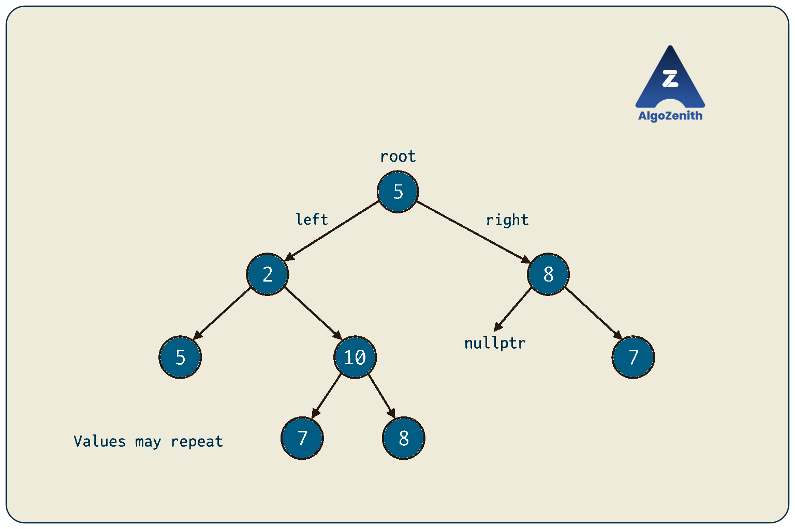
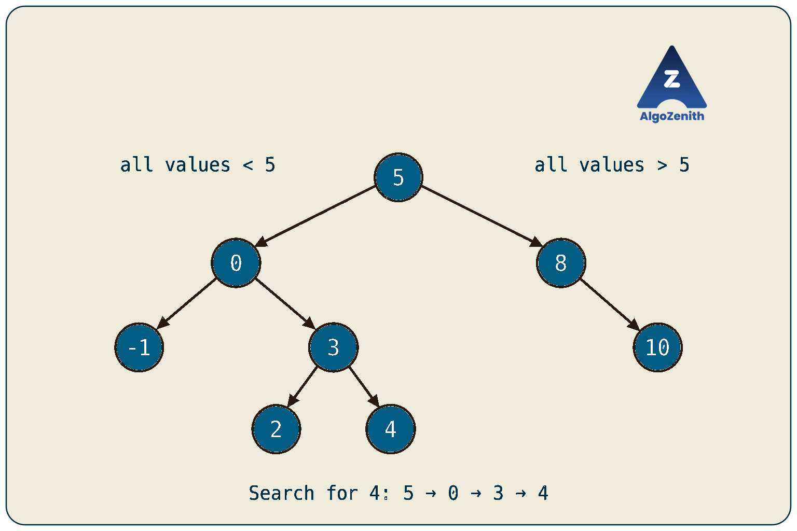
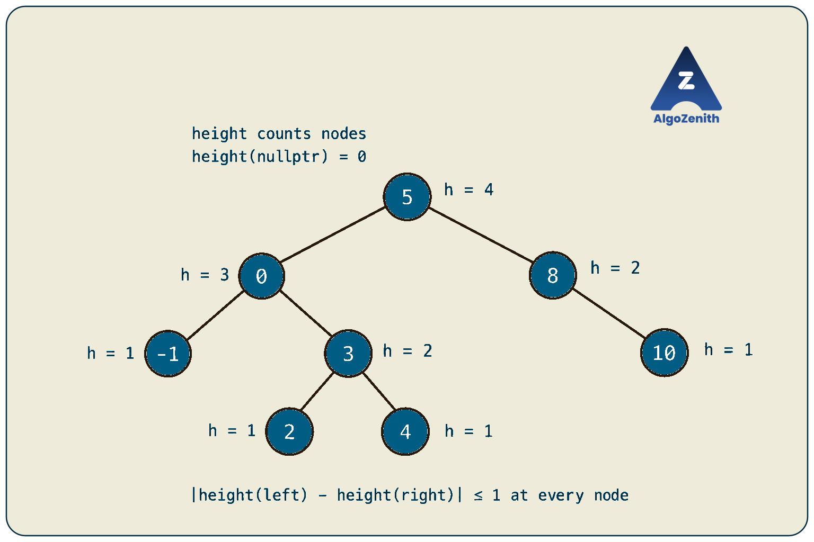
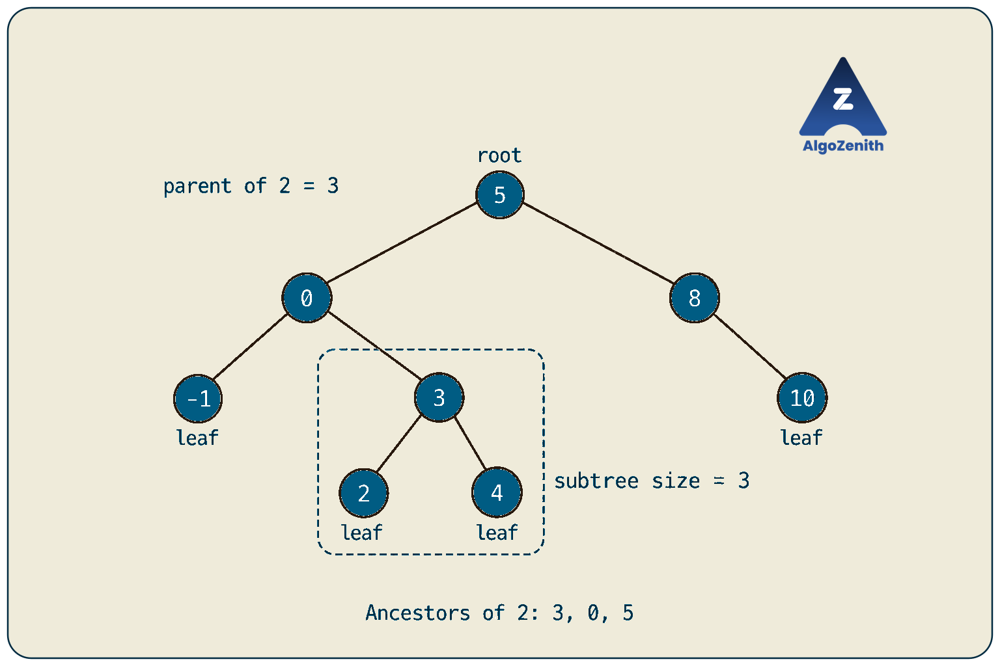
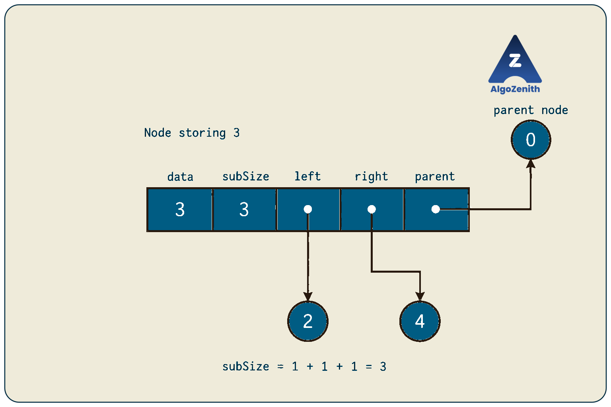

<VIDEO_WIDGET>

<VIDEO_ID></VIDEO_ID>

</VIDEO_WIDGET>

<READING_WIDGET>

# Binary Trees: Introduction and Implementation

A linked list gives each node a single next step. A binary tree lets a node branch in two directions: **left** and **right**. This small change allows us to represent hierarchies and, with additional rules, organize values for efficient searching.

In this lesson, we will distinguish a binary tree from a binary search tree and a balanced binary search tree, implement their basic node structure in C++, and learn the terminology used in later problems. We will leave insertion, deletion, balancing algorithms, and detailed traversals for later lessons.

## 1. What Is a Binary Tree?

A **binary tree** is a rooted tree in which each node has **at most two children**, called its left child and right child.

- A node may have zero, one, or two children. Two children are allowed, not required.
- The topmost node is the **root**. Every other node has exactly one parent.
- Following child links never forms a cycle, and every node is reachable from the root.
- Left and right are distinct positions: having only a left child is different from having only a right child.

Consider the binary tree from the lecture:

```text
        5
       / \
      2   8
     / \   \
    5  10   7
       / \
      7   8
```

This is a valid binary tree even though its values are not sorted and some values repeat. **The binary-tree definition restricts the structure, not the values.** The two nodes containing `5` are different objects.



### Basic C++ Node Structure

```cpp
struct Node {
    int data;
    Node* left;
    Node* right;

    Node(int value)
        : data(value), left(nullptr), right(nullptr) {}
};
```

Each node stores a value and two child pointers. `nullptr` represents a missing child. The constructor initializes both pointers so they never begin with unpredictable addresses.

We keep a `Node* root` to access the whole tree. For an empty tree, `root == nullptr`; for a single-node tree, the root exists but both of its child pointers are null.

## 2. Binary Search Tree: Add an Ordering Rule

A **binary search tree (BST)** is a binary tree with an additional property at **every node**:

- Every value in its **left subtree** is smaller than the node's value.
- Every value in its **right subtree** is larger than the node's value.

A subtree consists of a node and all nodes below it. For this lesson, we use distinct values and strict comparisons. Problems that allow duplicates must specify how to handle them.

Here is the BST used throughout the remaining examples:

```text
          5
         / \
        0   8
       / \   \
     -1   3   10
         / \
        2   4
```

At the root, the left subtree contains `-1, 0, 2, 3, 4`, all smaller than `5`. The right subtree contains `8, 10`, both larger than `5`. The same rule holds at each node below the root.

For a nonempty child subtree, the rule can also be written as:

```text
maximum value in left subtree < node's value
minimum value in right subtree > node's value
```

There is no minimum or maximum to check for an empty subtree; that side imposes no restriction.

### Why Does the Ordering Help?

To search for `4`, compare it with the current node:

1. At `5`, go left because `4 < 5`.
2. At `0`, go right because `4 > 0`.
3. At `3`, go right because `4 > 3`.
4. Reach `4`: the value is found.

We follow one downward path instead of exploring both branches. If the selected child is null before finding the value, the value is absent.



> **Interview insight:** The BST rule applies to entire subtrees, not just immediate children. If we replaced the node `4` with `6`, it would still be larger than its parent `3`, but it would violate the restriction imposed by the root `5`. A parent-child comparison alone cannot validate a BST.

A BST can use the same `Node` structure as an ordinary binary tree. **The links and values determine whether it is a BST; the struct does not enforce the ordering.**

## 3. Balanced BST: Keep the Search Path Short

BST ordering alone does not guarantee a short tree. For example, a BST containing `1, 2, 3, 4, 5` can form a chain of right children. Searching for `5` then visits all five nodes.

Let `h` be the tree's height. A BST search takes **`O(h)` time**, which can become `O(n)` for a chain of `n` nodes. Balanced BST structures maintain height `O(log n)`, keeping search paths short.

### Height Convention Used Here

Following the lecture, we count height in **nodes** on the longest downward path:

```text
height(nullptr) = 0
height(leaf) = 1
height(node) = 1 + max(height(node->left), height(node->right))
```

Some problems count edges instead, giving a leaf height `0`. Always check the convention before implementing a height-related problem.

### The Balance Rule Shown in the Lecture

The lecture uses this condition at **every node**:

```text
abs(height(left subtree) - height(right subtree)) <= 1
```

This is the **AVL-style height-balance condition**. In our running example:

| Node | Left height | Right height | Difference |
| --- | --- | --- | --- |
| `3` | 1 | 1 | 0 |
| `0` | 1 | 2 | 1 |
| `8` | 0 | 1 | 1 |
| `5` | 3 | 2 | 1 |

Each leaf has two empty child subtrees, so its difference is `0`. Thus, the example satisfies the condition throughout the tree and has height `4`.



**Checking only the root is not enough.** A deeper subtree may be unbalanced even when the root's two subtree heights are close.

“Balanced BST” is a broader category: AVL trees and red-black trees use different balancing rules to maintain logarithmic height. A balanced tree need not have equally sized subtrees, and it need not have every level completely filled. Maintaining balance after updates requires extra logic; we will study that later.

## 4. Essential Tree Terminology

Use the same eight-node BST for each definition below.

### Leaf

A **leaf** is a node with no children. The leaves are `-1`, `2`, `4`, and `10`.

For an existing node `cur`, the check is:

```cpp
bool isLeaf = (cur->left == nullptr && cur->right == nullptr);
```

Both children must be absent. Node `8` is not a leaf because it has a right child. Check that `cur` itself is non-null before accessing its fields.

### Subtree Size

The **subtree rooted at a node** includes that node and all its descendants. Its **size** is the number of nodes it contains, including its root:

```text
size(nullptr) = 0
size(node) = 1 + size(node->left) + size(node->right)
```

For example:

- The subtree at `3` contains `3, 2, 4`, so its size is `3`.
- The subtree at `0` contains `0, -1, 3, 2, 4`, so its size is `5`.
- The subtree at `8` has size `2`.
- The entire tree has size `1 + 5 + 2 = 8`.

Do not confuse **size**, which counts all nodes in a subtree, with **height**, which measures its longest downward path.

### Traversals

A **traversal** is a systematic way to visit every node. Different orders are useful for different tasks.

| Traversal | Visiting rule | Order in our example |
| --- | --- | --- |
| Preorder | Node, then left subtree, then right subtree | `5, 0, -1, 3, 2, 4, 8, 10` |
| Inorder | Left subtree, then node, then right subtree | `-1, 0, 2, 3, 4, 5, 8, 10` |
| Postorder | Left subtree, then right subtree, then node | `-1, 2, 4, 3, 0, 10, 8, 5` |
| Level order | Level by level, left to right | `5, 0, 8, -1, 3, 10, 2, 4` |

Notice that inorder visits this BST's values in increasing order. This follows from the BST property; inorder traversal of an arbitrary binary tree is **not** necessarily sorted.

For now, recognize the orders. Their implementations and applications will be covered separately.

### Parent

A node's **parent** is the node directly above it. The parent of `2` is `3`, and the parent of `3` is `0`. The root `5` has no parent.

Child pointers let us move downward. If an algorithm needs to move upward directly, we can optionally store a `parent` pointer as well.

### Ancestor

An **ancestor** lies on the path from the root to a node. Here, we exclude the node itself: the ancestors of `2` are `3`, `0`, and `5`. Its parent is its nearest ancestor.

Node `4` is not an ancestor of `2`; it is its sibling because they share a parent. Some problems allow a node to count as its own ancestor, so check the problem's definition.



## 5. Adding Subtree Size and Parent Pointers

We can extend the basic node definition to store the extra information shown in the lecture. **Use this definition instead of the earlier one**, not alongside it:

```cpp
struct Node {
    int data;
    int subSize;
    Node* left;
    Node* right;
    Node* parent;

    Node(int value)
        : data(value), subSize(1),
          left(nullptr), right(nullptr), parent(nullptr) {}
};
```

A newly created node is a one-node subtree, so its initial `subSize` is `1`. Connecting children does not automatically update this field.

The following helper computes child sizes first, then combines them. It is a small preview of postorder processing:

```cpp
int updateSubtreeSizes(Node* root) {
    if (root == nullptr) return 0;

    int leftSize = updateSubtreeSizes(root->left);
    int rightSize = updateSubtreeSizes(root->right);
    root->subSize = 1 + leftSize + rightSize;
    return root->subSize;
}
```

It visits each node once: **`O(n)` time** and **`O(h)` auxiliary space** for recursive calls. On a very deep, skewed tree, recursion may exceed the call-stack limit. Here, subtree sizes are assumed to fit in an `int`.



### Build the Lecture's Tree in C++

Place `#include <iostream>` above the extended `Node` definition and the helper, then add this `main` to form a complete C++17 program:

```cpp
int main() {
    Node n5(5), n0(0), n8(8), nMinus1(-1);
    Node n3(3), n10(10), n2(2), n4(4);

    n5.left = &n0;
    n5.right = &n8;
    n0.left = &nMinus1;
    n0.right = &n3;
    n8.right = &n10;
    n3.left = &n2;
    n3.right = &n4;

    n0.parent = &n5;
    n8.parent = &n5;
    nMinus1.parent = &n0;
    n3.parent = &n0;
    n10.parent = &n8;
    n2.parent = &n3;
    n4.parent = &n3;

    Node* root = &n5;
    updateSubtreeSizes(root);

    std::cout << "Tree size: " << root->subSize << '\n';
    std::cout << "Subtree size at 3: " << n3.subSize << '\n';
    std::cout << "Parent of 2: " << n2.parent->data << '\n';
    return 0;
}
```

Output:

```text
Tree size: 8
Subtree size at 3: 3
Parent of 2: 3
```

`&n0` gives the address of the object `n0`. We explicitly connect existing nodes; this is **manual construction**, not a BST insertion or balancing algorithm. The root's parent and all missing children remain `nullptr`.

These nodes are local objects that remain alive until `main` finishes and are then destroyed automatically. Do not call `delete` on them or return their addresses from a function after the objects have gone out of scope.

> **Implementation insight:** A `parent` pointer and `subSize` are optional metadata. If you later change the tree's links, update the affected metadata too. Adding these fields alone does not keep them correct or make the tree balanced.

## Quick Recap

- A **binary tree** allows at most two children per node; its values need not be ordered.
- A **BST** adds an ordering rule over every node's entire left and right subtrees.
- A **balanced BST** keeps height logarithmic; the lecture illustrates AVL-style height balance.
- A **leaf** has no children. **Subtree size** counts nodes, including the subtree's root.
- **Traversals** define visiting order. **Parents** and **ancestors** describe upward relationships.
- The basic representation needs a value and two child pointers. Additional fields support particular algorithms, but must be maintained explicitly.

The distinction to remember is **structure, then ordering, then balance**. These are separate properties, even when all three trees use a similar C++ node representation.

</READING_WIDGET>
