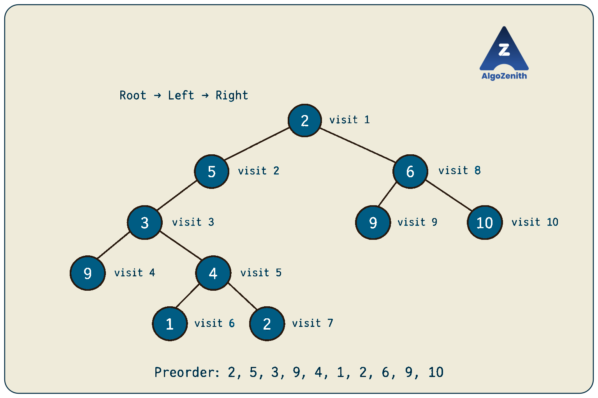
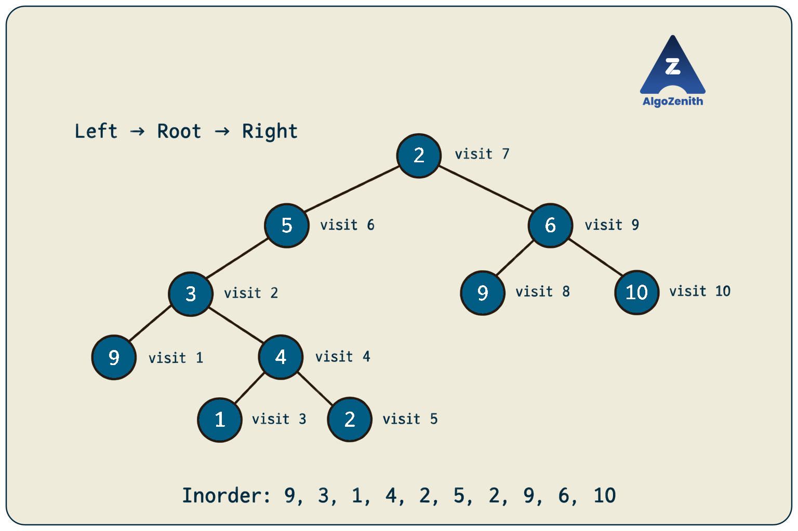
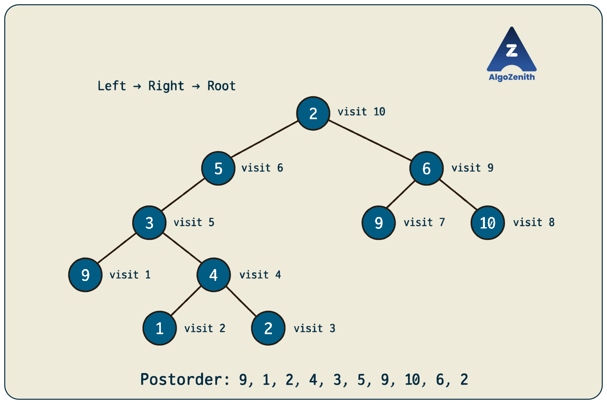
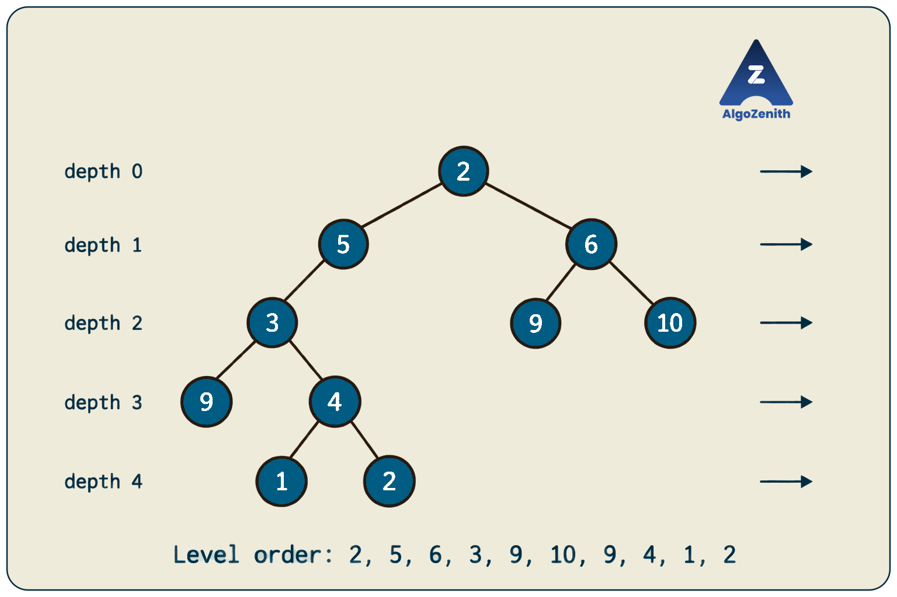
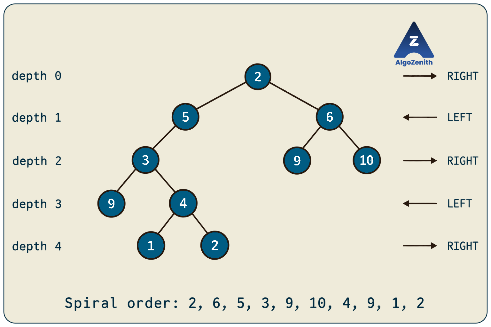
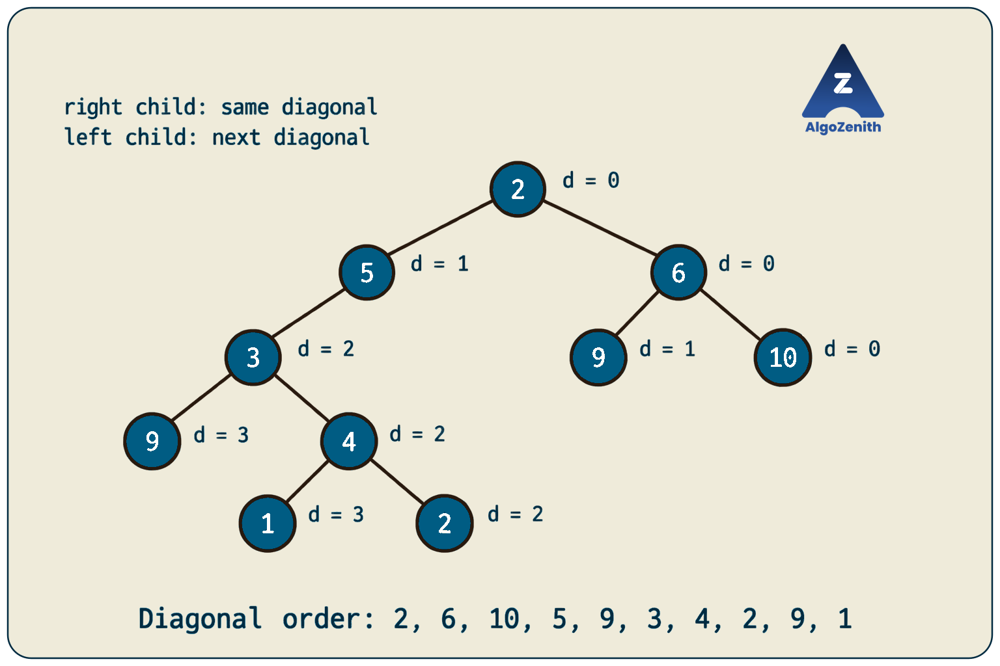
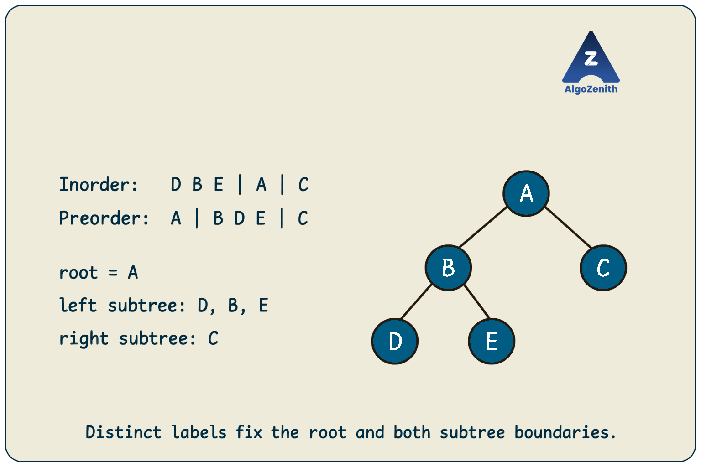
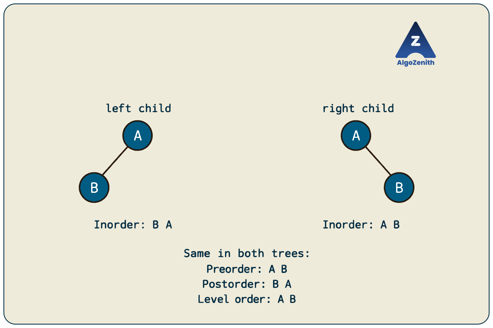

<VIDEO_WIDGET>

<VIDEO_ID></VIDEO_ID>

</VIDEO_WIDGET>

<READING_WIDGET>

# Binary Tree Traversals and Uniqueness

A binary tree branches into left and right subtrees. If we want to process every node, which branch should we explore first, and when should we process the current node?

Different answers give us different **traversal orders**. These orders help us print a tree, compute information about its subtrees, and process nodes level by level. They also raise a useful question: **if we know a tree's traversal sequences, can we reconstruct its exact structure?**

We will study preorder, inorder, postorder, level order, spiral order, and diagonal order using the same example, then examine which traversal combinations uniquely determine a binary tree.

## 1. Running Example and Node Structure

Use the tree from the lecture:

```text
              2
            /   \
           5     6
          /     / \
         3     9  10
        / \
       9   4
          / \
         1   2
```

There are **10 nodes**. The two nodes containing `2` are different objects, as are the two nodes containing `9`. Repeated values are valid in an ordinary binary tree, and each node must be processed once even if its value has already appeared.

Here, **visiting** a node means appending its value to the output. In another problem, visiting might mean printing the value or performing some computation.

All implementations use C++17 and the following shared definition:

```cpp
#include <iostream>
#include <queue>
#include <vector>
using namespace std;

struct Node {
    int data;
    Node* left;
    Node* right;

    Node(int value)
        : data(value), left(nullptr), right(nullptr) {}
};
```

We assume the child pointers form a valid tree: there are no cycles and no shared child nodes. An empty tree is represented by `nullptr`.

## 2. Depth-First Traversals: When Do We Visit the Root?

For a subtree rooted at `x`, there are three tasks:

- Visit `x`.
- Traverse the entire left subtree.
- Traverse the entire right subtree.

Keep the left subtree before the right subtree, and change only the position of the visit:

| Traversal | Order within every subtree | Position of the root |
| --- | --- | --- |
| Preorder | Root → Left → Right | Before both subtrees |
| Inorder | Left → Root → Right | Between the subtrees |
| Postorder | Left → Right → Root | After both subtrees |

These are **depth-first traversals**: we finish exploring a subtree before moving to its sibling subtree. The names refer to when we process the current root, not to whether the values are increasing or decreasing.

Every recursive implementation needs the same base case: **if the current node is null, return immediately**.

### Preorder: Root → Left → Right

```cpp
void preorder(Node* root, vector<int>& order) {
    if (root == nullptr) return;

    order.push_back(root->data);
    preorder(root->left, order);
    preorder(root->right, order);
}
```

We record the root `2` first. Next, we completely process the subtree rooted at `5`, followed by the subtree rooted at `6`.

```text
Root:          2
Left subtree:  5, 3, 9, 4, 1, 2
Right subtree: 6, 9, 10

Preorder: 2, 5, 3, 9, 4, 1, 2, 6, 9, 10
```

Preorder is useful when a node must be handled before its descendants, such as when passing information from a parent down to its children.



### Inorder: Left → Root → Right

```cpp
void inorder(Node* root, vector<int>& order) {
    if (root == nullptr) return;

    inorder(root->left, order);
    order.push_back(root->data);
    inorder(root->right, order);
}
```

The call starts at the root, but the root's value is not recorded immediately. We first finish its entire left subtree.

```text
Left subtree:  9, 3, 1, 4, 2, 5
Root:          2
Right subtree: 9, 6, 10

Inorder: 9, 3, 1, 4, 2, 5, 2, 9, 6, 10
```

Notice that the subtree rooted at `4` contributes `1, 4, 2`. Inorder does not sort an arbitrary binary tree. **It produces increasing values for a BST with distinct keys because the BST already satisfies the ordering rule.**



### Postorder: Left → Right → Root

```cpp
void postorder(Node* root, vector<int>& order) {
    if (root == nullptr) return;

    postorder(root->left, order);
    postorder(root->right, order);
    order.push_back(root->data);
}
```

The subtree rooted at `4` contributes `1, 2, 4`. Both children are processed before `4`, and the same rule applies at every ancestor.

```text
Left subtree:  9, 1, 2, 4, 3, 5
Right subtree: 9, 10, 6
Root:          2

Postorder: 9, 1, 2, 4, 3, 5, 9, 10, 6, 2
```

Postorder is useful when the parent's answer depends on answers from its children. For example, computing subtree size requires both child subtree sizes before evaluating `1 + leftSize + rightSize`.



### Why Do These Functions Visit Every Node Exactly Once?

A call processes its root once and recursively processes its two disjoint child subtrees. Missing children stop at the null base case. Since each non-root node has exactly one parent, no node is reached through two different child paths.

The recursion may return through a node after exploring a child, but that return is not another visit. Only `order.push_back(...)` records a value.

## 3. Level Order: Process One Level at a Time

**Level-order traversal** visits nodes by increasing depth, processing each level from left to right. This is breadth-first search, or **BFS**.

For our tree:

| Depth, with root at 0 | Values from left to right |
| --- | --- |
| 0 | `2` |
| 1 | `5, 6` |
| 2 | `3, 9, 10` |
| 3 | `9, 4` |
| 4 | `1, 2` |

```text
Level order: 2, 5, 6, 3, 9, 10, 9, 4, 1, 2
```

A **queue** preserves the required order. Remove the oldest waiting node, visit it, and add its left child before its right child.

```cpp
vector<int> levelOrder(Node* root) {
    vector<int> order;
    if (root == nullptr) return order;

    queue<Node*> q;
    q.push(root);

    while (!q.empty()) {
        Node* cur = q.front();
        q.pop();
        order.push_back(cur->data);

        if (cur->left != nullptr) q.push(cur->left);
        if (cur->right != nullptr) q.push(cur->right);
    }

    return order;
}
```

After processing the root, the queue contains `5, 6`. Processing `5` adds `3` behind `6`, giving `6, 3`. Processing `6` then gives `3, 9, 10`. Thus, the next level waits behind all remaining nodes in the current level.

Level order is useful for grouping nodes by depth and answering questions about individual levels.



## 4. Spiral Order: Alternate the Direction of Each Level

**Spiral traversal**, also called **zigzag level order**, alternates the output direction between consecutive levels.

We will use this convention: depth `0` is left to right, depth `1` is right to left, and so on. The root's level contains only one node, but stating the convention determines the direction of all later levels.

| Depth | Direction | Output |
| --- | --- | --- |
| 0 | Left to right | `2` |
| 1 | Right to left | `6, 5` |
| 2 | Left to right | `3, 9, 10` |
| 3 | Right to left | `4, 9` |
| 4 | Left to right | `1, 2` |

```text
Spiral order: 2, 6, 5, 3, 9, 10, 4, 9, 1, 2
```

We can keep ordinary BFS queue behavior and change only where each value is placed in the current level's output.

```cpp
vector<int> spiralOrder(Node* root) {
    vector<int> order;
    if (root == nullptr) return order;

    queue<Node*> q;
    q.push(root);
    bool leftToRight = true;

    while (!q.empty()) {
        int levelSize = static_cast<int>(q.size());
        vector<int> level(levelSize);

        for (int i = 0; i < levelSize; ++i) {
            Node* cur = q.front();
            q.pop();

            int index = leftToRight ? i : levelSize - 1 - i;
            level[index] = cur->data;

            if (cur->left != nullptr) q.push(cur->left);
            if (cur->right != nullptr) q.push(cur->right);
        }

        order.insert(order.end(), level.begin(), level.end());
        leftToRight = !leftToRight;
    }

    return order;
}
```

**Capture `levelSize` before processing the level.** The queue grows as children are added; using its changing size as the loop bound would mix different levels.

The queue always receives children left first, then right. The temporary vector reverses the output where required. Some problems choose the opposite starting direction, so check their stated convention.



## 5. Diagonal Order: Follow Right Links, Defer Left Branches

For diagonal traversal, assign the root diagonal number `0`:

- Moving to a **right child** keeps the diagonal number unchanged.
- Moving to a **left child** increases the diagonal number by `1`.

Process diagonals in increasing order. Within a diagonal, use the order obtained by following right-child chains and handling their deferred left branches in queue order.

| Diagonal | Values |
| --- | --- |
| 0 | `2, 6, 10` |
| 1 | `5, 9` |
| 2 | `3, 4, 2` |
| 3 | `9, 1` |

```text
Diagonal order: 2, 6, 10, 5, 9, 3, 4, 2, 9, 1
```

Start by following `2 → 6 → 10`. While doing so, enqueue the left children `5` and `9`. They start the next diagonal. Processing `5` defers `3`, and later the chain `3 → 4 → 2` defers `9` and `1`.

```cpp
vector<int> diagonalOrder(Node* root) {
    vector<int> order;
    if (root == nullptr) return order;

    queue<Node*> q;
    q.push(root);

    while (!q.empty()) {
        Node* cur = q.front();
        q.pop();

        while (cur != nullptr) {
            order.push_back(cur->data);
            if (cur->left != nullptr) q.push(cur->left);
            cur = cur->right;
        }
    }

    return order;
}
```

Each queued node starts a right-child chain. Left branches are deferred behind chains already waiting for the current diagonal, so they are processed in a later diagonal. Every node belongs to exactly one such chain and is visited once.

Diagonal traversal is different from level order: nodes at different depths may belong to the same diagonal. Problems may also specify a different ordering within a diagonal; follow that requirement rather than assuming values should be sorted.



## 6. Running the Implementations

Place the shared definition and all six traversal functions above this code:

```cpp
void printOrder(const char* label, const vector<int>& order) {
    cout << label << ":";
    for (int value : order) cout << ' ' << value;
    cout << '\n';
}

int main() {
    Node root(2), n5(5), n6(6), n3(3), n4(4);
    Node left9(9), right9(9), n10(10), n1(1), leaf2(2);

    root.left = &n5;
    root.right = &n6;
    n5.left = &n3;
    n3.left = &left9;
    n3.right = &n4;
    n4.left = &n1;
    n4.right = &leaf2;
    n6.left = &right9;
    n6.right = &n10;

    vector<int> pre, in, post;
    preorder(&root, pre);
    inorder(&root, in);
    postorder(&root, post);

    printOrder("Preorder", pre);
    printOrder("Inorder", in);
    printOrder("Postorder", post);
    printOrder("Level order", levelOrder(&root));
    printOrder("Spiral order", spiralOrder(&root));
    printOrder("Diagonal order", diagonalOrder(&root));
}
```

Output:

```text
Preorder: 2 5 3 9 4 1 2 6 9 10
Inorder: 9 3 1 4 2 5 2 9 6 10
Postorder: 9 1 2 4 3 5 9 10 6 2
Level order: 2 5 6 3 9 10 9 4 1 2
Spiral order: 2 6 5 3 9 10 4 9 1 2
Diagonal order: 2 6 10 5 9 3 4 2 9 1
```

The example uses local node objects that remain alive throughout `main`. No dynamic allocation or manual deletion is needed. The recursive functions append to an existing vector; pass a fresh or cleared vector when starting a new traversal.

### Time and Space Complexity

Let `n` be the number of nodes, `h` the height measured in nodes, and `w` the maximum number of nodes at any level.

| Traversal | Time | Auxiliary space, excluding output |
| --- | --- | --- |
| Preorder, inorder, postorder | `O(n)` | `O(h)` recursion stack |
| Level order | `O(n)` | `O(w)` queue |
| Spiral order | `O(n)` | `O(w)` queue and level vector |
| Diagonal order | `O(n)` | `O(n)` worst-case queue bound |

All implementations store `n` values, so **output storage is an additional `O(n)`**. In a balanced tree, `h = O(log n)`; in a skewed tree, `h = O(n)`. A BFS queue can contain parts of two adjacent levels, but its size remains `O(w)`.

## 7. Can Traversals Uniquely Determine a Tree?

Generating a traversal starts with a known tree. Reconstruction reverses the question: given the sequences, can there be more than one tree with those sequences?

**Uniqueness means recovering both the node labels and the exact left/right child structure.** A node with only a left child is different from a node with only a right child.

For the results below, assume:

- Every node has a **distinct value**, or a distinct identity recorded consistently in every traversal.
- The given sequences are valid traversals of the same binary tree.
- The sequences contain node labels only, with no markers for missing children.

Our running example has duplicate values, so these uniqueness guarantees do not apply to its value sequences without additional information.

### Why Is Inorder Useful?

Once we know the root, its position in inorder splits the sequence into two parts:

```text
[all nodes in the left subtree]  root  [all nodes in the right subtree]
```

Distinct labels make the root's position unambiguous. Another traversal tells us which label is the root. Together, these facts let us repeat the process recursively.

### Inorder + Preorder: Unique

The **first** element of preorder is the root. Locate it in inorder to determine the left and right subtree sizes, then split the remaining preorder sequence into matching blocks.

Consider a separate example with distinct labels:

```text
Inorder:  D B E A C
Preorder: A B D E C
```

1. Preorder starts with `A`, so `A` is the root.
2. Inorder splits into `D B E | A | C`: three nodes on the left and one on the right.
3. The next three preorder labels, `B D E`, belong to the left subtree. The remaining `C` belongs to the right subtree.
4. For the left subtree, `B` is the root and inorder splits into `D | B | E`.

This forces exactly one tree:

```text
        A
       / \
      B   C
     / \
    D   E
```

At each step, the root and subtree boundaries are fixed. No structural choice remains.



### Inorder + Postorder: Unique

The **last** element of postorder is the root. Its position in inorder gives the subtree sizes. Postorder then splits as:

```text
[left subtree] [right subtree] root
```

For the same example, postorder is `D E B C A`. The last label `A` splits inorder into `D B E` and `C`; the corresponding postorder blocks are `D E B` and `C`. Apply the same reasoning recursively.

### Inorder + Level Order: Unique

The **first** element of level order is the root. Split inorder around it, then filter the remaining level-order labels into the left and right subtree groups, preserving their relative order.

```text
Inorder:     D B E | A | C
Level order: A B C D E

Left subtree level order:  B D E
Right subtree level order: C
```

Unlike preorder and postorder, a subtree's nodes need not form a contiguous block in level order. **Filter by membership in the inorder partition; do not simply slice by subtree size.** Each filtered sequence identifies its subtree's root, allowing the process to continue uniquely.

## 8. Why Are Other Pairs Not Sufficient in General?

Consider these two different trees:

```text
Tree 1:       Tree 2:

    A             A
   /               \
  B                 B
```

Both have:

```text
Preorder:    A B
Postorder:   B A
Level order: A B
```

None of these three orders tells us whether the only child is on the left or the right. Their inorder sequences do differ: Tree 1 gives `B A`, while Tree 2 gives `A B`.

This one counterexample shows why pairs without inorder do not guarantee uniqueness for a general binary tree. Even **preorder, postorder, and level order together** cannot resolve this ambiguity.



| Available traversals | Unique for every valid binary tree with distinct labels? |
| --- | --- |
| Inorder + preorder | Yes |
| Inorder + postorder | Yes |
| Inorder + level order | Yes |
| Preorder + postorder | No |
| Preorder + level order | No |
| Postorder + level order | No |

“No” means **not guaranteed**, rather than “never unique.” A particular input may still admit only one tree. A single ordinary traversal also does not guarantee uniqueness: for example, inorder `A B` fits either root `A` with right child `B`, or root `B` with left child `A`.

### Conditions Can Change the Answer

- **Duplicate values:** Even inorder plus preorder may be ambiguous. A root `7` with one left child `7` and a root `7` with one right child `7` both give inorder `7 7` and preorder `7 7`. Unique node identities would distinguish the occurrences.
- **Full binary tree:** If every node has either zero or two children, preorder plus postorder uniquely determines the tree when labels are distinct. A single-child ambiguity is impossible; the next preorder label identifies the left subtree root, and its postorder position fixes that subtree's size.
- **Explicit null markers:** Preorder can encode a general binary tree uniquely by recording every missing child. Root `A` with left child `B` gives `A B # # #`; root `A` with right child `B` gives `A # B # #`. The marker `#` must be distinguishable from every stored value. This also works with duplicate values because the missing-child positions encode the shape.

These are extra assumptions or extra information. Always establish them before making a reconstruction claim.

## 9. Interview and Competitive Programming Insights

- **Choose the traversal according to the dependency.** Process parents before descendants with preorder, or combine child answers at the parent with postorder. Use level order when depth is central to the problem.
- **Do not use values as a visited set.** Equal values may belong to different nodes. For a valid tree traversed only through child links, no visited set is needed at all. If you also follow parent pointers, prevent walking back along the edge you just used.
- **Account for recursion depth.** Recursive DFS is concise, but a very deep skewed tree can exhaust the call stack. An explicit stack is an alternative when constraints make deep recursion unsafe.
- **Check reconstruction complexity separately.** A straightforward inorder search at every recursive step can take `O(n²)` time. For distinct labels, precompute their inorder positions and use index ranges to reconstruct from preorder or postorder in expected `O(n)` time with hashing. Repeatedly copying subtree slices can still introduce extra work.
- **Do not confuse uniqueness with a fast algorithm.** Inorder plus level order is unique, but a direct implementation that repeatedly filters sequences can take `O(n²)` time on a skewed tree.

Before submitting traversal code, check an empty tree, a single node, a tree with only left children, a tree with only right children, and repeated values. Empty input should produce an empty sequence; a single node should appear exactly once in every order.

## 10. Quick Recap

- Preorder, inorder, and postorder differ only in whether the root is visited before, between, or after its child subtrees.
- Level order uses a queue to process nodes by depth. Spiral order alternates each level's output direction.
- Diagonal order keeps right links on the same diagonal and moves left branches to the next diagonal.
- With distinct labels and valid input, inorder paired with preorder, postorder, or level order determines a unique tree.
- Without inorder, a single child's left/right position can remain ambiguous. Duplicate values, full-tree restrictions, and null markers must be considered explicitly.

</READING_WIDGET>
