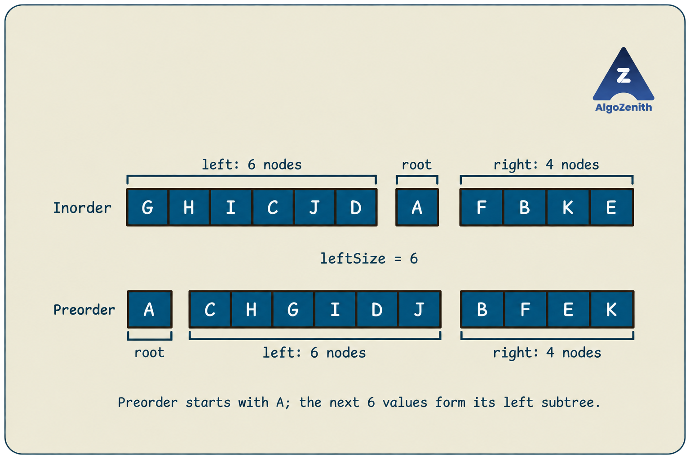

<VIDEO_WIDGET>

<VIDEO_ID></VIDEO_ID>

</VIDEO_WIDGET>

<READING_WIDGET>

# Recovering the Original Tree from Inorder and Preorder

In the previous lesson, we saw that inorder and preorder together uniquely determine a binary tree when its node values are distinct. How do we turn that observation into an algorithm that actually creates the nodes and connects them?

The key is to use each traversal for a different purpose: **preorder identifies the root, while inorder separates its left and right subtrees**.

We will first derive the recursive solution, use hashing to avoid repeated searches, and then study the lecture's stack-based solution, which scans both traversals backwards and reconstructs the tree without recursion or a hash map.

## 1. Problem Statement

Given the **inorder** and **preorder** traversals of a binary tree, construct the original tree and return a pointer to its root.

Assume that:

- Both sequences contain the same `n` distinct node values.
- They are valid traversals of the same binary tree.
- The input sequences must remain unchanged.
- If both sequences are empty, return `nullptr`.

This is an ordinary binary tree, not necessarily a binary search tree. We cannot decide a node's position by comparing whether its value is smaller or larger than another value.

### Running Example

Use the sequences from the lecture:

```text
Inorder:  G H I C J D A F B K E
Preorder: A C H G I D J B F E K
```

The required tree is:

```text
               A
            /     \
           C       B
         /   \   /   \
        H     D F     E
       / \   /       /
      G   I J       K
```

In particular, `J` is the left child of `D`, and `K` is the left child of `E`. Recovering these left/right positions is part of the problem; merely recovering the set of values is not enough.


### Why Are Distinct Values Required?

When we find the root in inorder, we need to identify exactly one position. Repeated values can make this ambiguous.

For example, a root `A` with one left child `A` and a root `A` with one right child `A` both have inorder `A A` and preorder `A A`. The traversals alone cannot distinguish them. Our implementations therefore assume distinct values, as required by the uniqueness result.

## 2. The Core Observation: Find the Root, Then Split

Recall the traversal rules:

```text
Preorder: Root → Left subtree → Right subtree
Inorder:  Left subtree → Root → Right subtree
```

The first preorder value is `A`, so `A` must be the root. Locate `A` in inorder:

```text
Inorder:  [G H I C J D]  A  [F B K E]
            6 nodes          4 nodes
```

This tells us that the left subtree contains six nodes. Therefore, the next six values after `A` in preorder must belong to that left subtree:

```text
Preorder: A  [C H G I D J]  [B F E K]
                left          right
```

We now have two smaller instances of the same problem:

| Subtree | Inorder | Preorder |
| --- | --- | --- |
| Left of `A` | `G H I C J D` | `C H G I D J` |
| Right of `A` | `F B K E` | `B F E K` |

**The inorder partition determines the subtree sizes. Those sizes determine the preorder boundaries.** We do not guess where one subtree ends and the other begins.



## 3. From Repeated Search to Hashing

A straightforward recursive approach finds the root by scanning the current inorder range. It then applies the same procedure to the two child ranges.

This is correct, but searching can become expensive. Consider a left-skewed tree whose root is always the last value in the current inorder range. The searches examine:

```text
n + (n - 1) + (n - 2) + ... + 1
```

values, giving **`O(n²)` worst-case time**.

Instead, scan inorder once and store the position of each value:

```text
Value:  G H I C J D A F B K  E
Index:  0 1 2 3 4 5 6 7 8 9 10
```

For example, `position['A'] = 6` and `position['C'] = 3`. With a hash map, each root lookup takes expected constant time.

The map stores **inorder indices**, not node pointers or preorder indices. Distinct values ensure that each value maps to exactly one index.

## 4. Recursive Reconstruction Using Index Ranges

We will pass ranges into the recursion rather than copying smaller traversal arrays.

Let a call work with these **inclusive** ranges:

```text
inorder[inL ... inR]
preorder[preL ... preR]
```

Both ranges describe the same subtree and contain the same number of nodes.

For a nonempty range:

```text
rootValue = preorder[preL]
mid       = position[rootValue]
leftSize  = mid - inL
```

The child ranges are:

| Child | Inorder range | Preorder range |
| --- | --- | --- |
| Left | `[inL, mid - 1]` | `[preL + 1, preL + leftSize]` |
| Right | `[mid + 1, inR]` | `[preL + leftSize + 1, preR]` |

The left preorder range starts immediately after the root and contains exactly `leftSize` values. The right range begins after those values.

An empty range has its left endpoint greater than its right endpoint. It represents a missing child and returns `nullptr`.

### Shared Node Definition and Headers

All code in this lesson uses C++17. We use `char` values to reproduce the lecture's letter labels. For integer-valued problems, change the node value, traversal element type, and map key type to `int`; the algorithms are unchanged.

```cpp
#include <iostream>
#include <stack>
#include <unordered_map>
#include <vector>
using namespace std;

struct Node {
    char data;
    Node* left;
    Node* right;

    Node(char value)
        : data(value), left(nullptr), right(nullptr) {}
};
```

### C++ Implementation

```cpp
Node* buildRange(const vector<char>& preorder,
                 const unordered_map<char, int>& position,
                 int inL, int inR, int preL, int preR) {
    if (inL > inR) return nullptr;

    char rootValue = preorder[preL];
    int mid = position.at(rootValue);
    int leftSize = mid - inL;

    Node* root = new Node(rootValue);

    root->left = buildRange(preorder, position,
                            inL, mid - 1,
                            preL + 1, preL + leftSize);

    root->right = buildRange(preorder, position,
                             mid + 1, inR,
                             preL + leftSize + 1, preR);

    return root;
}

Node* buildRecursive(const vector<char>& preorder,
                     const vector<char>& inorder) {
    int n = static_cast<int>(inorder.size());
    unordered_map<char, int> position;
    position.reserve(n);

    for (int i = 0; i < n; ++i) {
        position[inorder[i]] = i;
    }

    return buildRange(preorder, position, 0, n - 1, 0, n - 1);
}
```

The vectors and map are passed by reference, so recursive calls do not copy them. `position.at(rootValue)` reads an existing entry without inserting a new one.

These functions rely on the stated valid-input assumptions; they are reconstruction routines, not general input validators. For valid input, the preorder range is empty exactly when the inorder range is empty, so one base-case check is sufficient. For `n = 0`, the initial range is `[0, -1]` and returns `nullptr` before accessing preorder.

### Dry Run: Follow the Ranges

Write a call as `build(inL, inR, preL, preR)` for brevity.

At `A`, the call is `build(0, 10, 0, 10)`. Since `A` is at inorder index `6`, its left subtree has six nodes:

```text
Left child:  build(0, 5, 1, 6)   → root C
Right child: build(7, 10, 7, 10) → root B
```

Continue splitting the non-leaf subtrees:

| Root | Current call | Root's inorder index | Left child call | Right child call |
| --- | --- | --- | --- | --- |
| `A` | `(0, 10, 0, 10)` | 6 | `(0, 5, 1, 6)` → `C` | `(7, 10, 7, 10)` → `B` |
| `C` | `(0, 5, 1, 6)` | 3 | `(0, 2, 2, 4)` → `H` | `(4, 5, 5, 6)` → `D` |
| `H` | `(0, 2, 2, 4)` | 1 | `(0, 0, 3, 3)` → `G` | `(2, 2, 4, 4)` → `I` |
| `D` | `(4, 5, 5, 6)` | 5 | `(4, 4, 6, 6)` → `J` | Empty |
| `B` | `(7, 10, 7, 10)` | 8 | `(7, 7, 8, 8)` → `F` | `(9, 10, 9, 10)` → `E` |
| `E` | `(9, 10, 9, 10)` | 10 | `(9, 9, 10, 10)` → `K` | Empty |

At `C`, notice that `leftSize = 3 - 0 = 3`. The left preorder range is `[2, 4]`, and the right range starts at `5`. The absolute inorder index is not generally the left subtree size: at `B`, `leftSize = 8 - 7 = 1`.

A single-node range creates a leaf. Both of its child calls receive empty ranges.

### Why Is the Recursive Construction Correct?

Use induction on the number of nodes in the current range.

- **Empty subtree:** The function returns `nullptr`, which is correct.
- **Nonempty subtree:** Preorder's first value must be the root. Its unique inorder position separates exactly the nodes in the left and right subtrees. Their sizes identify the corresponding preorder blocks. By the induction hypothesis, the recursive calls construct both children correctly. Connecting them to the root reconstructs the entire subtree.

Every root and partition is forced by the traversals, so the algorithm constructs the unique tree consistent with the input.

### Complexity

If the left subtree has `k` nodes, the recursive work satisfies:

$$
T(n) = T(k) + T(n - k - 1) + O(1),
$$

assuming average constant-time hash lookups. There is one nonempty call per node, so the total recursive work is linear even when the tree is skewed.

- **Expected time:** `O(n)`, including the inorder map construction.
- **Auxiliary space:** `O(n)` for the map plus `O(h)` for recursion, where `h` is the tree height. Together this is `O(n)`.
- **Output space:** `O(n)` for the newly created nodes, counted separately.

For general key types, hash operations can degrade under collisions, so `unordered_map` does not provide a worst-case linear-time guarantee. Using `std::map` instead gives `O(n log n)` time with logarithmic lookups. The recursion stack itself can reach `O(n)` on a skewed tree.

## 5. Stack-Based Reconstruction: Read Both Traversals Backwards

The lecture also presents a different construction that avoids searching inorder entirely.

Read the traversal orders in reverse:

```text
Reversed preorder: Right subtree → Left subtree → Root
Reversed inorder:  Right subtree → Root → Left subtree
```

Each subtree's traversal is also read backwards. The important difference is when we encounter its root: reversed inorder reaches it **before** its left subtree, while reversed preorder reaches it **after** its left subtree.

This suggests using a stack to save roots whose right subtrees are ready but whose left subtrees still need to be built.

### State We Maintain

- `i` moves from the end of preorder to the beginning. `preorder[i]` is the root of the subtree we must finish next.
- `j` moves from the end of inorder to the beginning. It tracks the next inorder value that has not yet been consumed.
- `subtree` points to the completed subtree currently ready to be attached, or is `nullptr` when there is none.
- `pending` stores nodes already created from inorder. Each has its right child assigned and is waiting for its left subtree.

The pending nodes form an ancestor chain. The most recently deferred ancestor must be completed first, which is why a stack is appropriate.

### The Three Moves

Let `target = preorder[i]`.

**Move 1: The current inorder value equals `target`.**

Create the target node, attach `subtree` as its right child, and make it the new `subtree`. Its left child remains null. Decrement `j`; this target is complete, so continue to the next reversed-preorder value.

**Move 2: The stack's top node equals `target`.**

This node was created earlier, when its right subtree was available. Pop it, attach the current `subtree` as its left child, and make that node the new `subtree`. Do not decrement `j`: its inorder entry was consumed when it was first created.

**Move 3: Neither matches.**

We have reached an inorder root before reversed preorder is ready to finish it. Create a node for `inorder[j]`, attach `subtree` as its right child, and push the node onto `pending`. Set `subtree = nullptr` and decrement `j` so we can build its left subtree.

Repeat Move 3 until Move 1 or Move 2 becomes possible. Then finish the current target and advance `i`.

### Why Must We Clear `subtree` in Move 3?

The completed subtree has just been attached as the deferred node's right child. The next work belongs to that node's left subtree. Keeping the old pointer would incorrectly reuse the right subtree while constructing the left side.

For example, when we defer `B`, the subtree rooted at `E` becomes `B->right`. We clear `subtree` before constructing `F`, which will become `B->left`.


### C++ Implementation

This is the lecture's reverse-scan algorithm with descriptive names and the three moves written explicitly:

```cpp
Node* buildStack(const vector<char>& preorder,
                 const vector<char>& inorder) {
    int n = static_cast<int>(preorder.size());
    int j = n - 1;
    stack<Node*> pending;
    Node* subtree = nullptr;

    for (int i = n - 1; i >= 0; --i) {
        char target = preorder[i];

        while (j >= 0) {
            if (inorder[j] == target) break;
            if (!pending.empty() && pending.top()->data == target) break;

            // Move 3: save a root whose left subtree is still pending.
            Node* node = new Node(inorder[j]);
            node->right = subtree;
            pending.push(node);
            subtree = nullptr;
            --j;
        }

        if (j >= 0 && inorder[j] == target) {
            // Move 1: finish a new node with no left child.
            Node* node = new Node(target);
            node->right = subtree;
            subtree = node;
            --j;
            continue;
        }

        if (!pending.empty() && pending.top()->data == target) {
            // Move 2: finish a saved node by attaching its left subtree.
            Node* node = pending.top();
            pending.pop();
            node->left = subtree;
            subtree = node;
        }
    }

    return subtree;
}
```

As with the recursive version, valid traversals with distinct values are assumed. Under that assumption, every outer iteration finishes its target through Move 1 or Move 2. At the end, `j == -1`, the stack is empty, and `subtree` is the original root. For empty input, the loop never runs and the function returns `nullptr`.

Notice that `i` and `j` are signed integers. They must be able to reach `-1`; using an unsigned index with a condition such as `i >= 0` would not terminate as intended.

### Dry Run on the Lecture Example

The reversed-preorder targets are:

```text
K E F B J D I G H C A
```

Initially, `j` points to the final inorder value, `E`. In the table, stack entries are shown from bottom to top.

| Target | Work performed | Pending stack afterwards | Completed subtree root |
| --- | --- | --- | --- |
| `K` | Defer `E`; create leaf `K` | `E` | `K` |
| `E` | Pop `E`; attach `K` as its left child | Empty | `E` |
| `F` | Defer `B` with right child `E`; create leaf `F` | `B` | `F` |
| `B` | Pop `B`; attach `F` as its left child | Empty | `B` |
| `J` | Defer `A` with right child `B`; defer `D`; create leaf `J` | `A, D` | `J` |
| `D` | Pop `D`; attach `J` as its left child | `A` | `D` |
| `I` | Defer `C` with right child `D`; create leaf `I` | `A, C` | `I` |
| `G` | Defer `H` with right child `I`; create leaf `G` | `A, C, H` | `G` |
| `H` | Pop `H`; attach `G` as its left child | `A, C` | `H` |
| `C` | Pop `C`; attach `H` as its left child | `A` | `C` |
| `A` | Pop `A`; attach `C` as its left child | Empty | `A` |

By the time we finish `B`, its children are already `F` and `E`, and `E` already has left child `K`. That whole subtree is later attached to `A` in one pointer assignment.

Similarly, finishing `H` connects its children `G` and `I`. Finishing `C` connects `H` and `D`. The last step joins the completed left subtree rooted at `C` to `A`, whose right subtree rooted at `B` was saved earlier.

### Why Does the Stack Construction Work?

Reversed preorder requires both child subtrees to be finished before their root, with the right subtree finished first. Reversed inorder tells us when we have moved past the right subtree and reached its parent.

If that parent is not yet the current reversed-preorder target, its left subtree must still be processed. Move 3 stores the parent with its correct right child. Later, Move 2 retrieves the same parent after its left subtree is complete. If the inorder value already matches the target, there is no left subtree to wait for, so Move 1 finishes it immediately.

Thus, after each outer iteration, `subtree` is the correctly assembled subtree rooted at that iteration's target. The stack preserves the pending ancestors in the order needed to attach those completed subtrees. The final target is the original root, so the final result is the entire tree.

### Why Is the Nested Loop Still Linear?

The inner loop does not restart its inorder scan for each preorder value. The single index `j` only moves left.

- `i` processes each preorder entry once.
- Each inorder entry is consumed once and creates exactly one node, through Move 1 or Move 3.
- Each deferred node is pushed once and popped once.

Therefore, the total number of operations is linear.

- **Time:** `O(n)`, without hash-table lookup assumptions.
- **Auxiliary space:** `O(h)` for pending ancestors, which is `O(n)` in the worst case.
- **Output space:** `O(n)` for the constructed nodes.

The method avoids recursive calls, but it does not guarantee constant extra space. A deep tree can still require a large explicit stack.

## 6. Verify the Constructed Tree

A useful check is to traverse the result again. Its inorder and preorder sequences should reproduce both inputs exactly.

Place the shared definition and both construction implementations above this driver:

```cpp
void collectInorder(Node* root, vector<char>& values) {
    if (root == nullptr) return;
    collectInorder(root->left, values);
    values.push_back(root->data);
    collectInorder(root->right, values);
}

void collectPreorder(Node* root, vector<char>& values) {
    if (root == nullptr) return;
    values.push_back(root->data);
    collectPreorder(root->left, values);
    collectPreorder(root->right, values);
}

void deleteTree(Node* root) {
    if (root == nullptr) return;
    stack<Node*> nodes;
    nodes.push(root);

    while (!nodes.empty()) {
        Node* cur = nodes.top();
        nodes.pop();
        if (cur->left != nullptr) nodes.push(cur->left);
        if (cur->right != nullptr) nodes.push(cur->right);
        delete cur;
    }
}

void verifyTree(const char* label, Node* root,
                const vector<char>& preorder,
                const vector<char>& inorder) {
    vector<char> actualPre, actualIn;
    collectPreorder(root, actualPre);
    collectInorder(root, actualIn);
    cout << label << ": "
         << (actualPre == preorder && actualIn == inorder ? "OK" : "Mismatch")
         << '\n';
}

int main() {
    vector<char> inorder = {'G', 'H', 'I', 'C', 'J', 'D',
                            'A', 'F', 'B', 'K', 'E'};
    vector<char> preorder = {'A', 'C', 'H', 'G', 'I', 'D',
                             'J', 'B', 'F', 'E', 'K'};

    Node* recursiveRoot = buildRecursive(preorder, inorder);
    Node* stackRoot = buildStack(preorder, inorder);

    verifyTree("Recursive construction", recursiveRoot, preorder, inorder);
    verifyTree("Stack construction", stackRoot, preorder, inorder);

    deleteTree(recursiveRoot);
    deleteTree(stackRoot);
}
```

Output:

```text
Recursive construction: OK
Stack construction: OK
```

Both builders allocate new nodes with `new`, so the caller owns the returned tree. The driver releases each tree after verification. The small-example traversal helpers use recursion; for very deep trees, use iterative verification as well if avoiding call-stack limits is a requirement.

## 7. Comparing the Approaches

| Approach | Time | Auxiliary space, excluding the output tree |
| --- | --- | --- |
| Recursion with a linear inorder search | `O(n²)` worst case | `O(h)` |
| Recursion with an inorder hash map | `O(n)` expected | `O(n)` map + `O(h)` call stack |
| Reverse-scan stack construction | `O(n)` | `O(h)` explicit stack |

The recursive hashing method follows directly from the traversal definitions and is usually easier to derive and explain. The stack method removes both the map and recursive calls, but requires a clear understanding of which subtrees are complete and which ancestors are still waiting.

All three approaches create `O(n)` output nodes. The linear-search space bound assumes index ranges and references, rather than copied subarrays.

## 8. Common Mistakes and Interview Insights

- **Using `mid` as the left subtree size.** The correct size is `mid - inL`, because the current subtree may start partway through inorder.
- **Starting the right preorder range too early.** Its first index is `preL + leftSize + 1`: skip both the current root and every left-subtree node.
- **Copying traversal vectors in recursive calls.** Hashing alone does not make the solution linear if each call also copies a large vector. Pass references and index ranges.
- **Creating a node twice in the stack method.** Move 2 retrieves an existing node. Only Moves 1 and 3 allocate nodes, and each consumes one inorder entry.
- **Moving both indices together.** In the stack method, `i` advances once per completed target. `j` advances when a new node is created, which may happen several times in one outer iteration or not at all.
- **Treating matching value sets as proof of valid input.** Inorder `A B C` and preorder `B C A` use the same distinct values, but are inconsistent: root `B` requires left subtree `A`, whereas preorder places `C` next. If validation is requested, check range membership and sequence consistency explicitly.
- **Assuming a balanced result.** The traversals may describe a chain. Include skewed cases when reasoning about recursion depth and stack space.

For testing, include empty input, a single node, only-left and only-right chains, and a mixed tree with missing children such as the lecture example. Regenerating both traversals is a strong check under the distinct-value assumption because those sequences uniquely identify the tree.

## 9. Quick Recap

- The first preorder value identifies the current root. Its inorder position separates the left and right subtrees.
- Compute `leftSize = mid - inL` to obtain the correct preorder boundaries.
- Precomputing inorder positions gives expected `O(n)` recursive construction without copying subarrays.
- The reverse-scan method builds right subtrees before left subtrees and uses a stack to defer ancestors whose left side is unfinished.
- Each node is created once. Both methods reconstruct the same unique tree when the traversals are valid and values are distinct.

</READING_WIDGET>
