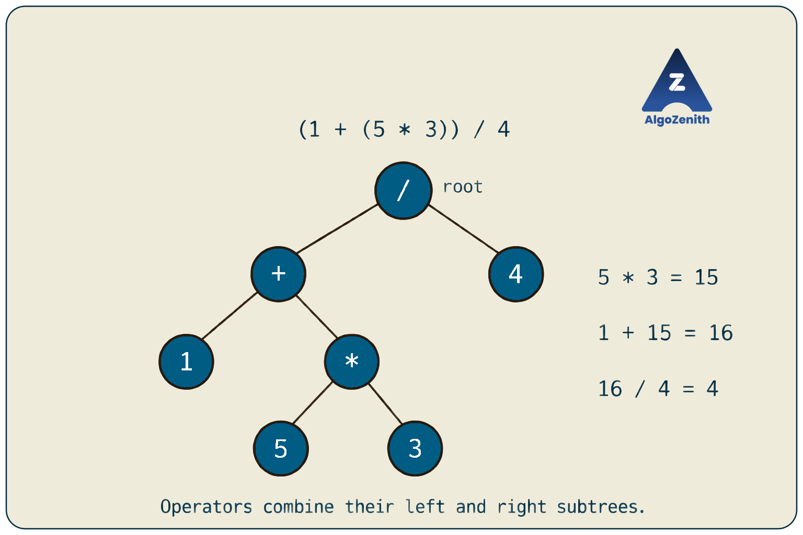
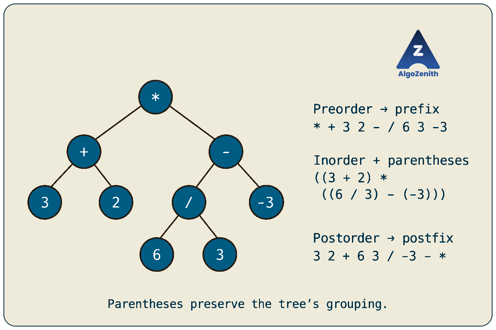
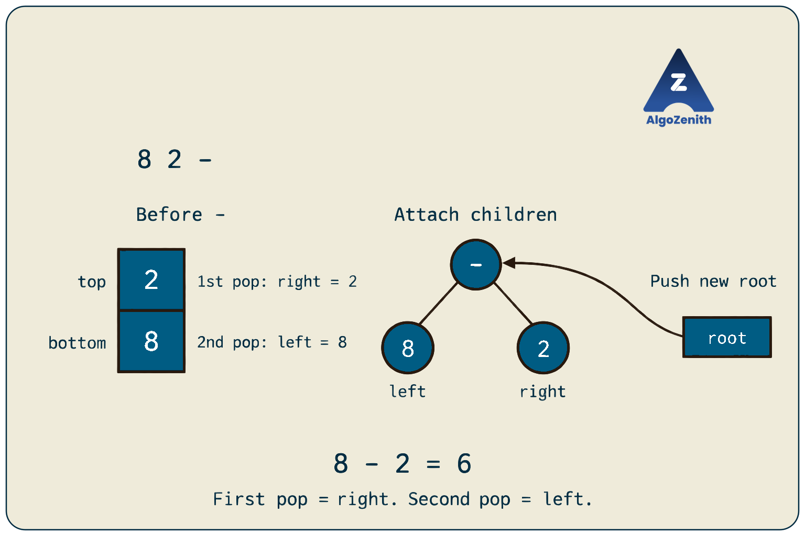
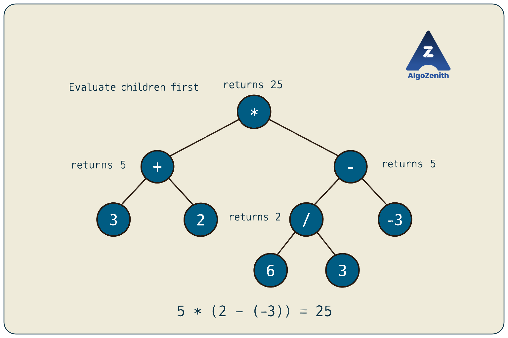

<VIDEO_WIDGET>

<VIDEO_ID></VIDEO_ID>

</VIDEO_WIDGET>

<READING_WIDGET>

# Expression Trees

An arithmetic expression tells us which operations to perform, but its written order is not always its evaluation order. In `1 + 5 * 3`, multiplication happens before addition. Parentheses can change that order again.

An **expression tree** makes these dependencies explicit. Operands become leaves, operators become internal nodes, and each subtree represents a complete subexpression.

We will use the lecture's examples to connect expression trees with prefix, infix, and postfix notation, construct a tree from postfix tokens, and evaluate an expression both with and without building the tree.

## 1. Representing an Expression as a Tree

Consider the first expression from the lecture:

```text
(1 + (5 * 3)) / 4
```

The last operation is division. Its left operand is the entire expression `1 + (5 * 3)`, and its right operand is `4`. Therefore, `/` becomes the root:



Read each operator node as “apply this operator to the values of my left and right subtrees.” Here:

1. The `*` subtree produces `5 * 3 = 15`.
2. The `+` subtree produces `1 + 15 = 16`.
3. The `/` root produces `16 / 4 = 4`.

The tree records the grouping, so it does not need separate nodes for parentheses.

### Scope of This Lesson

We will work with:

- **Binary operators:** `+`, `-`, `*`, and `/`, each taking exactly two operands.
- **Integer operands:** including negative and multi-digit values.
- **Ordered children:** the left subtree supplies the left operand, and the right subtree supplies the right operand.

Under these rules, every internal node has exactly two children, so the expression tree is a **full binary tree**. It need not be balanced or complete, and it is not a binary search tree.

Expression trees can also represent variables, unary operators, and function calls, but those require additional rules. In this lesson, `-3` is a single signed integer leaf, not a unary-minus node with a child `3`.

## 2. Running Example: One Tree, Several Representations

The remaining lecture examples use this tree:



The `/` below the subtraction node is a division operator. Its children are `6` and `3`.

The tree represents:

```text
(3 + 2) * ((6 / 3) - (-3))
```

There are **nine nodes**: four operators and five operands. The two leaves containing `3` are separate nodes; repeated operands are allowed.

The final value is:

```text
(3 + 2) * ((6 / 3) - (-3))
= 5 * (2 - (-3))
= 5 * 5
= 25
```

Notice that the subtraction node computes `2 - (-3)`, not `(-3) - 2`. Child order matters even though swapping operands would happen to preserve the result of addition or multiplication.

## 3. Traversals Give Prefix, Infix, and Postfix Notation

The three depth-first traversal orders correspond directly to three ways of writing an expression.

| Traversal | Visit order | Expression notation |
| --- | --- | --- |
| Preorder | Root → Left → Right | Prefix: operator before its operands |
| Inorder | Left → Root → Right | Infix: operator between its operands |
| Postorder | Left → Right → Root | Postfix: operator after its operands |

### Preorder: Prefix Notation

Visit `*` first, then the entire `+` subtree, then the entire `-` subtree:

```text
* + 3 2 - / 6 3 -3
```

Each operator appears before the two subexpressions it combines. With separate tokens and a known number of operands per operator, parentheses are unnecessary.

### Inorder: Infix Notation

A plain inorder traversal produces:

```text
3 + 2 * 6 / 3 - -3
```

This is the inorder token sequence, but **it does not preserve the tree's grouping**. Under ordinary arithmetic precedence, it evaluates to `10`, whereas our tree evaluates to `25`.

To produce an unambiguous infix expression, wrap every operator's subexpression in parentheses:

```text
((3 + 2) * ((6 / 3) - (-3)))
```

Here, `(-3)` simply makes the negative leaf easier to read. Parentheses around operator subexpressions preserve the tree structure. Removing only unnecessary parentheses is a separate formatting problem that must respect both precedence and associativity.

### Postorder: Postfix Notation

Visit both child subtrees before their operator:

```text
3 2 + 6 3 / -3 - *
```

The sequence can be grouped conceptually as:

```text
[3 2 +] [6 3 / -3 -] *
```

The first block represents the left subtree. The second represents the right subtree. The final `*` combines them. These brackets explain the grouping; they are not part of the postfix input.

### Why Use Tokens Instead of Individual Characters?

Our input will be a `vector<string>`:

```text
["3", "2", "+", "6", "3", "/", "-3", "-", "*"]
```

`"-"` is a binary operator, while `"-3"` is an operand. Likewise, `"125"` is one operand, not three separate digits. Checking only the first character of a token would incorrectly classify negative numbers as subtraction operators.

## 4. Shared C++ Representation and Arithmetic

All code in this lesson uses C++17. Combine the code blocks in order, including the driver near the end, to form a complete program.

The implementations assume that:

- The postfix input is nonempty and structurally valid: every operator has two available operands, and exactly one expression remains at the end.
- Each operand token is a valid decimal integer representable by `long long`.
- Every intermediate arithmetic result fits in `long long`.
- No division has a zero divisor, and the minimum `long long` value is never divided by `-1`, which would overflow.

We will discuss how to detect malformed postfix structure later. Keeping these assumptions explicit lets the main implementations focus on the tree and stack algorithms.

### Headers and Node Definition

```cpp
#include <iostream>
#include <stack>
#include <stdexcept>
#include <string>
#include <vector>
using namespace std;

enum class NodeType { VALUE, OPERATOR };

struct Node {
    NodeType type;
    long long value;
    char op;
    Node* left;
    Node* right;

    explicit Node(long long number)
        : type(NodeType::VALUE), value(number), op('\0'),
          left(nullptr), right(nullptr) {}

    explicit Node(char symbol)
        : type(NodeType::OPERATOR), value(0), op(symbol),
          left(nullptr), right(nullptr) {}
};

bool isOperator(const string& token) {
    return token == "+" || token == "-" ||
           token == "*" || token == "/";
}
```

The two constructors create either a value node or an operator node. `type` identifies which kind it is; `op` stores the actual operation. A value node's `op` and an operator node's `value` are unused.

### Applying an Operator

Both evaluation methods will share this helper:

```cpp
long long applyOperator(char op, long long leftValue,
                        long long rightValue) {
    switch (op) {
        case '+': return leftValue + rightValue;
        case '-': return leftValue - rightValue;
        case '*': return leftValue * rightValue;
        case '/': return leftValue / rightValue;
        default: throw invalid_argument("Unsupported operator");
    }
}
```

The helper always computes **left operand `op` right operand**. It expects valid arithmetic inputs under the assumptions above; it does not perform overflow or zero-divisor checks.

Because these are integer operands, C++ division truncates toward zero: `7 / 2` is `3`, and `-7 / 2` is `-3`. If a problem requires real-number division, the operand type, conversion, and arithmetic must all follow that requirement. Both lecture examples divide exactly, so this distinction does not change their answers.

## 5. Constructing an Expression Tree from Postfix

Postfix places an operator after both of its operands. When we reach an operator, the subtrees for its operands can already be complete.

We maintain a **stack of pointers to completed subtree roots** and scan the tokens from left to right.

### Algorithm

For each token:

1. **If it is an operand:** create a leaf and push its pointer.
2. **If it is an operator:** create an operator node, pop its right subtree first, then its left subtree, attach both, and push the new root.

After processing valid input, the stack contains exactly one pointer: the root of the complete expression tree.

### Why Do We Pop the Right Child First?

Postfix writes a binary expression in this order:

```text
postfix(left subtree), postfix(right subtree), operator
```

The right subtree is completed and pushed after the left subtree, so it sits on top of the stack.

For example:

```text
8 2 -
```

Before processing `-`, the stack contains `8, 2` from bottom to top. We must pop `2` as the right operand and `8` as the left operand, producing `8 - 2 = 6`.

**First pop = right. Second pop = left.** Reversing these assignments changes subtraction and division.



### Dry Run on the Lecture Example

In the following table, each stack entry describes a completed subtree. The actual implementation stores pointers, not expression strings. Stack entries appear from bottom to top.

| Token | Action | Stack afterwards |
| --- | --- | --- |
| `3` | Create a leaf | `[3]` |
| `2` | Create a leaf | `[3, 2]` |
| `+` | Attach left `3`, right `2` | `[(3 + 2)]` |
| `6` | Create a leaf | `[(3 + 2), 6]` |
| `3` | Create a leaf | `[(3 + 2), 6, 3]` |
| `/` | Attach left `6`, right `3` | `[(3 + 2), (6 / 3)]` |
| `-3` | Create a signed-value leaf | `[(3 + 2), (6 / 3), -3]` |
| `-` | Attach left `(6 / 3)`, right `-3` | `[(3 + 2), ((6 / 3) - (-3))]` |
| `*` | Attach the two remaining subtrees | `[((3 + 2) * ((6 / 3) - (-3)))]` |

At `*`, the stack entries are entire subtrees. Connecting their roots attaches all their descendants without copying any nodes.

### C++ Implementation

```cpp
Node* buildExpressionTree(const vector<string>& postfix) {
    stack<Node*> st;

    for (const string& token : postfix) {
        if (!isOperator(token)) {
            st.push(new Node(stoll(token)));
            continue;
        }

        Node* parent = new Node(token[0]);

        parent->right = st.top();
        st.pop();

        parent->left = st.top();
        st.pop();

        st.push(parent);
    }

    return st.top();
}
```

`stoll(token)` converts the operand to `long long`. Because `isOperator` compares whole strings, `"-3"` correctly reaches the operand branch. The input vector and each token are read by reference, avoiding unnecessary copies.

This builder relies on the valid-input assumptions. Calling `top()` on an empty stack is invalid; do not use it on arbitrary unvalidated input. It allocates one node per token, and the caller owns the returned tree.

### Why Is the Construction Correct?

After each processed token, the stack contains the roots of complete subexpressions that have been read but have not yet been combined by a later operator.

- An operand creates a correct one-node subtree.
- An operator takes the two most recently completed subexpressions. Postfix order identifies the first pop as the right subtree and the second as the left subtree. Attaching them to the operator creates the correct larger subtree.
- Pushing that new root preserves the same property for the next token.

For a valid complete expression, exactly one subtree remains after the final token. It represents the entire input.

### Complexity

Let `n` be the number of tokens, which is also the number of nodes. With fixed-width integer tokens and constant-time arithmetic:

- **Time:** `O(n)`. Each node is created once, pushed once, and popped at most once.
- **Auxiliary space:** `O(n)` in the worst case for the stack.
- **Output space:** `O(n)` for the tree, counted separately.

If token lengths are not treated as bounded, parsing also requires time proportional to the total number of characters read.

## 6. Evaluating an Expression Tree

Once the tree exists, evaluation follows its structure:

- A value node returns its stored integer.
- An operator node evaluates its left subtree, evaluates its right subtree, and applies its operator to the two results.

This is **postorder computation**: an operator's result depends on both children's results.

### C++ Implementation

```cpp
long long evaluateTree(const Node* root) {
    if (root->type == NodeType::VALUE) {
        return root->value;
    }

    long long leftValue = evaluateTree(root->left);
    long long rightValue = evaluateTree(root->right);

    return applyOperator(root->op, leftValue, rightValue);
}
```

The function expects a non-null root of a valid expression tree. An empty tree has no expression value under our contract; we do not silently assign it `0`.

Notice that `applyOperator` receives `root->op`, not `root->type`. The type tells us whether a node is an operator; only the operator symbol tells us whether to add, subtract, multiply, or divide.

### Dry Run: Values Return from Children to Parents

| Operator node | Left result | Right result | Returned value |
| --- | --- | --- | --- |
| `+` | `3` | `2` | `5` |
| `/` | `6` | `3` | `2` |
| `-` | `2` | `-3` | `5` |
| `*` | `5` | `5` | `25` |

The recursive calls travel down to the leaves, and the computed values return upward. The tree itself is unchanged.



### Complexity

Each node is visited once, giving **`O(n)` time**. If `h` is the number of nodes on the longest root-to-leaf path, the recursion uses **`O(h)` auxiliary space**.

Even a full binary expression tree can have height `O(n)`: each successive operator may have one leaf child and one large operator subtree. Therefore, do not assume logarithmic recursion depth.

## 7. Evaluating Postfix Directly Without Building a Tree

If we only need the final numerical answer, can we avoid allocating tree nodes?

Yes. Use the same left-to-right scan, but store **computed values** instead of subtree pointers.

- For an operand, push its value.
- For an operator, pop the right value, then the left value.
- Compute the result and push it back.

The tree-building algorithm preserves each subexpression's structure. Direct evaluation replaces each completed subexpression with its value immediately.

### C++ Implementation

```cpp
long long evaluatePostfix(const vector<string>& postfix) {
    stack<long long> st;

    for (const string& token : postfix) {
        if (!isOperator(token)) {
            st.push(stoll(token));
            continue;
        }

        long long rightValue = st.top();
        st.pop();

        long long leftValue = st.top();
        st.pop();

        st.push(applyOperator(token[0], leftValue, rightValue));
    }

    return st.top();
}
```

The return type and stack element type are both numerical. A `stack<Node*>` is appropriate for construction, but not for direct value evaluation.

### Dry Run

| Token | Work performed | Value stack, bottom to top |
| --- | --- | --- |
| `3` | Push `3` | `[3]` |
| `2` | Push `2` | `[3, 2]` |
| `+` | Compute `3 + 2` | `[5]` |
| `6` | Push `6` | `[5, 6]` |
| `3` | Push `3` | `[5, 6, 3]` |
| `/` | Compute `6 / 3` | `[5, 2]` |
| `-3` | Push `-3` | `[5, 2, -3]` |
| `-` | Compute `2 - (-3)` | `[5, 5]` |
| `*` | Compute `5 * 5` | `[25]` |

After each token, the value stack contains the evaluations of the same subtrees that the construction stack would contain. An operator combines the same left and right subexpressions in both methods, so direct evaluation gives the same answer as building and evaluating the tree.

![Direct postfix evaluation snapshots after each operator: the stacks from bottom to top are [5] after +, [5, 2] after /, [5, 5] after -, and [25] after *. Each completed subexpression is replaced by its value.](images/expression-tree-postfix-values.png)

### Complexity and When to Use Each Method

Direct postfix evaluation takes **`O(n)` time** and **`O(n)` auxiliary space** in the worst case. It avoids the `O(n)` allocated tree, but its value stack is not necessarily constant-sized.

| Requirement | Suitable method |
| --- | --- |
| Compute only the final value from postfix | Evaluate postfix directly |
| Print prefix or parenthesized infix from the same expression | Build and traverse the tree |
| Inspect or modify individual subexpressions | Preserve the tree |
| Reevaluate an expression for different variable assignments | Extend the tree with variable leaves and an environment |

## 8. Print the Traversals and Verify the Result

The following helpers print prefix, fully parenthesized infix, and postfix. Negative leaves are parenthesized only in infix for readability.

```cpp
void printToken(const Node* root) {
    if (root->type == NodeType::VALUE) cout << root->value;
    else cout << root->op;
}

void printPrefix(const Node* root) {
    if (root == nullptr) return;
    printToken(root);
    cout << ' ';
    printPrefix(root->left);
    printPrefix(root->right);
}

void printInfix(const Node* root) {
    if (root == nullptr) return;

    if (root->type == NodeType::VALUE) {
        if (root->value < 0) cout << '(' << root->value << ')';
        else cout << root->value;
        return;
    }

    cout << '(';
    printInfix(root->left);
    cout << ' ' << root->op << ' ';
    printInfix(root->right);
    cout << ')';
}

void printPostfix(const Node* root) {
    if (root == nullptr) return;
    printPostfix(root->left);
    printPostfix(root->right);
    printToken(root);
    cout << ' ';
}

void deleteTree(Node* root) {
    if (root == nullptr) return;
    deleteTree(root->left);
    deleteTree(root->right);
    delete root;
}

int main() {
    vector<string> postfix = {
        "3", "2", "+", "6", "3", "/", "-3", "-", "*"
    };

    Node* root = buildExpressionTree(postfix);

    cout << "Prefix: ";
    printPrefix(root);
    cout << '\n';

    cout << "Infix: ";
    printInfix(root);
    cout << '\n';

    cout << "Postfix: ";
    printPostfix(root);
    cout << '\n';

    cout << "Tree value: " << evaluateTree(root) << '\n';
    cout << "Postfix value: " << evaluatePostfix(postfix) << '\n';

    deleteTree(root);
}
```

Output, ignoring trailing spaces after prefix and postfix tokens:

```text
Prefix: * + 3 2 - / 6 3 -3
Infix: ((3 + 2) * ((6 / 3) - (-3)))
Postfix: 3 2 + 6 3 / -3 - *
Tree value: 25
Postfix value: 25
```

The postorder output reproduces the input sequence, and both evaluation methods return `25`.

The traversal helpers take `O(n)` time and `O(h)` recursion space under the fixed-width token model. `deleteTree` also uses postorder: it releases the children before their parent. These recursive helpers suit the lesson examples; deeply nested expressions may require iterative traversals and cleanup to avoid call-stack limits.

## 9. Validating Postfix and Checking Edge Cases

The core algorithms assume valid input, but interviews and programming problems may ask you to reject malformed expressions.

### Structural Validation with a Counter

After verifying that every token is either a supported operator or a valid integer, maintain a count of available completed subexpressions:

```text
available = 0

for each token:
    if token is an operand:
        available += 1
    else:
        if available < 2:
            reject
        available -= 1

accept only if available == 1
```

An operator consumes two subexpressions and produces one, reducing the count by one. This check takes `O(n)` time and `O(1)` extra space once token classification is available. It can run before construction, so structurally invalid input is rejected before any nodes are allocated.

- `3 +` fails because `+` has only one available operand.
- `3 2` fails because two separate expressions remain.
- Empty input fails because no expression remains.
- `3 + 2` fails at `+`, even though the total operand and operator counts look plausible.

This validates postfix structure, not arithmetic safety. Token validity, numeric range, division by zero, and intermediate overflow need their own checks if the input is not guaranteed valid. For strict numeric parsing with `stoll`, check that its consumed-character position equals the token's length and handle conversion errors; otherwise a token such as `"12abc"` can be partially parsed.

If parsing or construction can fail after allocation, arrange cleanup for partially built trees or use owning smart pointers. The compact raw-pointer builder above assumes valid tokens and successful allocation.

### Useful Test Cases

| Postfix input | Expected result or behavior | What it checks |
| --- | --- | --- |
| `42` | `42`; root is a leaf | No operator is required |
| `-3` | `-3`; root is a leaf | Signed operand recognition |
| `12 3 +` | `15` | Multi-digit token handling |
| `8 2 -` | `6` | Left/right order for subtraction |
| `8 2 /` | `4` | Left/right order for division |
| `-7 2 /` | `-3` | Integer division truncates toward zero |
| `1 5 3 * + 4 /` | `4` | The opening lecture example |
| `3 2 + 6 3 / -3 - *` | `25` | The main lecture example |
| `4 0 /` | Reject before division | Zero divisor |
| `3 +`, `3 2`, or empty input | Reject before construction/evaluation | Invalid postfix structure |

The rejection cases are requirements for a validating wrapper; they must not be passed directly to the assumption-based implementations above.

## 10. Interview and Competitive Programming Insights

- **Known operator arity makes reconstruction possible.** A general binary tree is not uniquely determined by postorder alone. An expression's postfix tokens provide additional structure: operands have no children and each supported operator has exactly two. With unambiguous tokens and fixed arity, the stack operations force one unique ordered expression tree, even when operand values repeat.
- **Count operands and operators.** If there are `k` binary operators, there must be `k + 1` operands and `2k + 1` total nodes. Starting from the operand count, each operator reduces the number of independent expressions by one. This count is necessary, but the prefix-by-prefix availability check is also needed to prove structural validity.
- **Prefix can be processed in reverse.** Scan prefix tokens from right to left with a stack. This time, the first pop is the left operand and the second is the right operand. Derive the order from the notation instead of copying the postfix rule blindly.
- **Infix needs precedence and associativity handling.** The lecture's first tree illustrates the grouping of an infix expression; our builder takes already-tokenized postfix. Parsing raw infix is a separate step, commonly handled by recursive descent or an operator-stack algorithm that converts infix to postfix. Unary minus needs explicit handling during that step.
- **Specify arithmetic semantics before coding.** Integer division, real division, and modular division are different operations. In modular-arithmetic problems, ordinary `/` is generally not the required operation; an inverse may be needed and must exist under the problem's conditions.
- **Do not assume a wider type prevents overflow.** `long long` increases the range but does not make arbitrary products safe. Use the constraints to choose checked arithmetic, wider intermediates where supported, or arbitrary-precision arithmetic when required.
- **Build only the structure the task needs.** Direct postfix evaluation is sufficient for a final value. Preserve a tree when later operations need the expression's structure, such as printing another notation or transforming subexpressions.

## Quick Recap

- Leaves store operands; internal nodes store operators. Each subtree represents one subexpression.
- Preorder gives prefix, and postorder gives postfix. Inorder needs parentheses to reliably preserve grouping.
- Build a tree from postfix using a stack of subtree pointers: push operands, then combine two subtrees at each operator.
- In a left-to-right postfix scan, pop the **right operand first**, then the left.
- Evaluate a tree by recursively computing child values before applying the parent's operator.
- Evaluate postfix directly with the same stack pattern using values instead of pointers.
- Construction and both evaluation methods take `O(n)` time under fixed-width arithmetic. Tree evaluation uses `O(h)` recursion space; postfix processing uses up to `O(n)` stack space.

</READING_WIDGET>
