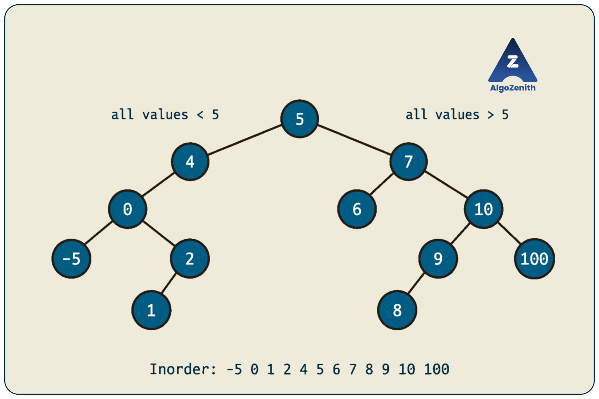
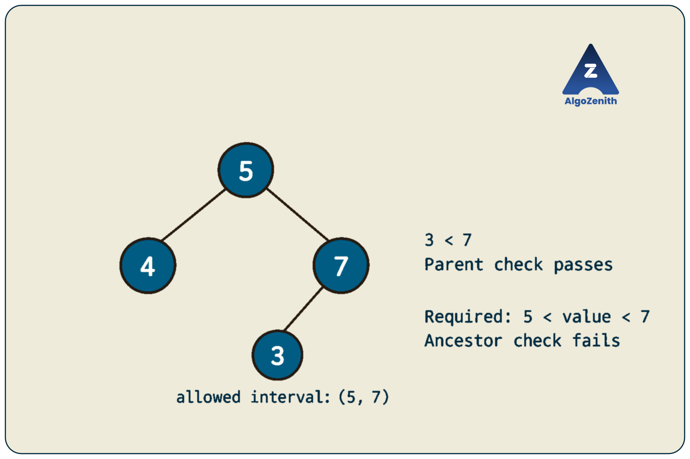
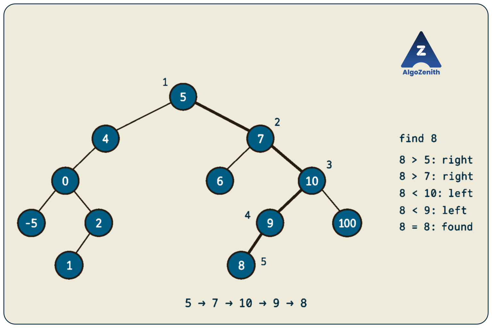
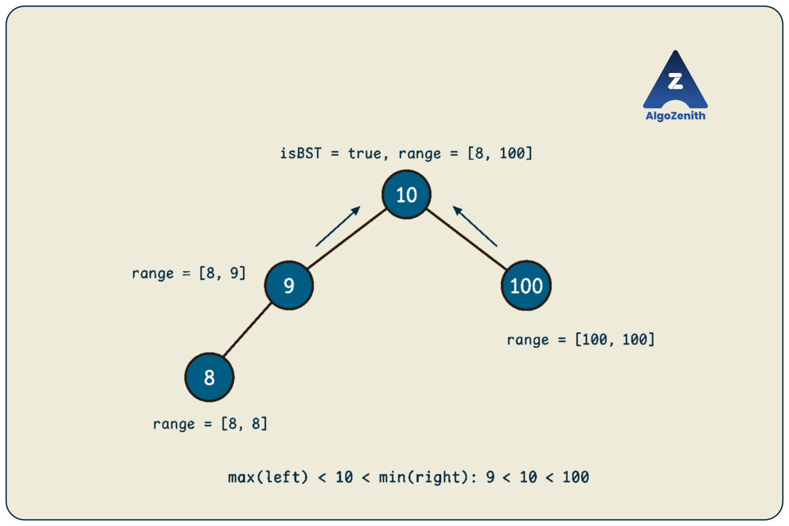
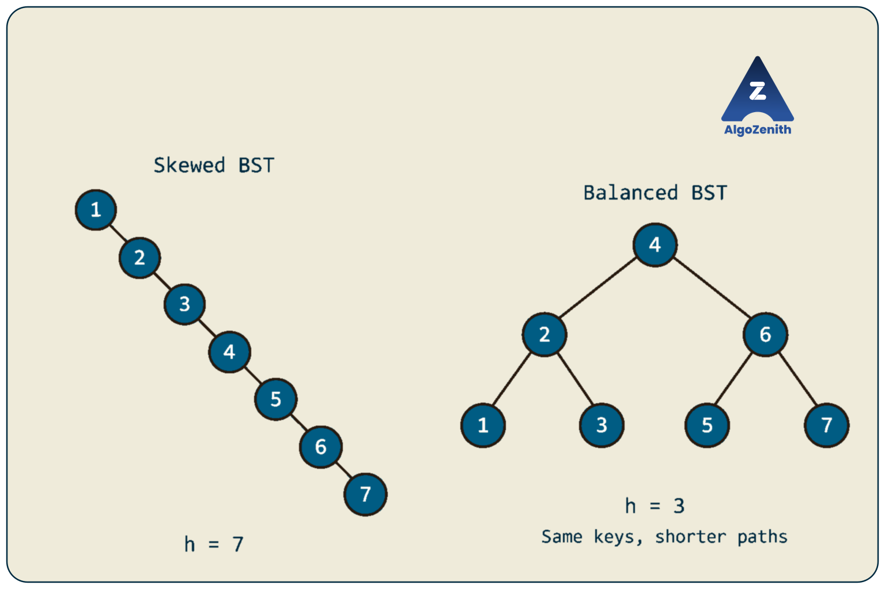
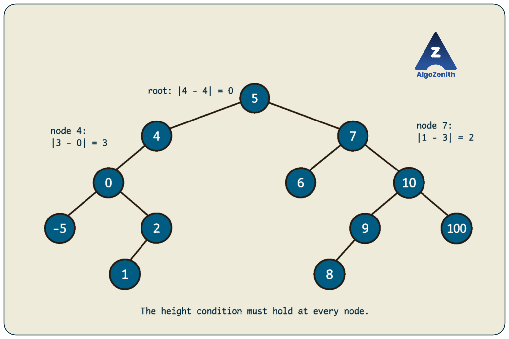
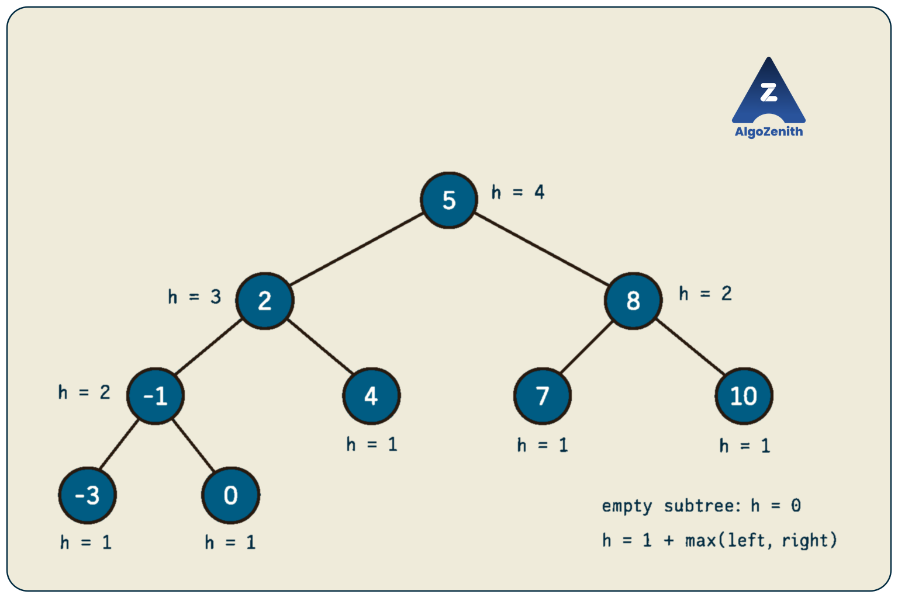

<VIDEO_WIDGET>

<VIDEO_ID></VIDEO_ID>

</VIDEO_WIDGET>

<READING_WIDGET>

# Binary Search Trees and Balanced BSTs

In a general binary tree, searching for a value may require visiting every node. A **binary search tree (BST)** adds an ordering rule that lets us choose just one child at each step.

However, choosing one branch does not automatically make a search fast. If the tree forms a long chain, that single path can still contain every node. A **balanced BST** keeps the height small so that searches remain efficient.

We will use the lecture's trees to understand BST ordering, search for a value, validate a BST, and check height balance. Insertion, deletion, and rotations that maintain balance are separate topics; this lesson focuses on understanding and checking the properties.

## 1. The BST Property Applies to Entire Subtrees

A **binary search tree** is a binary tree in which, at every node:

- Every value in the **left subtree** is smaller than the node's value.
- Every value in the **right subtree** is larger than the node's value.
- Both subtrees follow the same rule recursively.

For now, assume **distinct keys** and strict comparisons. We will discuss duplicates separately.

Here is the main tree from the lecture:



At the root `5`:

- The left subtree contains `-5, 0, 1, 2, 4`, all smaller than `5`.
- The right subtree contains `6, 7, 8, 9, 10, 100`, all larger than `5`.

At node `7`, the left subtree contains `6`, while the right subtree contains `8, 9, 10, 100`. The ordering rule holds there too, and at every other node.

### Why Checking Only the Children Is Not Enough

Consider this different tree:



Every immediate child is on the correct side of its parent: `4 < 5`, `7 > 5`, and `3 < 7`. Nevertheless, this is **not a BST**. Node `3` lies in the right subtree of `5`, so it must also be greater than `5`.

Each ancestor contributes a restriction. Here, the left child of `7` must lie in the open interval `(5, 7)`, not merely be smaller than `7`.

### Shared C++ Node Definition

All code in this lesson uses C++17 and the following headers and definition:

```cpp
#include <algorithm>
#include <cstdlib>
#include <iostream>
using namespace std;

struct Node {
    int data;
    Node* left;
    Node* right;

    Node(int value)
        : data(value), left(nullptr), right(nullptr) {}
};
```

This is the same basic representation as an ordinary binary tree. **The struct does not enforce BST ordering**; whether the tree is a BST depends on its values and links.

Throughout the lesson, `n` is the number of nodes and `h` is the height measured in nodes. An empty tree has height `0`, and a leaf has height `1`. We assume a valid, finite tree structure with no cycles or shared child nodes, and heights that fit in an `int`.

## 2. Inorder Traversal Produces Sorted Values

Inorder traversal visits:

```text
left subtree -> current node -> right subtree
```

In a strict BST, all left-subtree values are smaller than the current value, and all right-subtree values are larger. Applying the same reasoning recursively means that **inorder traversal produces a strictly increasing sequence**.

For the lecture's tree, the complete sequence is:

```text
-5 0 1 2 4 5 6 7 8 9 10 100
```

### C++ Implementation

```cpp
void printInorder(const Node* cur) {
    if (cur == nullptr) return;

    printInorder(cur->left);
    cout << cur->data << ' ';
    printInorder(cur->right);
}
```

The traversal takes **`O(n)` time** and **`O(h)` auxiliary space** for recursion. Printing all values still requires visiting all nodes, even when the BST is balanced.

The converse also holds: **if a binary tree's inorder sequence is strictly increasing, it is a strict BST**. Every node's left-subtree values occur before it and its right-subtree values occur after it, so the required inequalities hold.

> **Interview insight:** You can validate a strict BST by checking consecutive values during inorder traversal. There is no need to store the entire sequence: keep the previous visited value and a separate flag indicating whether one exists. Reject if `current <= previous`. Do not use a valid key such as `INT_MIN` to mean “no previous value.”

A sorted inorder sequence does **not** uniquely determine the tree's shape. For example, `1, 2, 3` can belong to a BST rooted at `2` or a rightward chain rooted at `1`.

## 3. Searching: Follow One Candidate Path

Suppose we want to find a value `x`. At a non-null node `cur`:

1. If `x == cur->data`, return this node.
2. If `x < cur->data`, continue into the left subtree.
3. Otherwise, continue into the right subtree.
4. If the chosen path reaches `nullptr`, the value is absent.

The ordering lets us discard the other subtree completely. If `x < cur->data`, neither the current node nor any node in its right subtree can contain `x`.

### Dry Run: Search for `8`



| Current node | Comparison | Next action |
| --- | --- | --- |
| `5` | `8 > 5` | Go right to `7` |
| `7` | `8 > 7` | Go right to `10` |
| `10` | `8 < 10` | Go left to `9` |
| `9` | `8 < 9` | Go left to `8` |
| `8` | Equal | Return this node |

For a missing value such as `3`, the path is `5 -> 4 -> 0 -> 2 -> nullptr`: at `2`, we try its missing right child.

The lecture's “unique traversal to find” means that the comparisons determine **one candidate downward path**. It does not mean that the set of keys determines a unique tree shape.

### Recursive C++ Implementation

```cpp
Node* findValue(Node* cur, int x) {
    if (cur == nullptr) return nullptr;
    if (cur->data == x) return cur;

    if (x < cur->data) {
        return findValue(cur->left, x);
    }
    return findValue(cur->right, x);
}
```

Check `cur == nullptr` **before** reading `cur->data`. This handles both an empty tree and an unsuccessful search. Also return the result of the recursive call; finding a node deeper down is useful only if its pointer reaches the original caller.

### Iterative C++ Implementation

```cpp
Node* findValueIterative(Node* cur, int x) {
    while (cur != nullptr) {
        if (cur->data == x) return cur;

        if (x < cur->data) {
            cur = cur->left;
        } else {
            cur = cur->right;
        }
    }
    return nullptr;
}
```

Both versions take **`O(h)` time**. The recursive version uses `O(h)` call-stack space in the worst case; the iterative version uses `O(1)` auxiliary space. Neither modifies the tree.

These functions assume that the input is already a BST. On an arbitrary binary tree, the selected path may miss a value that exists elsewhere.

## 4. Handling Duplicate Keys

“BST” alone does not settle how equal values should be represented. Choose a policy and use it consistently in insertion, searching, and validation.

| Policy | Required ordering at each node |
| --- | --- |
| Reject duplicate keys | Left values `< key`; right values `> key` |
| Store a frequency in each node | Structural keys remain distinct; equal insertions increase a count |
| Place equal keys on the right | Left values `< key`; right values `>= key` |
| Place equal keys on the left | Left values `<= key`; right values `> key` |

The lecture includes the “equal keys go right” convention. The implementations in this lesson use the **strict, distinct-key convention**, so their comparisons are unambiguous. Under a duplicate policy, inorder values are generally **nondecreasing**, rather than strictly increasing.

However, nondecreasing inorder alone cannot validate a policy that permits duplicates on only one side. A root `5` with left child `5` has inorder `5, 5`, but violates “equal keys go right.” That policy needs subtree comparisons or ancestor bounds that preserve which side permits equality.

> **Balancing insight:** A rule such as “equal keys always go right” needs care when rotations are introduced: rotating equal-valued nodes can place an equal key on the left. A frequency field, or a strict composite key such as `(value, uniqueId)`, avoids this ambiguity in a balanced-tree implementation.

Searching for one matching node can still stop on equality. Finding every occurrence or counting duplicates depends on the chosen representation.

## 5. Checking Whether a Binary Tree Is a BST

Search follows one path because it assumes ordering. **Validation must establish that ordering throughout the tree.** A correct validator must account for descendants, not just immediate children.

The lecture uses a bottom-up approach: each subtree reports its minimum and maximum values. At a node with value `v`, check:

```text
maximum(left subtree) < v < minimum(right subtree)
```

Only apply a side's comparison when that subtree is nonempty. We must also know that both child subtrees are themselves valid BSTs.

### What Should Each Recursive Call Return?

Return a small summary containing:

- Whether the subtree is a BST.
- Its minimum value, if nonempty.
- Its maximum value, if nonempty.

This is **postorder processing**: obtain both child summaries before deciding the current node's result.



In mathematical notation, an empty subtree can use minimum `+infinity` and maximum `-infinity`, making the comparisons automatically pass. In code, integer limits are actual key values, not infinity. The implementation below checks whether a child exists, so `INT_MIN` and `INT_MAX` remain valid keys without special sentinels.

### C++ Implementation

```cpp
struct BSTInfo {
    bool isBST;
    int minValue;
    int maxValue;
};

BSTInfo inspectBST(const Node* cur) {
    if (cur == nullptr) {
        // Empty trees are valid. Their extrema are not used.
        return {true, 0, 0};
    }

    BSTInfo left = inspectBST(cur->left);
    BSTInfo right = inspectBST(cur->right);

    bool valid = left.isBST && right.isBST;

    if (cur->left != nullptr && left.maxValue >= cur->data) {
        valid = false;
    }
    if (cur->right != nullptr && right.minValue <= cur->data) {
        valid = false;
    }

    int smallest = cur->data;
    int largest = cur->data;

    if (cur->left != nullptr) {
        smallest = min(smallest, left.minValue);
        largest = max(largest, left.maxValue);
    }
    if (cur->right != nullptr) {
        smallest = min(smallest, right.minValue);
        largest = max(largest, right.maxValue);
    }

    return {valid, smallest, largest};
}

bool isBST(const Node* root) {
    return inspectBST(root).isBST;
}
```

The empty-tree extrema `0, 0` are placeholders and never participate in a comparison or an extrema update. Therefore, the implementation also works with all-negative trees and integer boundary values.

Notice that the maximum is computed with **`max`**, not `min`. We combine both children and the current value so that the reported extrema remain correct even for an invalid subtree. Returning validity in the summary also avoids a global flag that would need resetting before each new validation.

### Dry Run on the Lecture's Tree

Leaves return their own value as both minimum and maximum.

| Subtree root | Left range | Right range | Returned range | Valid? |
| --- | --- | --- | --- | --- |
| `2` | `[1, 1]` | Empty | `[1, 2]` | Yes: `1 < 2` |
| `0` | `[-5, -5]` | `[1, 2]` | `[-5, 2]` | Yes: `-5 < 0 < 1` |
| `4` | `[-5, 2]` | Empty | `[-5, 4]` | Yes: `2 < 4` |
| `9` | `[8, 8]` | Empty | `[8, 9]` | Yes: `8 < 9` |
| `10` | `[8, 9]` | `[100, 100]` | `[8, 100]` | Yes: `9 < 10 < 100` |
| `7` | `[6, 6]` | `[8, 100]` | `[6, 100]` | Yes: `6 < 7 < 8` |
| `5` | `[-5, 4]` | `[6, 100]` | `[-5, 100]` | Yes: `4 < 5 < 6` |

In the earlier invalid example, the right subtree rooted at `7` returns minimum `3`. At the root `5`, the check fails because `3 <= 5`.

### Why Is This Correct?

An empty tree is a BST. For a nonempty tree, assume the child summaries are correct:

1. Both children must report valid BSTs.
2. Comparing the left maximum with the current value checks **every** left-subtree value at once.
3. Comparing the right minimum with the current value checks **every** right-subtree value at once.

Together, these are exactly the strict BST requirements. The minimum and maximum of the combined subtree are obtained from the current value and both child summaries, preserving the information needed by the parent.

### Complexity and Another Useful Approach

Each node does constant work after its recursive calls, giving **`O(n)` time** and **`O(h)` auxiliary space**.

Another approach carries an allowed interval `(low, high)` downward. A node must lie inside that interval; its left child inherits `(low, value)` and its right child inherits `(value, high)`. This also takes `O(n)` time and `O(h)` recursion space. Represent missing bounds explicitly, or use bounds wider than the entire key domain. Avoid `value - 1` and `value + 1`, which can overflow at integer limits.

The two approaches carry different information: ancestor restrictions travel **downward**, while subtree extrema travel **upward**.

## 6. Why an Ordinary BST Can Be Slow

The search complexity is `O(h)`, not automatically `O(log n)`.

For example, inserting `1, 2, 3, ..., 100` into an ordinary BST without rebalancing produces:

```text
1
 \
  2
   \
    3
     \
      4
       \
        ...
           \
            100
```

This is a valid BST, but its height is `100`. Searching for `100`, or for a value larger than `100`, visits all nodes.

For a chain of `n` nodes:

- Height is `n` under our node-count convention.
- Worst-case search time is `O(n)`.
- Recursive search can use `O(n)` stack space.

Basic BST insertion and deletion also have worst-case time `O(h)` when implemented using downward search paths. Inserting sorted keys one by one without balancing can therefore take `O(n^2)` total time to build the tree.

**Ordering tells us which direction to choose. Balance controls how many choices we may need to make.**



*The smaller example above uses the same keys in both trees to isolate the effect of shape on height.*

## 7. Balanced BSTs and the Lecture's Height Condition

A balanced BST maintains height `O(log n)`. Different balanced-tree families enforce different rules; the lecture uses the **AVL-style height-balance condition**:

```text
abs(height(left subtree) - height(right subtree)) <= 1
```

This condition must hold at **every node**. In the checks below, “balanced BST” means a strict BST that also satisfies this particular height condition. Other families, such as red-black trees, achieve logarithmic height using different invariants.

Recall our height convention:

```text
height(nullptr) = 0
height(leaf) = 1
height(node) = 1 + max(height(left), height(right))
```

### The Original BST Is Not Height-Balanced

In the main lecture tree:

| Node | Left height | Right height | Absolute difference | Locally balanced? |
| --- | --- | --- | --- | --- |
| `0` | 1 | 2 | 1 | Yes |
| `4` | 3 | 0 | 3 | No |
| `10` | 2 | 1 | 1 | Yes |
| `7` | 1 | 3 | 2 | No |
| `5` | 4 | 4 | 0 | Yes |



The root's two subtree heights are equal, yet nodes `4` and `7` violate the condition. **Checking only the root would give the wrong answer.** The entire tree is a BST, but it is not height-balanced.

### The Balanced Example from the Lecture

The lecture then illustrates a different BST:



All leaves have height `1`. The subtree at `-1` has height `2`, the subtree at `2` has height `3`, and the subtree at `8` has height `2`. The root has height `4`.

Every node's child heights differ by at most `1`, and all BST comparisons hold. Thus, it is a height-balanced BST. It need not have equal-sized child subtrees or every level filled.

### Why Does This Rule Give Logarithmic Height?

Let `N(h)` be the minimum number of nodes in a tree of height `h` satisfying this rule. To reach height `h` with as few nodes as possible, one child has height `h - 1` and the other has height `h - 2`:

```text
N(0) = 0
N(1) = 1
N(h) = 1 + N(h - 1) + N(h - 2), for h >= 2
```

This Fibonacci-like recurrence grows exponentially with height. Consequently, a tree with `n` nodes satisfying the condition has height **`O(log n)`**, giving logarithmic search time for a nonempty balanced BST.

This describes a property of the current shape. A **self-balancing BST** additionally maintains its balancing invariant after updates, typically through metadata updates and rotations. Checking balance does not perform those repairs.

## 8. Checking Height Balance in One Postorder Pass

A direct but inefficient approach calculates both subtree heights afresh at every node. On a skewed tree, repeated height calculations can add up to **`O(n^2)` time**.

Instead, compute each subtree's height once and return it to its parent. Each call needs to report both height and whether a violation has occurred.

We can encode both outcomes in one integer:

- A result `>= 0` is the subtree's height, and means it is balanced.
- A result of `-1` means the subtree is unbalanced.

Because valid heights are never negative, `-1` is an unambiguous marker.

### C++ Implementation

```cpp
int heightIfBalanced(const Node* cur) {
    if (cur == nullptr) return 0;

    int leftHeight = heightIfBalanced(cur->left);
    if (leftHeight == -1) return -1;

    int rightHeight = heightIfBalanced(cur->right);
    if (rightHeight == -1) return -1;

    if (abs(leftHeight - rightHeight) > 1) {
        return -1;
    }

    return 1 + max(leftHeight, rightHeight);
}

bool isHeightBalanced(const Node* root) {
    return heightIfBalanced(root) != -1;
}

bool isBalancedBST(const Node* root) {
    return isBST(root) && isHeightBalanced(root);
}
```

Check for `-1` before using a child's result as a height. Once a subtree is unbalanced, its ancestors must also report failure; a later node with equal child heights cannot undo that violation.

In the original tree, node `0` returns height `3`. Node `4` receives heights `3` and `0`, returns `-1`, and this failure reaches the root. Early termination means the balance checker need not inspect the right subtree once this failure is known.

In the balanced example, every call returns a valid height, and the root returns `4`.

### Height Balance Does Not Check BST Ordering

Consider:

```text
      5
     / \
    8   2
```

The child heights are equal, so `isHeightBalanced` returns `true`. The ordering is wrong, so `isBST` and `isBalancedBST` return `false`.

If the problem guarantees a BST, checking height balance alone is enough. If it gives an arbitrary binary tree and asks whether it is a balanced BST under our definition, check **both properties**.

### Why Is the Balance Check Correct?

The empty subtree has height `0` and is balanced. At a nonempty node:

1. Either child returning `-1` proves a violation already exists below this node.
2. Otherwise, both child heights are correct and their subtrees are balanced.
3. Their height difference decides the current node's balance.
4. If it passes, `1 + max(leftHeight, rightHeight)` is the correct height to return.

The worst-case time is **`O(n)`**, and auxiliary space is **`O(h)`**. For arbitrary input, that stack bound can be `O(n)`; do not assume logarithmic height before checking it.

Calling the BST validator and balance checker separately still takes `O(n)` total time and `O(h)` peak auxiliary space. Two linear passes are linear. They can also be combined into one summary containing validity, extrema, height, and balance if a task benefits from one pass.

## 9. Running the Checks on the Lecture's Tree

Combine the headers, node definition, and functions above with this `main` to form a complete C++17 program:

```cpp
int main() {
    Node n5(5), n4(4), n7(7), n0(0), n6(6), n10(10);
    Node nMinus5(-5), n2(2), n1(1), n9(9), n100(100), n8(8);

    n5.left = &n4;
    n5.right = &n7;
    n4.left = &n0;
    n0.left = &nMinus5;
    n0.right = &n2;
    n2.left = &n1;
    n7.left = &n6;
    n7.right = &n10;
    n10.left = &n9;
    n10.right = &n100;
    n9.left = &n8;

    Node* root = &n5;

    cout << "Inorder: ";
    printInorder(root);
    cout << '\n' << boolalpha;

    Node* found = findValue(root, 8);
    cout << "Search 8: " << (found != nullptr) << '\n';
    cout << "Search 3: "
         << (findValueIterative(root, 3) != nullptr) << '\n';
    cout << "BST: " << isBST(root) << '\n';
    cout << "Height-balanced: " << isHeightBalanced(root) << '\n';
    cout << "Balanced BST: " << isBalancedBST(root) << '\n';
}
```

Output, ignoring the trailing space after the inorder values:

```text
Inorder: -5 0 1 2 4 5 6 7 8 9 10 100
Search 8: true
Search 3: false
BST: true
Height-balanced: false
Balanced BST: false
```

These are local node objects connected manually, rather than dynamically allocated nodes or the result of an insertion algorithm. They remain alive until `main` finishes and are then destroyed automatically. Do not call `delete` on them. The search functions return pointers to existing nodes and do not allocate new ones.

## 10. Edge Cases and Complexity Summary

Under the strict BST and AVL-style balance conventions used here:

| Input tree | `isBST` | `isHeightBalanced` | `isBalancedBST` |
| --- | --- | --- | --- |
| Empty tree | `true` | `true` | `true` |
| Single node, including `INT_MIN` or `INT_MAX` | `true` | `true` | `true` |
| Root `2` with left child `1` | `true` | `true` | `true` |
| Rightward chain `1 -> 2 -> 3` | `true` | `false` | `false` |
| Root `5`, left child `8`, right child `2` | `false` | `true` | `false` |
| Root `5` with an equal-valued child | `false` | `true` | `false` |
| Root `5`, left `4`, right `7`, and `7`'s left child `3` | `false` | `true` | `false` |
| Original twelve-node lecture tree | `true` | `false` | `false` |
| Nine-node balanced lecture example | `true` | `true` | `true` |

Search on an empty tree returns `nullptr`. On a nonempty BST, test both an existing value and a missing value whose search path ends at a null child.

| Operation | Time | Auxiliary space |
| --- | --- | --- |
| Recursive BST search | `O(h)` | `O(h)` |
| Iterative BST search | `O(h)` | `O(1)` |
| Inorder traversal | `O(n)` | `O(h)` |
| BST validation using subtree summaries | `O(n)` | `O(h)` |
| Height-balance check using returned heights | `O(n)` worst case | `O(h)` |
| Combined balanced-BST check above | `O(n)` worst case | `O(h)` |

For a nonempty balanced BST, `h = O(log n)`; for a skewed tree, `h = O(n)`. These bounds exclude the input tree's storage and count recursive calls as auxiliary space. Empty inputs return immediately in constant time.

## 11. Interview and Competitive Programming Insights

- **State the assumptions first.** Clarify whether the input is guaranteed to be a BST, which duplicate policy applies, and what “balanced” means. Those choices determine the required checks and inequalities.
- **Use ancestor constraints to expose incorrect validators.** A descendant that satisfies its parent's comparison but violates an ancestor, such as `3` in the right subtree of `5`, is a stronger test than a misplaced immediate child.
- **Separate path queries from full-tree work.** A balanced BST supports logarithmic search, but inorder output and worst-case validation still take linear time. Balance does not remove the need to examine all relevant nodes.
- **Avoid repeated subtree scans.** Computing minima, maxima, or heights from scratch at every node can lead to quadratic work. Return the information a parent needs from the same postorder call that checks the child.
- **Handle recursion depth deliberately.** Large skewed inputs can exhaust the call stack. Iterative search already avoids that issue; validation can use explicit stacks for inorder or bound-based traversal, and iterative postorder can support balance checks.
- **Do not assume sorted insertion creates balance.** In an ordinary BST it creates a chain. If rebuilding a static set of distinct sorted keys is permitted, choosing the middle key recursively for each subtree constructs a height-balanced BST in `O(n)` time once the keys are sorted. This does not provide automatic balancing for later updates.
- **Recognize the reusable postorder pattern.** The parent needs a compact summary, not every descendant's value. Here those summaries are extrema and validity, or height and balance. The same idea extends to problems such as finding the largest BST subtree.

## Quick Recap

- A BST orders **entire subtrees**: smaller keys on the left and larger keys on the right under the strict convention.
- Inorder traversal of a strict BST is strictly increasing, but does not determine its shape.
- Search follows one candidate path and takes `O(h)` time; check for null before dereferencing a node.
- Duplicate handling is a policy that must remain consistent across operations.
- Validate a BST in `O(n)` time by returning subtree validity, minimum, and maximum.
- An ordinary BST can become a chain, making search linear.
- The lecture's balance rule requires child heights to differ by at most `1` at **every node**.
- Check balance in `O(n)` time by returning heights and propagating failure. For an arbitrary binary tree, checking a balanced BST requires both ordering and balance.

</READING_WIDGET>
