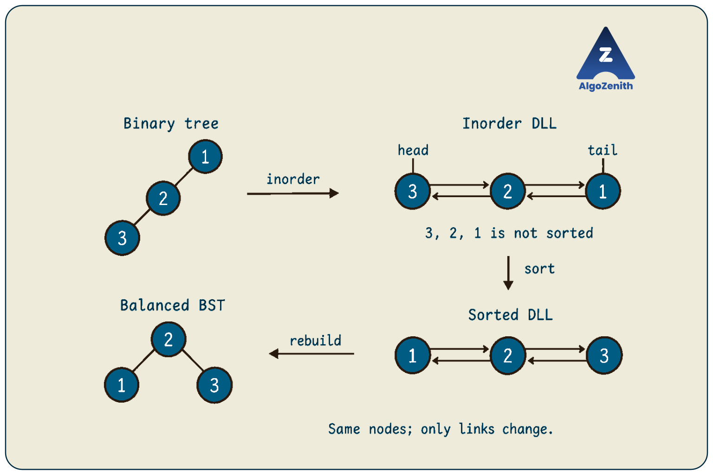
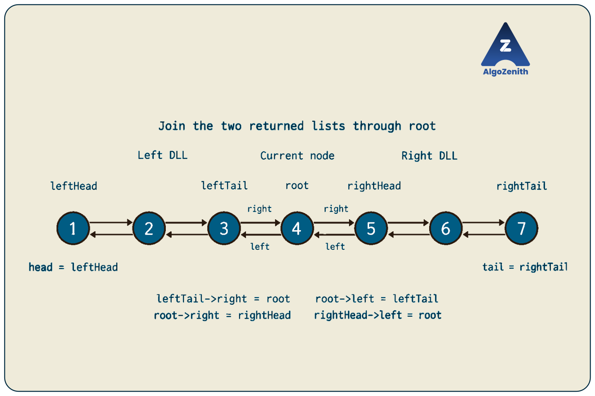
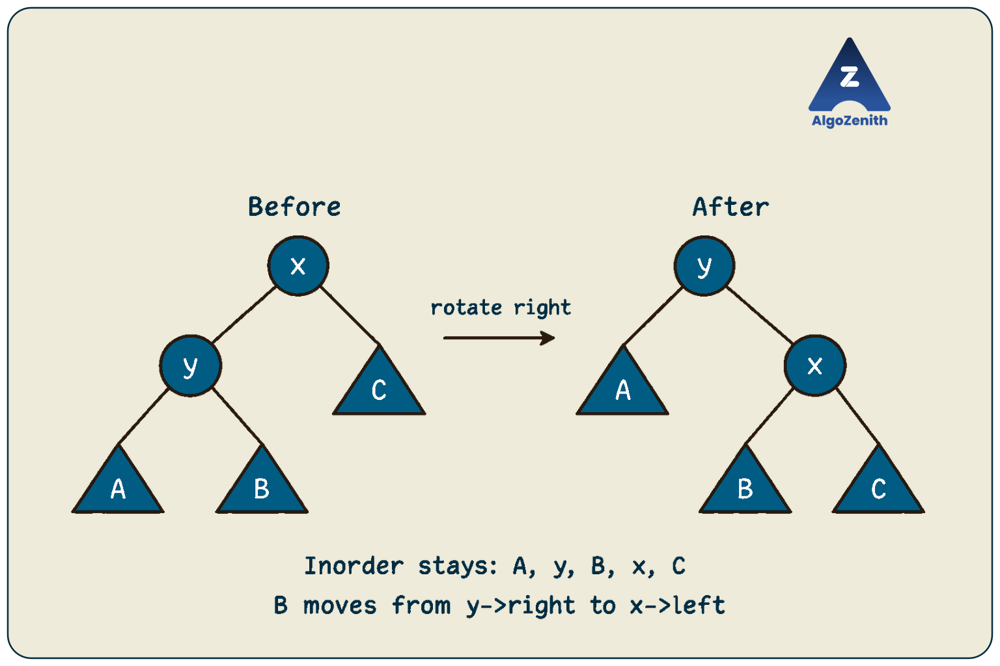

<VIDEO_WIDGET>

<VIDEO_ID></VIDEO_ID>

</VIDEO_WIDGET>

<READING_WIDGET>

# Binary Tree and Doubly Linked List Interconversion

A binary tree node has two pointers: `left` and `right`. A doubly linked list (DLL) node also has two pointers: `prev` and `next`. Can we reuse the same nodes to move between these two structures?

Yes. The key is to choose an ordering for the nodes, then change what their pointers represent. **Inorder traversal connects trees to lists**, while choosing a middle element connects sorted sequences to balanced BSTs.

Following the lecture's conversion map, we will first compare the vector and DLL routes. Then we will convert a tree into a DLL, build a balanced BST from a sorted DLL, and combine these operations to balance a BST or merge two BSTs.

## 1. The Conversion Map

The lecture uses three tree categories:

- **Binary tree:** each node has at most two children; values need not be ordered.
- **BST:** every left-subtree key is smaller and every right-subtree key is larger, under the distinct-key convention used here.
- **Balanced BST (BBST):** a BST whose shape keeps its height logarithmic. Our construction produces a tree whose child heights differ by at most one at every node.

The two main routes are:

```text
Using a vector of values:

Binary tree -> Inorder values -> Sort -> Sorted values -> Balanced BST
BST ---------------------------------> Sorted values -> Balanced BST

Reusing the existing nodes:

Binary tree -> Inorder DLL -> Sort -> Sorted DLL -> Balanced BST
BST ------------------------------> Sorted DLL -> Balanced BST
```

An arbitrary binary tree's inorder sequence is **not necessarily sorted**. A BST's inorder sequence is sorted already, so that route skips sorting.



Let `n` be the number of nodes and `h` the input tree's height, measured in nodes. For nonempty inputs, the main costs are:

| Conversion | Time | Auxiliary space | Important condition |
| --- | --- | --- | --- |
| Binary tree or BST to a vector of inorder values | `O(n)` | `O(n)` | Includes vector storage and traversal stack |
| Unsorted vector to sorted vector | `O(n log n)` | Vector route remains `O(n)` overall | A comparison sort is sufficient |
| Sorted vector to balanced BST | `O(n)` | `O(log n)` recursion, in addition to the input vector | Allocating a new tree also requires `O(n)` output storage |
| Binary tree to inorder DLL, recursive version | `O(n)` | `O(h)` | Reuses nodes; does not sort them |
| BST to sorted DLL, recursive version | `O(n)` | `O(h)` | `h` can be `n` for a skewed BST |
| DLL to sorted DLL, merge sort below | `O(n log n)` | `O(log n)` | Merge is iterative |
| Sorted DLL to balanced BST, consuming nodes in order | `O(n)` | `O(log n)` | Reuses nodes |

The lecture's logarithmic stack bound for BST-to-DLL conversion applies when the **input BST is balanced**. For an arbitrary BST, the correct recursive bound is `O(h)`, which can be `O(n)`.

### What Does “In Place” Mean Here?

The DLL route reuses existing node objects and their pointer fields. It needs no vector of all values and no replacement nodes. However, the recursive versions still use a call stack.

We will state these two facts separately: **node reuse** describes where the result is stored; **auxiliary space** includes recursion and other temporary storage. Section 10 also gives a tree-to-DLL variant with `O(1)` auxiliary space.

## 2. Shared Node Representation and Assumptions

All implementations use C++17 and the following shared definition:

```cpp
#include <cstddef>
#include <iostream>
#include <utility>
using namespace std;

struct Node {
    int data;
    Node* left;
    Node* right;

    Node(int value)
        : data(value), left(nullptr), right(nullptr) {}
};
```

The fields keep their names, but their meanings change:

| Field | In a tree | In a DLL |
| --- | --- | --- |
| `left` | Left child | Previous node |
| `right` | Right child | Next node |

We assume:

- Input trees are finite and have no cycles or shared child nodes.
- Input DLLs are finite, non-circular, and have consistent forward and backward links.
- Empty inputs are allowed.
- BST construction uses **distinct keys**. Tree-to-DLL conversion and DLL sorting also work with repeated values; duplicate policies for the final BST are discussed later.
- Counts fit in `size_t`.

These conversions **modify the input structure**. After a tree becomes a DLL, its former root is just one node in the list. Do not use tree traversal on it. After a DLL becomes a tree, use the returned root instead of following the former list links.

## 3. The Vector Route: A Useful Baseline

Before manipulating links, understand the simpler route shown at the top of the lecture's map.

### Arbitrary Binary Tree to Balanced BST

1. Collect the tree's values into a vector using inorder traversal.
2. Sort the vector.
3. Choose its middle value as the new root.
4. Recursively build the left subtree from the values before the middle and the right subtree from the values after it.

For example, the lecture's leftward chain is:

```text
    1
   /
  2
 /
3
```

Its inorder values are `3, 2, 1`. Sorting gives `1, 2, 3`, from which we build:

```text
    2
   / \
  1   3
```

This takes `O(n log n)` time overall and `O(n)` auxiliary space for the vector. If we allocate new tree nodes, their `O(n)` storage is output space, separate from that vector. The original tree can remain unchanged.

For an input BST, skip sorting: collecting its inorder sequence and rebuilding take `O(n)` time overall.

### Binary Tree to BST While Preserving Its Shape

A related task asks for a BST with the **same shape** as the original binary tree. Collect and sort its values, then perform another inorder traversal and assign the sorted values back to the existing nodes in sequence.

With distinct keys, strictly increasing inorder guarantees BST ordering. However, this approach changes which value belongs to each node and **does not balance the shape**. A chain remains a chain.

> **Interview insight:** Clarify what must be preserved: the values, each node's value, the shape, or the original tree itself. Reassigning values and rewiring nodes satisfy different requirements.

The DLL route below preserves each node's stored value while changing its links.

## 4. Binary Tree to DLL: Return the Head and Tail

The desired list follows the tree's inorder order:

```text
DLL(left subtree) <-> current node <-> DLL(right subtree)
```

For the leftward chain `1 -> 2 -> 3` from the lecture, the result is:

```text
nullptr <- 3 <-> 2 <-> 1 -> nullptr
```

This is a valid inorder DLL, but it is not sorted in increasing order. If the input were a BST, its inorder DLL would already be sorted.

### What Should a Recursive Call Return?

The lecture proposes a pair of pointers:

```text
{head of the converted list, tail of the converted list}
```

Both endpoints matter. To attach the current node after the left list, we need that list's tail. To attach the right list, we need its head. Returning both avoids scanning for endpoints repeatedly.

For an empty subtree, return `{nullptr, nullptr}`.

For a nonempty subtree:

1. Convert its left and right subtrees.
2. Connect the left list's tail to the current node in both directions.
3. Connect the current node to the right list's head in both directions.
4. Return the combined list's head and tail.



### C++ Implementation

```cpp
pair<Node*, Node*> treeToDLL(Node* root) {
    if (root == nullptr) return {nullptr, nullptr};

    // Preserve the original child pointers before rewiring this node.
    Node* leftChild = root->left;
    Node* rightChild = root->right;

    auto [leftHead, leftTail] = treeToDLL(leftChild);
    auto [rightHead, rightTail] = treeToDLL(rightChild);

    root->left = leftTail;
    if (leftTail != nullptr) {
        leftTail->right = root;
    }

    root->right = rightHead;
    if (rightHead != nullptr) {
        rightHead->left = root;
    }

    Node* head = (leftHead != nullptr) ? leftHead : root;
    Node* tail = (rightTail != nullptr) ? rightTail : root;
    return {head, tail};
}
```

`auto [leftHead, leftTail]` is a C++17 structured binding: it names the two pointers returned in the pair.

The code sets `root->left` and `root->right` even when a neighboring list is empty. This ensures that the final head has `left == nullptr` and the final tail has `right == nullptr`.

### Dry Run on the Lecture's Chain

The recursive calls finish from the bottom upward:

| Current node | Left DLL | Right DLL | Returned DLL | Returned endpoints |
| --- | --- | --- | --- | --- |
| `3` | Empty | Empty | `3` | `{3, 3}` |
| `2` | `3` | Empty | `3 <-> 2` | `{3, 2}` |
| `1` | `3 <-> 2` | Empty | `3 <-> 2 <-> 1` | `{3, 1}` |

The table identifies nodes by their distinct values. No new node is allocated, and no stored value changes.

### Why Is It Correct?

Assume each recursive call returns a correctly linked inorder DLL with correct endpoints. All left-subtree nodes must precede the current node, and all right-subtree nodes must follow it.

The four boundary assignments join exactly those three pieces. Internal links in the child lists remain valid. Choosing the first nonempty piece's head and the last nonempty piece's tail gives the correct endpoints for the parent.

The empty-subtree case establishes the base case, so the argument applies to the whole tree.

### Complexity

Each node performs constant work after its two recursive calls:

```text
T(n) = T(left subtree size) + T(right subtree size) + O(1)
```

The total time is **`O(n)`**, regardless of shape. The auxiliary space is **`O(h)`** for recursion: `O(log n)` for a balanced tree, but `O(n)` for a chain.

Returning only a head and then repeatedly walking to the left list's tail can make a skewed case quadratic. Returning both endpoints removes that repeated work.

## 5. Sorted DLL to Balanced BST

Now suppose the input is:

```text
nullptr <- 1 <-> 2 <-> 3 <-> 4 <-> 5 <-> 6 -> nullptr
```

Choosing a middle node as the root leaves approximately half the nodes for each child. The difficulty is that a DLL does not provide constant-time indexing.

### Approach 1: Repeatedly Find the Middle

For each list segment, use slow and fast pointers to find its middle, detach the two sides, and recurse.

This gives a balanced shape, but finding the middle scans the current segment. The recurrence is:

```text
T(n) = T(floor(n / 2)) + T(n - floor(n / 2) - 1) + O(n)
```

The total is **`O(n log n)` time**, with `O(log n)` recursive depth. When implementing this approach, detach both directions at the boundaries so that recursive segments remain separate.

Can we avoid searching for the middle at every level?

### Approach 2: Build in Inorder and Consume Each Node Once

Count the nodes first. Then let a shared pointer `current` identify the next unused list node.

To build a tree containing `n` nodes:

1. Build the left subtree from the first `n / 2` nodes.
2. Use the node now identified by `current` as the root.
3. Advance `current` to its next list node.
4. Build the right subtree from the remaining `n - n / 2 - 1` nodes.

This follows the same order as inorder traversal: **left subtree, root, right subtree**. The middle node becomes available naturally after the left subtree has consumed its share.

### C++ Implementation

```cpp
size_t countDLL(const Node* head) {
    size_t count = 0;
    for (const Node* cur = head; cur != nullptr; cur = cur->right) {
        ++count;
    }
    return count;
}

Node* buildBalancedFromDLL(Node*& current, size_t n) {
    if (n == 0) return nullptr;

    size_t leftCount = n / 2;
    Node* leftRoot = buildBalancedFromDLL(current, leftCount);

    // current is now the next node after the entire left subtree.
    Node* root = current;
    current = current->right; // Save the forward progress before rewiring.

    root->left = leftRoot;
    root->right = buildBalancedFromDLL(current, n - leftCount - 1);
    return root;
}

Node* sortedDLLToBalancedBST(Node* head) {
    size_t n = countDLL(head);
    Node* current = head;
    return buildBalancedFromDLL(current, n);
}
```

`Node*& current` is a **reference to a pointer**. All recursive calls update the same cursor. Passing it only by value would prevent the caller from seeing how far the left-subtree construction advanced.

The helper requires at least `n` remaining list nodes. The wrapper provides the exact count; the helper does not validate an arbitrary caller-supplied count. The wrapper also assumes the list is sorted and does not sort it.

Advance `current` before overwriting the root's `right` pointer. Until that advance, `right` still identifies the next list node. After construction, it identifies a tree child.

### Dry Run on Six Nodes

With `n = 6`, `leftCount = 3`:

| Stage | Nodes consumed | `current` afterward |
| --- | --- | --- |
| Build the left subtree of size 3 | `1, 2, 3` | `4` |
| Select the overall root | `4` | `5` |
| Build the right subtree of size 2 | `5, 6` | `nullptr` |

The result is:

```text
        4
       / \
      2   6
     / \ /
    1  3 5
```

For an even-sized segment, this implementation chooses the **upper middle** node. Choosing the lower middle consistently would also produce a valid balanced BST.


### Why Is It Correct?

The recursive contract is:

> Consume exactly the next `n` nodes, return a height-balanced tree whose inorder sequence is those nodes in their original order, and leave `current` at the first unconsumed node.

For `n = 0`, consume nothing and return an empty tree. Otherwise, the left call consumes exactly `leftCount` nodes, the root consumes one, and the right call consumes the rest.

Because the input is strictly increasing, every left-subtree key is smaller than the root and every right-subtree key is larger. Recursively splitting sizes as evenly as possible produces child heights that differ by at most one at every node.

### Complexity: Why the Fast Version Is Linear

Counting takes `O(n)`. Construction performs constant local work for each node:

```text
T(n) = T(floor(n / 2)) + T(n - floor(n / 2) - 1) + O(1)
```

Thus, construction and the complete conversion take **`O(n)` time**. The balanced recursive splits use **`O(log n)` auxiliary space** for nonempty inputs, with constant space for an empty list.

There are two recursive subproblems, not just one. The linear bound follows because each list node is consumed once; no recursive call scans its segment to locate a middle node.

## 6. Sorting a DLL Without a Vector

An arbitrary tree may produce an unsorted inorder DLL. To complete the lower route in the lecture's map, sort the list before building a BST.

**Merge sort** is a natural fit: split a list into two halves, sort each half, then merge them by changing links. No random access is needed.

### Merge Two Sorted DLLs

The following helper will also be useful when merging two BSTs. Its inputs must be separate lists with no shared nodes.

```cpp
Node* mergeSortedDLLs(Node* a, Node* b) {
    Node* head = nullptr;
    Node* tail = nullptr;

    while (a != nullptr || b != nullptr) {
        Node* chosen;

        if (b == nullptr || (a != nullptr && a->data <= b->data)) {
            chosen = a;
            a = a->right;
        } else {
            chosen = b;
            b = b->right;
        }

        // The source cursor has already saved the next unmerged node.
        chosen->left = tail;
        chosen->right = nullptr;

        if (tail != nullptr) {
            tail->right = chosen;
        } else {
            head = chosen;
        }
        tail = chosen;
    }

    return head;
}
```

At each step, append the smaller available head. The output prefix remains sorted, and each node is removed from one input exactly once. Setting both links maintains a valid DLL, including null endpoints.

For lists of lengths `a` and `b`, merging takes **`O(a + b)` time** and **`O(1)` auxiliary space**. Equal values are taken from the first list first, so the merge is stable.

### C++ Merge Sort

```cpp
Node* sortDLL(Node* head) {
    if (head == nullptr || head->right == nullptr) return head;

    Node* slow = head;
    Node* fast = head->right;

    while (fast != nullptr && fast->right != nullptr) {
        slow = slow->right;
        fast = fast->right->right;
    }

    Node* second = slow->right;
    slow->right = nullptr;
    second->left = nullptr;

    Node* firstSorted = sortDLL(head);
    Node* secondSorted = sortDLL(second);
    return mergeSortedDLLs(firstSorted, secondSorted);
}
```

The halves differ in size by at most one. Splitting and merging together do `O(n)` work per recursion level, and there are `O(log n)` levels. Therefore, sorting takes **`O(n log n)` time** and **`O(log n)` auxiliary space**.

The merge helper is iterative. A recursive merge that makes one call per output node can require `O(n)` stack space, even though merge sort's splitting depth is logarithmic.

## 7. Combining the Conversions

### Arbitrary Binary Tree to Balanced BST

```cpp
Node* binaryTreeToBalancedBST(Node* root) {
    Node* head = treeToDLL(root).first;
    head = sortDLL(head);
    return sortedDLLToBalancedBST(head);
}
```

For the lecture's three-node example:

```text
Leftward tree rooted at 1
    -> 3 <-> 2 <-> 1
    -> 1 <-> 2 <-> 3
    -> balanced BST rooted at 2
```

All original nodes and their values are reused. Only their links change.

- **Time:** `O(n log n)` overall, dominated by sorting.
- **Auxiliary space:** `O(max(h, log n))` across the sequential stages; `O(n)` in the worst case of a skewed input.

### Existing BST to Balanced BST

```cpp
Node* balanceBST(Node* root) {
    Node* head = treeToDLL(root).first;
    return sortedDLLToBalancedBST(head);
}
```

There is no need to sort: the input BST's inorder DLL is already sorted.

- **Time:** `O(n)`.
- **Auxiliary space:** `O(max(h, log n))`; the first stage can use `O(n)` stack space on a skewed input BST.

This rebuilds a static tree into a balanced shape. It does not add the update rules of an AVL tree or another self-balancing data structure.

### Does a Round Trip Recover the Original Tree?

No. Tree-to-DLL conversion preserves inorder order, but discards the original parent-child relationships. Multiple tree shapes have the same inorder sequence.

For example, the rightward BST chain `1 -> 2 -> 3` becomes the list `1 <-> 2 <-> 3`. Rebuilding produces a root `2` with children `1` and `3`, rather than the original chain.

If an unsorted DLL is passed directly to `buildBalancedFromDLL`, the resulting tree still has a balanced shape and preserves the list's inorder sequence, but it is generally **not a BST**.

## 8. Application: Merge Two BSTs into One Balanced BST

The final lecture diagrams show two BSTs becoming two lists, then one merged list, and finally a BST.

Let the trees contain `n` and `m` nodes, with heights `h1` and `h2`. Assume they have no shared nodes and **all keys across both trees are distinct**.

1. Convert each BST to its sorted DLL.
2. Merge those sorted DLLs in linear time.
3. Build a balanced BST from the merged list.

For example:

```text
BST A -> 1 <-> 4 <-> 7
BST B -> 2 <-> 3 <-> 8

Merge -> 1 <-> 2 <-> 3 <-> 4 <-> 7 <-> 8
```


### C++ Implementation

```cpp
Node* mergeBSTs(Node* root1, Node* root2) {
    Node* head1 = treeToDLL(root1).first;
    Node* head2 = treeToDLL(root2).first;
    Node* merged = mergeSortedDLLs(head1, head2);
    return sortedDLLToBalancedBST(merged);
}
```

All phases are linear, so the total time is **`O(n + m)`**. They run sequentially, giving peak auxiliary space:

```text
O(max(h1, h2, log(n + m)))
```

Both original trees are consumed: their nodes now belong to the returned tree. Calling ordinary tree operations on the old roots no longer refers to the original trees.

> **Interview insight:** If the task asks only for the merged values, building a DLL and a new tree is unnecessary. Two inorder iterators with explicit stacks can merge the values in `O(n + m)` time and `O(h1 + h2)` auxiliary space while preserving both trees, excluding storage for any collected output.

## 9. A Complete Run on the Lecture's Example

Combine the headers, node definition, and functions above with this `main`:

```cpp
void printInorder(const Node* root) {
    if (root == nullptr) return;
    printInorder(root->left);
    cout << root->data << ' ';
    printInorder(root->right);
}

int main() {
    Node n1(1), n2(2), n3(3);
    n1.left = &n2;
    n2.left = &n3;

    auto [head, tail] = treeToDLL(&n1);

    cout << "Inorder DLL: ";
    for (Node* cur = head; cur != nullptr; cur = cur->right) {
        cout << cur->data << ' ';
    }
    cout << "\nBackward DLL: ";
    for (Node* cur = tail; cur != nullptr; cur = cur->left) {
        cout << cur->data << ' ';
    }

    head = sortDLL(head);
    cout << "\nSorted DLL: ";
    for (Node* cur = head; cur != nullptr; cur = cur->right) {
        cout << cur->data << ' ';
    }

    Node* root = sortedDLLToBalancedBST(head);
    cout << "\nBalanced BST inorder: ";
    printInorder(root);
    cout << "\nRoot: " << root->data << '\n';
}
```

Output, ignoring trailing spaces:

```text
Inorder DLL: 3 2 1
Backward DLL: 1 2 3
Sorted DLL: 1 2 3
Balanced BST inorder: 1 2 3
Root: 2
```

The backward traversal helps check that `left` links were updated too. After sorting, the previously saved `tail` is not guaranteed to remain the tail, so we do not reuse it.

These nodes are local objects. They remain alive until `main` finishes and must not be passed to `delete`. The conversions allocate and free no nodes. If a caller uses `new`, it must eventually delete each node exactly once using the final structure.

## 10. Optional Extension: Tree to DLL with Constant Auxiliary Space

The lecture later revisits the memory bound for BST-to-DLL conversion. `O(1)` auxiliary space is achievable, but it requires a different implementation from the recursive endpoint method.

One approach uses **right rotations** to turn the tree into a rightward chain, also called a vine. A right rotation preserves inorder order:

```text
        x                    y
       / \                  / \
      y   C      ->        A   x
     / \                      / \
    A   B                    B   C

Inorder before and after: A, y, B, x, C
```



Once every `left` pointer is null, the rightward chain already lists nodes in inorder. A second pass fills in the backward links.

```cpp
Node* treeToDLLConstantSpace(Node* root) {
    Node dummy(0);
    dummy.right = root;

    Node* tail = &dummy;
    Node* rest = root;

    while (rest != nullptr) {
        if (rest->left == nullptr) {
            tail = rest;
            rest = rest->right;
        } else {
            Node* promoted = rest->left;
            rest->left = promoted->right;
            promoted->right = rest;
            tail->right = promoted;
            rest = promoted;
        }
    }

    Node* head = dummy.right;
    Node* previous = nullptr;
    for (Node* cur = head; cur != nullptr; cur = cur->right) {
        cur->left = previous;
        previous = cur;
    }
    return head;
}
```

`tail` ends the already processed prefix. `rest` is the root of the remaining portion. If `rest` has a left child, rotate that child upward; otherwise, its position in the chain is final and we advance.

Every rotation adds one node to the overall right spine from the dummy node, without removing the nodes already on that spine. For a nonempty input, at most `n - 1` rotations are possible. There are exactly `n` forward advances, and the final backward-link pass is linear. Thus, the time is **`O(n)`** and auxiliary space is **`O(1)`**.

The dummy node is a temporary local object, not part of the result. Its value is never compared with a key. The second pass ensures the returned head's `left` pointer is null, so no result pointer refers to the dummy.

This method works for any binary tree and preserves its inorder order. It yields a sorted DLL only when that inorder order is sorted.

Replacing the recursive conversion with this version reduces the complete BST-balancing pipeline to `O(log n)` auxiliary space, because DLL-to-BST construction still uses recursion. Likewise, merging two BSTs can use `O(log(n + m))` auxiliary space with these conversions and the iterative merge. **An `O(1)`-space stage does not make the entire pipeline constant-space.**

## 11. Edge Cases and Common Mistakes

| Case | Expected behavior or requirement |
| --- | --- |
| Empty tree | DLL endpoints are both null; rebuilding returns null |
| Single node | It becomes both head and tail, then the sole tree root |
| Only left children | Inorder DLL runs from the deepest node toward the original root |
| Only right children | Inorder DLL follows the existing rightward order |
| Arbitrary, unsorted binary tree | Sort the DLL before requesting a BST |
| Even list length | Either consistent middle choice can produce a balanced tree |
| One empty BST in a merge | Rebuild the other tree's sorted sequence |
| Two empty BSTs | Return null |
| Circular DLL | Not supported; counting would not terminate |
| Shared nodes between two inputs | Not supported by the destructive merge |

### Duplicate Keys Need an Explicit Policy

Tree-to-DLL conversion preserves repeated values, and merge sort orders them correctly. However, choosing a middle node from a nondecreasing list does not necessarily satisfy “equal keys always go right” or “equal keys always go left.”

For example, `5 <-> 5 <-> 5` becomes a root `5` with equal-valued children on both sides. That violates both one-sided duplicate policies and the strict BST convention used in this chapter.

If duplicates are required, choose an appropriate representation: store a frequency per distinct key, or order nodes by a unique composite key such as `(value, id)`. A representation allowing equality on both sides is another possibility when the problem explicitly permits it. Do not silently change the ordering rule during conversion.

### Pointer and Complexity Pitfalls

- **Save the next link before overwriting it.** DLL construction, merging, and tree rebuilding all change pointer meanings.
- **Update both directions of a DLL connection.** Forward output alone can look correct while backward links are broken.
- **Return and use the new entry point.** A DLL head and a rebuilt tree root need not be the original root.
- **Do not claim every BST has logarithmic height.** A valid BST can be a chain, so recursive conversion can exhaust the call stack on large inputs.
- **Do not confuse a balanced shape with sorted order.** The DLL builder balances by node counts; the caller must supply sorted keys for a BST.
- **Avoid rescanning for information recursion can return.** Returning head and tail makes tree-to-DLL joining constant-time per node. Sharing a cursor makes DLL-to-BST construction constant-time per consumed node.
- **Keep ownership separate from structure.** Rewiring changes connections; it does not create new node lifetimes or transfer memory management automatically.

## Quick Recap

- Reuse `left` as `prev` and `right` as `next` to convert tree nodes into DLL nodes.
- Inorder defines the list order; only a BST guarantees that order is sorted.
- Returning `{head, tail}` lets each subtree join its pieces in constant local time, giving `O(n)` time and `O(h)` recursion space.
- Build a balanced BST from a sorted DLL in `O(n)` time by counting nodes and consuming them through a shared inorder cursor.
- An arbitrary binary tree needs sorting before BST construction; an existing BST does not.
- Merge two BSTs by converting to sorted DLLs, merging them, and rebuilding in `O(n + m)` total time.
- Node reuse does not eliminate recursion space. A rotation-based tree-to-DLL conversion uses `O(1)` auxiliary space, while the balanced builder shown here still uses `O(log n)`.

</READING_WIDGET>
