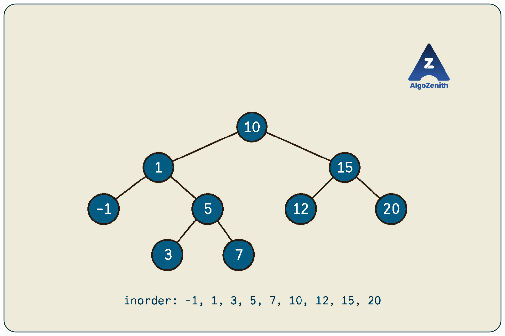
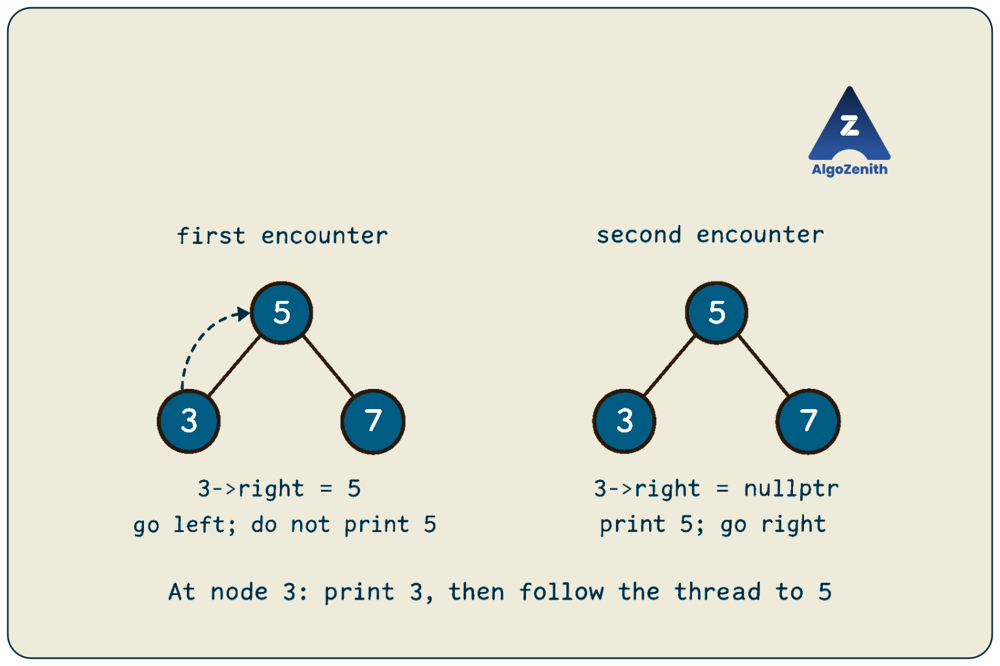
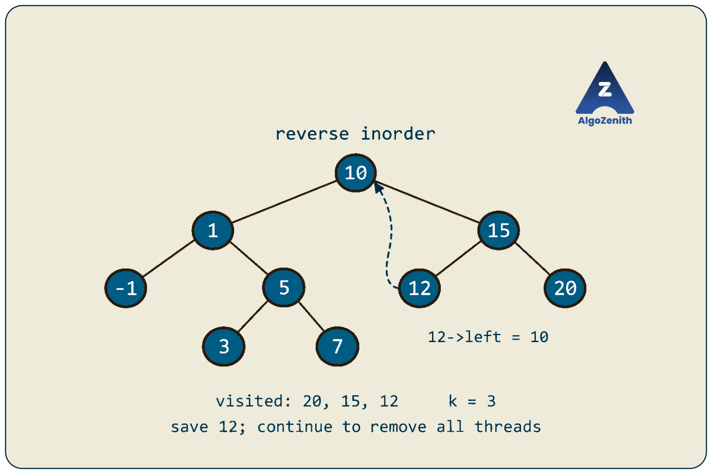

<VIDEO_WIDGET>

<VIDEO_ID></VIDEO_ID>

</VIDEO_WIDGET>

<READING_WIDGET>

# Morris Traversal: Inorder with Constant Extra Space

Inorder traversal follows a simple rule: **Left → Root → Right**. Recursion makes this easy because the call stack remembers which node to return to after finishing a left subtree.

Can we remember that return path without recursion or an explicit stack?

**Morris traversal temporarily uses otherwise-null child pointers as return links.** These links let us come back to a node after processing its left subtree. We remove each temporary link when it has served its purpose, restoring the original tree.

Following the lecture, we will move from recursion to the need for marking links, derive the Morris inorder algorithm, trace its execution, and explain its complexity. We will then adapt it for preorder and finding the kth largest element in a BST, and discuss what changes for postorder.

## 1. Problem Statement

Given the root of a binary tree, process its nodes in **inorder using `O(1)` auxiliary space**.

Assume that:

- The input is a finite binary tree with no cycles or shared child nodes.
- The tree may be empty, skewed, or contain repeated values.
- We may temporarily modify child pointers, but must restore every pointer before the traversal finishes.
- Node values must remain unchanged.

Let `n` be the number of nodes and `h` the height measured in nodes.

### What Counts as Extra Space?

The recursion stack counts as auxiliary space. Replacing recursion with an explicit stack also uses additional storage.

Our main implementation **prints values as they are visited**, so it does not store the traversal. It uses `O(1)` auxiliary space, excluding the output destination. If a platform requires a `vector<int>` result, that vector needs `O(n)` output storage; the traversal itself can still use `O(1)` auxiliary space beyond the result.

Morris traversal works on an ordinary binary tree. **A BST is needed only when we interpret inorder as sorted order**, such as in the kth-largest application later.

## 2. How Does Recursion Solve It?

All implementations in this lesson use C++17 and this shared node definition:

```cpp
#include <cstddef>
#include <iostream>
using namespace std;

struct Node {
    int data;
    Node* left;
    Node* right;

    Node(int value)
        : data(value), left(nullptr), right(nullptr) {}
};
```

The recursive solution is:

```cpp
void printInorderRecursive(Node* cur) {
    if (cur == nullptr) return;

    printInorderRecursive(cur->left);
    cout << cur->data << ' ';
    printInorderRecursive(cur->right);
}
```

When we call `printInorderRecursive(cur->left)`, the current function call pauses. Its stack frame remembers `cur` and where execution should resume. After the left subtree finishes, execution returns to the print statement, then enters the right subtree.

This gives **`O(n)` time and `O(h)` auxiliary space**. A balanced tree has `h = O(log n)`, but a skewed tree can have `h = n`.

An iterative traversal with a stack stores the same pending ancestors explicitly. To reach constant auxiliary space, we need another way to encode those pending returns.

## 3. Running Example: Where Must We Return?

Use the nine-node shape shown in the lecture's marking-link discussion, with the values from its final BST example:



```text
              10
            /    \
           1      15
          / \    /  \
        -1   5  12  20
            / \
           3   7
```

Its inorder traversal is:

```text
-1, 1, 3, 5, 7, 10, 12, 15, 20
```

Start at `10`. We must finish its left subtree before printing `10`. The last node visited in that left subtree is `7`. Immediately after `7`, we need to return to `10`.

That suggests a temporary connection:

```text
Before: 7->right = nullptr
During: 7->right = node containing 10
After:  7->right = nullptr
```

The same idea applies inside smaller subtrees: after `-1`, return to `1`; after `3`, return to `5`; after `12`, return to `15`.

These connections are called **threads**, or **marking links** in the lecture. They are temporary return paths, not new tree edges that should remain in the result.

## 4. The Concept of Marking Links

### Which Node Should Point Back to `cur`?

If `cur` has a left subtree, its **inorder predecessor** is the rightmost node in that left subtree. Starting from `cur->left`, keep following right children.

Call this node `pred`. It is the last node processed before `cur` in inorder. Its original right pointer is null; otherwise, it would not be the rightmost node.

Therefore, we can temporarily set:

```cpp
pred->right = cur;
```

This borrows a null pointer without overwriting an original child link. The predecessor need not be a leaf: it may have a left child. Only its original **right** pointer must be null.


### How Do We Distinguish the First and Second Encounters?

A node with a left child is reached twice as `cur`:

1. **First encounter:** its left subtree still needs processing. Create the thread and go left.
2. **Second encounter:** we have returned through the thread after finishing that left subtree. Remove the thread, process the node, and go right.

The thread itself stores this state. We do not need a visited array, hash set, or extra flag in each node.

| Predecessor's right pointer | Meaning | Action |
| --- | --- | --- |
| `nullptr` | Marking link is inactive; first encounter | Set it to `cur`, then go left |
| `cur` | Marking link is active; second encounter | Reset it to `nullptr`, process `cur`, then go right |

### Finding the Predecessor Safely

Once a thread exists, blindly following right pointers until null would continue past the predecessor. We must stop at either a null pointer **or a link back to `cur`**:

```cpp
Node* pred = cur->left;
while (pred->right != nullptr && pred->right != cur) {
    pred = pred->right;
}
```

`pred` starts at a non-null left child, and the loop advances only through non-null right pointers. The comparison `pred->right != cur` compares **node addresses**, not values. Repeated values do not affect the algorithm.

## 5. Morris Inorder: The Three Cases

Keep a pointer `cur`, initially at the root. Repeat while it is non-null.

### Case 1: `cur` Has No Left Child

There is no left subtree to finish, so process `cur` immediately and move right.

```text
Process cur
cur = cur->right
```

The right pointer may be an original child pointer or a temporary thread. Either way, it leads to the next place the traversal needs to reach.

### Case 2: `cur` Has a Left Child and No Active Thread

Find its inorder predecessor. If `pred->right == nullptr`, create the return link and move left.

```text
pred->right = cur
cur = cur->left
```

Do **not** process `cur` yet: inorder requires its left subtree first.

### Case 3: `cur` Has a Left Child and an Active Thread

If `pred->right == cur`, the left subtree is complete. Remove the thread, process `cur`, and move right.

```text
pred->right = nullptr
Process cur
cur = cur->right
```

Restoring the pointer is part of the algorithm. Merely printing the correct sequence is not sufficient if the tree is left with temporary links.



### C++ Implementation

```cpp
void printInorderMorris(Node* root) {
    Node* cur = root;

    while (cur != nullptr) {
        if (cur->left == nullptr) {
            cout << cur->data << ' ';
            cur = cur->right;
        } else {
            Node* pred = cur->left;
            while (pred->right != nullptr && pred->right != cur) {
                pred = pred->right;
            }

            if (pred->right == nullptr) {
                // First encounter: arrange a return after the left subtree.
                pred->right = cur;
                cur = cur->left;
            } else {
                // Second encounter: restore the tree before processing cur.
                pred->right = nullptr;
                cout << cur->data << ' ';
                cur = cur->right;
            }
        }
    }
}
```

The code uses only two moving pointers, `cur` and `pred`. It allocates no nodes and uses no recursion.

## 6. Dry Run: Creating, Following, and Removing Threads

Each row represents one iteration of the outer loop. Values identify nodes in this example because all nine values are distinct.

| Step | `cur` | Action | Value printed | Next `cur` |
| --- | --- | --- | --- | --- |
| 1 | `10` | Find predecessor `7`; create `7->right = 10` | — | `1` |
| 2 | `1` | Find predecessor `-1`; create `-1->right = 1` | — | `-1` |
| 3 | `-1` | No left child; process and follow its thread | `-1` | `1` |
| 4 | `1` | Remove `-1->right = 1`; process and go right | `1` | `5` |
| 5 | `5` | Find predecessor `3`; create `3->right = 5` | — | `3` |
| 6 | `3` | No left child; process and follow its thread | `3` | `5` |
| 7 | `5` | Remove `3->right = 5`; process and go right | `5` | `7` |
| 8 | `7` | No left child; process and follow its thread | `7` | `10` |
| 9 | `10` | Remove `7->right = 10`; process and go right | `10` | `15` |
| 10 | `15` | Find predecessor `12`; create `12->right = 15` | — | `12` |
| 11 | `12` | No left child; process and follow its thread | `12` | `15` |
| 12 | `15` | Remove `12->right = 15`; process and go right | `15` | `20` |
| 13 | `20` | No left child; process and move to null | `20` | `nullptr` |

The output is:

```text
-1 1 3 5 7 10 12 15 20
```

At step 9, the predecessor search starts again at `1`, follows the original right links to `5` and then `7`, and stops because `7->right == cur`. It does not follow that thread during the search.

All four created threads are removed by the end. Every original child pointer has its initial value again.

## 7. Why Is the Algorithm Correct?

The key invariant is: **an active thread from a predecessor to a node records a pending return after that node's left subtree**. Original non-null child links are preserved.

Consider a node `x`.

- **If `x` has no left child**, there is nothing that must precede it within its own subtree. We process it and continue right.
- **If `x` has a left child**, its first encounter creates a return link and enters that left subtree without processing `x`. The same rules process the left subtree in inorder. Its final node is `x`'s predecessor, whose thread brings us back to `x`. At this second encounter, we remove the thread, process `x` exactly once, and enter its right subtree.

Thus, every subtree is processed in **Left → Root → Right** order. A node with a left child is encountered twice but printed only on the second encounter; a node without a left child is encountered and printed once.

Each thread replaces an originally null pointer. Its second encounter sets that pointer back to null. Since all pending returns are completed before normal termination, the original tree is restored.

## 8. Time and Space Complexity

### Why Doesn't the Nested Loop Make It `O(n²)`?

An individual predecessor search may follow several right links, but we must count those traversals **across the whole algorithm**.

There are two types of work:

1. **Outer-loop work:** each node becomes `cur` once if it has no left child, or twice if it has a left child. This contributes `O(n)` iterations.
2. **Predecessor searches:** for each node with a left child, the right boundary of that left subtree is scanned twice—once to create its thread and once to remove it.

An original right edge can belong to only one such right-boundary path: trace upward along right-child edges, and the first left-child edge identifies the ancestor whose search uses that path. Consequently, each original right edge is followed by the inner loop at most twice overall.

Thread creation and removal each take constant time, and each thread is followed once to return. Adding these costs gives **`O(n)` total time**. For a nonempty tree, visiting all nodes also requires `Ω(n)` work, so the traversal is `Θ(n)`.

> **Interview insight:** “Every node is printed once” alone does not prove linear time. Explain why all predecessor searches together also take linear time.

### Why Is the Auxiliary Space `O(1)`?

The algorithm stores only a fixed number of pointers. Multiple threads can coexist, but they occupy existing pointer fields in the input tree; no extra collection is allocated.

| Approach | Time | Auxiliary space, excluding output | Temporarily changes tree links? |
| --- | --- | --- | --- |
| Recursive inorder | `O(n)` | `O(h)` | No |
| Inorder with an explicit stack | `O(n)` | `O(h)` | No |
| Morris inorder | `O(n)` | `O(1)` | Yes; restores them on completion |

The improvement is in auxiliary space, not in asymptotic running time.

## 9. Morris Preorder: Move the Processing Step

Preorder follows **Root → Left → Right**. We need the same return paths, but must process a node before entering its left subtree.

For a node with a left child, move the print statement from **thread removal** to **thread creation**. For a node without a left child, keep printing immediately.

| Situation | Inorder | Preorder |
| --- | --- | --- |
| No left child | Process, then go right | Process, then go right |
| Thread absent | Create thread, then go left | Process, create thread, then go left |
| Thread present | Remove thread, process, then go right | Remove thread, then go right |

### C++ Implementation

```cpp
void printPreorderMorris(Node* root) {
    Node* cur = root;

    while (cur != nullptr) {
        if (cur->left == nullptr) {
            cout << cur->data << ' ';
            cur = cur->right;
        } else {
            Node* pred = cur->left;
            while (pred->right != nullptr && pred->right != cur) {
                pred = pred->right;
            }

            if (pred->right == nullptr) {
                cout << cur->data << ' '; // Process before the left subtree.
                pred->right = cur;
                cur = cur->left;
            } else {
                pred->right = nullptr;
                cur = cur->right;
            }
        }
    }
}
```

For the running example:

```text
10 1 -1 5 3 7 15 12 20
```

The pointer operations are unchanged, so time remains `O(n)` and auxiliary space remains `O(1)`.

### Can We Also Do Postorder?

Yes, but moving the print statement alone is not enough. Postorder is **Left → Right → Root**. The second encounter in ordinary Morris inorder occurs after the left subtree, before the right subtree has been processed.

Two useful extensions are:

- **Store and reverse a sequence:** perform mirrored Morris preorder in **Root → Right → Left** order, collect the values, and reverse the vector to obtain **Left → Right → Root**. Traversal uses `O(1)` auxiliary space beyond the `O(n)` result vector, but this does not stream postorder with constant total working storage.
- **Reverse tree boundaries temporarily:** use a dummy root whose left child is the actual root. On each second encounter, reverse the right-pointer path from `cur->left` to its predecessor, process that boundary in reverse order, restore the path, and remove the thread. The dummy root ensures that the final boundary is processed too. With iterative path reversal, this achieves `O(n)` time and `O(1)` auxiliary space without a result vector.

The second method requires additional pointer manipulation and restoration. For this lesson, the central implementation is Morris inorder; preorder demonstrates the simple change in processing time, while postorder requires an additional technique.

## 10. Application: Kth Largest Element in a BST

The lecture ends with a natural application: find the **kth largest element of a BST using constant auxiliary space**.

Use **1-based indexing**. In our nine-node BST, the descending order is:

```text
20, 15, 12, 10, 7, 5, 3, 1, -1
```

For `k = 3`, the answer is `12`.

### Option 1: Count Nodes, Then Use Inorder

If the tree contains `n` nodes, the kth largest is the **`(n - k + 1)`th smallest**. The `+1` is necessary for 1-based ranks.

If `n` is unknown, one complete Morris traversal can count nodes, and a second can locate the required inorder rank. Two linear passes still take `O(n)` time and `O(1)` auxiliary space. Reject `k < 1` or `k > n` before using the rank formula.

### Option 2: Reverse Morris Inorder

We can avoid counting `n` by traversing **Right → Root → Left**, which visits BST nodes in descending order.

Mirror the inorder algorithm:

- If there is no right child, process the node and go left.
- Otherwise, find the **leftmost node of the right subtree**, called `succ`.
- If `succ->left` is null, set `succ->left = cur` and go right.
- If `succ->left == cur`, remove that thread, process `cur`, and go left.

### Do Not Return Immediately at the Kth Visit

Finding the answer does not imply that all threads have been removed.

In the example, reverse Morris first creates `12->left = 10`. When the third processed node is `12`, that thread still exists. Returning immediately would leave the original tree modified, with a cycle through `10`, `15`, and `12`.

**Save the answer and continue the traversal to restore all links.** The implementation below therefore runs in `O(n)` time even when `k` is small.



### C++ Implementation

```cpp
Node* kthLargestMorris(Node* root, long long k) {
    if (k <= 0) return nullptr;

    Node* cur = root;
    Node* answer = nullptr;

    while (cur != nullptr) {
        if (cur->right == nullptr) {
            if (answer == nullptr && --k == 0) {
                answer = cur;
            }
            cur = cur->left;
        } else {
            Node* succ = cur->right;
            while (succ->left != nullptr && succ->left != cur) {
                succ = succ->left;
            }

            if (succ->left == nullptr) {
                succ->left = cur;
                cur = cur->right;
            } else {
                succ->left = nullptr;
                if (answer == nullptr && --k == 0) {
                    answer = cur;
                }
                cur = cur->left;
            }
        }
    }

    return answer; // All temporary links have now been removed.
}
```

The counter decreases only when a node is processed and only until the answer is found. C++ short-circuit evaluation skips `--k` once `answer` is non-null. If there are fewer than `k` nodes, the function returns `nullptr` after completing and restoring the traversal.

Returning a pointer avoids using a value such as `-1` to signal failure, since `-1` may be a valid BST key. The returned pointer refers to an existing node; no new node is allocated.

For this application, assume a valid BST with distinct keys. If duplicates are allowed, clarify the rank definition: counting every processed node gives the kth value **with repetitions counted**. Finding the kth distinct value requires counting changes between consecutive values instead.

> **CP insight:** For one query with a strict constant-space requirement, reverse Morris is useful. For many kth-element queries on a changing BST, subtree-size augmentation in a balanced BST can support selection in `O(log n)` time per query, at the cost of maintained metadata.

## 11. Building and Running the Example

Combine the shared headers and `Node` definition with the three Morris functions above and this `main` to form a complete C++17 program:

```cpp
int main() {
    Node n10(10), n1(1), n15(15), minus1(-1), n5(5);
    Node n12(12), n20(20), n3(3), n7(7);

    n10.left = &n1;
    n10.right = &n15;
    n1.left = &minus1;
    n1.right = &n5;
    n5.left = &n3;
    n5.right = &n7;
    n15.left = &n12;
    n15.right = &n20;

    cout << "Inorder: ";
    printInorderMorris(&n10);
    cout << '\n';

    cout << "Preorder: ";
    printPreorderMorris(&n10);
    cout << '\n';

    Node* answer = kthLargestMorris(&n10, 3);
    if (answer != nullptr) {
        cout << "3rd largest: " << answer->data << '\n';
    }

    cout << "Inorder after all operations: ";
    printInorderMorris(&n10);
    cout << '\n';
}
```

Output, ignoring trailing spaces:

```text
Inorder: -1 1 3 5 7 10 12 15 20
Preorder: 10 1 -1 5 3 7 15 12 20
3rd largest: 12
Inorder after all operations: -1 1 3 5 7 10 12 15 20
```

The nodes are local objects that remain alive until `main` finishes. Do not call `delete` on them.

## 12. Edge Cases and Common Mistakes

| Case | Expected behavior |
| --- | --- |
| Empty tree | Print nothing; kth-largest returns `nullptr` |
| Single node | Process it once; rank `1` returns that node |
| Only right children | Inorder proceeds right without creating threads |
| Only left children | Create return threads while descending; remove them while returning |
| Repeated values | Traversal still processes each node once because thread checks compare addresses |
| Arbitrary non-BST tree | Inorder is correct but need not be sorted |
| `k <= 0` or `k > n` | Return `nullptr`; leave the tree unchanged |

The most common implementation errors are:

- **Stopping the predecessor search only at null.** Also stop when `pred->right == cur`, or an existing thread can lead the search outside the intended subtree.
- **Processing a node on both encounters.** Inorder processes it on thread removal; preorder processes it on thread creation.
- **Forgetting to remove a thread.** Restoring the original tree is part of correctness. Later traversals may otherwise loop or produce incorrect results.
- **Returning or breaking early.** Outstanding threads may remain even after the desired value is found. Record the result and complete cleanup.
- **Claiming a returned vector takes constant space.** Distinguish `O(1)` traversal workspace from `O(n)` output storage.
- **Treating Morris as a read-only traversal.** The final tree is restored, but intermediate pointer states are modified.

For verification, compare the output with a normal traversal and compare **every node's left and right pointers** before and after the operation. Checking output alone can miss a restoration bug.

## 13. Interview and Practical Insights

**Explain the missing return path before presenting code.** Recursion remembers where to resume after the left subtree; Morris puts that return address in the predecessor's unused right pointer. This explains both why the thread is placed there and why a second encounter means the left subtree is complete.

**Clarify whether temporary modification is allowed.** Morris is appropriate when child pointers are writable and we have exclusive access during traversal. A read-only tree or another reader that expects ordinary tree links throughout the operation may require a recursive or explicit-stack approach instead.

**Completion is part of the restoration guarantee.** The implementations assume processing runs to completion without throwing or aborting. A callback that throws, or an exception-enabled output stream that throws midway, can leave active threads behind. Adding arbitrary processing therefore requires considering how cleanup will complete.

**Do not delete nodes while traversing this way.** Other nodes may still contain temporary return links to them. Similarly, processing should not independently rewrite child pointers that the traversal relies on.

**Choose Morris for its space benefit.** It avoids recursion depth limits and traversal-stack storage, but performs extra pointer searches and writes. If `O(h)` memory is acceptable, an explicit stack is often simpler and supports stopping a kth-element search without restoring tree links.

## Quick Recap

- Inorder means **Left → Root → Right**; recursion normally remembers pending ancestors using `O(h)` stack space.
- Morris borrows the inorder predecessor's null right pointer as a temporary return link.
- No left child: process the node and go right.
- Inactive thread: create it and go left.
- Active thread: remove it, process the node, and go right.
- The full traversal takes **`O(n)` time and `O(1)` auxiliary space**, excluding stored output, and restores the tree.
- Preorder processes a node when creating its thread instead of when removing it.
- Reverse Morris visits BST values in descending order; save the kth answer and finish traversal to remove all threads.

</READING_WIDGET>
