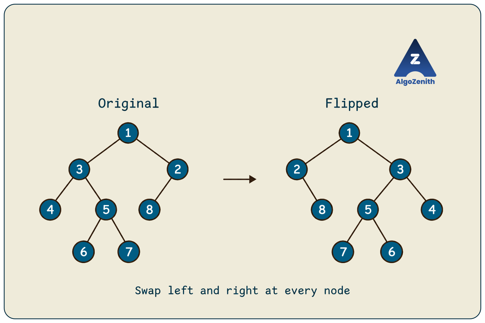
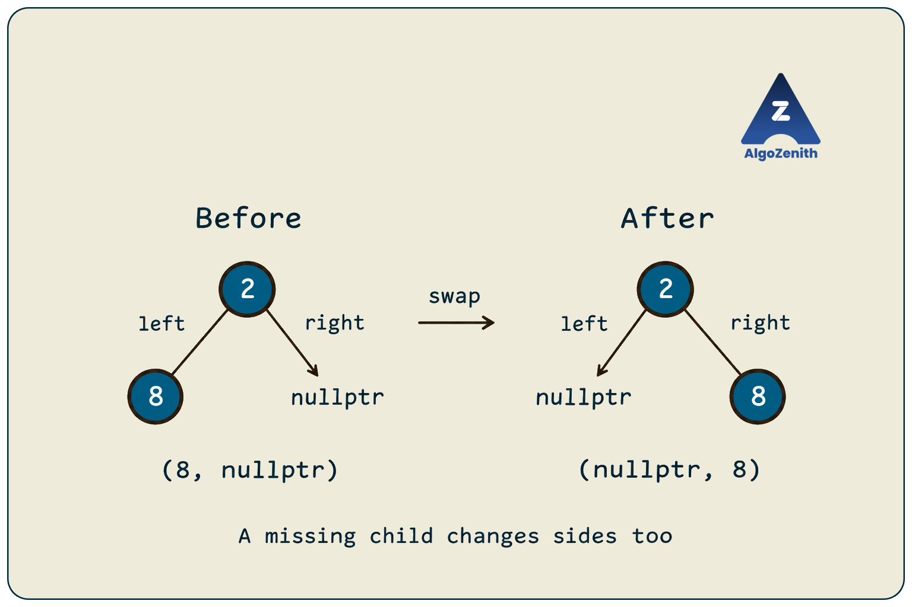

<VIDEO_WIDGET>

<VIDEO_ID></VIDEO_ID>

</VIDEO_WIDGET>

<READING_WIDGET>

# Flip a Binary Tree

To flip a binary tree, imagine placing a vertical mirror beside it. Every left branch becomes a right branch, and every right branch becomes a left branch, throughout the tree.

The key observation is local: **swap the left and right child pointers at every node**. Recursion lets us apply this same operation to the entire tree.

Following the lecture, we will examine small examples, build the recursive solution, and trace it on the full tree. We will also discuss its complexity and an iterative alternative for trees that are too deep for recursion.

## 1. Problem Statement

Given the root of a binary tree, **modify the tree in place to produce its lateral mirror image**. This operation is also called **inverting**, **mirroring**, or **flipping** a binary tree.

Assume that:

- The input is a finite binary tree with no cycles or shared child nodes.
- The tree may be empty, skewed, or contain repeated values.
- We may modify child pointers, but node values must remain unchanged.
- We must reuse the existing nodes rather than allocate a second tree.

The root remains the same node. Only the left and right positions of its descendants change.

Let `n` be the number of nodes and `h` the height measured in nodes. An empty tree has height `0`, and a leaf has height `1`.

### Running Example from the Lecture



```text
Original tree:                    Flipped tree:

        1                                1
       / \                              / \
      3   2                            2   3
     / \ /                              \ / \
    4  5 8                               8 5 4
      / \                                 / \
     6   7                               7   6
```

The required changes are:

| Node | Original `(left, right)` | After flipping `(left, right)` |
| --- | --- | --- |
| `1` | `(3, 2)` | `(2, 3)` |
| `3` | `(4, 5)` | `(5, 4)` |
| `2` | `(8, nullptr)` | `(nullptr, 8)` |
| `5` | `(6, 7)` | `(7, 6)` |
| `4`, `6`, `7`, `8` | `(nullptr, nullptr)` | `(nullptr, nullptr)` |

Here, the numbers identify the nodes in this example. The algorithm works equally well when multiple nodes store the same value.

## 2. Looking into the Changes

Start with the smallest tree that has two children:

```text
    1              1
   / \    ->      / \
  3   2          2   3
```

Swapping the root's child pointers completes the flip because both children are leaves.

Now add children below node `2`, as in the lecture's second example:


```text
    1                  1
   / \                / \
  3   2      ->      2   3
     / \            / \
    5   4          4   5
```

Swapping only the root's children moves the entire subtree rooted at `2` to the left. However, inside that subtree, `5` would still be the left child and `4` the right child. We must swap the children of node `2` as well.

This gives the general rule:

> **A complete mirror requires exchanging the two child pointers at every node, including nodes with only one child.**

For a one-child node, the missing position matters:



```text
    2              2
   /       ->       \
  8                  8
```

Its pair of child pointers changes from `(8, nullptr)` to `(nullptr, 8)`. A condition that swaps only when both children exist would fail here.

### Swap Links, Not Values

Swapping `cur->left` and `cur->right` exchanges references to **whole subtrees**. Every descendant remains attached to its subtree root.

Swapping the values stored in the two child nodes does not accomplish this. It leaves their descendants in the original positions and cannot handle a missing child safely without additional checks. The required operation changes the structure, not the data.

## 3. Building the Recursive Solution

Define the meaning of our function precisely:

```text
flip(cur): mirror the entire subtree rooted at cur, in place.
```

There are two cases.

### Base Case: Empty Subtree

If `cur == nullptr`, there is nothing to flip. Return immediately.

This check must happen before accessing `cur->left` or `cur->right`.

### Recursive Case: An Existing Node

1. Swap `cur->left` and `cur->right`.
2. Flip the subtree now referenced by `cur->left`.
3. Flip the subtree now referenced by `cur->right`.

After the swap, the new left child is the original right child, and the new right child is the original left child. The two recursive calls still process both original subtrees exactly once.

A leaf needs no separate condition. Swapping its two null pointers has no effect, and both recursive calls return immediately.

## 4. C++ Implementation

All code in this lesson uses C++17. Use the following shared headers and node definition:

```cpp
#include <iostream>
#include <stack>
#include <utility>
using namespace std;

struct Node {
    int data;
    Node* left;
    Node* right;

    Node(int value)
        : data(value), left(nullptr), right(nullptr) {}
};
```

The recursive solution follows the lecture directly:

```cpp
void flip(Node* cur) {
    if (cur == nullptr) return;

    swap(cur->left, cur->right);

    flip(cur->left);
    flip(cur->right);
}
```

`swap` exchanges the two pointer values. It does not copy the subtrees, allocate nodes, or change their stored values.

### Why Does Passing `Node*` Work?

Although `cur` is a local copy of a pointer, it points to an existing node. Assigning to `cur->left` or `cur->right` changes fields in that actual node, so the caller sees the modified tree.

We do not need a `Node*&` parameter because we do not replace the caller's root pointer. The existing root stays at the top of the mirrored tree.

If a coding platform expects the function to return the root, use a wrapper:

```cpp
Node* invertTree(Node* root) {
    flip(root);
    return root;
}
```

For an empty tree, this returns `nullptr`.

## 5. Dry Run on the Lecture's Tree

The implementation swaps first and then recursively visits the **new left subtree**, followed by the **new right subtree**.

| Step | Current node | Child pointers before swap | Child pointers after swap |
| --- | --- | --- | --- |
| 1 | `1` | `(3, 2)` | `(2, 3)` |
| 2 | `2` | `(8, nullptr)` | `(nullptr, 8)` |
| 3 | `8` | `(nullptr, nullptr)` | `(nullptr, nullptr)` |
| 4 | `3` | `(4, 5)` | `(5, 4)` |
| 5 | `5` | `(6, 7)` | `(7, 6)` |
| 6 | `7` | `(nullptr, nullptr)` | `(nullptr, nullptr)` |
| 7 | `6` | `(nullptr, nullptr)` | `(nullptr, nullptr)` |
| 8 | `4` | `(nullptr, nullptr)` | `(nullptr, nullptr)` |

The table omits calls on `nullptr`, which return immediately. For example, after swapping at node `2`, `flip(cur->left)` receives `nullptr`, and `flip(cur->right)` receives node `8`.

The non-null nodes are processed in this order:

```text
1, 2, 8, 3, 5, 7, 6, 4
```

This is a preorder-style solution because each node's swap occurs before its recursive calls. Since the pointers change before traversal continues, its processing order follows the mirrored child positions.

## 6. Why Is the Algorithm Correct?

We can prove correctness using the recursive structure of the tree.

**Base case:** An empty tree is already its own mirror, so returning is correct.

**Recursive step:** Suppose the two recursive calls correctly mirror their respective subtrees. Let the original left and right subtrees at the current node be `L` and `R`.

- Swapping child pointers places `R` on the left and `L` on the right.
- The first recursive call turns the new left subtree into `mirror(R)`.
- The second recursive call turns the new right subtree into `mirror(L)`.

The final structure is therefore:

```text
        cur
       /   \
 mirror(R) mirror(L)
```

This is exactly the mirror of the original subtree. Applying the same reasoning from the leaves to the root proves that the entire tree is flipped correctly.

### Can We Swap After the Recursive Calls?

Yes. We can first mirror the original left and right subtrees and then exchange their positions:

```cpp
void flipPostorder(Node* cur) {
    if (cur == nullptr) return;

    flipPostorder(cur->left);
    flipPostorder(cur->right);

    swap(cur->left, cur->right);
}
```

Both versions work because they mirror both subtrees once and swap the current node's children once. Use either version for a single flip; calling both consecutively would flip the tree twice.

## 7. Time and Space Complexity

### Time: `O(n)`

Every node performs one constant-time pointer swap. The recursive calls collectively visit every node once, with constant work for each null child position as well.

For a subtree whose left and right sides contain `nL` and `nR` nodes:

```text
T(n) = T(nL) + T(nR) + O(1)
nL + nR = n - 1
```

The total is `O(n)` for balanced and skewed trees alike.

### Auxiliary Space: `O(h)`

The recursive call stack follows a root-to-leaf path. The left and right calls run sequentially, so we count the maximum number of simultaneously active calls, not all calls made during execution.

- **Balanced tree:** `O(log n)` stack space.
- **Skewed tree:** `O(n)` stack space.
- **Empty tree:** `O(1)` time and space.

Although we modify the tree **in place**, this recursive implementation does not use constant auxiliary space. In place means we reuse the existing nodes; recursion still consumes memory.

## 8. Building and Running the Example

Combine the shared headers and `Node` definition with `flip` and the following code to form a complete C++17 program:

```cpp
void printPreorder(Node* cur) {
    if (cur == nullptr) {
        cout << "# ";
        return;
    }

    cout << cur->data << ' ';
    printPreorder(cur->left);
    printPreorder(cur->right);
}

int main() {
    Node n1(1), n2(2), n3(3), n4(4);
    Node n5(5), n6(6), n7(7), n8(8);

    n1.left = &n3;
    n1.right = &n2;
    n3.left = &n4;
    n3.right = &n5;
    n2.left = &n8;
    n5.left = &n6;
    n5.right = &n7;

    Node* root = &n1;

    cout << "Before: ";
    printPreorder(root);
    cout << '\n';

    flip(root);

    cout << "After: ";
    printPreorder(root);
    cout << '\n';

    flip(root);

    cout << "Restored: ";
    printPreorder(root);
    cout << '\n';
}
```

Output, ignoring trailing spaces:

```text
Before: 1 3 4 # # 5 6 # # 7 # # 2 8 # # #
After: 1 2 # 8 # # 3 5 7 # # 6 # # 4 # #
Restored: 1 3 4 # # 5 6 # # 7 # # 2 8 # # #
```

`#` represents a missing child. Including these markers makes the tree's shape visible: `2 8 # # #` describes node `2` with a left child `8`, while `2 # 8 # #` describes it with a right child `8`.

The second flip restores the original structure because each pair of child pointers is exchanged a second time.

These nodes are local objects that remain alive until `main` finishes. They are destroyed automatically; do not call `delete` on them.

## 9. Iterative Alternative for Deep Trees

The recursive solution is the lecture's main approach. If the tree can form a very long chain, an explicit stack avoids depending on the program's recursion limit.

```cpp
void flipIterative(Node* root) {
    if (root == nullptr) return;

    stack<Node*> pending;
    pending.push(root);

    while (!pending.empty()) {
        Node* cur = pending.top();
        pending.pop();

        swap(cur->left, cur->right);

        // Push right first so the new left child is processed first.
        if (cur->right != nullptr) pending.push(cur->right);
        if (cur->left != nullptr) pending.push(cur->left);
    }
}
```

This performs the same swaps in the same non-null processing order as the recursive version. Each node is pushed and popped once, giving **`O(n)` time**.

The explicit DFS stack uses **`O(h)` auxiliary space as an upper bound**: it stores pending sibling subtrees along the current descent. Its occupancy can be smaller than the recursive call stack; for a simple chain, it holds at most one node at a time. The general worst-case bound over binary trees is still `O(n)`.

A queue-based breadth-first traversal is another valid alternative: remove a node, swap its children, and enqueue each non-null child. Its auxiliary space is `O(w)`, where `w` is the maximum number of nodes on any level.

> **CP insight:** Check the maximum possible height, not just whether the tree is usually balanced. For a large skewed input, iterative traversal avoids call-stack overflow while keeping the same linear running time.

## 10. Edge Cases and Common Mistakes

| Case | Expected behavior |
| --- | --- |
| Empty tree | Return immediately |
| Single node | Both child pointers remain null |
| Only a left child | That child becomes the right child |
| Only a right child | That child becomes the left child |
| Left-only chain | Becomes a right-only chain |
| Repeated values | Flip links normally; values do not affect the algorithm |
| Tree flipped twice | Every original child pointer is restored |

Watch for these implementation mistakes:

- **Swapping only at the root.** This exchanges the two top-level subtrees but leaves their internal orientations unchanged.
- **Requiring both children to exist.** A single child must also move to the opposite side.
- **Swapping child values.** This does not exchange the subtrees and may dereference a null child.
- **Overwriting a pointer before saving it.** The assignments `cur->left = cur->right; cur->right = cur->left;` make both fields equal to the original right pointer. Use `swap` or a temporary pointer.
- **Putting the swap between the two usual recursive calls.** In `flip(cur->left); swap(cur->left, cur->right); flip(cur->right);`, the final call follows the original left subtree again. The original right subtree is never flipped. Place the swap before both calls or after both calls.
- **Claiming recursion takes `O(1)` space.** Include the active call stack in the space analysis.

## 11. Interview Insights

**Clarify what “flip” means.** This lesson mirrors the whole tree from left to right. Some problems use “flip” for exchanging children at selected nodes or for turning a tree upside down. Those are different specifications.

**Explain the recursive contract before writing code.** “This function mirrors the subtree rooted at `cur`” makes the base case, child swap, and two recursive calls easy to justify.

**Mirroring preserves several structural properties.** The root, node count, node values, each node's depth, and the tree's height remain unchanged. Each node also keeps the same parent; only its left/right position changes. Existing parent pointers and subtree-size metadata therefore remain valid for this operation.

**Mirroring generally breaks ordinary BST ordering.** In a BST with distinct keys, smaller values originally lie on the left. After mirroring, they lie on the right, so the usual BST search rule no longer applies. The resulting inorder traversal is descending rather than ascending.

**Flipping twice is a useful check, but is not sufficient alone.** A function that does nothing also leaves the tree unchanged after two calls. Verify the expected mirrored child pointers after the first call, then verify restoration after the second. Include a one-child node and an asymmetric subtree in your tests.

## Quick Recap

- Flipping a binary tree means producing its lateral mirror image.
- Swap the left and right **child pointers at every node**.
- Return immediately for `nullptr`; a leaf needs no separate case.
- Swap before both recursive calls or after both recursive calls.
- The recursive solution takes **`O(n)` time and `O(h)` auxiliary space**.
- An explicit stack avoids deep recursion; a queue also works.
- Applying the operation twice restores the original tree.

</READING_WIDGET>
