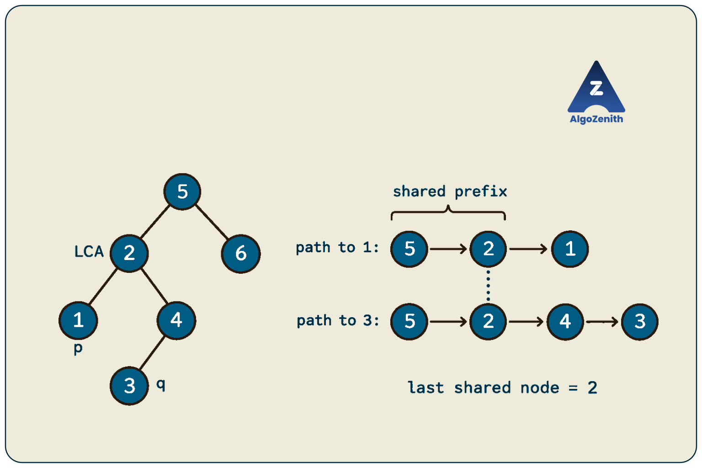
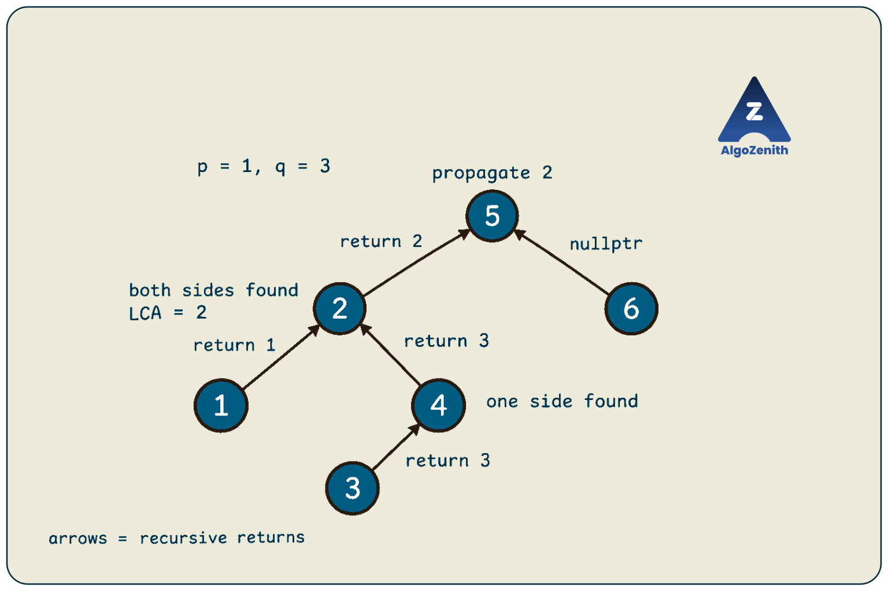
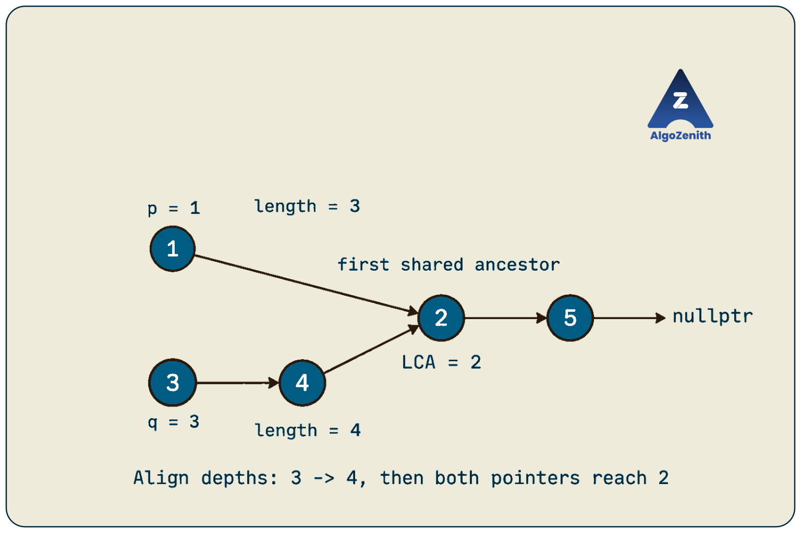
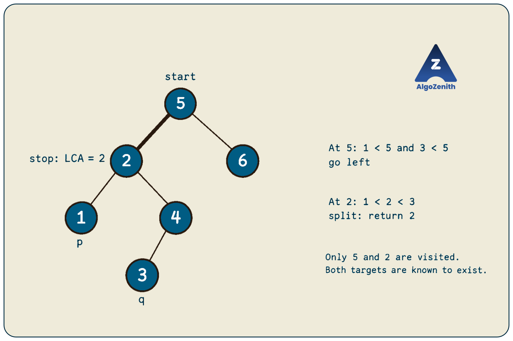
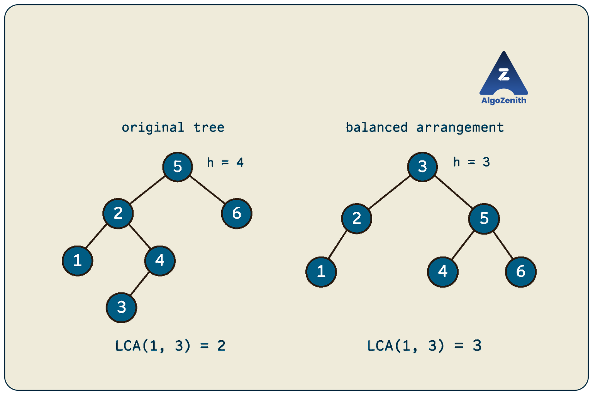

<VIDEO_WIDGET>

<VIDEO_ID></VIDEO_ID>

</VIDEO_WIDGET>

<READING_WIDGET>

# Lowest Common Ancestor of a Binary Tree

Two nodes in a tree may lie in different branches, or one may lie below the other. Their **lowest common ancestor (LCA)** is the deepest node whose subtree contains both of them.

The question stays the same across this lesson, but the information available to us changes. With only child pointers, we search from the root. With parent pointers, we walk upward. In a binary search tree, ordering lets us choose one branch at a time. If that BST is balanced, its small height gives us a logarithmic time bound.

Following the lecture, we will work through these four variants and explain exactly where their time and space complexities come from.

## 1. Problem Statement and Conventions

Given two nodes `p` and `q`, return a pointer to their **lowest common ancestor** in a rooted tree.

An ancestor lies on the path from the root to a node. For LCA problems, **a node is considered an ancestor of itself**. Therefore:

- If `p` is an ancestor of `q`, their LCA is `p`.
- If `p == q`, their LCA is that same node.
- The LCA may be the root, an internal node, or one of the query nodes.

“Lowest” means **greatest depth**, not smallest stored value.

Assume that:

- The input is a finite tree with no cycles or shared child nodes.
- We must return an existing node without modifying the tree.
- Queries identify nodes by their addresses. General binary trees may contain repeated values.
- The main algorithms assume both query nodes belong to the tree, except where we explicitly handle missing nodes or separate trees.
- The BST variants use **distinct keys** and the strict smaller-on-the-left, larger-on-the-right rule.

Let `n` be the number of nodes and `h` the height measured in nodes. An empty tree has height `0`, and a leaf has height `1`. Auxiliary space excludes the input tree but includes recursion stacks and temporary containers. Empty or null-query inputs return immediately in the implementations below.

### Running Example from the Lecture

```text
        5
       / \
      2   6
     / \
    1   4
       /
      3
```

For nodes `1` and `3`:

```text
Root-to-1 path: 5 -> 2 -> 1
Root-to-3 path: 5 -> 2 -> 4 -> 3
Common ancestors: 5, 2
Lowest common ancestor: 2
```

Node `5` is a common ancestor, but node `2` is deeper and still contains both targets in its subtree.



| Query | LCA | Reason |
| --- | --- | --- |
| `1`, `3` | `2` | Their paths separate below `2` |
| `3`, `6` | `5` | They belong to opposite subtrees of the root |
| `4`, `3` | `4` | Node `4` is an ancestor of `3` |
| `2`, `2` | `2` | A node is its own ancestor |

The pictured tree also happens to satisfy BST ordering. In the general binary-tree variant, however, we cannot use that property unless the problem guarantees it.

## 2. Variant 1: A Normal Binary Tree

We are given `root`, `p`, and `q`. Each node has only left and right child pointers; there is no ordering guarantee.

### Approach 1: Store Both Root-to-Node Paths

The lecture's two path columns suggest a direct solution:

1. Find the path from the root to `p`.
2. Find the path from the root to `q`.
3. Compare the paths from their beginnings.
4. Return the **last matching node before they diverge**, or before one path ends.

Root-to-node paths share a prefix. Once they diverge, they cannot meet again: a node in a tree has only one parent and one path from the root.

For our query:

| Index | Path to `1` | Path to `3` | Result |
| --- | --- | --- | --- |
| 0 | `5` | `5` | Common ancestor so far: `5` |
| 1 | `2` | `2` | Deeper common ancestor: `2` |
| 2 | `1` | `4` | Paths diverge; return `2` |

If we query `4` and `3`, the first path ends at `4` while all its nodes still match the second path. The last match is `4`, which correctly handles the ancestor case.

### Building a Path with Backtracking

During depth-first search, keep a vector containing the path to the current node:

- Push the current node when entering it.
- If it is the target, keep the path and return success.
- Otherwise, search its children.
- If neither child leads to the target, pop the current node before returning failure.

The pop is essential. A failed branch must not remain in the path used by the next branch.

### Shared Headers and Node Definition

All code in this lesson uses C++17. The child-pointer algorithms use this definition:

```cpp
#include <iostream>
#include <vector>
using namespace std;

struct Node {
    int data;
    Node* left;
    Node* right;

    Node(int value)
        : data(value), left(nullptr), right(nullptr) {}
};
```

### C++ Implementation

```cpp
bool findPath(Node* cur, Node* target, vector<Node*>& path) {
    if (cur == nullptr) return false;

    path.push_back(cur);

    if (cur == target) return true;

    if (findPath(cur->left, target, path) ||
        findPath(cur->right, target, path)) {
        return true;
    }

    path.pop_back();
    return false;
}

Node* lcaByPaths(Node* root, Node* p, Node* q) {
    if (root == nullptr || p == nullptr || q == nullptr) {
        return nullptr;
    }

    vector<Node*> pathP, pathQ;
    if (!findPath(root, p, pathP) || !findPath(root, q, pathQ)) {
        return nullptr;
    }

    Node* answer = nullptr;
    for (size_t i = 0; i < pathP.size() && i < pathQ.size(); ++i) {
        if (pathP[i] != pathQ[i]) break;
        answer = pathP[i];
    }

    return answer;
}
```

`vector<Node*>&` passes the vector by reference, so recursive calls update the same path instead of copying it. The `||` operator short-circuits: if the left search succeeds, the right search is not performed and the successful path remains intact.

We compare **node pointers**, not `data`. Two different nodes containing the same value are not the same ancestor. This implementation also returns `nullptr` if either target is absent from the tree.

### Complexity

Each path search visits at most `n` nodes. Comparing the paths takes at most `O(h)` time:

```text
O(n) + O(n) + O(h) = O(n)
```

The searches run one after the other; their costs add rather than multiply.

Each stored path contains at most `h` nodes, and recursion uses at most `O(h)` stack space. Together, the auxiliary space is **`O(h)`**.

- **General worst case:** `O(n)` time and `O(n)` auxiliary space, as shown in the lecture.
- **Height-balanced binary tree:** still `O(n)` worst-case time, but `O(log n)` auxiliary space.

Even when the final path is short, finding it in an unordered tree may require exploring many unsuccessful branches.

## 3. Variant 1 Follow-Up: Return the Answer Through Recursion

The path method makes the definition visible. A common interview follow-up is to find the LCA without explicitly storing both paths.

For a subtree rooted at `cur`, return:

- `nullptr` if neither target occurs in that subtree.
- The target node if exactly one target occurs there.
- Their LCA if both occur there.

When `p == q`, finding that node satisfies both targets.

### How to Combine the Child Results

First, if `cur` is null, return null. If `cur` equals either target, return `cur`: under the assumption that both targets exist in the overall tree, it will either be their LCA or the target pointer needed by an ancestor.

Otherwise, search both subtrees:

| Left result | Right result | What to return |
| --- | --- | --- |
| Null | Null | `nullptr` |
| Non-null | Null | Left result |
| Null | Non-null | Right result |
| Non-null | Non-null | `cur` |

If both sides return a result, one target lies on each side. No descendant of `cur` can contain both, so `cur` is their lowest common ancestor.

If only one side returns a result, propagate it. That result may be one target or an LCA already found deeper in that side.

### C++ Implementation

```cpp
Node* lcaRecursive(Node* root, Node* p, Node* q) {
    if (root == nullptr || p == nullptr || q == nullptr) {
        return nullptr;
    }

    if (root == p || root == q) return root;

    Node* left = lcaRecursive(root->left, p, q);
    Node* right = lcaRecursive(root->right, p, q);

    if (left != nullptr && right != nullptr) return root;
    return left != nullptr ? left : right;
}
```

For `1` and `3`, node `1` returns itself, and node `3` returns itself through node `4`. Node `2` receives a non-null result from both children and returns itself. At node `5`, the left result is `2` and the right result is null, so `2` remains the answer.



### Complexity and the Missing-Node Caveat

This method takes **`O(n)` worst-case time** and **`O(h)` auxiliary space** for recursion. Removing the path vectors reduces stored information, but does not remove the call stack or change the asymptotic space bound.

**The compact recursive algorithm assumes both targets exist.** If `p` exists but `q` does not, it can return `p` without proving that `q` was found. Similarly, stopping at `p` does not verify whether `q` exists below it.

If absence is allowed, use the path implementation above, which verifies both targets. Another option is to check membership before calling this recursive function; a constant number of full-tree traversals still takes `O(n)` time.

## 4. Variant 2: A Binary Tree with Parent Pointers

Now every node also has a pointer to its parent, and the root's parent is `nullptr`. We are given `p` and `q`; we do not need the root pointer.

Reverse the direction of the paths from the lecture:

```text
From 1: 1 -> 2 -> 5 -> nullptr
From 3: 3 -> 4 -> 2 -> 5 -> nullptr
```

Each parent chain behaves like a singly linked list, with `parent` taking the role of `next`. Once the chains meet, they share every remaining ancestor up to the root.

Therefore, **the LCA is the first intersection node of the two parent chains**. This is the same technique developed in [Finding the Intersection Node of Two Linked Lists](../Linked%20List/Atomic%20Techniques/1_Technique_1.md).

Assume the parent links correctly describe finite, acyclic chains. The implementations below also return `nullptr` if the nodes belong to separate trees.

### Approach 1: Align the Chain Lengths

1. Count the nodes from `p` to its root, including both endpoints.
2. Count the nodes from `q` to its root.
3. Move the pointer on the longer chain upward by the difference.
4. Move both pointers upward together until they match.

Counting nodes to the root gives `depth + 1`, so the difference is also the difference in depths.

For `1` and `3`, the chain lengths are `3` and `4`. Move the second pointer once, from `3` to `4`. The pointers now sit at equal depth. One paired move takes both to `2`.



### C++ Implementation

Use a separate node type for this variant:

```cpp
struct ParentNode {
    int data;
    ParentNode* left;
    ParentNode* right;
    ParentNode* parent;

    ParentNode(int value)
        : data(value), left(nullptr), right(nullptr), parent(nullptr) {}
};

int chainLength(ParentNode* cur) {
    int length = 0;
    while (cur != nullptr) {
        ++length;
        cur = cur->parent;
    }
    return length;
}

ParentNode* lcaByParentDepth(ParentNode* p, ParentNode* q) {
    if (p == nullptr || q == nullptr) return nullptr;

    int lengthP = chainLength(p);
    int lengthQ = chainLength(q);

    while (lengthP > lengthQ) {
        p = p->parent;
        --lengthP;
    }
    while (lengthQ > lengthP) {
        q = q->parent;
        --lengthQ;
    }

    while (p != q) {
        p = p->parent;
        q = q->parent;
    }

    return p;
}
```

After alignment, both pointers have equal remaining chain lengths. They either meet at their first common ancestor or reach `nullptr` together if their trees are separate. Thus, the paired loop never dereferences one null pointer while the other is still non-null. The counters assume the chain lengths fit in an `int`.

### Approach 2: Switch Starting Nodes

We can also apply the linked-list head-switching method directly:

```cpp
ParentNode* lcaByParentSwitching(ParentNode* p, ParentNode* q) {
    if (p == nullptr || q == nullptr) return nullptr;

    ParentNode* a = p;
    ParentNode* b = q;

    while (a != b) {
        a = (a == nullptr) ? q : a->parent;
        b = (b == nullptr) ? p : b->parent;
    }

    return a;
}
```

Each pointer traverses the parent chains in the opposite order. This cancels their initial length difference and aligns their arrival at the first shared ancestor. Switching changes only a local pointer; it does not modify any parent link.

For the running query, the positions after each iteration are:

```text
a: 1 -> 2 -> 5 -> null -> 3 -> 4 -> 2
b: 3 -> 4 -> 2 -> 5    -> null -> 1 -> 2
```

### Complexity

If the two starting chains contain `a` and `b` nodes, either approach takes **`O(a + b)` time** and **`O(1)` auxiliary space**. In one tree, both chain lengths are at most `h`, so this is **`O(h)` time**.

- A skewed tree gives `O(n)` worst-case time, matching the lecture's bound.
- A height-balanced tree gives `O(log n)` time, even without BST ordering, because parent pointers already provide the upward routes.

The parent pointers are part of this variant's input. If we are given only child pointers and first construct a parent map, that preprocessing takes `O(n)` time and `O(n)` additional space. It must not be hidden inside an `O(1)`-space claim.

## 5. Variant 3: A Binary Search Tree

We are again given `root`, `p`, and `q`, but now the tree is guaranteed to be a BST with distinct keys, and both targets are present.

At a current node `cur`:

- If both target values are smaller, both targets lie in its left subtree. Move left.
- If both are larger, both lie in its right subtree. Move right.
- Otherwise, the targets lie on opposite sides, or `cur` equals one of them. Return `cur`.

The answer is the **first split point**, including equality with a target.

### Dry Run: LCA of `1` and `3`

Use the original lecture tree:

| Current node | Comparison | Action |
| --- | --- | --- |
| `5` | `1 < 5` and `3 < 5` | Move left to `2` |
| `2` | `1 < 2` and `3 > 2` | Targets split; return `2` |

We do not need to visit nodes `1` or `3`. The ordering guarantee already tells us which subtrees contain them.



For `4` and `3`, we move from `5` to `2`, then to `4`. Equality with one target makes `4` the answer.

### C++ Implementation

Use the original `Node` definition:

```cpp
Node* lcaBST(Node* root, Node* p, Node* q) {
    if (p == nullptr || q == nullptr) return nullptr;

    Node* cur = root;
    while (cur != nullptr) {
        if (p->data < cur->data && q->data < cur->data) {
            cur = cur->left;
        } else if (p->data > cur->data && q->data > cur->data) {
            cur = cur->right;
        } else {
            return cur;
        }
    }

    return nullptr;
}
```

### Why Is the First Split Point Correct?

Whenever both targets lie on the same side, that child subtree contains both. Its root is already a deeper common ancestor than the current node, so the current node cannot be the LCA.

At a split, neither child subtree contains both targets. The current node is a common ancestor, and no descendant can be one. If the current node is itself a target, no proper descendant can be an ancestor of that target, so equality also gives the LCA.

### Complexity and Assumptions

The loop follows one downward path, with constant work per visited node:

- **Time:** `O(h)`.
- **Auxiliary space:** `O(1)` because the implementation is iterative.
- **Worst case for an ordinary BST:** `O(n)` time when the tree is skewed.

A recursive implementation follows the same path but uses `O(h)` call-stack space.

**Reaching a split does not prove both targets exist.** For example, in the lecture tree, queries with keys `0` and `6` would split at `5`, even though `0` is absent. If presence is not guaranteed, search for both targets first. With distinct keys and pointer-based queries, verify that each search returns the exact supplied pointer. Two searches plus the LCA walk still take `O(h)` time and `O(1)` auxiliary space iteratively.

If duplicate keys are allowed, comparisons by value alone may not distinguish the requested nodes. Establish the duplicate policy and node identity requirements before adapting this algorithm; the general binary-tree method remains valid without key uniqueness.

## 6. Variant 4: A Balanced Binary Search Tree

A balanced BST adds a height guarantee to BST ordering. Under the height-balance convention from the earlier lesson, the left and right subtree heights differ by at most `1` **at every node**. Such a tree has `h = O(log n)` height for nontrivial inputs.

**The LCA algorithm does not change.** Use the same iterative `lcaBST` function. Only the bound on the number of steps improves:

```text
BST LCA time:          O(h)
Balanced BST height:  O(log n)
Balanced BST LCA time: O(log n)
Auxiliary space:      O(1)
```

### A Separate Balanced Example

The lecture's original six-node tree is not height-balanced: at root `5`, the left subtree has height `3` and the right subtree has height `1`.

For this final variant, consider the same keys in a balanced arrangement:

```text
        3
       / \
      2   5
     /   / \
    1   4   6
```

For `1` and `4`, the search stops immediately at `3`, where the values split. For `4` and `6`, it moves right to `5`, then returns `5`.

This is a different tree, so some LCA answers also change. In the original tree, the LCA of `1` and `3` was `2`; in this balanced arrangement, it is `3`. **LCA depends on the tree's structure as well as the target nodes.**



### Balance and Ordering Play Different Roles

BST ordering lets us discard one subtree at each step. Balance bounds the length of the remaining path. Both are needed for the logarithmic downward-search guarantee.

A balanced **binary tree without ordering or parent pointers** still needs `O(n)` worst-case time for the general LCA methods. A short height does not tell us which branch contains a target.

The logarithmic bound assumes the balanced BST is already given. Building or validating it is separate work. Do not rebalance an arbitrary input just to answer an LCA query: changing its structure can change the answer.

## 7. Building and Running the Lecture Example

Combine the shared headers and `Node` definition with `findPath`, `lcaByPaths`, `lcaRecursive`, `lcaBST`, and this `main` to form a complete C++17 program:

```cpp
int main() {
    Node n1(1), n2(2), n3(3), n4(4), n5(5), n6(6);

    n5.left = &n2;
    n5.right = &n6;
    n2.left = &n1;
    n2.right = &n4;
    n4.left = &n3;

    Node* root = &n5;
    Node* p = &n1;
    Node* q = &n3;

    Node* byPaths = lcaByPaths(root, p, q);
    Node* byRecursion = lcaRecursive(root, p, q);
    Node* byOrdering = lcaBST(root, p, q);

    if (byPaths != nullptr) {
        cout << "Path method: " << byPaths->data << '\n';
    }
    if (byRecursion != nullptr) {
        cout << "Recursive method: " << byRecursion->data << '\n';
    }
    if (byOrdering != nullptr) {
        cout << "BST method: " << byOrdering->data << '\n';
    }

    return 0;
}
```

Output:

```text
Path method: 2
Recursive method: 2
BST method: 2
```

All three methods return the same existing node. The BST method is applicable here because this particular example satisfies BST ordering.

For a parent-pointer version, build the same links using `ParentNode` and set each child's `parent` to the node that owns it. For example, after `n2.left = &n1`, set `n1.parent = &n2`. Leave the root's parent null. Both parent-pointer functions then return the `ParentNode` representing `2` for the same query.

The example uses local objects that remain alive until `main` finishes. No node is allocated with `new`, and none should be passed to `delete`.

## 8. Comparing the Variants

The following bounds describe a single query on an already constructed, nonempty tree. The two parent chains are assumed to belong to that tree.

| Input and approach | Time | Auxiliary space | What makes it work? |
| --- | --- | --- | --- |
| General binary tree: two root paths | `O(n)` | `O(h)` | Last node of the common prefix |
| General binary tree: recursive returns | `O(n)` | `O(h)` | Combine target information from both sides |
| Parent pointers: depth alignment or switching | `O(h)` | `O(1)` | First intersection of upward chains |
| Ordinary BST: iterative split search | `O(h)` | `O(1)` | Both smaller, both larger, or split |
| Balanced BST: same iterative search | `O(log n)` | `O(1)` | BST ordering plus logarithmic height |

For an arbitrary tree or ordinary BST, `h` can be `n`. This explains the lecture's general bounds of `O(n)` time with `O(n)` space for stored paths, and `O(n)` time with `O(1)` space for the parent-pointer and iterative BST variants.

## 9. Edge Cases and Common Mistakes

| Case | Expected behavior or requirement |
| --- | --- |
| Empty root or null query pointer | Return `nullptr` |
| Both queries identify the same existing node | Return that node |
| One target is an ancestor of the other | Return the ancestor target |
| Targets lie in opposite root subtrees | Return the root |
| Distinct nodes store equal values | Compare addresses in general-tree and parent-chain methods |
| One target is absent | Path method returns null; compact recursion and BST search need presence checks |
| Parent-pointer nodes belong to separate trees | Both parent-chain methods return null |
| Tree is a long chain | Height may be `n`; recursive methods may exhaust the call stack |

Common mistakes include:

- **Returning the first common node in root paths.** That is usually the root. We need the last node of their common prefix.
- **Forgetting to pop a failed path branch.** This mixes unrelated nodes into the next candidate path.
- **Ignoring the self-ancestor convention.** The answer need not be strictly above both targets.
- **Using BST comparisons on an unordered tree.** A smaller value can occur in either subtree when ordering is not guaranteed.
- **Claiming every BST query is logarithmic.** State `O(h)` first, then use `O(log n)` only when height is bounded accordingly.
- **Ignoring recursion space.** A recursive solution is not constant-space just because it has no explicit container.

## 10. Interview Insights

**Identify the available information before choosing an algorithm.** Clarify whether you have the root, parent pointers, BST ordering, a balance guarantee, and assurance that both nodes exist. Each condition enables a different simplification.

**Explain why the candidate is the lowest ancestor.** It is not enough to show that both targets lie below it. In root paths, it is the last shared prefix node. In parent chains, it is the first shared node while moving upward. In a BST, it is the first split or equality point during descent.

**Separate a single query from many queries.** For `Q` queries on a static general tree, running a full DFS each time can cost `O(Qn)`. A standard extension is binary lifting: preprocess depths and ancestors at powers of two in `O(n log n)` time and space, then answer each LCA query in `O(log n)` time. That preprocessing is useful when the query count justifies it; it is not required for the lecture's single-query variants.

**LCA also gives the distance between two nodes.** If `depth` counts edges from the root and `a = LCA(p, q)`, then the number of edges on their connecting path is:

```text
distance(p, q) = depth(p) + depth(q) - 2 * depth(a)
```

The path climbs from `p` to `a` and then descends to `q`. In the lecture tree, `depth(1) = 2`, `depth(3) = 3`, and `depth(2) = 1`, giving `2 + 3 - 2 = 3` edges: `1 -> 2 -> 4 -> 3`.

**Plan for deep inputs.** General-tree recursion may be unsafe for a very long chain. An iterative traversal with a parent map is one practical alternative, but it uses `O(n)` extra space. Parent-pointer and iterative BST methods already avoid recursion when their input guarantees apply.

## Quick Recap

- The LCA is the deepest common ancestor, and a node counts as its own ancestor.
- In a normal binary tree, compare root-to-node paths or combine recursive child results: `O(n)` time and `O(h)` auxiliary space.
- With parent pointers, treat the upward paths as intersecting linked lists: `O(h)` time and `O(1)` auxiliary space.
- In a BST, follow one branch until the targets split or the current node equals a target: `O(h)` time and `O(1)` auxiliary space iteratively.
- In a balanced BST, the same algorithm takes `O(log n)` time because the height is logarithmic.
- Compare node identities where values can repeat, verify target presence when required, and include recursion in the space analysis.

</READING_WIDGET>
