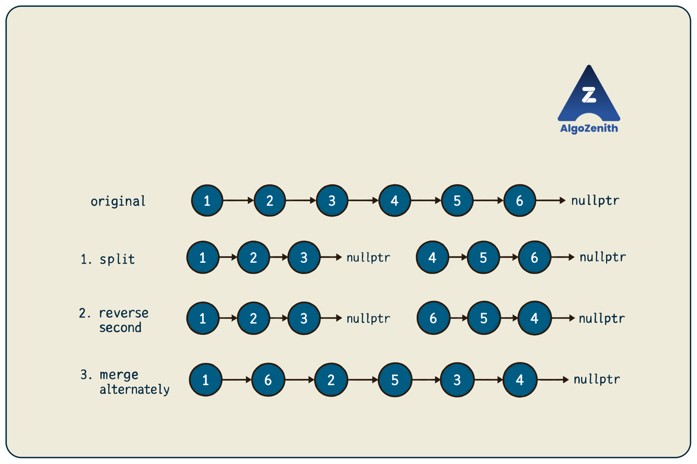
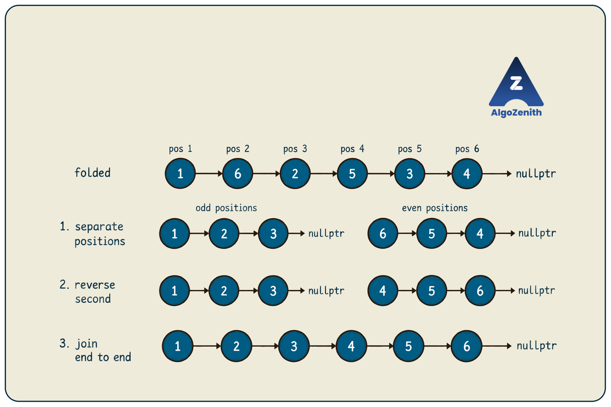

<VIDEO_WIDGET>

<VIDEO_ID></VIDEO_ID>

</VIDEO_WIDGET>

<READING_WIDGET>

# Folding and Unfolding a Singly Linked List

Suppose we want to rearrange a linked list by taking its first node, then its last node, then its second node, then its second-last node, and so on.

This rearrangement is called **folding** in this lesson. The reverse operation, **unfolding**, restores the original order.

The challenge is that a singly linked list only lets us move forward. Instead of repeatedly searching for the last node, we can combine a few smaller operations: **split, reverse, and reconnect**.

Following the lecture, we will build these operations separately, then use them to implement both transformations.

## 1. Problem Statements

Let the original list contain nodes `a1, a2, ..., an`. These labels represent the nodes in their original order, **not sorted data values**.

### Folding

Rearrange:

```text
a1 -> a2 -> a3 -> ... -> a(n-1) -> an -> nullptr
```

into:

```text
a1 -> an -> a2 -> a(n-1) -> a3 -> a(n-2) -> ... -> nullptr
```

Take nodes alternately from the front and back until every node has been used exactly once.

### Unfolding

Given a list in the folded order above, restore:

```text
a1 -> a2 -> a3 -> ... -> a(n-1) -> an -> nullptr
```

Unfolding reverses the **rearrangement**, not the entire linked list. It does not sort the data.

### Assumptions and Requirements

- The input is a finite, acyclic singly linked list.
- The list may be empty, and values may repeat.
- Rearrange the existing nodes by changing their `next` pointers.
- Do not swap data values, allocate replacement nodes, or delete nodes.
- The result must remain acyclic and end at `nullptr`.
- Both functions return the resulting head. For these transformations, the original first node remains first.

Let `n` denote the number of nodes. Our target is **`O(n)` time and `O(1)` auxiliary space**, meaning constant extra memory.

## 2. Running Examples: Even and Odd Lengths

For six nodes, the lecture's folding order is:

```text
Original: 1 -> 2 -> 3 -> 4 -> 5 -> 6 -> nullptr
Folded:   1 -> 6 -> 2 -> 5 -> 3 -> 4 -> nullptr
```

For five nodes:

```text
Original: 1 -> 2 -> 3 -> 4 -> 5 -> nullptr
Folded:   1 -> 5 -> 2 -> 4 -> 3 -> nullptr
```

With an odd number of nodes, the original middle node appears once, at the end of the folded list. With an even number, the two central nodes form the final pair.

The numbers are convenient example values. The same positional rule applies to an unsorted list:

```text
Original: 8 -> 2 -> 8 -> 1 -> nullptr
Folded:   8 -> 1 -> 2 -> 8 -> nullptr
```

The two nodes containing `8` are different objects. Correctness depends on preserving the intended **node order**, not merely printing matching values.

### Why Not Repeatedly Bring the Last Node Forward?

Finding the last node and its predecessor requires a traversal in a singly linked list. Repeating that search on the remaining portion can take:

$$
O(n + (n - 2) + (n - 4) + \cdots) = O(n^2).
$$

Storing all node pointers in an array would let us reconnect them from both ends in `O(n)` time, but would use `O(n)` extra space.

We can avoid both repeated searches and extra storage by reversing the second half once.

## 3. Folding: Split, Reverse, Merge Alternately

For the six-node example:

| Stage | First part | Second part |
| --- | --- | --- |
| Split at the middle | `1 -> 2 -> 3` | `4 -> 5 -> 6` |
| Reverse the second part | `1 -> 2 -> 3` | `6 -> 5 -> 4` |
| Take nodes alternately | `1, 6, 2, 5, 3, 4` in the final list | No nodes remain unused |

All separate lists shown in the table end at `nullptr`.



The same nodes are reused throughout. Their values and identities stay the same; only their links change.

Reversing the second half converts the original back-to-front order into an ordinary forward traversal. We can now take one node from each part without searching for any tail.

For odd lengths, keep the extra node in the first part:

```text
Split:           1 -> 2 -> 3    and    4 -> 5
Reverse second:  1 -> 2 -> 3    and    5 -> 4
Merge:           1 -> 5 -> 2 -> 4 -> 3
```

The first part has either the same number of nodes as the second part or one more. This property makes the alternate merge straightforward.

## 4. Shared Node Definition and Returning Two Heads

All implementations use C++17 and the following node definition:

```cpp
#include <iostream>
using namespace std;

struct Node {
    int data;
    Node* next;

    Node(int value) {
        data = value;
        next = nullptr;
    }
};
```

`Node*` means a pointer to a node. `nullptr` means that the pointer does not identify a node.

The lecture's splitting functions need to provide **two resulting heads** to their caller. We will follow that interface using `Node**` parameters.

**Small syntax note:** `Node**` is a pointer to a `Node*` variable. If the caller has `Node* first`, passing `&first` gives the function access to that pointer variable. Assigning to `*firstHead` inside the function then updates the caller's `first`. It does not create or copy a node.

Our calls pass the addresses of two distinct local pointer variables. The splitting helpers assume that these output arguments are valid.

## 5. Helper 1: Split at the Middle

We want the first part to contain:

$$
\left\lceil \frac{n}{2} \right\rceil
$$

nodes, and the second part to contain:

$$
\left\lfloor \frac{n}{2} \right\rfloor.
$$

The ceiling symbol means “round up,” and the floor symbol means “round down.”

Use the **first-middle convention** from Technique 2:

- Start `slow` at `head`.
- Start `fast` at `head->next`, after checking that `head` exists.
- Move `slow` one link and `fast` two while the two-step move is safe.

For six nodes, `slow` stops at node `3`. For five nodes, it also stops at node `3`.

Save the successor of `slow` as the second head, then disconnect the two parts.

### C++ Implementation

```cpp
void splitMid(Node* head, Node** firstHead, Node** secondHead) {
    *firstHead = head;
    *secondHead = nullptr;
    if (head == nullptr) return;

    Node* slow = head;
    Node* fast = head->next;

    while (fast != nullptr && fast->next != nullptr) {
        slow = slow->next;
        fast = fast->next->next;
    }

    *secondHead = slow->next;
    slow->next = nullptr;
}
```

The `&&` guard checks `fast` before accessing `fast->next`. Its right-hand condition is evaluated only if the left-hand condition is true.

Two details are important:

1. **Save the second head before cutting the link.** Otherwise, we lose access to the second part through this traversal.
2. **Actually cut the link.** Merely remembering two head pointers does not create two separate lists. `slow->next = nullptr` makes their node sets disjoint before reversal and merging.

An empty list produces two null heads. A one-node list produces that node as the first part and an empty second part.

## 6. Helper 2: Reverse a List

The second part must change from:

```text
4 -> 5 -> 6 -> nullptr
```

to:

```text
6 -> 5 -> 4 -> nullptr
```

We reverse links, not data values.

### Iterative Version: Constant Extra Space

Maintain three pointers:

- `previous`: the head of the portion already reversed.
- `current`: the next node to process.
- `nextNode`: the original successor, saved before changing a link.

```cpp
Node* reverseList(Node* head) {
    Node* previous = nullptr;
    Node* current = head;

    while (current != nullptr) {
        Node* nextNode = current->next;
        current->next = previous;
        previous = current;
        current = nextNode;
    }

    return previous;
}
```

At each iteration, one node moves from the unprocessed portion to the front of the reversed portion. When `current` becomes null, `previous` is the new head.

For `4 -> 5 -> 6`:

| After processing | Reversed portion | Unprocessed portion |
| --- | --- | --- |
| 4 | `4 -> nullptr` | `5 -> 6 -> nullptr` |
| 5 | `5 -> 4 -> nullptr` | `6 -> nullptr` |
| 6 | `6 -> 5 -> 4 -> nullptr` | Empty |

**Save `current->next` first.** After assigning `current->next = previous`, that field no longer leads to the unprocessed nodes.

### The Recursive Version Shown in the Lecture

The lecture reverses the remaining list first, then reconnects the current node while the recursive calls return. The same logic can return the new head directly:

```cpp
Node* reverseRecursive(Node* head) {
    if (head == nullptr || head->next == nullptr) {
        return head;
    }

    Node* newHead = reverseRecursive(head->next);
    head->next->next = head;
    head->next = nullptr;
    return newHead;
}
```

After the recursive call, `head->next` still identifies the original successor. Assigning `head->next->next = head` makes that successor point back to the current node. Then `head->next = nullptr` removes the old forward link; omitting it would create a cycle.

The screenshot communicates the new head through a `Node**` output parameter. Returning `Node*` communicates the same result with a simpler call.

Both reversal versions take `O(k)` time for `k` nodes. However, the recursive version also uses **`O(k)` call-stack space**: each unfinished call must be remembered. It can exceed the stack limit on a long list.

We will use **`reverseList`**, the iterative version, in both folding and unfolding to keep their extra space at `O(1)`.

## 7. Helper 3: Merge Two Lists Alternately

After splitting and reversing, the two lists are:

```text
first:  1 -> 2 -> 3 -> nullptr
second: 6 -> 5 -> 4 -> nullptr
```

Insert one node from `second` immediately after one node from `first`, then advance to the next unused node in each list.

### C++ Implementation

```cpp
Node* mergeAlternate(Node* first, Node* second) {
    Node* result = first;

    while (first != nullptr && second != nullptr) {
        Node* nextFirst = first->next;
        Node* nextSecond = second->next;

        first->next = second;
        second->next = nextFirst;

        first = nextFirst;
        second = nextSecond;
    }

    return result;
}
```

**Helper requirement:** The two inputs must be disjoint, null-terminated lists, and the first must contain at least as many nodes as the second. Our middle split guarantees this. This helper is not a general solution for every pair of list lengths.

We save **both** original successors before changing either link. Moving to `first->next` after rewiring would take us to the inserted node instead of the next unused node from the first list.

### Dry Run: Alternating the Six-Node Example

The saved pointers below are recorded before each pair of link updates:

| Iteration | `first` | `second` | `nextFirst` | `nextSecond` | Completed pairs in final order |
| --- | --- | --- | --- | --- | --- |
| 1 | 1 | 6 | 2 | 5 | `1 -> 6` |
| 2 | 2 | 5 | 3 | 4 | `1 -> 6 -> 2 -> 5` |
| 3 | 3 | 4 | `nullptr` | `nullptr` | `1 -> 6 -> 2 -> 5 -> 3 -> 4` |

For five nodes, the two lists are `1 -> 2 -> 3` and `5 -> 4`. After two iterations, `second` is null and the remaining node `3` is already connected at the end:

```text
1 -> 5 -> 2 -> 4 -> 3 -> nullptr
```

This is an **alternate merge**, not a sorted merge. We never compare node values.

## 8. Put the Folding Steps Together

```cpp
Node* fold(Node* head) {
    if (head == nullptr || head->next == nullptr) return head;

    Node* first = nullptr;
    Node* second = nullptr;
    splitMid(head, &first, &second);

    second = reverseList(second);
    return mergeAlternate(first, second);
}
```

The function is short because each helper has one clear responsibility:

1. `splitMid` creates the two separate parts.
2. `reverseList` makes the second part accessible from the original back toward the middle.
3. `mergeAlternate` combines their nodes in the required order.

### Why Is Folding Correct?

For an even length `n = 2k`, splitting and reversing produce:

```text
First:   a1 -> a2 -> ... -> ak
Second:  a(2k) -> a(2k-1) -> ... -> a(k+1)
```

The alternate merge takes `a1, a(2k), a2, a(2k-1), ...`, exactly the folding order.

For an odd length `n = 2k + 1`, the first part has one extra node, `a(k+1)`. After all `k` pairs have been merged, that node remains at the end.

Splitting partitions the original nodes into two disjoint lists. Reversal preserves every node in its part, and the merge uses every node exactly once. Therefore, folding loses no nodes, duplicates no nodes, and ends at `nullptr`.

## 9. Unfolding: Separate Alternate Positions, Reverse, Join

Now suppose the input is:

```text
1 -> 6 -> 2 -> 5 -> 3 -> 4 -> nullptr
```

Where did the original first and second halves go?

| Current position, counting from 1 | 1 | 2 | 3 | 4 | 5 | 6 |
| --- | --- | --- | --- | --- | --- | --- |
| Node in the folded list | 1 | 6 | 2 | 5 | 3 | 4 |
| Came from | First half | Reversed second half | First half | Reversed second half | First half | Reversed second half |

The original first half occupies the **odd positions**. The reversed second half occupies the **even positions**.

Therefore:

1. Separate the current list into its odd-position and even-position nodes, preserving order within each group.
2. Reverse the even-position list.
3. Append it to the odd-position list.

```text
Separate:        1 -> 2 -> 3    and    6 -> 5 -> 4
Reverse second:  1 -> 2 -> 3    and    4 -> 5 -> 6
Join:            1 -> 2 -> 3 -> 4 -> 5 -> 6
```



**Odd and even refer to positions, not data values.** In this example, the odd-position list contains the value `2`, and the even-position list contains `5`.

We must separate **alternate nodes**, not split at the middle again. A middle split of the folded list would produce `1 -> 6 -> 2` and `5 -> 3 -> 4`, which are not the parts we need.

## 10. Helper 4: Split Alternate Nodes

Use two pointers:

- `odd` follows nodes at positions `1, 3, 5, ...`.
- `even` follows nodes at positions `2, 4, 6, ...`.

On each iteration, reconnect each pointer to the next node belonging to its own group.

### C++ Implementation

```cpp
void splitAlternate(Node* head, Node** firstHead, Node** secondHead) {
    *firstHead = head;
    *secondHead = nullptr;
    if (head == nullptr || head->next == nullptr) return;

    Node* odd = head;
    Node* even = head->next;
    *secondHead = even;

    while (even != nullptr && even->next != nullptr) {
        odd->next = even->next;
        odd = odd->next;

        even->next = odd->next;
        even = even->next;
    }

    odd->next = nullptr;
}
```

The loop runs only when another odd-position node exists after `even`. We first move `odd` to that node, then use its still-unchanged successor to locate the next even-position node.

### Why Must We End the First List Explicitly?

On an even-length input, the last odd-position node may still point to the last even-position node. The final `odd->next = nullptr` removes this leftover cross-link.

The even-position list is already null-terminated: for an even length it ends at the original tail; for an odd length its final link is set to null during the loop.

Without separating the lists fully, reversing the second one can create a cycle or reconnect a node twice.

### Dry Run: Splitting `1 -> 6 -> 2 -> 5 -> 3 -> 4`

| Stage | `odd` | `even` | Links changed in this iteration |
| --- | --- | --- | --- |
| Initialization | 1 | 6 | None |
| After iteration 1 | 2 | 5 | `1 -> 2`, `6 -> 5` |
| After iteration 2 | 3 | 4 | `2 -> 3`, `5 -> 4` |
| After the loop | 3 | 4 | Set `3->next = nullptr` |

The loop stops because node `4` has no successor. The results are now two independent lists:

```text
first:  1 -> 2 -> 3 -> nullptr
second: 6 -> 5 -> 4 -> nullptr
```

For an odd-length folded list such as `1 -> 5 -> 2 -> 4 -> 3`, the same code produces `1 -> 2 -> 3` and `5 -> 4`. No separate odd-length branch is required.

## 11. Put the Unfolding Steps Together

After the alternate split, reverse the second list and attach it after the tail of the first.

```cpp
Node* unfold(Node* head) {
    if (head == nullptr || head->next == nullptr) return head;

    Node* first = nullptr;
    Node* second = nullptr;
    splitAlternate(head, &first, &second);

    second = reverseList(second);

    Node* tail = first;
    while (tail->next != nullptr) {
        tail = tail->next;
    }
    tail->next = second;

    return first;
}
```

The early return ensures that `first` is non-null before we look for its tail. This final operation is **joining end to end**, not merging alternately.

### Why Is Unfolding Correct?

Folding preserves the order of the first half and interleaves it with the reversed second half, beginning with a node from the first half.

Therefore, separating odd and even positions recovers those exact two parts. Reversing the second part restores its original order. Joining the parts recreates the original list.

For both odd and even lengths:

```text
Original list -> fold -> folded list -> unfold -> original list
```

This restores the original **node identities and links**, not just a matching sequence of values.

If we apply `unfold` to an arbitrary list, it still performs the same positional transformation: odd-position nodes followed by reversed even-position nodes. It does not detect whether the list was previously folded or infer an unrelated earlier order.

## 12. Complete Demonstration

Combine the shared headers and `Node` definition with all the functions above and the following code to form a complete C++17 program:

```cpp
void printList(Node* head) {
    while (head != nullptr) {
        cout << head->data << " -> ";
        head = head->next;
    }
    cout << "nullptr\n";
}

int main() {
    Node n1(1), n2(2), n3(3), n4(4), n5(5), n6(6);
    n1.next = &n2;
    n2.next = &n3;
    n3.next = &n4;
    n4.next = &n5;
    n5.next = &n6;

    Node* head = &n1;

    cout << "Original: ";
    printList(head);

    head = fold(head);
    cout << "Folded:   ";
    printList(head);

    head = unfold(head);
    cout << "Unfolded: ";
    printList(head);

    // Reuse the restored first five nodes for an odd-length example.
    // Node n6 still exists; it is simply no longer linked from n5.
    n5.next = nullptr;

    head = fold(head);
    cout << "Five nodes, folded:   ";
    printList(head);

    head = unfold(head);
    cout << "Five nodes, unfolded: ";
    printList(head);

    return 0;
}
```

Output:

```text
Original: 1 -> 2 -> 3 -> 4 -> 5 -> 6 -> nullptr
Folded:   1 -> 6 -> 2 -> 5 -> 3 -> 4 -> nullptr
Unfolded: 1 -> 2 -> 3 -> 4 -> 5 -> 6 -> nullptr
Five nodes, folded:   1 -> 5 -> 2 -> 4 -> 3 -> nullptr
Five nodes, unfolded: 1 -> 2 -> 3 -> 4 -> 5 -> nullptr
```

`&n1` gives the address of node `n1`. These nodes are local objects, so they are destroyed automatically when `main` ends. They were not allocated with `new`, and we must not call `delete` on them.

Neither transformation creates a separate copy. Other pointers to these nodes still identify the same objects, but their `next` links have changed.

## 13. Complexity Analysis

The stages run **one after another**, not as nested full-list traversals.

| Operation | Work performed | Time | Auxiliary space |
| --- | --- | --- | --- |
| Split at the middle | Find the first middle and cut one link | `O(n)` | `O(1)` |
| Iterative reversal | Reverse about half the nodes | `O(n)` | `O(1)` |
| Alternate merge | Reconnect one pair per iteration | `O(n)` | `O(1)` |
| Alternate split | Separate the two positional groups | `O(n)` | `O(1)` |
| Final join | Walk to the first part's tail and connect | `O(n)` | `O(1)` |

Thus, **both `fold` and `unfold` take `O(n)` time and `O(1)` auxiliary space** with the iterative reversal used here. The existing nodes are the input storage, not newly allocated auxiliary storage.

Replacing iterative reversal with the recursive version keeps the time at `O(n)` but increases the extra space to `O(n)` because of the recursion stack.

## 14. Useful Insights and Common Mistakes

- **Identify the three stages before coding.** Folding is middle split, reverse, alternate merge. Unfolding is alternate split, reverse, end-to-end join.
- **Keep the middle convention consistent.** The first half should have at least as many nodes as the second. Our first-middle split gives equal halves for even lengths and keeps the middle in the first half for odd lengths.
- **A saved head is not a detached list.** Cut the middle link before reversing the second half.
- **Save successors before overwriting links.** This is essential in reversal and alternate merging; otherwise the remaining nodes may become unreachable.
- **Odd/even positions are not odd/even values.** Unfolding uses the current list positions, counting from 1, regardless of the data.
- **Null termination is part of correctness.** In the alternate split, the first group's final node must not retain a link into the second group.
- **Folding twice does not generally unfold.** For six nodes, folding `1 -> 6 -> 2 -> 5 -> 3 -> 4` again gives `1 -> 4 -> 6 -> 3 -> 2 -> 5`, not the original order.
- **Do not confuse unfolding with sorting.** Duplicate and unsorted values require exactly the same pointer operations.
- **Respect helper assumptions.** `mergeAlternate` is specialized to a first list at least as long as the second. A general-purpose alternate merge needs extra handling if the second list has leftover nodes.
- **Count recursive stack usage.** Reusing existing nodes does not by itself make a recursive solution constant-space.
- **Clarify mutation in an interview.** These algorithms change links. If the original structure must remain available at the same time, an in-place transformation alone cannot provide an independent copy.
- **Reuse the building blocks.** Finding the middle, reversing a half, and reconnecting lists also appear in palindrome checks and linked-list reordering problems. In each problem, decide whether the modified links must be restored before returning.

### Edge Cases to Test

| Original list | Folded order | After unfolding |
| --- | --- | --- |
| Empty | Empty | Empty |
| `1` | `1` | `1` |
| `1 -> 2` | `1 -> 2` | `1 -> 2` |
| `1 -> 2 -> 3` | `1 -> 3 -> 2` | `1 -> 2 -> 3` |
| `1 -> 2 -> 3 -> 4` | `1 -> 4 -> 2 -> 3` | `1 -> 2 -> 3 -> 4` |
| `1 -> 2 -> 3 -> 4 -> 5` | `1 -> 5 -> 2 -> 4 -> 3` | Original five-node order |
| `8 -> 2 -> 8 -> 1` | `8 -> 1 -> 2 -> 8` | Original order of the same four nodes |

All rows represent null-terminated lists. For each test, check node addresses as well as values: every original node should appear exactly once, the tail should point to `nullptr`, and unfolding after folding should restore every original link.

## Quick Recap

- Folding rearranges nodes as first, last, second, second-last, and so on.
- Split at the first middle so the first half is never shorter than the second.
- Reverse the second half, then merge the two halves alternately.
- Unfolding separates odd and even positions in the folded list.
- Reverse the even-position list, then append it to the odd-position list.
- Save pointers before changing links, and terminate each separated list correctly.
- With iterative reversal, both operations take `O(n)` time and `O(1)` extra space.
- Recursive reversal follows the lecture's idea but uses `O(n)` stack space.

</READING_WIDGET>
