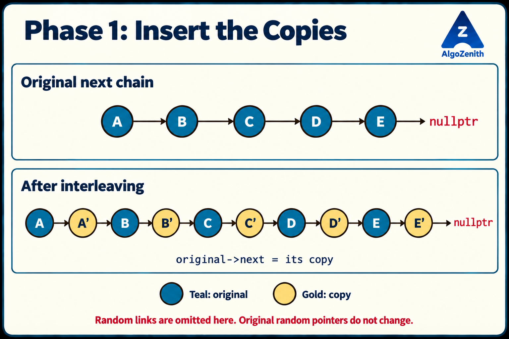
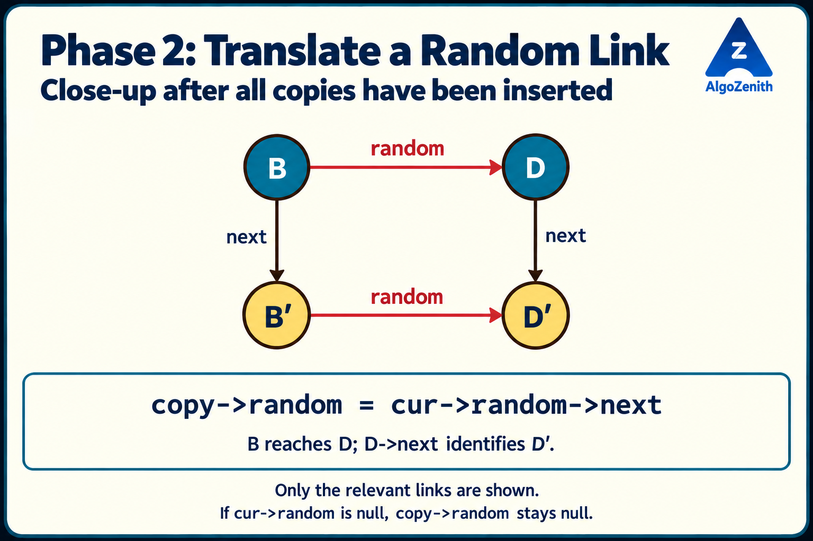
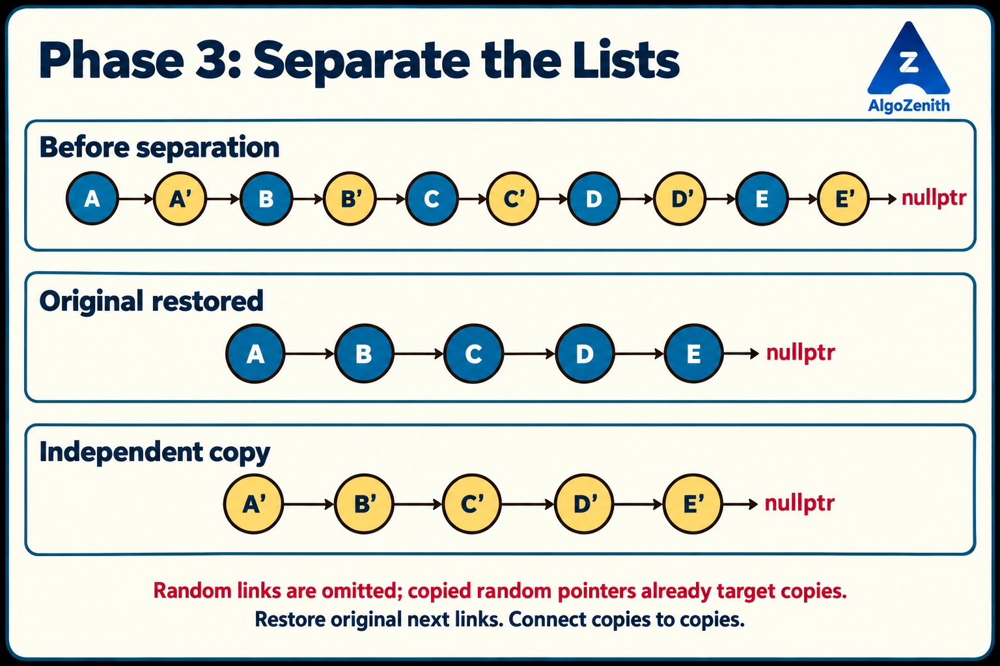

<VIDEO_WIDGET>

<VIDEO_ID></VIDEO_ID>

</VIDEO_WIDGET>

<READING_WIDGET>

# Deep Copy Technique: Copying a Random-Pointer Linked List

Copying the values of a linked list is straightforward. Copying its connections is more interesting.

Suppose every node has a `next` pointer and an additional `random` pointer. The random pointer may point forward, backward, to the same node, or to no node at all. How can we create a completely independent list with exactly the same structure?

The central challenge is to answer one question efficiently:

> Given an original node, where is its copy?

We will first answer this using a hash map. Then, following the lecture, we will use three phases: **insert copies between original nodes, assign the copies' random pointers, and separate the two lists**.

## 1. Problem Statement

Given the head of a singly linked list whose nodes contain:

- `data`: the stored value.
- `next`: the next node in the list.
- `random`: any node in the same list, or `nullptr`.

Return the head of a **deep copy**.

For every original node `X`, create exactly one new node `X'` such that:

1. `X'` stores the same data as `X`.
2. If `X->next` points to `Y`, then `X'->next` points to `Y'`.
3. If `X->random` points to `R`, then `X'->random` points to `R'`.
4. A null pointer in the original corresponds to a null pointer in the copy.
5. No node in the copied list is an original node, and no copied pointer points back into the original list.

The original list must have its original values and links when the function returns.

### Assumptions

- Following `next` produces a finite, acyclic list ending at `nullptr`.
- Every non-null `random` target belongs to that same `next` chain.
- Random pointers may form cycles, including self-loops.
- Values may repeat, and the list may be empty.
- The interleaving approach may temporarily modify original `next` pointers, but must restore them before returning.

Let `n` denote the number of original nodes.

### Deep Copy Is Not a Second Pointer to the Same List

Assigning another pointer to `head` does not copy the list. Both pointers still identify the same nodes.

Even allocating new nodes and copying the old pointer fields is insufficient. A copied node whose `random` still points to an original node is not independent.

We need **new nodes and translated connections**, not just equal values.

## 2. Running Example: Preserve Identities and Connections

Use five original nodes, matching the lecture's structure. We give them labels so that node identity is separate from the stored value:

```text
Original next chain:
A -> B -> C -> D -> E -> nullptr

Copied next chain:
A' -> B' -> C' -> D' -> E' -> nullptr
```

The prime mark means “the copy of this node.” It is a label, not C++ syntax.

| Original node | Data | Original random target | Required copied random target |
| --- | --- | --- | --- |
| `A` | 10 | `A` | `A'` |
| `B` | 20 | `D` | `D'` |
| `C` | 10 | `D` | `D'` |
| `D` | 40 | `nullptr` | `nullptr` |
| `E` | 50 | `A` | `A'` |

This example includes a self-loop, forward and backward random links, a shared random target, and a null random pointer.

Notice that `A` and `C` both contain `10`, but are different nodes. A mapping based on values would confuse them. Also, `B'` and `C'` must share the **same** target `D'`; we must not create a separate copy of `D` for each incoming random pointer.

## 3. Approach 1: Map Each Original Node to Its Copy

A direct solution stores an address-to-address mapping:

```text
A -> A'
B -> B'
C -> C'
D -> D'
E -> E'
```

Use two passes:

1. Traverse the original `next` chain and create one copy of every node.
2. Traverse it again and translate both pointer fields using the map.

Creating all copies first makes forward random pointers easy to handle: the target's copy already exists by the time we assign any links.

### Shared Node Definition and Headers

All implementations use C++17 and the following definition:

```cpp
#include <iostream>
#include <unordered_map>
using namespace std;

struct Node {
    int data;
    Node* next;
    Node* random;

    Node(int value) {
        data = value;
        next = nullptr;
        random = nullptr;
    }
};
```

`Node*` means a pointer to a node. `nullptr` means that a pointer does not identify a node. The constructor initializes both links, so a newly created node does not contain uninitialized pointers.

`new Node(value)` creates a new node that remains alive after the copying function returns. The caller is responsible for eventually releasing these allocated nodes.

### C++ Implementation

```cpp
Node* deepCopyByHashing(Node* head) {
    if (head == nullptr) return nullptr;

    unordered_map<Node*, Node*> copyOf;

    // Pass 1: create every copied node.
    for (Node* cur = head; cur != nullptr; cur = cur->next) {
        copyOf[cur] = new Node(cur->data);
    }

    // Pass 2: translate original links into copied links.
    for (Node* cur = head; cur != nullptr; cur = cur->next) {
        Node* copy = copyOf.at(cur);

        if (cur->next != nullptr) {
            copy->next = copyOf.at(cur->next);
        }
        if (cur->random != nullptr) {
            copy->random = copyOf.at(cur->random);
        }
    }

    return copyOf.at(head);
}
```

`unordered_map<Node*, Node*>` maps an original node address to its copied node address. `copyOf.at(cur)` retrieves the entry created in the first pass; it does not create a new entry.

For null targets, the copied fields keep the `nullptr` value assigned by the constructor. We never look up `nullptr` in the map.

### Complexity and Trade-Off

- **Expected time:** `O(n)`, assuming average constant-time hash-map operations.
- **Auxiliary space:** `O(n)` for the map.
- **Output storage:** `O(n)` for the new nodes.

Hash-map operations are not guaranteed constant-time in the worst case; this implementation can take `O(n²)` time under pathological collisions.

This approach does not modify the original list, even temporarily. It is a good choice when temporary modification is forbidden.

The lecture asks us to eliminate the separate map. Can the list itself hold the original-to-copy relationship?

## 4. The Main Idea: Place Each Copy Beside Its Original

Insert every new node immediately after the corresponding original:

```text
Before:
A -> B -> C -> D -> E -> nullptr

After interleaving:
A -> A' -> B -> B' -> C -> C' -> D -> D' -> E -> E' -> nullptr
```

Now, for every original node `X`:

```text
X->next is X'
```

This is our temporary replacement for the hash map.

If `X->random` points to `R`, then `R->next` is `R'`. Therefore, the random pointer of `X'` should point to `X->random->next`.

The relationship only works while **every original still has its copy immediately after it**. That is why the phases must be completed in order:

| Phase | What we do | What becomes true |
| --- | --- | --- |
| 1. Interleave | Insert one copy after each original | Every original can find its copy through `next` |
| 2. Assign random links | Use the target original's `next` pointer | Every copied random pointer targets a copy or null |
| 3. Separate | Restore original links and connect copied links | Two independent lists remain |

The helpers below implement these phases separately. They are intended to be called in this order by the final copying function.

## 5. Phase 1: Introduce the New Nodes in Between

Suppose the current original node is `X`, followed by another original node `Y`.

We want to change:

```text
X -> Y
```

into:

```text
X -> X' -> Y
```

The order of assignments matters:

1. Create `X'` with `X`'s data.
2. Make `X'` point to the old successor of `X`.
3. Make `X` point to `X'`.
4. Continue at the next **original** node.

### C++ Implementation

```cpp
void insertCopies(Node* head) {
    Node* cur = head;

    while (cur != nullptr) {
        Node* copy = new Node(cur->data);
        copy->next = cur->next;
        cur->next = copy;

        cur = copy->next;
    }
}
```

Saving the old successor in `copy->next` before overwriting `cur->next` preserves access to the rest of the original list.

After insertion, `copy->next` is the next original node. Advancing only to `cur->next` would visit the newly created copy and start copying copies.

### Dry Run

| After processing | Interleaved `next` chain |
| --- | --- |
| `A` | `A -> A' -> B -> C -> D -> E -> nullptr` |
| `B` | `A -> A' -> B -> B' -> C -> D -> E -> nullptr` |
| `C` | `A -> A' -> B -> B' -> C -> C' -> D -> E -> nullptr` |
| All five originals | `A -> A' -> B -> B' -> C -> C' -> D -> D' -> E -> E' -> nullptr` |

All original random pointers remain unchanged. All copied random pointers are still null at this point.



**Finish this entire phase before assigning random pointers.** A random link may target an original node farther ahead whose copy has not yet been inserted.

## 6. Phase 2: Fix the Random Pointers

For an original node `cur`:

- `cur->next` is its copy.
- `cur->random` is its original random target.
- If that target exists, `cur->random->next` is the copy of the target.

For example, `B->random` points to `D`. Since `D->next` points to `D'`, we set `B'->random` to `D'`.



This close-up shows only the links needed for the lookup, not the complete `next` chain. The vertical `next` arrows connect originals to their copies; the horizontal `random` arrows show the corresponding relationship in each list.

### C++ Implementation

```cpp
void assignRandomPointers(Node* head) {
    Node* cur = head;

    while (cur != nullptr) {
        Node* copy = cur->next;

        if (cur->random == nullptr) {
            copy->random = nullptr;
        } else {
            copy->random = cur->random->next;
        }

        cur = copy->next;
    }
}
```

This helper assumes phase 1 has completed: every original has a copy immediately after it.

The lecture's expression `X->next->random = X->random->next` captures the central idea. The null check is essential before accessing `X->random->next`.

### Dry Run: Translate Each Random Link

| Current original | Original random target | How we find the copied target | Assignment |
| --- | --- | --- | --- |
| `A` | `A` | `A->next` is `A'` | `A'->random = A'` |
| `B` | `D` | `D->next` is `D'` | `B'->random = D'` |
| `C` | `D` | `D->next` is `D'` | `C'->random = D'` |
| `D` | `nullptr` | No dereference is needed | `D'->random = nullptr` |
| `E` | `A` | `A->next` is `A'` | `E'->random = A'` |

A self-loop needs no special algorithm: when `cur->random == cur`, the expression identifies the copy itself.

Similarly, several random pointers targeting one original all resolve to the same copy. We preserve shared targets without allocating extra nodes.

**Do not separate the lists during this phase.** A later node may point backward to an earlier original. We still need that earlier original's `next` field to identify its copy.

## 7. Phase 3: Restore the Original and Extract the Copy

The random pointers are now correct, but the `next` pointers still form an interleaved chain.

For one pair, the local structure is:

```text
cur -> copy -> nextOriginal -> nextCopy
```

We must reconnect it as:

```text
Original list: cur  -> nextOriginal
Copied list:   copy -> nextCopy
```

Keep the copied head before restoring the first original link. Then process one original-copy pair at a time.

### C++ Implementation

```cpp
Node* separateCopies(Node* head) {
    if (head == nullptr) return nullptr;

    Node* copyHead = head->next;
    Node* cur = head;

    while (cur != nullptr) {
        Node* copy = cur->next;
        Node* nextOriginal = copy->next;

        // Restore the original list.
        cur->next = nextOriginal;

        // The next original still has its copy immediately after it.
        if (nextOriginal == nullptr) {
            copy->next = nullptr;
        } else {
            copy->next = nextOriginal->next;
        }

        cur = nextOriginal;
    }

    return copyHead;
}
```

This helper assumes the list is still fully interleaved when it begins. In the complete algorithm, all copied random pointers have already been assigned.

Why can we use `nextOriginal->next`? We process originals from left to right. The next original has not yet been separated, so its successor is still its copy.

For the tail, `nextOriginal` is null. We set the copied tail's `next` to null without dereferencing it.

### Dry Run: Separating the First Pair

Starting at `A`:

```text
copy         = A'
nextOriginal = B
```

The updates are:

```text
A->next  = B
A'->next = B'
```

Continue at `B`. After all pairs have been processed:

```text
Original: A  -> B  -> C  -> D  -> E  -> nullptr
Copy:     A' -> B' -> C' -> D' -> E' -> nullptr
```

No random pointers change in this phase. The originals retain their original random links, and the copies retain the copied random links established in phase 2.



## 8. Put the Three Phases Together

```cpp
Node* deepCopyInterleaved(Node* head) {
    if (head == nullptr) return nullptr;

    insertCopies(head);
    assignRandomPointers(head);
    return separateCopies(head);
}
```

The short function reflects the lecture's structure:

1. Establish the original-to-copy relationship.
2. Use that relationship to translate random links.
3. Remove the temporary relationship and return the independent copy.

The original head still identifies the original first node. The returned pointer identifies a newly allocated node.

**Implementation scope:** These teaching implementations assume allocations succeed. If `new` or a hash-map allocation fails, robust application code also needs cleanup of partially created copies; the interleaving version additionally needs restoration of any original links already changed. That failure-recovery machinery is not included here.

## 9. Why Does the Technique Work?

We can justify correctness with one guarantee from each phase.

### After Phase 1: Every Original Has Exactly One Copy

Each iteration visits one original and inserts one new node with matching data. Advancing through `copy->next` skips the inserted node and reaches the next original.

Therefore, every original `X` has exactly one copy `X'`, and `X->next` identifies it.

### After Phase 2: Every Copied Random Link Is Correct

If `X->random` is null, we assign null to the copy.

Otherwise, let the original target be `R`. Phase 1 guarantees that `R->next` is `R'`, so assigning it to `X'->random` creates exactly the required copied link.

This argument does not depend on whether `R` appears before or after `X`, whether `R == X`, or whether other nodes also point to `R`.

### After Phase 3: The Lists Are Independent

For each original-copy pair, we restore the original successor and connect the copy to the next copy. Both tails end at null.

Original data and random pointers were never changed, and every original `next` link has been restored. Copied random pointers already target only copied nodes or null; copied `next` pointers now do the same.

Thus, the result is a deep copy and the original structure is restored.

## 10. Complete Demonstration

Combine the shared headers, `Node` definition, and functions above with the following code to form a complete C++17 program.

The printing helper uses zero-based positions to identify random targets. Printing only target values would be ambiguous when values repeat.

```cpp
void printList(Node* head) {
    unordered_map<Node*, int> position;
    int index = 0;

    for (Node* cur = head; cur != nullptr; cur = cur->next) {
        position[cur] = index;
        ++index;
    }

    index = 0;
    for (Node* cur = head; cur != nullptr; cur = cur->next) {
        cout << index << ": data=" << cur->data << ", random=";
        if (cur->random == nullptr) {
            cout << "null";
        } else {
            cout << position.at(cur->random);
        }
        cout << '\n';
        ++index;
    }
}

void deleteCopiedList(Node* head) {
    while (head != nullptr) {
        Node* nextNode = head->next;
        delete head;
        head = nextNode;
    }
}

int main() {
    Node a(10), b(20), c(10), d(40), e(50);
    a.next = &b;
    b.next = &c;
    c.next = &d;
    d.next = &e;

    a.random = &a;
    b.random = &d;
    c.random = &d;
    d.random = nullptr;
    e.random = &a;

    Node* copyHead = deepCopyInterleaved(&a);

    cout << "Original after copying:\n";
    printList(&a);
    cout << "Deep copy:\n";
    printList(copyHead);

    copyHead->data = 99;
    cout << "After changing copied head: original=" << a.data
         << ", copy=" << copyHead->data << '\n';

    deleteCopiedList(copyHead);
    return 0;
}
```

Output:

```text
Original after copying:
0: data=10, random=0
1: data=20, random=3
2: data=10, random=3
3: data=40, random=null
4: data=50, random=0
Deep copy:
0: data=10, random=0
1: data=20, random=3
2: data=10, random=3
3: data=40, random=null
4: data=50, random=0
After changing copied head: original=10, copy=99
```

The two printed structures match, but their nodes occupy different addresses. Changing the copied head does not change the original.

`&a` is the address of the local object `a`. The original nodes in this example were not allocated with `new`, so we must not call `delete` on them. The copied nodes were allocated with `new` and are released by `deleteCopiedList`.

Delete the copied nodes by following `next` only. Random links do not represent additional ownership: following them during deletion could revisit a node and delete it more than once.

The printing helper uses a map for readable output. It is separate from the copying algorithm and is not part of the interleaving method's auxiliary-space claim.

## 11. Complexity and Choosing an Approach

Each interleaving phase visits the `n` originals once and does constant work per original:

$$
O(n) + O(n) + O(n) = O(n).
$$

Three sequential passes are still linear time.

| Approach | Time | Auxiliary space, excluding output | New nodes | Temporarily modifies original links? |
| --- | --- | --- | --- | --- |
| Hash map | `O(n)` expected | `O(n)` | `n` | No |
| Interleaving | `O(n)` | `O(1)` | `n` | Yes; restores them before returning |

**Constant auxiliary space does not mean constant total memory.** Both methods must allocate `n` copied nodes, which require `O(n)` output storage. Interleaving uses only a fixed number of working pointers beyond that output.

Use the map when the original must remain untouched throughout the operation. Use interleaving when temporary modification is allowed and eliminating the extra map matters.

## 12. Useful Insights and Common Mistakes

- **Map identities, not data.** Two nodes with equal data may have completely different next and random targets.
- **Allocate exactly one copy per original.** Repeated references to one target must lead to one shared copied target.
- **Copy the data as well as the links.** Inserting a blank node is not enough; `new Node(cur->data)` preserves the value.
- **Handle null random pointers explicitly.** Never evaluate `cur->random->next` when `cur->random` is null.
- **Advance between originals in phases 1 and 2.** After interleaving, the next original is reached through the copy, not by a single `next` step.
- **Do not combine assignment and separation prematurely.** Detaching an earlier copy destroys the lookup needed by a later backward random pointer.
- **Save the copied head before restoring `head->next`.** After restoration, `head->next` points to the second original, not the first copy.
- **Restoration is part of correctness.** Returning a valid copy is insufficient if the original still contains inserted nodes or changed links.
- **Clarify mutation constraints in an interview.** Restoring the list afterward does not make temporary modification safe for concurrent readers. Interleaving requires exclusive access during the operation.
- **Clarify what the pointers can reach.** If `next` contains cycles or random targets can lie outside the list, these implementations do not cover that broader problem. General graph cloning needs a visited original-to-copy mapping and a traversal that discovers all relevant nodes.

### How Can We Reuse the Idea?

The reusable technique is **storing a temporary correspondence inside a structure we are allowed to modify**.

Here, a hash map would answer “where is this node's copy?” Interleaving makes the same answer available through one `next` link. Once all dependent links are assigned, we restore the original structure.

Before applying this idea elsewhere, check three things: the temporary relationship must be unambiguous, it must remain available until all lookups are complete, and the original structure must be recoverable.

## 13. Edge Cases and Verification

| Case | What to verify |
| --- | --- |
| Empty list | Return `nullptr` without allocating a node |
| One node, null random | Create a distinct node with both links null |
| One node, self-random | The copy's random pointer targets the copy itself |
| All random pointers null | Every copied random pointer is null |
| Several nodes share a random target | Their copies share the corresponding copied target |
| Repeated data values | Nodes remain distinct and links follow identities |
| Forward and backward random links | Both translate to the correct copied nodes |
| Random pointers form a cycle | Copy the cycle without traversing it indefinitely |

A strong test checks more than printed values:

1. Traverse each list through `next` and confirm that each has exactly `n` nodes.
2. Check that no copied node address occurs in the original node set.
3. Compare corresponding data values and random-target positions.
4. Check that every non-null copied link targets a copied node.
5. Confirm that every original value, `next` pointer, and `random` pointer is unchanged after the call.
6. Modify a copied value or link and confirm that the original remains unchanged.

## Quick Recap

- A deep copy preserves values and connectivity using entirely new nodes.
- A hash map records each original-to-copy address relationship explicitly.
- Interleaving stores that relationship temporarily as `original->next`.
- First insert every copy, then assign copied random pointers, then separate the lists.
- A non-null original random target's `next` pointer identifies its copy.
- Preserve null links, shared targets, self-loops, and repeated-value node identities.
- Restore the original list completely before returning the copied head.
- Interleaving takes `O(n)` time and `O(1)` auxiliary space, excluding the required `O(n)` output nodes.

</READING_WIDGET>
