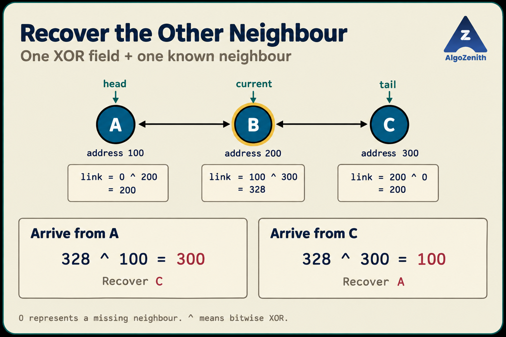
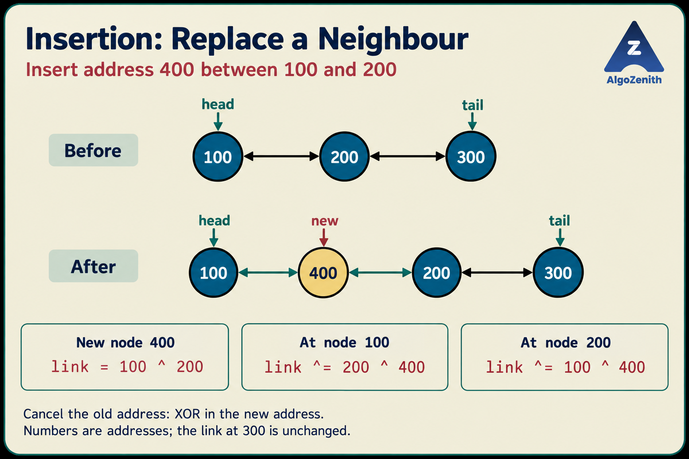
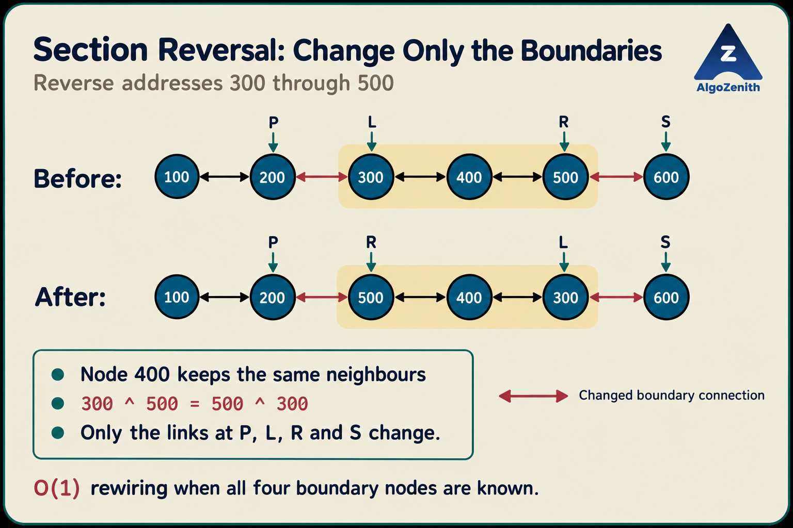

<VIDEO_WIDGET>

<VIDEO_ID></VIDEO_ID>

</VIDEO_WIDGET>

<READING_WIDGET>

# XOR Linked List: Two Neighbours in One Link Field

A doubly linked list stores two pointers in every node: one to the previous node and one to the next node. This makes movement in either direction straightforward, but it also requires two link fields per node.

Can we support traversal in both directions with just **one encoded link field**?

An **XOR linked list** does this by storing the XOR of the two neighbouring addresses. The important catch is that the encoded field does not reveal both neighbours by itself. We must already know one neighbour to recover the other.

We will build the idea in the same order as the lecture: representation, traversal, insertion, deletion, reversal, and section reversal.

## 1. Problem Statement

Design a linked list in which each node stores:

- Its data.
- A single field containing the bitwise XOR of its previous and next node addresses.

Support:

1. Traversal from either end.
2. Insertion between two known adjacent nodes.
3. Deletion when a node and one of its neighbours are known.
4. Reversal of the entire list.
5. Reversal of a contiguous section.

Assume that:

- The list is finite, linear, and has no cycles.
- We maintain both `head` and `tail`.
- A missing neighbour is represented by the encoded value `0`.
- Nodes stay at fixed addresses until they are removed.
- Operations change links, not the data stored in existing nodes.

The goal is to reduce **per-node link storage**, not to reduce the list's total space complexity below `O(n)`.

> **Implementation note:** XORing actual addresses is a low-level, platform-dependent technique. We will first understand the algorithm using illustrative addresses, then give a C++ implementation with explicit platform assumptions. An index-based alternative is discussed near the end.

## 2. The XOR Property That Makes It Work

In C++, `^` means **bitwise XOR**, not exponentiation. At each bit position, the result is `1` if the two input bits differ and `0` if they are the same.

The useful identities are:

```text
x ^ x = 0
x ^ 0 = x
x ^ y = y ^ x
(x ^ y) ^ z = x ^ (y ^ z)
```

The last two properties let us change the order and grouping of XOR operations. Therefore:

```text
x ^ (x ^ y)
= (x ^ x) ^ y
= 0 ^ y
= y
```

**XOR a value twice, and its contribution cancels.**

For a node `cur`, define:

```text
cur.link = address(previous) ^ address(next)
```

If we already know `previous`, we recover `next`:

```text
address(next) = cur.link ^ address(previous)
```

Similarly, knowing `next` lets us recover `previous`.

### What Has Actually Been Stored?

We have not compressed two arbitrary addresses into one field from which both can be recovered independently.

Instead, we have stored a relationship:

> **One known neighbour + the encoded link = the other neighbour.**

That is why an XOR-list traversal needs two pieces of state: the current node and the neighbour from which we arrived.

## 3. Running Example: Addresses 100, 200, and 300

Use the three-node example from the lecture:

```text
head                         tail
 |                            |
 v                            v
A(100) <-> B(200) <-> C(300)
```

The numbers in parentheses are **illustrative addresses**, not node values. Actual allocations do not have to be consecutive or separated by any fixed distance.

In a normal doubly linked list:

| Node | Previous address | Next address |
| --- | --- | --- |
| `A` at `100` | `0` | `200` |
| `B` at `200` | `100` | `300` |
| `C` at `300` | `200` | `0` |

In the XOR representation:

| Node | Stored `link` | Decimal result |
| --- | --- | --- |
| `A` | `0 ^ 200` | `200` |
| `B` | `100 ^ 300` | `328` |
| `C` | `200 ^ 0` | `200` |

Notice that `B.link` is `328`, not the address of either neighbour. **The encoded link must not be dereferenced as if it were a pointer.**

At `B`, if we arrived from `A`, we know address `100`:

```text
next address = 328 ^ 100 = 300
```

If we arrived from `C`, we know address `300`:

```text
next address in this traversal = 328 ^ 300 = 100
```

The same stored field supports both directions.



The double-headed connectors in these illustrations show **logical adjacency**, not two separately stored pointers. Each node still stores only one encoded link field.

## 4. C++ Representation and Platform Assumptions

The lecture sketches the encoded field as `add`. We will call it `link` and store it as an **unsigned integer**, because an XOR result is not necessarily a valid pointer.

Do not write `previous ^ next` directly on C++ pointers. The bitwise operation must be performed on their integer representations.

### A Necessary Portability Boundary

`std::uintptr_t`, when available, is an unsigned integer type suitable for representing object pointers. Its availability is optional. C++ specifies a sufficiently large pointer-to-integer-to-pointer round trip, but pointer/integer mappings are implementation-defined. See the C++17 draft's [integer types](https://timsong-cpp.github.io/cppwp/n4659/cstdint.syn) and [pointer conversions](https://timsong-cpp.github.io/cppwp/n4659/expr.reinterpret.cast).

The educational implementation below assumes:

- `std::uintptr_t` can represent our `Node*` values.
- Live node addresses encode as nonzero integers.
- Recovering an address through XOR and converting it back is supported by the target implementation.
- The runtime does not relocate nodes or require ordinary pointer fields to keep them reachable.

Using `uintptr_t` avoids guessing that `int` or `unsigned long long` is the right address type; it does **not** make the whole technique universally portable. C++17 also permits implementations with stricter rules for reconstructed pointers, described in its [pointer-safety rules](https://timsong-cpp.github.io/cppwp/n4659/basic.stc.dynamic.safety).

### Node Definition and Conversion Helpers

All `cpp` blocks in this lesson can be combined, in order, into one C++17 demonstration program.

```cpp
#include <cstdint>
#include <iostream>
#include <utility>
using namespace std;

struct Node {
    int data;
    uintptr_t link;

    Node(int value) {
        data = value;
        link = 0;
    }
};

struct XorList {
    Node* head = nullptr;
    Node* tail = nullptr;
};

uintptr_t address(Node* node) {
    if (node == nullptr) {
        return 0;
    }
    return reinterpret_cast<uintptr_t>(node);
}

Node* fromAddress(uintptr_t value) {
    if (value == 0) {
        return nullptr;
    }
    return reinterpret_cast<Node*>(value);
}

Node* otherNeighbor(Node* current, Node* knownNeighbor) {
    return fromAddress(current->link ^ address(knownNeighbor));
}
```

Here:

- `Node*` means a pointer to a node; `nullptr` means no node.
- `uintptr_t` is available from `<cstdint>`; `using namespace std;` lets us omit its `std::` prefix.
- `reinterpret_cast<T>(value)` performs the low-level conversion to type `T`. It does not allocate a node or check that an address is valid.
- `address(nullptr)` explicitly returns `0`, and `fromAddress(0)` explicitly returns `nullptr`.
- `otherNeighbor` requires a non-null current node and one of its actual neighbours. At an endpoint, the missing neighbour is `nullptr`.

The null checks define our encoding convention; we do not rely on casting integer zero with `reinterpret_cast` to produce a null pointer.

`XorList` only groups the two endpoints. It is a small teaching structure, not a complete owning container. We will explicitly delete allocated nodes in the demonstration.

## 5. Traversal: Carry the Neighbour We Came From

To traverse from the head:

1. Set `previous = nullptr` and `current = head`.
2. Visit `current`.
3. Recover the other neighbour using `current->link ^ address(previous)`.
4. Move the pair forward: `previous = current`, then `current = next`.
5. Stop when `current` is `nullptr`.

The name `previous` means **previously visited in this traversal**. When walking from the tail, it is the neighbour on the right in the original drawing.

### Dry Run

| Step | Previously visited address | Current address | Stored link | Recovered address |
| --- | --- | --- | --- | --- |
| 1 | `0` | `100` | `200` | `200 ^ 0 = 200` |
| 2 | `100` | `200` | `328` | `328 ^ 100 = 300` |
| 3 | `200` | `300` | `200` | `200 ^ 200 = 0` |

The traversal visits `A`, `B`, and `C`, then stops.

For backward traversal, start at address `300` with the known neighbour `0`. The recovered addresses are `200`, `100`, and finally `0`.

### C++ Implementation

```cpp
void printFrom(Node* endpoint) {
    Node* previous = nullptr;
    Node* current = endpoint;

    while (current != nullptr) {
        cout << current->data << " ";

        Node* next = otherNeighbor(current, previous);
        previous = current;
        current = next;
    }
    cout << '\n';
}
```

Call `printFrom(list.head)` for forward traversal and `printFrom(list.tail)` for backward traversal.

Do not start this function at an arbitrary interior node: its initial known neighbour is `nullptr`, which is correct only at an endpoint.

### Why Does Traversal Work?

At every iteration, `previous` is the neighbour from which we reached `current`. The stored link contains that address XORed with the other neighbour's address. Cancelling the known address recovers the next node in our direction of travel.

After moving the two pointers, the same relationship holds at the next iteration. This is the **traversal invariant**.

Compute `next` before overwriting `previous`; otherwise, we lose the address needed for cancellation.

Traversal takes **`O(n)` time and `O(1)` auxiliary space**. The iterator carries an extra pointer, but that is not an extra field in every node.

## 6. One Update Rule for Insertion and Deletion

Suppose a node currently has neighbours `oldNeighbor` and `unchangedNeighbor`. Its link is:

```text
oldNeighbor ^ unchangedNeighbor
```

We want to replace `oldNeighbor` with `newNeighbor`, keeping the other neighbour unchanged.

```text
newLink = oldLink ^ oldNeighbor ^ newNeighbor
        = (oldNeighbor ^ unchangedNeighbor)
          ^ oldNeighbor ^ newNeighbor
        = unchangedNeighbor ^ newNeighbor
```

All names in this calculation stand for encoded addresses.

The reusable rule is:

> **Cancel the old neighbour, then XOR in the new neighbour.**

```cpp
void replaceNeighbor(Node* node, Node* oldNeighbor, Node* newNeighbor) {
    node->link ^= address(oldNeighbor) ^ address(newNeighbor);
}
```

`x ^= y` is shorthand for `x = x ^ y`. This helper assumes `node` exists and `oldNeighbor` really is the neighbour being replaced.

## 7. Insertion Between Two Known Nodes

Suppose `left` and `right` are adjacent:

```text
Before: ... <-> left <-> right <-> ...
After:  ... <-> left <-> added <-> right <-> ...
```

Three link fields need attention:

1. Set `added.link = address(left) ^ address(right)`.
2. At `left`, replace neighbour `right` with `added`.
3. At `right`, replace neighbour `left` with `added`.

For insertion before the head, `left` is null and we update `head`. For insertion after the tail, `right` is null and we update `tail`. If the list is empty, both are null.

### C++ Implementation

```cpp
Node* insertBetween(XorList& list, Node* left, Node* right, int value) {
    Node* added = new Node(value);
    added->link = address(left) ^ address(right);

    if (left != nullptr) {
        replaceNeighbor(left, right, added);
    } else {
        list.head = added;
    }

    if (right != nullptr) {
        replaceNeighbor(right, left, added);
    } else {
        list.tail = added;
    }

    return added;
}
```

`XorList& list` passes the list by reference, so changes to its endpoints affect the caller. `new Node(value)` allocates a node and calls its constructor.

The caller must provide a valid insertion gap in the current head-to-tail order:

- Two adjacent nodes.
- `nullptr` and the current head.
- The current tail and `nullptr`.
- Two null pointers only when the list is empty.

The helper does not search for or validate the gap.

### Example: Insert Address 400 Between 100 and 200

Initially:

```text
100 <-> 200 <-> 300
```

The updates are:

```text
link at 400 = 100 ^ 200
link at 100 = (0 ^ 200) ^ 200 ^ 400 = 0 ^ 400
link at 200 = (100 ^ 300) ^ 100 ^ 400 = 400 ^ 300
```

The result is:

```text
100 <-> 400 <-> 200 <-> 300
```

The link at `300` does not change.



**Link updates take `O(1)` time once the gap is known.** Finding an insertion position by walking the list can take `O(n)`. Allocator costs are separate from the link-update count.

## 8. Deletion: Recover, Reconnect, Then Release

Suppose we know `current` and its predecessor `previous` in head-to-tail order:

```text
Before: ... <-> previous <-> current <-> next <-> ...
After:  ... <-> previous <------------> next <-> ...
```

First recover `next`. Then:

1. At `previous`, replace `current` with `next`.
2. At `next`, replace `current` with `previous`.
3. Update an endpoint if necessary.
4. Delete `current` only after all address-dependent updates are complete.

### C++ Implementation

```cpp
void eraseNode(XorList& list, Node* previous, Node* current) {
    if (current == nullptr) {
        return;
    }

    Node* next = otherNeighbor(current, previous);

    if (previous != nullptr) {
        replaceNeighbor(previous, current, next);
    } else {
        list.head = next;
    }

    if (next != nullptr) {
        replaceNeighbor(next, current, previous);
    } else {
        list.tail = previous;
    }

    delete current;
}
```

`delete current` releases the node allocated with `new`. The caller must not use that pointer afterward.

This helper expects the predecessor in the **current logical order**, not an arbitrary neighbour. The distinction matters because it determines which endpoint may change.

### Example: Remove Address 200

Starting again from `100 <-> 200 <-> 300`:

```text
link at 100 = (0 ^ 200) ^ 200 ^ 300 = 0 ^ 300
link at 300 = (200 ^ 0) ^ 200 ^ 100 = 100 ^ 0
```

Now `100` and `300` are adjacent, and node `200` can be released.

For a one-node list, `previous` and the recovered `next` are both null. Both endpoints become null before the node is deleted.

### Why Is a Pointer to the Node Alone Not Enough?

At an interior node, `link` combines two unknown neighbours. A pointer to that node alone does not tell us how to separate them.

Therefore, unlike an ordinary doubly linked list, **deletion is not generally `O(1)` given only the target node**. We need a known neighbour or a traversal that finds the required context.

## 9. Reversing the Entire List in Constant Time

In an ordinary doubly linked list, reversing the list normally involves swapping `prev` and `next` at every node.

For an XOR node:

```text
previous ^ next = next ^ previous
```

Reversing the order does not change either neighbour's identity. It only exchanges their roles.

So no node's link field needs to change:

```cpp
void reverseList(XorList& list) {
    swap(list.head, list.tail);
}
```

`swap` exchanges the two endpoint pointers.

```text
Before: head -> A <-> B <-> C <- tail
After:  head -> C <-> B <-> A <- tail
```

This is a **logical reversal**: nodes are not moved in memory, and their stored XOR fields remain identical. Future forward traversals start from the former tail.

The operation takes **`O(1)` time and `O(1)` auxiliary space**, including for empty and one-node lists. If only `head` were stored, locating the other endpoint first could take `O(n)`.

## 10. Reversing a Section: Only the Boundaries Change

Now consider a contiguous section:

```text
Before: ... <-> P <-> L <-> ... <-> R <-> S <-> ...
After:  ... <-> P <-> R <-> ... <-> L <-> S <-> ...
```

- `L` is the first node of the section.
- `R` is the last node.
- `P` is immediately before the section, or null.
- `S` is immediately after the section, or null.

Every strictly internal node keeps the **same pair of neighbours**. Their order is exchanged, but XOR is unaffected.

Only the boundary relationships change:

| Node | Remove this neighbour | Add this neighbour |
| --- | --- | --- |
| `P`, if present | `L` | `R` |
| `L` | `P` | `S` |
| `R` | `S` | `P` |
| `S`, if present | `R` | `L` |

### Example: Reverse Addresses 300 Through 500

```text
Before: 100 <-> 200 <-> 300 <-> 400 <-> 500 <-> 600
After:  100 <-> 200 <-> 500 <-> 400 <-> 300 <-> 600
```

Here, `P = 200`, `L = 300`, `R = 500`, and `S = 600`.

```text
link at 200: replace 300 with 500
link at 300: replace 200 with 600
link at 500: replace 600 with 200
link at 600: replace 500 with 300
```

Node `400` keeps `300 ^ 500`, because its two neighbours are still `300` and `500`.



The rows show traversal order, not physical movement in memory. The red connections change; the internal neighbour pairs remain the same.

### C++ Implementation

```cpp
void reverseSection(XorList& list, Node* before, Node* first,
                    Node* last, Node* after) {
    // The caller provides a valid, non-empty contiguous section.
    if (first == last) {
        return;
    }

    if (before != nullptr) {
        replaceNeighbor(before, first, last);
    } else {
        list.head = last;
    }

    replaceNeighbor(first, before, after);
    replaceNeighbor(last, after, before);

    if (after != nullptr) {
        replaceNeighbor(after, last, first);
    } else {
        list.tail = first;
    }
}
```

The four arguments must describe the section **before** the operation. We do not traverse the partially updated list while changing its boundaries.

Important cases:

- **One node:** `first == last`; nothing changes.
- **Two nodes:** both are boundary nodes; the same replacement rules work.
- **Prefix:** `before == nullptr`; the old section end becomes the head.
- **Suffix:** `after == nullptr`; the old section start becomes the tail.
- **Entire list:** both outside neighbours are null. The XOR fields remain unchanged, and the endpoints exchange roles.

An empty list has no non-empty section, so the caller should not request a section reversal on it.

### Is Section Reversal Really `O(1)`?

The **rewiring** is `O(1)` when `P`, `L`, `R`, and `S` are already known.

If the problem gives positions such as “reverse nodes 3 through 500,” finding the boundary nodes and their outside neighbours still requires traversal. A position-based operation can therefore take **`O(n)` overall**.

After structural changes, do not blindly continue an old traversal pair. Its remembered neighbour may no longer be adjacent to the current node.

## 11. Complete Demonstration and Cleanup

The following cleanup repeatedly removes the current head. Its predecessor is always null, so we never need to carry an address of a deleted node into another traversal step.

```cpp
void clearList(XorList& list) {
    while (list.head != nullptr) {
        eraseNode(list, nullptr, list.head);
    }
}

int main() {
    XorList list;

    Node* a = insertBetween(list, nullptr, nullptr, 10);
    Node* b = insertBetween(list, a, nullptr, 20);
    Node* c = insertBetween(list, b, nullptr, 30);
    Node* d = insertBetween(list, c, nullptr, 40);
    Node* e = insertBetween(list, d, nullptr, 50);
    Node* f = insertBetween(list, e, nullptr, 60);

    cout << "Original: ";
    printFrom(list.head);

    Node* added = insertBetween(list, a, b, 99);
    cout << "After insertion: ";
    printFrom(list.head);

    eraseNode(list, a, added);
    added = nullptr;
    cout << "After deletion: ";
    printFrom(list.head);

    reverseSection(list, b, c, e, f);
    cout << "After section reversal: ";
    printFrom(list.head);

    reverseList(list);
    cout << "After full reversal: ";
    printFrom(list.head);

    cout << "Backward traversal: ";
    printFrom(list.tail);

    clearList(list);
    return 0;
}
```

Expected output:

```text
Original: 10 20 30 40 50 60
After insertion: 10 99 20 30 40 50 60
After deletion: 10 20 30 40 50 60
After section reversal: 10 20 50 40 30 60
After full reversal: 60 30 40 50 20 10
Backward traversal: 10 20 50 40 30 60
```

These printed numbers are **data values**, not addresses. The program does not assume that any allocation receives the illustrative addresses used earlier.

All nodes in this example are allocated with `new` and released by `clearList`. Copying the `XorList` structure would copy only its endpoint pointers, not its nodes; do not treat such a shallow copy as a second independently owned list.

## 12. Complexity and Memory Savings

Let `n` be the number of nodes.

| Operation | Time | Required context |
| --- | --- | --- |
| Traverse in either direction | `O(n)` | Starting endpoint |
| Find a node by position or value | `O(n)` | An endpoint |
| Insert: link updates | `O(1)` | Valid insertion gap |
| Delete: link updates | `O(1)` | Target and predecessor |
| Reverse entire list | `O(1)` | Both endpoints maintained |
| Reverse section: link updates | `O(1)` | Both section ends and outside neighbours |
| Reverse section given positions | `O(n)` | Includes locating the boundaries |
| Clear the list | `O(n)` | Head |

Each operation uses `O(1)` auxiliary space. Insertion additionally creates the requested new node. Allocation and deallocation costs depend on the allocator.

### Does It Use Half the Memory of a Doubly Linked List?

It reduces the number of link fields from two to one. That does **not** necessarily halve the entire node size.

For example, on a layout with a 4-byte `int`, 8-byte pointers, an 8-byte `uintptr_t`, and 8-byte alignment:

- A node containing an `int` and two pointers might occupy 24 bytes.
- A node containing an `int` and one XOR field might occupy 16 bytes.

That illustrative saving is 8 bytes per node, not half the total. Actual sizes depend on the compiler, alignment, payload, and allocator overhead. Measure with `sizeof` on the target platform.

The full list still uses **`O(n)` storage**.

## 13. Edge Cases and Common Mistakes

| Case | Expected behaviour |
| --- | --- |
| Empty list | Both endpoints are null; traversal prints no values |
| First insertion | Both endpoints become the new node; its link is `0` |
| One-node traversal | Visit it once, then recover null |
| Delete the only node | Both endpoints become null |
| Insert or delete at an endpoint | Update the appropriate endpoint as well as the neighbour's link |
| Duplicate data values | No special handling; links encode node identities |
| Reverse one node | No change |
| Reverse a prefix or suffix | Update `head` or `tail`, respectively |

Watch for these mistakes:

1. **XORing data instead of addresses.** Repeated values must not confuse node identity.
2. **Treating `link` as a pointer.** Decode it with a known neighbour before dereferencing the recovered pointer.
3. **Keeping only `current` during traversal.** The previously visited neighbour is part of the traversal state.
4. **Overwriting the known neighbour too early.** Recover the next node before moving the traversal pair.
5. **Updating only one side of a changed connection.** Forward traversal may appear correct while backward traversal is broken.
6. **Deleting a node before finishing link updates.** Obtain the needed neighbours and reconnect them first.
7. **Forgetting endpoint updates.** Correct XOR fields do not fix a stale `head` or `tail`.
8. **Claiming constant-time operations without their context.** Searching for the gap or section boundaries is separate work.
9. **Moving live nodes in memory.** Address encodings in their neighbours will refer to the old locations.

For testing, verify both traversal directions after every mutation. The forward sequence should be exactly the reverse of the backward sequence, with no missing or repeated node identities.

## 14. Interview and Competitive Programming Insights

### Explain the Tradeoff, Not Just the Trick

A strong explanation is:

> “Each node stores the XOR of its neighbouring addresses. During traversal I retain the neighbour I came from, cancel its address, and recover the other neighbour. This saves a link field per node, but makes operations depend on traversal context.”

Then discuss the practical costs: reconstructed pointers, more delicate updates, and less convenient debugging. A node's encoded field no longer directly shows either neighbour.

### Why Is This Not a General Replacement for a Doubly Linked List?

An ordinary doubly linked list lets us inspect both neighbours directly from a node. An XOR list trades away that independence.

Raw-address encoding also interacts poorly with systems that move objects or discover live objects by following normal references. This is not a technique to transfer directly into Java or Python using ordinary object references.

Use it to understand representation and cancellation; evaluate the implementation environment before considering it for real software.

### A Portable Way to Practise the Same Idea: Stable Indices

In an array-backed node pool, assign each node a stable nonzero integer index and reserve index `0` for “no node”:

```text
pool[current].link = previousIndex ^ nextIndex
nextIndex = pool[current].link ^ previousIndex
```

The same traversal and neighbour-replacement formulas now operate on integer IDs. There is no pointer-to-integer conversion.

The indices must remain stable: do not erase an array element by shifting all later nodes. Removed slots can be marked unused or managed with a free list after all links to them have been removed.

This is useful for practising the technique in CP settings. Still compare it with storing ordinary `prevIndex` and `nextIndex`: two index arrays are easier to inspect, and their clarity may matter more than saving one field.

### Reversal Reveals the Deeper Idea

The most reusable observation is not merely “XOR saves memory.”

It is:

> **When a representation stores an unordered pair of neighbours, changing traversal direction need not change the internal representation.**

That explains both constant-time whole-list reversal and boundary-only section reversal. It also explains why the traversal must supply the missing sense of direction.

## Quick Recap

- Store `address(previous) ^ address(next)` in one integer link field.
- Recover the other neighbour by XORing the field with a known neighbour's address.
- Traverse using a pair: the previously visited node and the current node.
- Replace a neighbour with `link ^= oldAddress ^ newAddress`.
- Insertion and deletion update both sides of the changed connection.
- Reverse the whole list by swapping `head` and `tail`.
- Reverse a section by changing only its boundary relationships.
- Distinguish constant-time rewiring from the time needed to locate nodes.
- Raw-address implementations need platform assumptions; stable indices offer an alternative without pointer reconstruction.

</READING_WIDGET>
