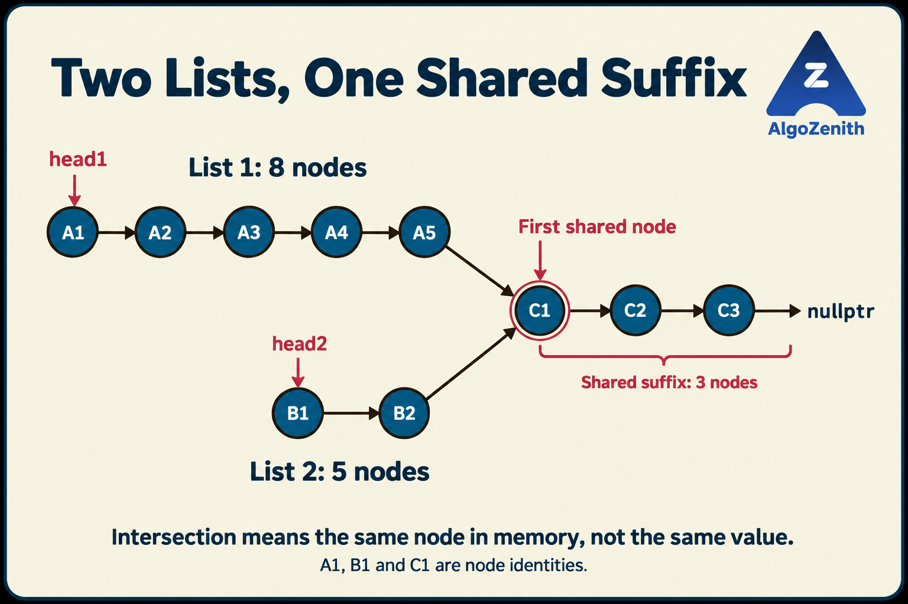
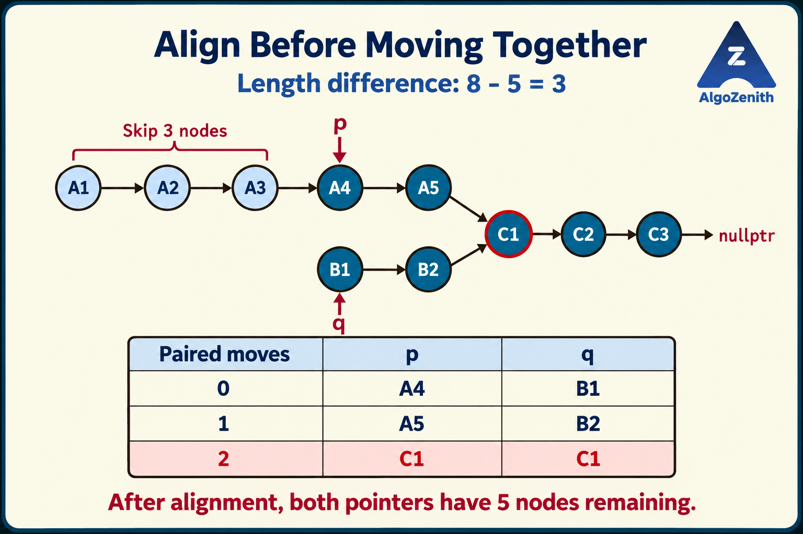

<VIDEO_WIDGET>

<VIDEO_ID></VIDEO_ID>

</VIDEO_WIDGET>

<READING_WIDGET>

# Technique 1: Finding the Intersection Node of Two Linked Lists

Two linked lists can start at different nodes and still share the same ending portion. How can we find the first node where they meet?

The challenge is not just moving two pointers forward. If the lists have different lengths, the pointers may reach the shared portion at different times. The key technique is to **remove this difference before comparing corresponding nodes**.

We will first solve the problem using hashing, then reduce the extra space using length alignment, and finally see how switching heads achieves the same alignment without length counters.

## 1. Problem Statement

Given the heads `head1` and `head2` of two **singly linked lists**, return a pointer to their **first shared node**. If the lists do not intersect, return `nullptr`.

Assume that:

- Both lists are finite and contain **no cycles**.
- Either list may be empty.
- Node values may repeat.
- The lists must remain unchanged: do not modify their data or `next` pointers.

Let `n` and `m` denote the lengths of the two lists. Each length includes the shared nodes, if any.

### Intersection Means the Same Node, Not the Same Value

Suppose two different nodes both contain `7`. They are not an intersection just because their values match.

- `p == q` checks whether the pointers identify the **same node**, or are both `nullptr`.
- `p->data == q->data` only compares stored values and is not the test we need.

If two non-null pointers identify the same node, they also see the same `next` pointer. Therefore, **once two acyclic singly linked lists intersect, they share every remaining node up to the tail**. They cannot merge and then split again.

## 2. Running Example: Two Prefixes and a Shared Suffix

Use the shape from the lecture: one list has five separate nodes before the intersection, the other has two, and they share three nodes.

```text
head1 -> A1 -> A2 -> A3 -> A4 -> A5 --+
                                    |
                                    v
                                    C1 -> C2 -> C3 -> nullptr
                                    ^
                                    |
head2 -----------------> B1 -> B2 --+
```

`A1`, `B1`, and `C1` are **node identities**, not necessarily the values stored inside them. There is only one actual `C1` node, reached from both `A5` and `B2`.



The lengths are:

```text
List 1: A1, A2, A3, A4, A5, C1, C2, C3   -> 8 nodes
List 2: B1, B2, C1, C2, C3               -> 5 nodes
Answer: C1
```

If we start at both heads and move together immediately, the first pointer reaches `C1` after five moves, while the second reaches it after two. We need to account for that three-node difference.

## 3. Approach 1: Remember Node Addresses Using Hashing

A direct solution is to remember every node in the first list, then search for those nodes while traversing the second list.

1. Traverse list 1 and insert each **node pointer** into a hash set.
2. Traverse list 2 from its head.
3. Return the first pointer that is already present in the set.
4. If no pointer matches, return `nullptr`.

For our example, the set contains `A1` through `A5` and `C1` through `C3`. The second traversal checks `B1`, then `B2`, then finds `C1` in the set.

### Node Definition and Headers

All code in this lesson uses C++17. The following definition is shared by the three approaches:

```cpp
#include <iostream>
#include <unordered_set>
#include <utility>
using namespace std;

struct Node {
    int data;
    Node* next;

    Node(int value) {
        data = value;
        next = nullptr;
    }
};
```

The constructor initializes each new node with a value and no following node. `Node*` means “pointer to a `Node`,” and `nullptr` means that it does not point to a node.

### C++ Implementation

```cpp
Node* intersectionByHashing(Node* head1, Node* head2) {
    unordered_set<Node*> seen;

    for (Node* cur = head1; cur != nullptr; cur = cur->next) {
        seen.insert(cur);
    }

    for (Node* cur = head2; cur != nullptr; cur = cur->next) {
        if (seen.count(cur) != 0) {
            return cur;
        }
    }

    return nullptr;
}
```

`unordered_set<Node*>` stores node addresses without duplicates. `seen.count(cur)` is `1` when the pointer is present and `0` otherwise. We store `cur`, not `cur->data`.

### Why Does It Return the First Shared Node?

Every pointer in the set belongs to list 1. While walking list 2 in order, the first pointer found in the set is exactly its first node that also belongs to list 1. Because the rest of the lists is shared from that point onward, this is the intersection node.

### Complexity

- **Expected time:** `O(n + m)`, assuming average constant-time hash-set operations.
- **Auxiliary space:** `O(n)` for the stored pointers.

Hash-table operations are not guaranteed constant-time in the worst case. The pointer-based approaches below avoid both the extra storage and that dependency.

## 4. Approach 2: Count Lengths and Align the Pointers

Can we find the intersection without remembering visited nodes?

Yes. The common suffix has the same length in both lists, so any difference in total length comes entirely from their separate prefixes.

Suppose:

- List 1 has `a` nodes before the intersection.
- List 2 has `b` nodes before the intersection.
- The shared suffix has `c` nodes, including the intersection node.

Then:

$$
n = a + c, \qquad m = b + c,
$$

so:

$$
n - m = a - b.
$$

**Advance the pointer in the longer list by the difference in lengths.** The two pointers will then have the same number of nodes remaining before `nullptr`. Move both one step at a time and compare their addresses.

### Algorithm

1. Count the lengths of both lists.
2. Put `p` at the longer list's head and `q` at the shorter list's head.
3. Advance `p` by `longerLength - shorterLength` links.
4. While `p != q`, advance both pointers once.
5. Return `p`: it is either the first shared node or `nullptr`.

### Dry Run: Lengths 8 and 5

The difference is `8 - 5 = 3`. Starting from `A1`, three moves take `p` to `A4`, not `A3`.

| Stage | `p` in list 1 | `q` in list 2 | Observation |
| --- | --- | --- | --- |
| Before alignment | `A1` | `B1` | 8 and 5 nodes remain |
| After advancing `p` three times | `A4` | `B1` | Both have 5 nodes remaining |
| After one paired move | `A5` | `B2` | Different nodes |
| After two paired moves | `C1` | `C1` | Same address: return `C1` |

“Nodes remaining” includes the node currently identified by the pointer.



The faded nodes are skipped only by the pointer during alignment; they are not removed from the list.

### C++ Implementation

```cpp
int getLength(Node* head) {
    int length = 0;
    while (head != nullptr) {
        ++length;
        head = head->next;
    }
    return length;
}

Node* intersectionByLength(Node* head1, Node* head2) {
    int length1 = getLength(head1);
    int length2 = getLength(head2);
    Node* p = head1;
    Node* q = head2;

    // Keep p on the longer list to use one alignment loop.
    if (length1 < length2) {
        swap(length1, length2);
        swap(p, q);
    }

    int difference = length1 - length2;
    while (difference > 0) {
        p = p->next;
        --difference;
    }

    while (p != q) {
        p = p->next;
        q = q->next;
    }

    return p;
}
```

`swap(x, y)` exchanges the values of two variables. Here, swapping the local pointers changes which list we call longer; it does **not** modify either list. The code assumes each length fits in an `int`.

### Why Is the Paired Walk Safe and Correct?

After alignment, the pointers have equal remaining lengths. Every paired move preserves that equality.

- If an intersection exists, both pointers reach the first shared node together. They cannot match earlier because their prefixes contain different nodes.
- If there is no intersection, both reach `nullptr` together, and the loop stops.

Thus, inside the paired loop, unequal pointers cannot consist of one null pointer and one non-null pointer. Either both identify nodes, or both are null and the loop has already stopped.

The initial advance is also safe: the length difference never exceeds the longer list's length. This handles empty lists as well.

### Complexity

Counting and traversing take **`O(n + m)` time**. Only a fixed number of pointers and counters are stored, so the auxiliary space is **`O(1)`**.

## 5. Approach 3: Switch Heads Instead of Counting Lengths

The length-based approach removes the difference directly. A second way to remove it is to let each pointer traverse both lists, in opposite orders.

- Start `p` at `head1` and `q` at `head2`.
- Move each non-null pointer to its next node.
- When `p` is null, reset it to `head2`.
- When `q` is null, reset it to `head1`.
- Stop when `p == q`.

This is often called the **two-pointer head-switching technique**. It aligns the traversals without explicitly storing the lengths or their difference.

### C++ Implementation

```cpp
Node* intersectionBySwitching(Node* head1, Node* head2) {
    Node* p = head1;
    Node* q = head2;

    while (p != q) {
        if (p == nullptr) {
            p = head2;
        } else {
            p = p->next;
        }

        if (q == nullptr) {
            q = head1;
        } else {
            q = q->next;
        }
    }

    return p;
}
```

The reset only changes a local pointer. We do not connect the tail of one list to the other list. Notice that a pointer first becomes `nullptr`; on the **next loop iteration**, it switches to the other head.

### Why Does Switching Heads Work?

Use the same prefix lengths `a`, `b` and common-suffix length `c`.

If the prefixes have equal length, the pointers meet on their first traversal. Otherwise, after switching:

- `p` reaches the intersection after passing through list 1 and then list 2's separate prefix: `(a + c) + b` nodes.
- `q` reaches it after passing through list 2 and then list 1's separate prefix: `(b + c) + a` nodes.

These totals are equal. In this implementation, each pointer also takes one loop iteration to switch from `nullptr` to the other head, so both receive the same extra step. They arrive at the first shared node together.

If there is no intersection, each pointer traverses both lists and they meet at `nullptr`. Equal-length disjoint lists reach `nullptr` together even before switching.

### Dry Run on the Same Lists

The table records pointer positions **after** each loop iteration. Row 0 is the initial state.

| Iterations completed | `p` | `q` |
| --- | --- | --- |
| 0 | `A1` | `B1` |
| 1 | `A2` | `B2` |
| 2 | `A3` | `C1` |
| 3 | `A4` | `C2` |
| 4 | `A5` | `C3` |
| 5 | `C1` | `nullptr` |
| 6 | `C2` | `A1` |
| 7 | `C3` | `A2` |
| 8 | `nullptr` | `A3` |
| 9 | `B1` | `A4` |
| 10 | `B2` | `A5` |
| 11 | `C1` | `C1` |

The pointers stop at `C1`. Reaching a null pointer first does not mean the lists are disjoint; it may simply mean one list is shorter.

### Complexity

Each pointer traverses at most both lists, with at most one head switch before termination. The total time is **`O(n + m)`**, and the auxiliary space is **`O(1)`**.

## 6. Building a Real Intersection in C++

Two separately created lists with matching values do not share nodes. To test intersection, their links must actually lead to the **same objects**.

The following `main` builds the running example. Combine it with the headers, `Node` definition, and the three approaches above to form a complete C++17 program.

```cpp
int main() {
    Node a1(1), a2(2), a3(3), a4(4), a5(5);
    Node b1(1), b2(2);
    Node c1(6), c2(7), c3(8);

    a1.next = &a2;
    a2.next = &a3;
    a3.next = &a4;
    a4.next = &a5;
    a5.next = &c1;

    b1.next = &b2;
    b2.next = &c1; // Both prefixes lead to this same object.

    c1.next = &c2;
    c2.next = &c3;

    Node* head1 = &a1;
    Node* head2 = &b1;

    Node* byHashing = intersectionByHashing(head1, head2);
    Node* byLength = intersectionByLength(head1, head2);
    Node* bySwitching = intersectionBySwitching(head1, head2);

    if (bySwitching != nullptr) {
        cout << "Intersection value: " << bySwitching->data << '\n';
    } else {
        cout << "No intersection\n";
    }

    if (byHashing == &c1 && byLength == &c1 && bySwitching == &c1) {
        cout << "All three methods found the same C1 node\n";
    }

    return 0;
}
```

Output:

```text
Intersection value: 6
All three methods found the same C1 node
```

`&c1` gives the address of the object `c1`. The two head nodes both store `1`, but they are different objects; the intersection is still `c1`.

These nodes are local objects, not allocated with `new`. They remain alive while `main` runs and are destroyed automatically when it finishes. Do not call `delete` on them. The algorithms return a pointer to an existing node; they do not create or own a new node.

## 7. Edge Cases to Check

| Case | Expected result |
| --- | --- |
| Both heads are `nullptr` | `nullptr` |
| Exactly one list is empty | `nullptr` |
| Both heads identify the same non-null node | That head node |
| One head lies inside the other list | That head node |
| Only the tail node is shared | The shared tail |
| Separate nodes contain equal values | No intersection unless some actual node is shared |
| Disjoint lists of different lengths | `nullptr` after aligning the traversals |

All three implementations handle these cases without modifying either list.

## 8. Comparing the Approaches

| Approach | Time | Auxiliary space | Main idea |
| --- | --- | --- | --- |
| Hashing | `O(n + m)` expected | `O(n)` | Remember addresses from the first list |
| Length alignment | `O(n + m)` | `O(1)` | Advance the longer list by the length difference |
| Head switching | `O(n + m)` | `O(1)` | Traverse both lists in opposite orders |

Length alignment is often the easiest constant-space solution to explain. Head switching is useful when asked for a solution without counting lengths. Neither constant-space approach requires sorting, modifying nodes, or allocating new nodes.

## 9. Useful Insights and Common Mistakes

- **Compare addresses, not values.** Returning the first equal value solves a different problem and fails when values repeat.
- **Clarify the assumptions in an interview.** Ask whether the lists can contain cycles and whether the structure must remain unchanged. The implementations here assume acyclic lists; they are not solutions for arbitrary cyclic lists.
- **A few counters still use constant space.** Length counting is a valid `O(1)`-space solution. If an interviewer asks for no length counters, explain head switching as an alternative rather than treating counters as inherently disallowed.
- **Advance the longer list, not the shorter one.** When swapping local pointers, also swap their length variables so the difference remains consistent.
- **Keep the null checks in the switching method.** Use `p == nullptr`, not an unguarded `p->next == nullptr`. Empty lists and end positions must be safe.
- **Equal tails are a useful diagnostic.** Two nonempty acyclic lists intersect if and only if their tail pointers are equal. This tells us whether an intersection exists, but does not locate its first node.
- **Do not change the lists just to compare them.** Linking tails or reversing shared nodes introduces restoration and correctness issues that these methods avoid.
- **Be careful when freeing shared nodes in a test.** If nodes were allocated with `new`, independently deleting both lists would delete their common suffix twice. Arrange for each distinct allocated node to be deleted exactly once.

The reusable idea is **alignment**: before comparing two forward-moving pointers, arrange for them to have equal remaining distance to a common endpoint. This principle also appears in finding common ancestors through parent chains.

## Quick Recap

- Intersection means sharing the same node in memory, not matching values.
- Once acyclic singly linked lists meet, they share the entire remaining suffix.
- Hashing finds the first shared address using extra memory.
- Length alignment skips the longer list's extra prefix, then moves both pointers together.
- Head switching cancels the same length difference without counters.
- Both pointer-based solutions take `O(n + m)` time and `O(1)` auxiliary space and return `nullptr` when no intersection exists.

</READING_WIDGET>
