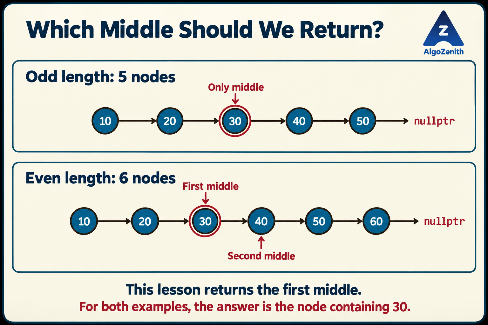
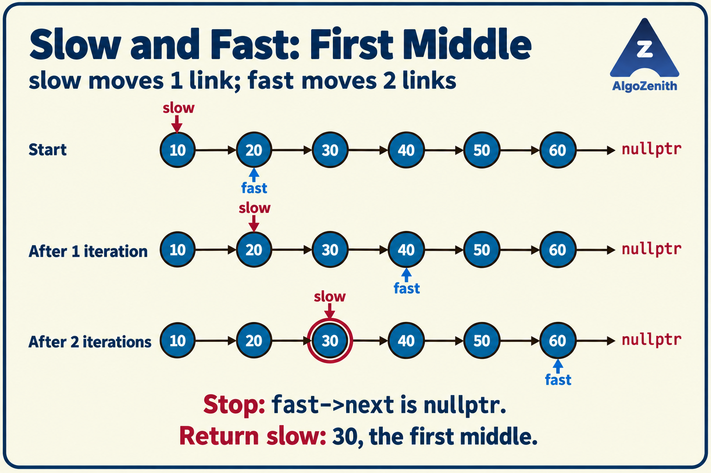

<VIDEO_WIDGET>

<VIDEO_ID></VIDEO_ID>

</VIDEO_WIDGET>

<READING_WIDGET>

# Technique 2: Finding the Middle Node of a Singly Linked List

Finding the middle of an array is straightforward when its length is known: calculate the middle index and access that element. A linked list does not support direct access by index, so we must follow its links.

One solution is to count the nodes and then walk halfway through the list. But can we find the middle without a separate counting pass?

The **slow-and-fast pointer technique** does exactly that: one pointer moves one link at a time, while another moves two. When the faster pointer reaches the end, the slower pointer is at the middle.

## 1. Problem Statement and the Middle Convention

Given the head of a **finite, acyclic singly linked list**, return a pointer to its middle node without changing the list.

- For an empty list, return `nullptr`.
- For an odd number of nodes, return the unique middle node.
- For an even number of nodes, this lesson returns the **first of the two middle nodes**, following the lecture examples.

The answer depends on the node's **position**, not its stored value. Values may repeat, and the list need not be sorted.

### Odd and Even Lengths

```text
Odd length:
10 -> 20 -> 30 -> 40 -> 50 -> nullptr
            ^
         middle

Even length:
10 -> 20 -> 30 -> 40 -> 50 -> 60 -> nullptr
            ^     ^
          first  second
         middle  middle
```

For both lists above, our answer is the node containing `30`. A problem that asks for the **second middle** would return the node containing `40` in the six-node example. We will implement that variation later.

**Always clarify which middle is required when the length is even.** Neither convention is universally correct; it depends on the problem statement.



## 2. Approach 1: Count the Length, Then Walk to the Middle

Let the list contain `n` nodes. Number their positions from `0` to `n - 1`.

For a nonempty list, the zero-based index of the first middle is:

$$
\left\lfloor \frac{n - 1}{2} \right\rfloor.
$$

The floor symbol means “round down.” In C++, integer division gives this result because `n - 1` is nonnegative here.

| Length `n` | First-middle index `(n - 1) / 2` | Position counting from 1 |
| --- | --- | --- |
| 1 | 0 | 1st |
| 2 | 0 | 1st |
| 5 | 2 | 3rd |
| 6 | 2 | 3rd |

The index also tells us how many links to follow from `head`. For example, reaching index `2` requires two moves, not three.

### Algorithm

1. If the list is empty, return `nullptr`.
2. Traverse the list to count its length `n`.
3. Start another pointer at `head`.
4. Advance it `(n - 1) / 2` times.
5. Return that pointer.

### Shared Node Definition

All implementations below use C++17 and this node definition:

```cpp
#include <iostream>
using namespace std;

struct Node {
    int data;
    Node* next;

    Node(int value) {
        data = value;
        next = nullptr;
    }
};
```

`Node*` means a pointer to a node. The constructor gives each node its data and initially sets its link to `nullptr`, meaning there is no next node.

### C++ Implementation

```cpp
Node* firstMiddleByLength(Node* head) {
    if (head == nullptr) return nullptr;

    int length = 0;
    Node* current = head;
    while (current != nullptr) {
        ++length;
        current = current->next;
    }

    int steps = (length - 1) / 2;
    current = head;
    while (steps > 0) {
        current = current->next;
        --steps;
    }

    return current;
}
```

The code assumes the number of nodes fits in an `int`. The empty-list check comes before calculating the middle index.

### Complexity

The first traversal visits all `n` nodes. The second follows about `n / 2` links. Together, they take **`O(n)` time**, not `O(n²)`: the traversals happen one after another, not inside one another.

Only a counter and a few pointers are stored, so the auxiliary space is **`O(1)`**.

## 3. Approach 2: Slow and Fast Pointers

Instead of counting first, use the faster pointer to tell us when the slower pointer has moved far enough.

For the **first-middle convention**, initialize:

- `slow = head`
- `fast = head->next`

The faster pointer starts one node ahead. For every complete pair of moves by `fast`, move `slow` once.

That one-node head start matters for even-length lists. Starting both pointers at `head` with the usual two-step loop would return the second middle instead.

### Why the Naive Two-Step Move Is Unsafe

Checking only `fast != nullptr` is not enough before evaluating `fast->next->next`.

If `fast` identifies the last node, `fast->next` is null. Attempting to access the next field of that null pointer is invalid. This is the issue corrected in the lecture.

There are two safe ways to write the traversal: take the two steps separately, or check both pointers before taking them together.

### Version A: Take the Steps Separately

This follows the corrected lecture logic, with an additional guard for an empty list:

```cpp
Node* firstMiddleStepByStep(Node* head) {
    if (head == nullptr) return nullptr;

    Node* slow = head;
    Node* fast = head->next;

    while (fast != nullptr) {
        fast = fast->next;

        if (fast != nullptr) {
            slow = slow->next;
            fast = fast->next;
        }
    }

    return slow;
}
```

If the first step makes `fast` null, stop without moving `slow`. Otherwise, the second step is safe, even if it sets `fast` to null.

### Version B: Check Before Taking Two Steps

The same result can be obtained with a shorter loop:

```cpp
Node* firstMiddle(Node* head) {
    if (head == nullptr) return nullptr;

    Node* slow = head;
    Node* fast = head->next;

    while (fast != nullptr && fast->next != nullptr) {
        slow = slow->next;
        fast = fast->next->next;
    }

    return slow;
}
```

The `&&` operator uses **short-circuit evaluation**: it evaluates the right-hand condition only if the left-hand condition is true. Therefore, `fast->next` is checked only when `fast` is non-null. Keep the checks in this order.

The final value assigned to `fast` may be null. That is safe; what must never happen is accessing a field through a null pointer.

We will use this compact version in the dry runs below. It returns the same `slow` as the step-by-step version, although the final `fast` position can differ: on an even-length list, the compact loop stops at the last node, while the step-by-step loop takes one final step to null.

## 4. Dry Runs

The tables show positions after each completed iteration of the **compact first-middle loop**. Values are distinct here only to make the movement easy to follow.

### Five Nodes: One Middle

```text
10 -> 20 -> 30 -> 40 -> 50 -> nullptr
```

| Stage | `slow` | `fast` | What happens next? |
| --- | --- | --- | --- |
| Initialization | 10 | 20 | Two-step move is safe |
| After iteration 1 | 20 | 40 | Two-step move is safe |
| After iteration 2 | 30 | `nullptr` | Stop |

Return the node containing `30`, the third of five nodes.

### Six Nodes: First of Two Middles

```text
10 -> 20 -> 30 -> 40 -> 50 -> 60 -> nullptr
```

| Stage | `slow` | `fast` | What happens next? |
| --- | --- | --- | --- |
| Initialization | 10 | 20 | Two-step move is safe |
| After iteration 1 | 20 | 40 | Two-step move is safe |
| After iteration 2 | 30 | 60 | Stop: `fast->next` is null |

Return the node containing `30`, the first middle. Moving `slow` once more would incorrectly select `40` for this convention.



## 5. Why Does the Slow Pointer Stop at the Middle?

Use zero-based positions. Initially, `slow` is at index `0`, and `fast` starts at index `1` if that node exists.

After `t` complete iterations:

- `slow` has moved `t` links and is at index `t`.
- `fast` has moved `2t` links from its starting position, so its index is `1 + 2t` while it still identifies a node.

Now consider the two possible lengths.

### Odd Length: `n = 2k + 1`

After `k` iterations, `fast` reaches `nullptr`, and `slow` is at index `k`. There are `k` nodes before it and `k` after it, so it is the unique middle. For a one-node list, `k = 0`, and no iteration is needed.

### Even Length: `n = 2k`

After `k - 1` iterations, `fast` is at index `2k - 1`, the last node. Its next pointer is null, so the loop stops. `slow` is at index `k - 1`, the first of the two middle positions `k - 1` and `k`.

In both cases, the returned index is exactly `floor((n - 1) / 2)`, matching the length-based method.

### Complexity

The loop performs about `n / 2` iterations, each taking constant time. Therefore:

- **Time:** `O(n)`.
- **Auxiliary space:** `O(1)`.

This is a one-pass technique in the sense that it needs no separate length-counting traversal or restart from `head`. It does not mean that the two pointers collectively touch each node only once. Both approaches remain linear-time; the improvement is avoiding the preliminary counting pass.

## 6. What If the Problem Asks for the Second Middle?

Start both pointers at `head` and keep the same safe loop condition:

```cpp
Node* secondMiddle(Node* head) {
    Node* slow = head;
    Node* fast = head;

    while (fast != nullptr && fast->next != nullptr) {
        slow = slow->next;
        fast = fast->next->next;
    }

    return slow;
}
```

For an empty list, both pointers are null, the loop is skipped, and the function returns null. No access to `head->next` occurs during initialization here.

On six nodes, the pointer pairs are `(10, 10)`, `(20, 30)`, `(30, 50)`, then `(40, nullptr)`. The returned node contains `40`.

| Convention | Initial `slow` | Initial `fast` | Returned zero-based index for `n > 0` |
| --- | --- | --- | --- |
| First middle | `head` | `head->next`, after checking for an empty list | `(n - 1) / 2` |
| Second middle | `head` | `head` | `n / 2` |

For odd lengths, both conventions return the same node. In the counting approach, choosing `length / 2` steps instead of `(length - 1) / 2` also selects the second middle.

## 7. Complete Demonstration

Combine the shared headers and `Node` definition, the four functions above, and this `main` to form a complete C++17 program:

```cpp
int main() {
    Node n1(10), n2(20), n3(30), n4(40), n5(50), n6(60);
    n1.next = &n2;
    n2.next = &n3;
    n3.next = &n4;
    n4.next = &n5;

    // Initially: 10 -> 20 -> 30 -> 40 -> 50
    cout << "Five nodes, first middle: " << firstMiddle(&n1)->data << '\n';
    cout << "Five nodes, second middle: " << secondMiddle(&n1)->data << '\n';

    // Extend the example to six nodes.
    n5.next = &n6;
    cout << "Six nodes, first middle: " << firstMiddle(&n1)->data << '\n';
    cout << "Six nodes, second middle: " << secondMiddle(&n1)->data << '\n';

    if (firstMiddleByLength(&n1) == &n3 &&
        firstMiddleStepByStep(&n1) == &n3 &&
        firstMiddle(&n1) == &n3) {
        cout << "All first-middle methods agree\n";
    }

    Node* emptyHead = nullptr;
    Node* middle = firstMiddle(emptyHead);
    if (middle == nullptr) {
        cout << "Empty list: no middle\n";
    }

    return 0;
}
```

Output:

```text
Five nodes, first middle: 30
Five nodes, second middle: 30
Six nodes, first middle: 30
Six nodes, second middle: 40
All first-middle methods agree
Empty list: no middle
```

`&n1` gives the address of the node object `n1`. These local objects are destroyed automatically when `main` finishes; they were not created with `new`, so we do not call `delete` on them.

The example accesses the result's data directly only for lists known to be nonempty. For a general input, check the returned pointer before reading `middle->data`. The middle-finding functions themselves never modify any links or values; the extra link in `main` only builds the six-node test case.

## 8. Useful Insights and Common Mistakes

- **Do not confuse the middle with the median value.** We are locating a position in the current list order, not sorting the values or computing a statistical median.
- **Test the even-length convention first.** A two-node list immediately reveals whether the code returns the first or second middle. Odd-only tests will not catch this difference.
- **Check for an empty list before using `head->next`.** The first-middle initialization requires this guard.
- **Check both `fast` and `fast->next` before a two-step move.** Testing only `fast` is unsafe. Replacing `&&` with `||` is also incorrect because both conditions must hold.
- **Do not move the pointers at the same speed.** The 1:2 movement ratio is what makes `slow` travel about halfway while `fast` reaches the end.
- **The list must be acyclic.** On a cyclic list, these loops need not terminate. Slow and fast pointers also appear in cycle detection, but that algorithm uses a different stopping rule.
- **Return the node when possible, not a special integer value.** A pointer lets the caller access or work with the middle node. Returning `-1` for an empty list would be ambiguous if `-1` were valid data.
- **Splitting a list needs a deliberate convention.** In linked-list merge sort, the first middle can serve as the last node of the left half, with its successor starting the right half. For a two-node list, this produces two one-node halves; a careless second-middle split may fail to shrink the problem.
- **This technique is a building block.** Finding the middle is useful in merge sort, palindrome checking, and list reordering. Those problems need additional operations, such as reversing or reconnecting a half; locating the middle alone does not solve them.

For testing, include lengths `0`, `1`, `2`, `5`, and `6`, along with repeated values. Compare the returned node's address, not just its data, to verify the exact position.

## Quick Recap

- Clarify whether an even-length list should return its first or second middle.
- Counting length and walking `(n - 1) / 2` links finds the first middle in two traversals.
- For the one-pass first-middle method, start `slow` at `head` and `fast` at `head->next`, after an empty-list check.
- Move `slow` one link and `fast` two only while both `fast` and `fast->next` are non-null.
- Starting both pointers at `head` gives the second middle with the same loop condition.
- Both methods take `O(n)` time and `O(1)` auxiliary space without changing the list.

</READING_WIDGET>
