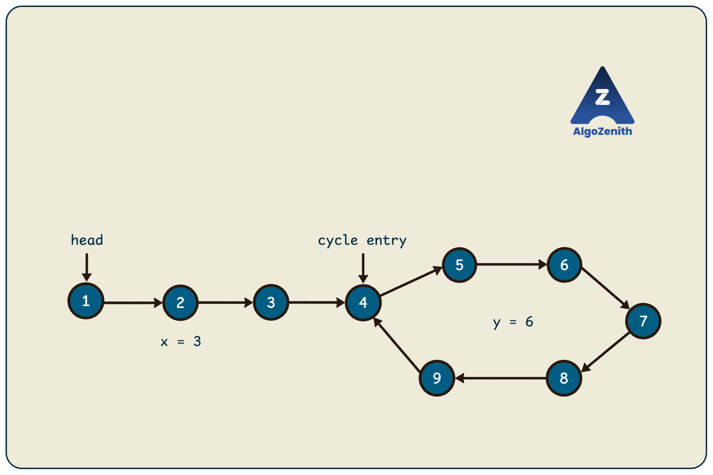
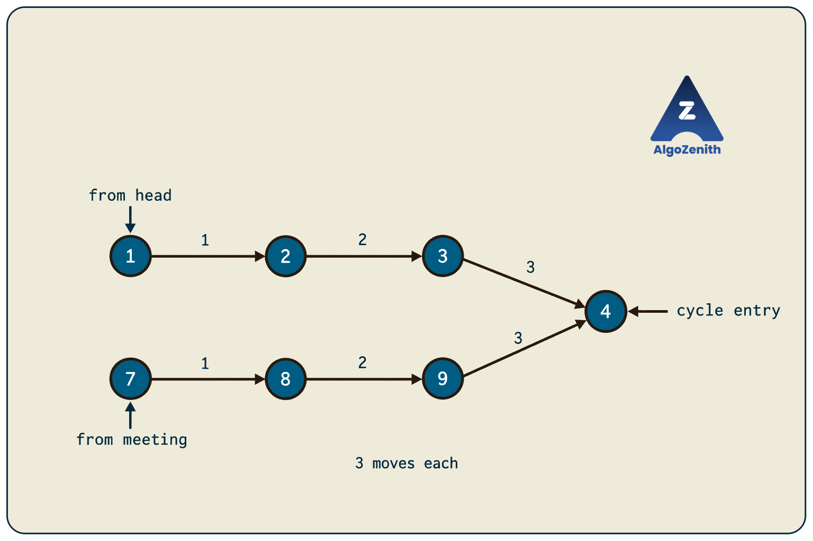
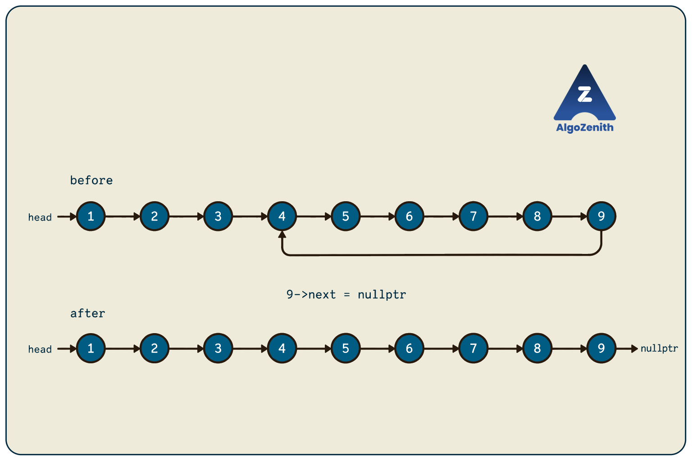

<VIDEO_WIDGET>

<VIDEO_ID></VIDEO_ID>

</VIDEO_WIDGET>

<READING_WIDGET>

# Technique 3: Detecting, Understanding, and Removing a Cycle in a Linked List

In the previous technique, we used slow and fast pointers to find the middle of a linked list. That solution assumed that following `next` would eventually reach `nullptr`.

What if a node points back to an earlier node instead? A normal traversal would keep revisiting the same nodes and never finish.

This lesson answers four connected questions: **Does a cycle exist? Where does it start? How long is it? How can we remove it without losing any nodes?**

Following the lecture's progression, we will start with hashing, examine the doubling-scope idea, and then use **Floyd's slow-and-fast pointer technique** to solve the problem with constant extra space.

## 1. Understanding the Problem

We are given `head`, a pointer to the first node of a singly linked list. Each node has one `next` pointer, which either points to another valid node or is `nullptr`.

A **cycle** exists if following these links eventually revisits the **same node**.

A cycle can contain just one node pointing to itself; this is called a **self-loop**.

Our required results are:

| Task | If a cycle exists | If no cycle exists |
| --- | --- | --- |
| Detect a cycle | Return `true` | Return `false` |
| Find its start | Return the first cycle node reached from `head` | Return `nullptr` |
| Find its length | Return the number of distinct nodes in the cycle | Return `0` |
| Correct the list | Remove the link that closes the cycle, preserving all reachable nodes | Leave the list unchanged |

Assume that there are finitely many distinct reachable nodes and that no other operation changes the links while an algorithm runs. Detection, entry finding, and length counting must not modify the list. Only the final removal step changes a link.

### Repeated Nodes, Not Repeated Values

Two different nodes can store the same value without forming a cycle.

- `p == q` compares node addresses: do the pointers identify the same node?
- `p->data == q->data` only compares values and cannot detect a structural cycle.

All comparisons and hash keys in this lesson use **node pointers**, not data values.

### Running Example

Use a three-node path leading into a six-node cycle:

```text
head -> 1 -> 2 -> 3 -> 4 -> 5 -> 6 -> 7 -> 8 -> 9
                      ^                        |
                      |________________________|
```

The numbers identify distinct nodes in this example.

- The cycle starts at node `4`.
- The cycle contains `4, 5, 6, 7, 8, 9`, so its length is `6`.
- Node `9` points back to node `4`.
- Correcting the list means changing **node `9`'s next pointer** to `nullptr`.

After correction:

```text
head -> 1 -> 2 -> 3 -> 4 -> 5 -> 6 -> 7 -> 8 -> 9 -> nullptr
```

Let:

- `x` be the number of nodes before the cycle, also the number of moves from `head` to the cycle entry.
- `y` be the number of nodes in the cycle.
- `n` be the total number of distinct nodes reachable from `head`.

For a cyclic list, `n = x + y`. Here, `x = 3`, `y = 6`, and `n = 9`. If the cycle starts at `head`, then `x = 0`. For an acyclic list, `n` simply means its ordinary length.



## 2. Approach 1: Remember Visited Nodes Using Hashing

The direct idea is to remember every node we have already visited.

1. Start at `head`.
2. Before visiting a node, check whether its address is already in a hash set.
3. If it is present, return that node.
4. Otherwise, store its address and follow `next`.
5. If the traversal reaches `nullptr`, return `nullptr`.

The **first repeated node is the cycle entry**. Nodes before the cycle cannot be revisited. Once we enter the cycle, we visit every cycle node once and then return to the entry.

In the running example, we first see nodes `1` through `9`. The next node is `4`, whose address is already stored. Therefore, the list has a cycle, and node `4` is its start.

### Shared Node Definition and Headers

All code below uses C++17:

```cpp
#include <iostream>
#include <unordered_set>
using namespace std;

struct Node {
    int data;
    Node* next;

    Node(int value) {
        data = value;
        next = nullptr;
    }
};
```

`Node*` means a pointer to a node. `nullptr` means that the pointer does not identify a node. The constructor initializes the data and starts each new node with no next node.

### C++ Implementation

```cpp
Node* cycleEntryByHashing(Node* head) {
    unordered_set<Node*> seen;
    Node* current = head;

    while (current != nullptr) {
        if (seen.find(current) != seen.end()) {
            return current;
        }

        seen.insert(current);
        current = current->next;
    }

    return nullptr;
}
```

`unordered_set<Node*>` stores node addresses. The expression `seen.find(current) != seen.end()` means that the address was found in the set.

This function solves detection and entry finding together: a non-null result means that a cycle exists. Once we know the entry, we can count one complete lap and remove the closing link using the helpers introduced later.

### Complexity

At most `n` distinct addresses are inserted. With average constant-time hash operations:

- **Expected time:** `O(n)`.
- **Auxiliary space:** `O(n)`.

The time bound is expected, not a worst-case guarantee for hashing; poor hash behavior can make operations slower. The drawback we want to remove is the extra storage for visited nodes.

## 3. Approach 2: Doubling Scope

The lecture also explores checking progressively larger ranges. A standard checkpoint-based version of this idea is **Brent's cycle-finding algorithm**. The name is optional to remember; the useful idea is to double how far we search from a fixed checkpoint. See [Brent's original paper, Section 2](https://maths-people.anu.edu.au/~brent/pd/rpb051i.pdf).

### Keep One Pointer Fixed, Move the Other

Use a fixed `checkpoint` and a moving `runner`. The search ranges have sizes `1, 2, 4, 8, ...`.

- Within a range, move `runner` one link at a time and compare it with `checkpoint`.
- If they meet after a positive number of moves, that count is the cycle length.
- If the range is exhausted without a match, set the checkpoint to the runner's current node, double the range, and restart the count.
- Reaching `nullptr` means there is no cycle.

**We double the range size, not the runner's speed.** Every intermediate node is checked.

### C++ Implementation: Find the Cycle Length

```cpp
int cycleLengthByDoubling(Node* head) {
    if (head == nullptr) return 0;

    Node* checkpoint = head;
    Node* runner = head->next;
    long long scope = 1;
    int length = 1;

    while (runner != nullptr && runner != checkpoint) {
        if (length == scope) {
            checkpoint = runner;
            scope *= 2;
            length = 0;
        }

        runner = runner->next;
        ++length;
    }

    if (runner == nullptr) return 0;
    return length;
}
```

Here, `length` counts moves from the current checkpoint, not from `head`. We check for a match before replacing a checkpoint. This also handles a self-loop: if `head->next == head`, the answer is immediately `1`.

For the example, the checkpoints are nodes `1`, `2`, `4`, and `8`, with scopes `1`, `2`, `4`, and `8`. From checkpoint `8`, the runner visits `9, 4, 5, 6, 7, 8` and returns after six moves.

### Why It Works

For a scope of size `s`, the checkpoint is reached after `s - 1` moves from `head`: these positions are `0, 1, 3, 7, ...`. Once `s - 1 >= x` and `s >= y`, the checkpoint is inside the cycle and the range covers a full lap. The runner's first return takes exactly `y` moves.

Such a scope is at most twice `max(x + 1, y)`. The preceding scopes form a geometric sum (`1 + 2 + 4 + ...`), so total work is `O(x + y)`, with `O(1)` extra space. An acyclic list takes `O(n)` time.

To recover the entry after finding `y`, start two pointers at `head`, advance one by `y` links, then move both one link at a time. Their first meeting is the entry: before then one pointer is outside the cycle; at the entry their separation is exactly one lap. The same removal procedure used later applies.

**Counter note:** The implementations assume at most `2,147,483,647` distinct nodes, so lengths fit in a 32-bit `int`. `long long` is a wider integer type; it lets the doubling scope grow beyond that limit without overflowing.

## 4. Approach 3: Floyd's Slow-and-Fast Pointer Technique

This approach connects directly to the previous lesson:

- `slow` moves **one link** per iteration.
- `fast` moves **two links** per iteration.
- Both start at `head`.

If the list ends, the fast pointer eventually reaches `nullptr` or a node whose next pointer is null. If there is a cycle, the pointers eventually meet inside it.

### C++ Implementation: Find a Meeting Node

```cpp
Node* findCycleMeeting(Node* head) {
    Node* slow = head;
    Node* fast = head;

    while (fast != nullptr && fast->next != nullptr) {
        slow = slow->next;
        fast = fast->next->next;

        if (slow == fast) {
            return slow;
        }
    }

    return nullptr;
}

bool hasCycle(Node* head) {
    return findCycleMeeting(head) != nullptr;
}
```

Two details are essential:

1. **Compare after moving.** Both pointers start at `head`, so their initial equality does not prove that a cycle exists.
2. **Check both `fast` and `fast->next`.** A two-link move is unsafe if either is null.

The `&&` operator checks its right-hand condition only if the left-hand condition is true. This is called **short-circuit evaluation**, and it makes the guard safe in the order shown.

Unlike the first-middle implementation from Technique 2, we do **not** start `fast` at `head->next`. The cycle-entry procedure and proof below use both pointers starting at `head`.

### Why Must They Meet?

Once both pointers are inside the cycle, imagine viewing their movement relative to each other. In each iteration, `fast` gains one link on `slow`.

There are only `y` possible relative positions around a cycle of length `y`. Advancing the relative position by one each time must reach equality within at most `y` further iterations. The fast pointer cannot keep skipping the slow pointer forever with this 1:2 movement rule.

It takes `x` moves for `slow` to enter the cycle, followed by at most `y` iterations to meet. Thus, detection takes **`O(x + y)` time and `O(1)` auxiliary space**.

### Dry Run: Detecting the Cycle

For the running example, node `9` points back to node `4`:

| Stage | `slow` | `fast` |
| --- | --- | --- |
| Initialization — not a cycle check | 1 | 1 |
| After iteration 1 | 2 | 3 |
| After iteration 2 | 3 | 5 |
| After iteration 3 | 4 | 7 |
| After iteration 4 | 5 | 9 |
| After iteration 5 | 6 | 5 |
| After iteration 6 | 7 | 7 |

The pointers meet at node `7`, proving that a cycle exists.

**The meeting node is not necessarily the cycle entry.** Here the meeting node is `7`, but the cycle starts at `4`.

## 5. Find the Cycle's Start Point

Once Floyd's algorithm has found a meeting node:

1. Put one pointer at `head`.
2. Put the other at the meeting node.
3. Move **both one link at a time**.
4. Their first meeting is the cycle entry.

### C++ Implementation

```cpp
Node* findCycleEntry(Node* head) {
    Node* meeting = findCycleMeeting(head);
    if (meeting == nullptr) return nullptr;

    Node* fromHead = head;
    Node* fromMeeting = meeting;

    while (fromHead != fromMeeting) {
        fromHead = fromHead->next;
        fromMeeting = fromMeeting->next;
    }

    return fromHead;
}
```

### Dry Run: Meeting at the Entry

| Stage | `fromHead` | `fromMeeting` |
| --- | --- | --- |
| Initialization | 1 | 7 |
| After one move each | 2 | 8 |
| After two moves each | 3 | 9 |
| After three moves each | 4 | 4 |

Return node `4`.



The diagram shows only the two paths followed during this reset phase, not every link in the original cycle. The small arrow labels count successive moves.

If the cycle starts at `head`, Floyd's meeting is also at `head`. The second loop then needs no moves.

### Why Does Resetting One Pointer Work?

Use the lecture's distance notation:

- `x`: moves from `head` to the cycle entry.
- `y`: cycle length.
- `m`: moves from the entry to the meeting node, measured forward within one lap, so `0 <= m < y`.
- `t`: total moves made by `slow` before the meeting.

At that time, `fast` has made `2t` moves. Since both pointers occupy the same cycle node, their traveled distances differ by a whole number of laps:

$$
2t - t = t = k y
$$

for some positive integer `k`.

The slow pointer first travels the prefix, possibly completes some full laps, and then reaches the meeting offset:

$$
t = x + a y + m
$$

where `a` is a nonnegative integer. Combining the equations:

$$
x + m = (k - a)y.
$$

Therefore, **moving `x` links forward from the meeting node lands at the cycle entry**, because the total distance from the entry becomes a whole number of laps.

Equivalently:

$$
x \equiv -m \pmod y.
$$

The notation “mod `y`” means that we compare remainders after division by `y`. Full laps do not change a pointer's position within the cycle.

Meanwhile, the pointer starting at `head` reaches the entry after exactly `x` moves. The two pointers cannot meet earlier: before those `x` moves, one is outside the cycle while the other is inside it. Their first meeting is therefore the entry.

**Do not assume `x = y - m` in every example.** The prefix can be longer than a lap. The relationship is equality after accounting for whole laps, not necessarily equality of the raw distances.

For example, if `x = 8` and `y = 3`, Floyd's first meeting occurs after `t = 9` slow moves, giving `m = 1`. Here, `x + m = 9` is three full laps; `x` is not equal to `y - m = 2`.

## 6. Find the Length of the Cycle

Once we have **any node known to be in the cycle**, counting its length is simple:

1. Keep that node as the starting marker.
2. Move to its successor and initialize the count to `1`.
3. Keep moving and counting until we return to the marker.

We can use Floyd's meeting node or the cycle entry.

### C++ Implementation

```cpp
int cycleLengthFromNode(Node* cycleNode) {
    if (cycleNode == nullptr) return 0;

    int length = 1;
    Node* current = cycleNode->next;

    while (current != cycleNode) {
        current = current->next;
        ++length;
    }

    return length;
}

int findCycleLength(Node* head) {
    Node* meeting = findCycleMeeting(head);
    return cycleLengthFromNode(meeting);
}
```

**Helper requirement:** A non-null argument to `cycleLengthFromNode` must already be known to lie inside a cycle. Do not pass an arbitrary list head. Use `findCycleLength(head)` when the structure is unknown.

Starting at node `7`, one complete lap is:

```text
7 -> 8 -> 9 -> 4 -> 5 -> 6 -> 7
```

That is six moves, so the cycle length is `6`. Do not count the final repeated `7` as a seventh distinct node.

For a self-loop, `cycleNode->next == cycleNode`. The loop is skipped and the initial count `1` is already correct.

Counting after detection takes **`O(y)` time and `O(1)` space**. Including detection, `findCycleLength` takes **`O(n)` time and `O(1)` space**.

## 7. Correct the Linked List Without Losing Nodes

Removing a cycle does not mean deleting its nodes. We only need to replace the **link from the last node of the cycle back to its entry** with `nullptr`.

After finding the entry:

1. Start `last` at the entry.
2. Move until `last->next == entry`.
3. Set `last->next = nullptr`.

### C++ Implementation

```cpp
bool removeCycle(Node* head) {
    Node* entry = findCycleEntry(head);
    if (entry == nullptr) return false;

    Node* last = entry;
    while (last->next != entry) {
        last = last->next;
    }

    last->next = nullptr;
    return true;
}
```

The function returns `true` if it removed a cycle, or `false` if there was no cycle.

In the running example, `last` walks through nodes `4, 5, 6, 7, 8, 9`. Since node `9` points to the entry, we change `9->next` to `nullptr`. All nine nodes remain reachable from `head` in their original first-visit order.



### Why Not Cut at the Meeting Node?

Setting node `7`'s next pointer to null would also stop the loop, but nodes `8` and `9` would no longer be reachable from `head`. Likewise, setting `entry->next` to null would discard most of the cycle from the reachable list.

We must find the cycle's **last node relative to the entry**, not cut an arbitrary link.

The procedure works without special branches for:

- **A self-loop:** `last` already points to the node whose next pointer closes the cycle.
- **A cycle starting at `head`:** walking one lap finds the correct final node.
- **No cycle or an empty list:** the early return leaves the list unchanged.

Removing the cycle takes **`O(n)` time and `O(1)` auxiliary space**, including entry detection.

## 8. Complete Demonstration

Combine the headers, `Node` definition, all functions above, and this `main` to form a complete C++17 program:

```cpp
int main() {
    Node n1(1), n2(2), n3(3), n4(4), n5(5);
    Node n6(6), n7(7), n8(8), n9(9);

    n1.next = &n2;
    n2.next = &n3;
    n3.next = &n4;
    n4.next = &n5;
    n5.next = &n6;
    n6.next = &n7;
    n7.next = &n8;
    n8.next = &n9;
    n9.next = &n4;  // Close the cycle.

    Node* head = &n1;

    cout << "Cycle exists: " << (hasCycle(head) ? "Yes" : "No") << '\n';

    Node* entry = findCycleEntry(head);
    if (entry != nullptr) {
        cout << "Cycle entry: " << entry->data << '\n';
    }

    cout << "Cycle length: " << findCycleLength(head) << '\n';

    if (cycleEntryByHashing(head) == entry &&
        cycleLengthByDoubling(head) == cycleLengthFromNode(entry)) {
        cout << "All approaches agree\n";
    }

    bool removed = removeCycle(head);
    cout << "Cycle removed: " << (removed ? "Yes" : "No") << '\n';
    cout << "Cycle exists now: " << (hasCycle(head) ? "Yes" : "No") << '\n';

    // Only perform an ordinary traversal after the cycle is removed.
    cout << "Corrected list: ";
    for (Node* current = head; current != nullptr; current = current->next) {
        cout << current->data << " -> ";
    }
    cout << "nullptr\n";

    return 0;
}
```

Output:

```text
Cycle exists: Yes
Cycle entry: 4
Cycle length: 6
All approaches agree
Cycle removed: Yes
Cycle exists now: No
Corrected list: 1 -> 2 -> 3 -> 4 -> 5 -> 6 -> 7 -> 8 -> 9 -> nullptr
```

`&n1` gives the address of node `n1`. The expression `condition ? "Yes" : "No"` chooses one of two values based on the condition; it is a compact alternative to an `if`/`else`.

The nodes here are local objects, not created with `new`, so they are destroyed automatically when `main` finishes. Do not call `delete` on them.

The demonstration calls detection several times to show independently usable functions. If all results are needed together, find a meeting once, reuse it to locate the entry and count the cycle, and then remove the closing link. A fixed number of linear traversals still takes `O(n)` time.

## 9. Complexity Comparison

Here, `n` means the number of **distinct reachable nodes**, not the number of visits in an endless traversal.

| Approach | Detection | Entry finding | Cycle length | Auxiliary space |
| --- | --- | --- | --- | --- |
| Hashing | Expected `O(n)` | First repeated node, expected `O(n)` overall | One lap after finding the entry: `O(y)` more | `O(n)` |
| Doubling scope | `O(n)` | After finding `y`, use a `y`-link gap: `O(n)` more | Obtained during detection | `O(1)` |
| Floyd's slow/fast pointers | `O(n)` | Reset one pointer and walk together: `O(x)` more | One lap from any cycle node: `O(y)` more | `O(1)` |

After the entry is known, removal needs at most one lap and one link update. Thus, all four tasks together take expected `O(n)` time with hashing, or worst-case `O(n)` time with either constant-space approach.

## 10. Useful Insights and Common Mistakes

- **Clarify whether the cycle is unwanted.** An intentionally circular linked list is not broken merely because it contains a cycle. Remove it only when the problem requires an ordinary null-terminated list.
- **Node identity matters.** Duplicate data values must not trigger detection or terminate a counting loop.
- **The meeting node and entry have different roles.** A Floyd meeting proves that a cycle exists; the reset-and-walk phase locates its beginning.
- **Initialization is part of the algorithm.** Both Floyd pointers start at `head`, and comparison happens after movement. Do not copy the first-middle initialization without revisiting the proof.
- **Keep the null checks in the safe order.** Test `fast != nullptr` before `fast->next != nullptr`, and combine them with `&&`, not `||`.
- **Use the standard 1:2 speeds for this entry proof.** Other speeds change the meeting relationship; the same reset procedure is not automatically valid.
- **Do not return a special data value for “no cycle.”** `nullptr` cannot be confused with a valid node whose data happens to be `-1` or `0`.
- **Do not traverse until null before handling a possible cycle.** Ordinary printing, length counting, or node deletion may never finish, revisit freed nodes, or delete a node twice.
- **Break only the closing link.** Removing or bypassing the entry node is unnecessary and can lose part of the list.
- **An interview explanation should include why reset works.** Stating the steps is not enough; connect the meeting distances to whole laps around the cycle.
- **The same idea extends beyond pointers.** In competitive programming, a sequence of states with exactly one next state can be treated like a linked list. If the reachable state space is finite, it eventually repeats unless there is a terminating state. This is useful for detecting repetition without storing every state; it is not a general cycle detector for graphs where a node may have several outgoing edges.

### Edge Cases to Test

| Input shape | Expected behavior |
| --- | --- |
| Empty list | No cycle, null entry, length `0`, no change |
| One node pointing to null | No cycle |
| One node pointing to itself | Entry is that node, length `1`; removal sets its next pointer to null |
| Two nodes pointing to each other | Entry is `head`, length `2` |
| A prefix followed by a self-loop | Entry is the self-loop node, length `1` |
| A cycle beginning at `head` | Preserve every node when breaking the final link |
| Long prefix and short cycle | Entry proof must account for multiple laps |
| Distinct nodes with equal values | Detect by addresses, not values |

After removal, verify that every originally reachable node appears exactly once, the last node points to `nullptr`, and calling `removeCycle` again returns `false` without changing anything.

## Quick Recap

- A cycle means revisiting the **same node**, not merely the same value.
- Hashing finds the cycle entry as the first repeated address, using `O(n)` extra space.
- Doubling scope keeps a checkpoint fixed while a runner searches ranges of size `1, 2, 4, 8, ...`.
- Floyd's algorithm starts both pointers at `head`, moves them at speeds 1 and 2, and compares after moving.
- After a meeting, reset one pointer to `head` and move both one link at a time to find the entry.
- Count one full lap from any known cycle node to find the cycle length.
- To preserve all nodes, find the node whose next pointer closes the cycle and set that pointer to `nullptr`.
- Floyd's complete solution takes `O(n)` time and `O(1)` auxiliary space.

</READING_WIDGET>
