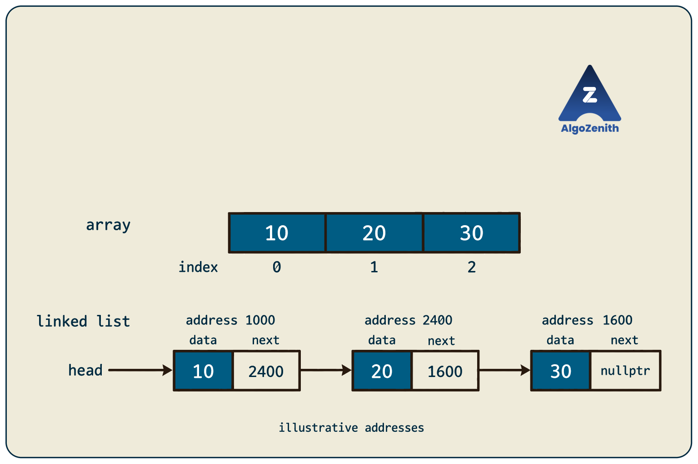
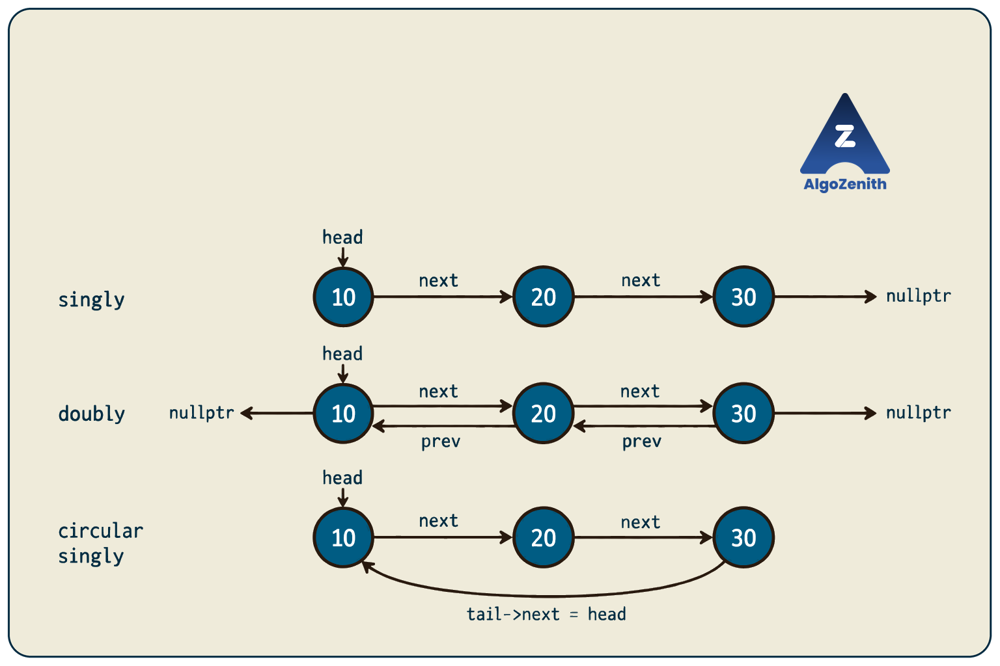

<VIDEO_WIDGET>

<VIDEO_ID></VIDEO_ID>

</VIDEO_WIDGET>

<READING_WIDGET>

# Introduction to Linked List

An array stores its elements next to one another in memory. But what if the elements of a sequence are stored at different locations? How do we know which element comes next?

A **linked list** answers this by storing a link along with each element. Instead of finding the next element by its position in memory, we follow that link.

## 1. What Is a Linked List?

A linked list is a **linear data structure made up of nodes**. Each node stores:

- **Data:** the value of the element.
- **Link information:** a pointer to another node, or pointers to neighbouring nodes, depending on the type of list.

For example, a singly linked list containing `10`, `20`, and `30` has the following logical order:

```text
head -> [10 | next] -> [20 | next] -> [30 | nullptr]
```

The arrows represent links, not adjacent memory locations.

- **`head`** stores the address of the first node. It is the entry point to the list.
- Each **`next`** pointer stores the address of the following node.
- The last node is called the **tail**. In a non-circular singly linked list, its `next` pointer is `nullptr`.
- **`nullptr`** means that the pointer does not point to a node.

For an empty list, `head == nullptr`. A list may also store a separate `tail` pointer for convenience, but this is not required to represent it.

**A linked list is linear because its nodes form a sequence, not because they occupy consecutive memory locations.**

## 2. How Is It Different from an Array?

### Contiguous Storage in an Array

An array's elements occupy consecutive locations, with each element taking the same amount of space. For a valid index `i`, C++ allows us to access an element using:

```cpp
arr[i]
```

This is equivalent to `*(arr + i)`. Pointer arithmetic accounts for the size of an element, so `arr + i` points to the element at index `i`, not merely `i` bytes ahead.

Because the location can be calculated directly, accessing an array element by index takes **`O(1)`** time.

### Linked Storage in a Linked List

Linked-list nodes **do not need to be contiguous**. A node can be stored wherever suitable memory is available, and its link determines which node follows it.

Imagine these illustrative addresses; they are labels, not actual addresses from a program:

| Node address | Data | Address stored in `next` |
| --- | --- | --- |
| 1000 | 10 | 2400 |
| 2400 | 20 | 1600 |
| 1600 | 30 | `nullptr` |

With `head` pointing to address `1000`, following the links gives `10 -> 20 -> 30`, even though the addresses are not consecutive or increasing.



To reach the third node from `head`, we must follow two links. There is no general equivalent of constant-time array indexing: reaching the node at a given position takes **`O(n)` in the worst case** for a list of `n` nodes.

Nodes may happen to be adjacent in memory, but linked-list operations must not rely on that. In particular, `head + 1` is **not** how we move to the next node; we follow `head->next`.

## 3. A Short Pointer Refresher

Since links are represented using pointers in C++, distinguish a **value**, its **address**, and the **pointer storing that address**:

```cpp
int value = 10;
int* p = &value;
```

- `value` is an integer containing `10`.
- `&value` gives the address of that integer.
- `p` stores that address.
- `*p` accesses the integer that `p` points to; here, its value is `10`.

The `*` in `int* p` declares a pointer. The `*` in the expression `*p` **dereferences** that pointer.

For a pointer to a node, `p->data` accesses the node's `data` field. It is shorthand for `(*p).data`.

Only dereference a pointer when it points to a valid, live object. In particular, never access `p->data` or `p->next` when `p == nullptr`.

## 4. Singly Linked List

In a **singly linked list**, each node stores its data and one pointer, `next`, to the following node.

We can follow links **forward**, but a node does not directly store the address of its predecessor.

### Node Representation in C++

```cpp
struct Node {
    int data;
    Node* next;

    Node(int value) {
        data = value;
        next = nullptr;
    }
};
```

`struct` groups related fields into a type named `Node`. Here, `Node(int value)` is a **constructor**: it runs when a node is created, stores the supplied value in `data`, and sets `next` to `nullptr`. For example, `Node first(10);` creates a node containing `10` with no next node yet.

`Node* next` is a pointer to another node; it does not contain an entire second node inside the first one.

### Connecting Three Nodes

Using the `Node` definition above:

```cpp
Node first(10);
Node second(20);
Node third(30);

first.next = &second;
second.next = &third;
Node* head = &first;
```

The list is now `10 -> 20 -> 30 -> nullptr`. The constructor already set `third.next` to `nullptr`.

Notice the distinction:

- `head` points to the first **node**.
- `head->data` is the **value** `10`.
- `head->next` points to the **second node**.

These nodes are local objects used to demonstrate linking. Their pointers are valid only while the objects remain alive. A linked list does not inherently require `new`; memory allocation and ownership will matter when we implement lists that grow and shrink.

### Following the Links

Starting with a temporary pointer `cur = head`, repeatedly read `cur->data` and move to `cur->next`. Stop when `cur == nullptr`.

For this example, the values encountered are `10`, `20`, and `30`. Keep `head` unchanged so that it continues to identify the start of the list.

## 5. Doubly Linked List

In a **doubly linked list**, each node stores two links:

- **`prev`:** points to the previous node.
- **`next`:** points to the next node.

This allows traversal in both directions by following the corresponding pointers.

```cpp
struct DoublyNode {
    int data;
    DoublyNode* prev;
    DoublyNode* next;

    DoublyNode(int value) {
        data = value;
        prev = nullptr;
        next = nullptr;
    }
};
```

For the sequence `10 <-> 20 <-> 30`:

- The first node's `prev` is `nullptr`.
- The middle node's `prev` points to `10`, and its `next` points to `30`.
- The last node's `next` is `nullptr`.

For consecutive nodes `u` and `v`, both relationships must agree: `u->next == v` and `v->prev == u`.

The additional link makes backward movement possible, but requires more storage per node and more links to maintain when the list changes. It does **not** provide constant-time access by index.

## 6. Circular Linked List

In a **circular linked list**, the last node links back to the first node instead of ending at `nullptr`.

For a circular singly linked list containing `10`, `20`, and `30`, following `next` gives:

```text
10 -> 20 -> 30 -> 10 -> 20 -> 30 -> ...
```

The second occurrence of `10` is the **same first node**, not a new node with the same value.

### Circular Singly Linked List

- Each node has a `next` pointer.
- For a nonempty list, `tail->next == head`.
- A one-node list has `head->next == head`.

### Circular Doubly Linked List

- Each node has both `prev` and `next` pointers.
- For a nonempty list, `tail->next == head` and `head->prev == tail`.
- In a one-node list, both pointers refer to that node itself.

Thus, **circular describes how the ends connect**; a circular list can be singly or doubly linked.

### When Does Traversal Stop?

In a nonempty circular list, following `next` will not reach `nullptr`. To visit every node once, start at `head`, process nodes while moving forward, and stop when the pointer returns to `head` after a complete round. Handle an empty list separately.

Compare **node addresses**, not data values, when checking whether you have returned to the starting node: different nodes may store equal values.

## 7. XOR Linked List — An Optional Concept

An **XOR linked list** is a space-saving variation of a doubly linked list. Conceptually, each node stores one combined link field instead of separate `prev` and `next` fields.

That field contains the bitwise XOR of integer representations of the two neighbouring addresses:

```text
link = previous_address XOR next_address
```

If we know one neighbouring address, we can recover the other using the identities `a XOR a = 0` and `0 XOR b = b`:

```text
previous_address XOR link
= previous_address XOR previous_address XOR next_address
= next_address
```

Traversal therefore keeps track of both the **current node** and the **node we came from**. The current node's combined field alone does not tell us which neighbour to visit next.

This is an encoding idea, not valid C++ pointer syntax: ordinary pointers cannot be XORed directly. Address-based implementations also require care about pointer representation and portability, as discussed in this [standards-committee pointer-model paper](https://open-std.org/jtc1/sc22/wg14/www/docs/n2263.htm#q11.-is-the-xor-linked-list-idiom-supported).

For this introduction, understanding the idea is sufficient. We will use ordinary singly and doubly linked nodes for the basic implementations rather than implementing XOR links here.

## 8. Comparing the Types



| Type | Link information per node | Movement | End condition |
| --- | --- | --- | --- |
| Singly linked, non-circular | `next` | Forward | Last node's `next` is `nullptr` |
| Doubly linked, non-circular | `prev`, `next` | Forward and backward | First node's `prev` and last node's `next` are `nullptr` |
| Circular singly linked | `next` | Forward, wrapping to the start | Last node links to `head` |
| Circular doubly linked | `prev`, `next` | Both directions, wrapping at the ends | Last and first nodes link to each other |
| XOR linked, non-circular | One encoded link field | Either direction, with a known neighbouring address | Recovered neighbouring address indicates an end |

For a fixed-size value in each node, all these representations use **`O(n)` total space**. The number and representation of links affect the per-node overhead, not the asymptotic bound.

## 9. Interview Insights and Common Misconceptions

- **A node is not just its value.** Two different nodes may both contain `10`; equal data does not make them the same node.
- **Linked lists do not support constant-time random access.** A known node can be accessed through its pointer, but finding a node by position or searching an unsorted list takes `O(n)` time in the worst case.
- **Insertion and deletion are not always `O(1)` overall.** Changing a fixed number of links is constant-time once the required nodes are known. Finding those nodes can take `O(n)`; in a singly linked list, deleting a general node requires access to its predecessor or the link that points to it.
- **Circular traversal needs a different stopping rule.** Waiting for `nullptr` in a nonempty circular list can loop forever.
- **Links have a memory cost.** A linked list trades direct indexing and contiguous storage for the ability to connect and rearrange nodes without shifting the remaining elements.

## Quick Recap

- A linked list stores a sequence in nodes connected by links; the nodes need not occupy consecutive memory locations.
- `head` identifies the first node, and links determine the order of traversal.
- Singly linked lists store `next`; doubly linked lists store `prev` and `next`.
- Circular lists connect the last node back to the first and can be singly or doubly linked.
- XOR linked lists encode two neighbouring addresses in one field, but require extra traversal context and implementation care.

</READING_WIDGET>
