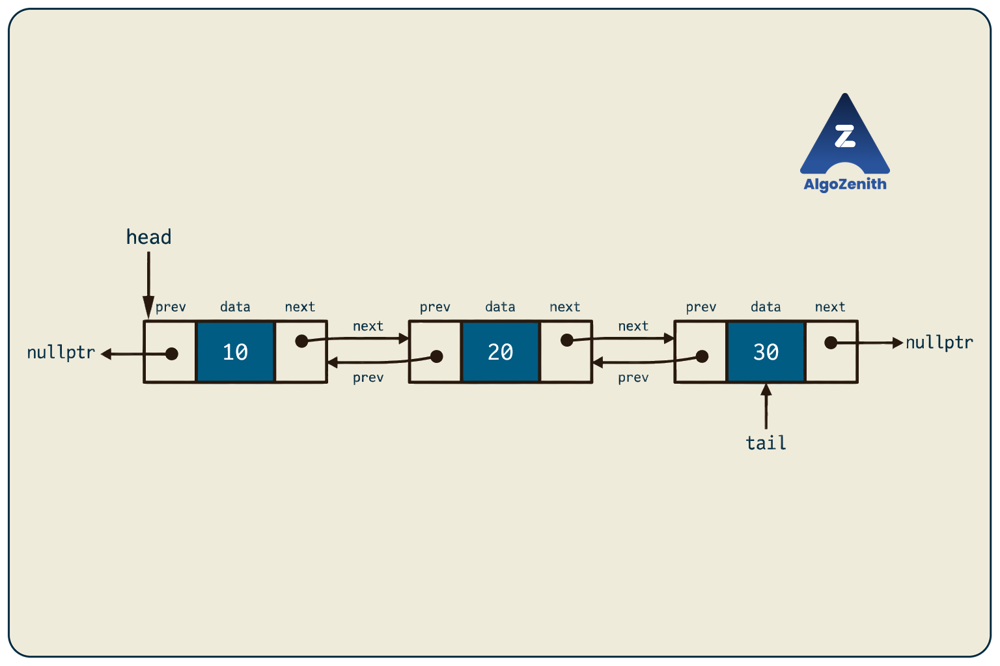

<VIDEO_WIDGET>

<VIDEO_ID>3519</VIDEO_ID> <!-- Required -->

</VIDEO_WIDGET>

<READING_WIDGET>

# Introduction to Doubly Linked List

What if you're on a treasure hunt, but you drop your compass and need to walk backward to the previous clue? A Singly Linked List can't help you—it only goes forward!

Enter the **Doubly Linked List**. In this structure, every node is upgraded to contain _three_ things:

1. The **Data**.
2. A **Next Pointer** (pointing forward).
3. A **Prev Pointer** (pointing backward).

This allows you to traverse the list in both directions, giving you ultimate flexibility!



### Creating a Doubly Linked List

```cpp
#include <iostream>
using namespace std;

// Defining the Doubly Linked Node structure
struct DoublyNode {
    int data;
    DoublyNode* next;
    DoublyNode* prev;

    DoublyNode(int val) {
        data = val;
        next = nullptr;
        prev = nullptr;
    }
};

int main() {
    // 1. Create the nodes
    DoublyNode* head = new DoublyNode(10);
    DoublyNode* second = new DoublyNode(20);
    DoublyNode* third = new DoublyNode(30);

    // 2. Link them together (Both forward and backward!)
    head->next = second;

    second->prev = head;
    second->next = third;

    third->prev = second;

    return 0;
}
```

### Operations on a Doubly Linked List

Doubly linked lists require slightly more pointer rewiring (to keep the `prev` pointers aligned), but offer much better versatility.

#### Traversal

You can start at the `head` and go forward using `next`, OR start at the `tail` and go backward using `prev`.

- _Time Complexity_: `O(N)`.

```cpp
// Traverse backward starting from a known node!
void traverseBackward(DoublyNode* tail) {
    DoublyNode* temp = tail;
    while (temp != nullptr) {
        cout << temp->data << " <-> ";
        temp = temp->prev; // Move backwards!
    }
    cout << "NULL" << endl;
}
```

#### Insertion

**At the Front (Head)**
Make the new node's `next` point to the current `head`, and update the old head's `prev` pointer. Finally, update the `head` to be the new node.

- _Time Complexity_: `O(1)`

```cpp
void insertAtFrontDoubly(DoublyNode*& head, int val) {
    DoublyNode* newNode = new DoublyNode(val);
    newNode->next = head;
    if (head != nullptr) {
        head->prev = newNode;
    }
    head = newNode;
}
```

**At the Back (Tail)**
Traverse the list to find the very last node, and make its `next` point to the new node, and the new node's `prev` to point to the last node.

- _Time Complexity_: `O(N)` (Because we must traverse to find the tail).

```cpp
void insertAtBackDoubly(DoublyNode*& head, int val) {
    DoublyNode* newNode = new DoublyNode(val);
    if (head == nullptr) {
        head = newNode;
        return;
    }
    DoublyNode* temp = head;
    while (temp->next != nullptr) {
        temp = temp->next;
    }
    temp->next = newNode;
    newNode->prev = temp;
}
```

**At Any Specific Position**
Traverse to the node _just before_ the desired position. Rewire the four affected pointers carefully.

- _Time Complexity_: `O(N)` (Due to traversal).

```cpp
void insertAtPositionDoubly(DoublyNode*& head, int val, int pos) {
    if (pos == 0) {
        insertAtFrontDoubly(head, val);
        return;
    }
    DoublyNode* newNode = new DoublyNode(val);
    DoublyNode* temp = head;
    for (int i = 0; temp != nullptr && i < pos - 1; i++) {
        temp = temp->next;
    }
    if (temp == nullptr) return; // Position out of bounds

    newNode->next = temp->next;
    if (temp->next != nullptr) {
        temp->next->prev = newNode;
    }
    temp->next = newNode;
    newNode->prev = temp;
}
```

#### Deletion

**At the Front (Head)**
Move the `head` pointer to `head->next`, ensure its `prev` pointer is set to `nullptr`, and delete the old head.

- _Time Complexity_: `O(1)`

```cpp
void deleteFrontDoubly(DoublyNode*& head) {
    if (head == nullptr) return;
    DoublyNode* toDelete = head;
    head = head->next;
    if (head != nullptr) {
        head->prev = nullptr;
    }
    delete toDelete;
}
```

**At the Back (Tail)**
Traverse to the end, step back using the `prev` pointer, set the second-to-last node's `next` to `nullptr`, and delete the tail.

- _Time Complexity_: `O(N)` (Because we don't have a global tail pointer).

```cpp
// Without a global tail pointer
void deleteBackDoubly(DoublyNode*& head) {
    if (head == nullptr) return;
    if (head->next == nullptr) {
        delete head;
        head = nullptr;
        return;
    }
    DoublyNode* temp = head;
    while (temp->next != nullptr) {
        temp = temp->next;
    }
    temp->prev->next = nullptr;
    delete temp;
}
```

**At Any Specific Position**
Traverse to the node _just before_ the one you want to delete. Rewire the pointers to completely skip over the target node in both directions.

- _Time Complexity_: `O(N)`

```cpp
void deleteAtPositionDoubly(DoublyNode*& head, int pos) {
    if (head == nullptr) return;
    if (pos == 0) {
        deleteFrontDoubly(head);
        return;
    }
    DoublyNode* temp = head;
    for (int i = 0; temp != nullptr && i < pos - 1; i++) {
        temp = temp->next;
    }
    if (temp == nullptr || temp->next == nullptr) return; // Out of bounds

    DoublyNode* toDelete = temp->next;
    temp->next = toDelete->next;
    if (toDelete->next != nullptr) {
        toDelete->next->prev = temp;
    }
    delete toDelete;
}
```

> 💡 **Core Insight:** Doubly Linked Lists take up slightly more memory (because of the extra `prev` pointer), but they make certain operations much faster and easier—especially deleting the tail if you explicitly keep track of a `tail` pointer!

---

## A Note on C++ STL (`std::list` & `std::forward_list`)

While it is absolutely crucial to know how to build a linked list from scratch for interviews, you rarely have to reinvent the wheel in real-world production or competitive programming! The C++ Standard Template Library (STL) actually provides built-in linked lists:

- `std::list`: This is implemented as a **Doubly Linked List** under the hood. It allows you to traverse in both directions and seamlessly push/pop elements from both the front and back in `O(1)` time.
- `std::forward_list`: This is implemented as a **Singly Linked List**. It is highly memory-efficient since it only uses one pointer, but it only allows forward traversal.

```cpp
#include <iostream>
#include <list>
using namespace std;

int main() {
    list<int> myList; // A built-in Doubly Linked List!

    myList.push_back(10);  // Insert at back O(1)
    myList.push_front(20); // Insert at front O(1)

    // Traversal is incredibly easy using iterators or range-based for loops!
    for (int val : myList) {
        cout << val << " <-> ";
    }
    cout << "NULL\n";

    return 0;
}
```

---

## Useful Insights and Common Mistakes

- **Maintain both directions.** For consecutive nodes `u` and `v`, `u->next == v` must agree with `v->prev == u`. Updating only one link can make forward traversal work while backward traversal is broken.
- **Keep the endpoints correct.** In a nonempty, non-circular doubly linked list, `head->prev` and the tail's `next` are `nullptr`. After deleting the head, reset the new head's `prev` if it exists.
- **Handle empty and one-node lists separately.** Check pointers before dereferencing them. Deleting the only node leaves `head == nullptr`; if a separate tail pointer is maintained, reset it too.
- **Distinguish a known node from a requested position.** With a valid pointer to the target node, deletion needs only a fixed number of link updates. Finding that node by position or value can still take `O(N)`.
- **A stored tail changes the complexity.** The head-only functions above scan to reach the back. With a maintained tail pointer, back insertion and deletion can both take `O(1)` time because `prev` provides the predecessor directly.
- **Validate before allocating, and reconnect before deleting.** Reject negative or out-of-range positions, preserve the neighbouring pointers, and release removed nodes with `delete`. Never access a node after freeing it.
- **Backward traversal is not random access.** Having `prev` does not make access by index constant-time. The extra link also adds storage and another relationship to maintain.

## Quick Recap

- A doubly linked node stores data, `next`, and `prev`.
- Follow `next` to move forward and `prev` to move backward; a complete traversal takes `O(N)` time.
- Insertion and deletion must keep both neighbouring links consistent.
- Front operations take `O(1)` time. Back operations also take `O(1)` when a tail pointer is maintained; the head-only implementations above take `O(N)`.
- Test both traversal directions, empty lists, and one-node lists when checking an implementation.

</READING_WIDGET>
