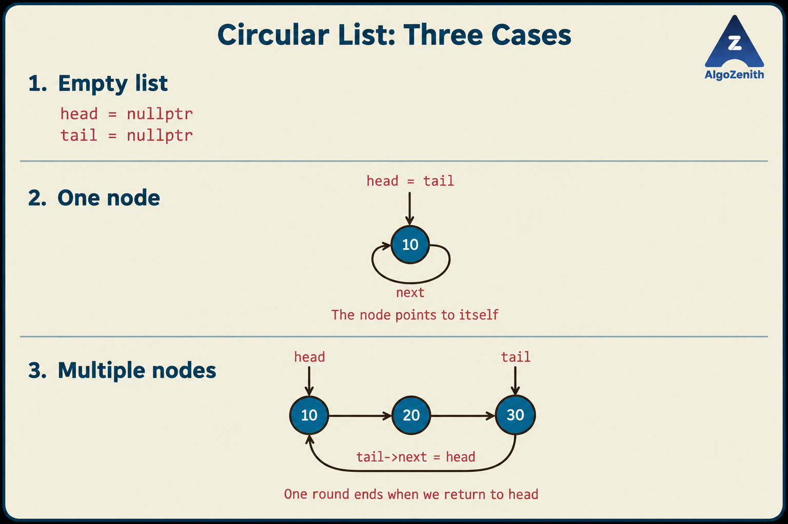
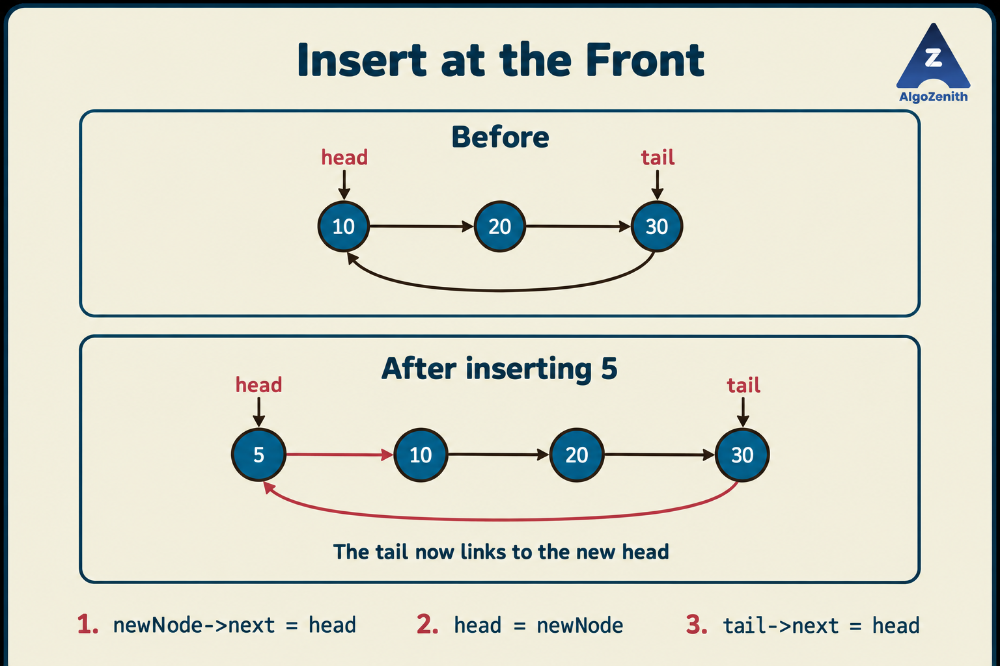
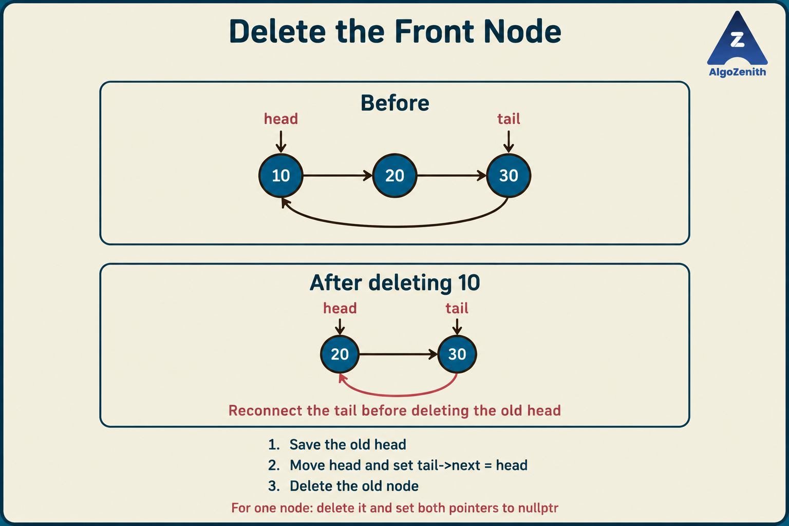

<VIDEO_WIDGET>

<VIDEO_ID></VIDEO_ID>

</VIDEO_WIDGET>

<READING_WIDGET>

# Introduction to Circular Linked List

In a non-circular singly linked list, following `next` eventually reaches `nullptr`. What if we want to move through the same sequence repeatedly, returning to the first node after the last one?

A **circular linked list** connects the last node back to the first. The node structure can remain the same; what changes is the final link and the way we decide when traversal is complete.

## 1. What Makes a Linked List Circular?

Consider three nodes containing `10`, `20`, and `30`:

```text
Non-circular: head -> 10 -> 20 -> 30 -> nullptr

Circular:     head -> 10 -> 20 -> 30
                      ^           |
                      |___________|
```

The circular list still contains **three nodes**, not an infinite number of nodes. Repeatedly following the links revisits the same nodes.

- `head` identifies the first node in the sequence we choose to display.
- `tail` identifies the node immediately before `head` in that sequence.
- In a nonempty circular singly linked list, **`tail->next == head`**.
- No node's `next` is `nullptr` in a correctly formed nonempty circular list.

There is no natural endpoint in the ring. `head` gives us a chosen starting point, and returning to it marks one complete round.

## 2. Circular Singly and Circular Doubly Linked Lists

**Circular** describes how the ends connect. It does not determine how many links each node stores.

| Property | Circular singly linked list | Circular doubly linked list |
| --- | --- | --- |
| Links in each node | `next` | `next` and `prev` |
| Movement | Forward | Forward and backward |
| Forward wraparound | `tail->next == head` | `tail->next == head` |
| Backward wraparound | No `prev` pointer | `head->prev == tail` |

In a circular doubly linked list, consecutive nodes must agree in both directions: if `u->next == v`, then `v->prev == u`.

The implementation in this lesson focuses on the **circular singly linked list**. Its node is the same `Node` used in the singly linked-list lesson: one data field and one `next` pointer. Circularity comes from connecting the nodes, not from adding another field.

## 3. Representation and Boundary Cases

We maintain **both `head` and `tail`**. Keeping `tail` saves us from searching for the last node whenever we need to update the link back to `head`.

These conditions must hold after every operation:

| List state | Required conditions |
| --- | --- |
| Empty | `head == nullptr` and `tail == nullptr` |
| One node | `head == tail` and `head->next == head` |
| Two or more nodes | `tail->next == head`; following `next` from `head` visits every node once before returning to `head` |

The one-node case is especially important. Its link points **to itself**, not to `nullptr`.



The code below assumes that the list starts empty and is modified through the supplied functions. It does not attempt to repair arbitrary broken pointers or malformed cycles.

## 4. Traversal: Stop After One Complete Round

The usual linear-list condition, `cur != nullptr`, does not work here: a nonempty circular list never reaches `nullptr`.

Instead:

1. If the list is empty, stop immediately.
2. Start at `head`.
3. Process the current node and follow `next`.
4. Stop when the pointer returns to `head`.

For `10 -> 20 -> 30 -> head`, the progression is:

| Current node | Action | Next node | Continue? |
| --- | --- | --- | --- |
| 10 | Process 10 | 20 | Yes |
| 20 | Process 20 | 30 | Yes |
| 30 | Process 30 | 10, which is `head` | No |

A **`do...while` loop** fits this pattern: it runs the body first and checks the condition afterward. A normal `while (cur != head)` loop would run zero times if `cur` initially equals `head`.

Always compare **pointers**, not data values, to recognize the starting node. A list such as `10 -> 20 -> 10 -> head` contains two different nodes with value `10`; both must be visited.

Searching follows the same rule: stop when the value is found, or after one complete round if it is absent. Traversal and worst-case search both take **`O(n)`** time.

## 5. Insertion: Keep the Ring Connected

### At the Front

For an empty list, make the new node point to itself and set both `head` and `tail` to it.

For a nonempty list:

1. Point the new node to the old `head`.
2. Update `head` to the new node.
3. Set `tail->next = head`.

Inserting `5` into `10 -> 20 -> 30 -> head` produces `5 -> 10 -> 20 -> 30 -> head`. The tail stays at `30`, but its link must now point to `5`.



**Time: `O(1)`**, because `tail` is already available.

### At the Back

For a nonempty list:

1. Point the new node to `head`.
2. Point the old tail to the new node.
3. Update `tail` to the new node.

The head does not change. **Time: `O(1)`** with a stored tail pointer.

### At a Given Position

Use **0-based positions relative to `head`**. For `n` nodes, valid insertion positions are `0` through `n`:

- Position `0`: insert at the front.
- Position `n`: insert after the old tail, becoming the new tail.
- A position in between: find its predecessor and insert between that node and its successor.

If `previous` is the predecessor, first connect the new node to `previous->next`, then connect `previous` to the new node. This order preserves access to the rest of the list.

**Positions do not wrap around.** Negative positions and positions greater than `n` are rejected. Otherwise, a large position could silently circle the list and modify the wrong location.

Finding the predecessor takes **`O(n)`** time in the worst case. The code validates the position before allocating a node, so an invalid request does not leak memory.

## 6. Deletion: Handle the Last Remaining Node Separately

### At the Front

- **Empty list:** there is nothing to delete.
- **One node:** delete it and set both pointers to `nullptr`.
- **Multiple nodes:** save the old head, advance `head`, reconnect `tail->next` to the new head, and delete the old node.

Simply advancing `head` is not enough: the tail would still point to the deleted node.



**Time: `O(1)`** with both pointers stored.

### At the Back

For multiple nodes, find the node immediately before `tail`, make it the new tail, and connect it back to `head`. Then delete the old tail.

Knowing `tail` does **not** give us its predecessor in a singly linked list. Finding that predecessor takes **`O(n)`** time.

### At a Given Position

Valid deletion positions are `0` through `n - 1`:

1. Handle position `0` using front deletion.
2. Otherwise, find the predecessor without going past the tail.
3. Bypass the target node by connecting its predecessor to its successor.
4. If the target was the tail, update `tail` to the predecessor.
5. Delete the target node.

Read any needed links **before** deleting a node. A pointer to a deleted node must not be dereferenced.

## 7. Complete C++17 Implementation

The program below demonstrates creation through insertion, traversal, search, insertion and deletion at different positions, and cleanup.

### A Few Syntax Notes

- **`Node(int value)`** is a constructor. It runs when a node is created and initializes its fields.
- **`new Node(value)`** creates a node dynamically. Each such node must eventually be released with `delete`.
- **`Node*& head`** means “a reference to a node pointer.” This allows a function to change the caller's actual `head` pointer. The same applies to `tail`.
- **`bool`** stores `true` or `false`. Deletion and positional-insertion functions return `false` if the requested operation is invalid, leaving the list unchanged.
- **`do...while`** executes its body at least once, which is why we check for an empty list before using it.

```cpp
#include <iostream>
using namespace std;

struct Node {
    int data;
    Node* next;

    Node(int value) {
        data = value;
        next = nullptr;
    }
};

void printList(Node* head) {
    if (head == nullptr) {
        cout << "Empty list\n";
        return;
    }

    Node* cur = head;
    do {
        cout << cur->data << " -> ";
        cur = cur->next;
    } while (cur != head);
    cout << "(back to head)\n";
}

bool contains(Node* head, int value) {
    if (head == nullptr) return false;

    Node* cur = head;
    do {
        if (cur->data == value) return true;
        cur = cur->next;
    } while (cur != head);
    return false;
}

void insertAtFront(Node*& head, Node*& tail, int value) {
    Node* newNode = new Node(value);

    if (head == nullptr) {
        head = tail = newNode;
        newNode->next = newNode;
        return;
    }

    newNode->next = head;
    head = newNode;
    tail->next = head;
}

void insertAtBack(Node*& head, Node*& tail, int value) {
    if (head == nullptr) {
        insertAtFront(head, tail, value);
        return;
    }

    Node* newNode = new Node(value);
    newNode->next = head;
    tail->next = newNode;
    tail = newNode;
}

bool insertAtPosition(Node*& head, Node*& tail, int value, int pos) {
    if (pos < 0) return false;
    if (pos == 0) {
        insertAtFront(head, tail, value);
        return true;
    }
    if (head == nullptr) return false;

    Node* previous = head;
    for (int i = 0; i < pos - 1; ++i) {
        // Do not wrap around while looking for the predecessor.
        if (previous == tail) return false;
        previous = previous->next;
    }

    Node* newNode = new Node(value);
    newNode->next = previous->next;
    previous->next = newNode;
    if (previous == tail) tail = newNode;
    return true;
}

bool deleteFront(Node*& head, Node*& tail) {
    if (head == nullptr) return false;

    Node* toDelete = head;
    if (head == tail) {
        head = tail = nullptr;
    } else {
        head = head->next;
        tail->next = head;
    }
    delete toDelete;
    return true;
}

bool deleteBack(Node*& head, Node*& tail) {
    if (head == nullptr) return false;
    if (head == tail) return deleteFront(head, tail);

    Node* previous = head;
    while (previous->next != tail) {
        previous = previous->next;
    }

    Node* toDelete = tail;
    tail = previous;
    tail->next = head;
    delete toDelete;
    return true;
}

bool deleteAtPosition(Node*& head, Node*& tail, int pos) {
    if (pos < 0 || head == nullptr) return false;
    if (pos == 0) return deleteFront(head, tail);

    Node* previous = head;
    for (int i = 0; i < pos - 1; ++i) {
        if (previous == tail) return false;
        previous = previous->next;
    }

    // Deleting after the tail would wrap to head: pos is invalid.
    if (previous == tail) return false;

    Node* toDelete = previous->next;
    previous->next = toDelete->next;
    if (toDelete == tail) tail = previous;
    delete toDelete;
    return true;
}

void clearList(Node*& head, Node*& tail) {
    while (head != nullptr) {
        deleteFront(head, tail);
    }
}

int main() {
    Node* head = nullptr;
    Node* tail = nullptr;

    insertAtBack(head, tail, 10);
    insertAtBack(head, tail, 20);
    insertAtBack(head, tail, 30);
    printList(head);

    insertAtFront(head, tail, 5);
    insertAtPosition(head, tail, 15, 2);
    printList(head);

    cout << "Contains 20: " << (contains(head, 20) ? "Yes" : "No") << '\n';

    deleteFront(head, tail);
    deleteBack(head, tail);
    deleteAtPosition(head, tail, 1);
    printList(head);

    if (!insertAtPosition(head, tail, 99, 10)) {
        cout << "Invalid insertion position\n";
    }

    clearList(head, tail);
    printList(head);
    return 0;
}
```

In `main`, `condition ? "Yes" : "No"` is shorthand for selecting one of two values: use `"Yes"` when the condition is true and `"No"` otherwise. Also, `head = tail = newNode` assigns the same pointer to both variables; it does not create two nodes.

`clearList` repeatedly deletes the front node. Unlike ordinary traversal, it can use `head != nullptr` because each iteration removes a node and deleting the final node sets `head` to `nullptr`.

## 8. Dry Run and Output

Each sequence below lists the nodes once, starting at `head`. In every nonempty row, the tail links back to that head.

| Operation | Sequence | Head value | Tail value |
| --- | --- | --- | --- |
| Append 10, 20, 30 | `10 -> 20 -> 30` | 10 | 30 |
| Insert 5 at front | `5 -> 10 -> 20 -> 30` | 5 | 30 |
| Insert 15 at position 2 | `5 -> 10 -> 15 -> 20 -> 30` | 5 | 30 |
| Delete front | `10 -> 15 -> 20 -> 30` | 10 | 30 |
| Delete back | `10 -> 15 -> 20` | 10 | 20 |
| Delete position 1 | `10 -> 20` | 10 | 20 |
| Try insertion at position 10 | Unchanged: invalid position | 10 | 20 |
| Clear the list | Empty | — | — |

The program takes no input. Its output is:

```text
10 -> 20 -> 30 -> (back to head)
5 -> 10 -> 15 -> 20 -> 30 -> (back to head)
Contains 20: Yes
10 -> 20 -> (back to head)
Invalid insertion position
Empty list
```

The text `(back to head)` is a display label, not another node.

## 9. Complexity

For a circular **singly** linked list containing `n` nodes, with both `head` and `tail` stored:

| Operation | Time |
| --- | --- |
| Traverse once | `O(n)` |
| Search for a value | `O(n)` worst case |
| Insert at front or back | `O(1)` |
| Delete front | `O(1)` |
| Delete back | `O(n)` worst case: find the predecessor |
| Insert or delete by position | `O(n)` worst case |
| Clear the list | `O(n)` |

The list occupies **`O(n)` space**. Each function uses **`O(1)` auxiliary space**, excluding the new node allocated by an insertion. As usual for these data-structure bounds, allocation and deallocation are treated as constant-time operations.

Calling `insertAtPosition` with position `n` still scans for the predecessor in this implementation. Use `insertAtBack` when you specifically want the constant-time append operation.

If we stored only `head`, changing the first node would require finding the tail to repair its link. The constant-time front operations above depend on our representation, not just on the list being circular.

## 10. Useful Insights and Common Mistakes

- **Repeated turns:** a circular list naturally represents a changing set of participants taking turns. Advancing to the next participant wraps around without a special end-of-list reset. Circular elimination problems such as Josephus use this idea, although a linked-list simulation is not automatically the fastest solution for large inputs.
- **Intentional circularity is not an accidental cycle.** These functions assume one ring containing every node. They are not cycle-detection functions for arbitrary linked structures.
- **Test empty and one-node lists first.** A sole node points to itself; deleting it must reset both pointers.
- **Never wait for `nullptr` during a normal round.** Stop when the current pointer returns to the starting node.
- **Update the closing link when `head` changes.** Otherwise, the ring may skip the new head or point to freed memory.
- **Do not confuse data equality with node identity.** Duplicate values are allowed; stopping rules use addresses.
- **Circular does not mean bidirectional.** A circular singly linked list still needs a forward scan to find a predecessor. A circular doubly linked list provides it through `prev`.
- **Position checks must not wrap.** Reject an invalid position without changing the list.

## Quick Recap

- A circular linked list connects its last node back to its first.
- With `head` and `tail`, preserve `tail->next == head` whenever the list is nonempty.
- Traverse one complete round, handling the empty list separately.
- Front insertion, back insertion, and front deletion take `O(1)` time with this representation; deleting the back of a singly linked ring still takes `O(n)`.
- Maintain valid links before freeing a node, and release all dynamically allocated nodes when finished.

</READING_WIDGET>
