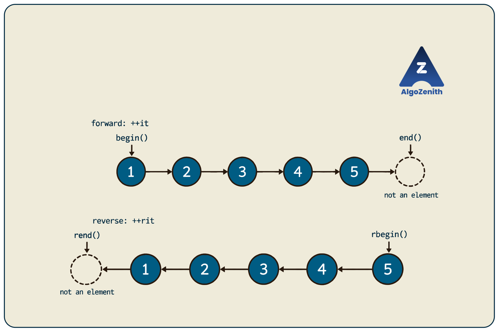
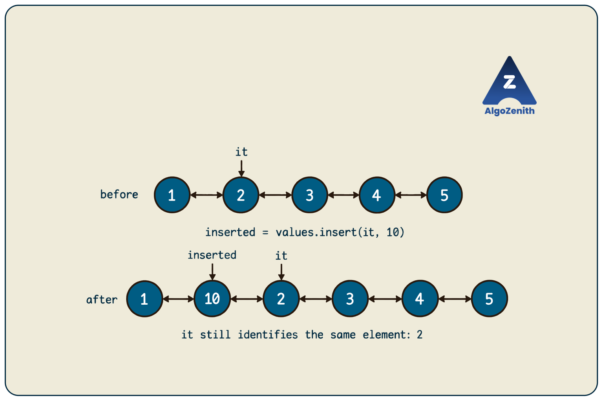
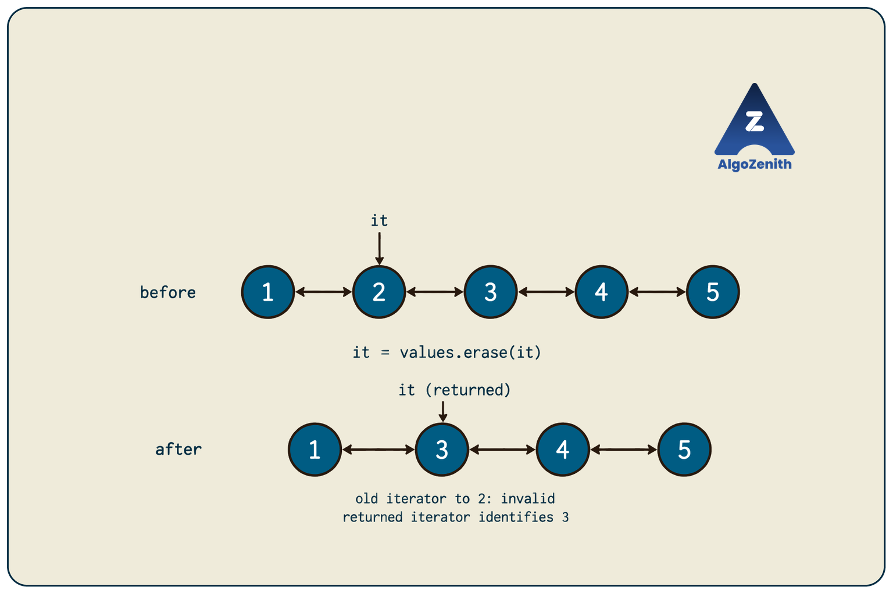

<VIDEO_WIDGET>

<VIDEO_ID></VIDEO_ID>

</VIDEO_WIDGET>

<READING_WIDGET>

# Linked List in STL

In the previous lessons, we created nodes, connected pointers, and handled insertion and deletion ourselves. C++ also provides a standard container that manages these details for us: **`std::list`**.

The important shift is from working with `Node*` pointers to working with **iterators**. Once we understand how iterators identify elements, most list operations become straightforward.

## 1. What Is `std::list`?

`std::list<T>` is a sequence container, normally implemented as a **doubly linked list**. Here, `T` is the type of value stored: `list<int>` stores integers, while `list<string>` stores strings.

Its main characteristics are:

- Elements stay in a sequence and can be traversed in both directions.
- Inserting or erasing **one element at a known iterator position** takes `O(1)` time.
- Direct access by index is not supported: there is no `values[i]` or `values.at(i)`.
- The container manages element storage automatically; we do not write `new`, `delete`, or pointer-rewiring code.

The phrase **“at a known iterator position”** matters. Finding that position may still require a linear scan. The [C++ specification's list overview](https://eel.is/c++draft/list.overview) distinguishes this fast modification from the absence of fast random access.

All examples in this lesson use **C++17** and integer lists. Each short example starts independently unless explicitly stated otherwise.

## 2. Creating a List

Include `<list>` to use the container and `<iostream>` to print values:

```cpp
#include <iostream>
#include <list>
using namespace std;

int main() {
    list<int> emptyList;                 // No elements
    list<int> values = {1, 2, 3, 4, 5}; // Elements in this order
    list<int> repeated(3, 10);          // Three copies of 10

    for (int value : values) {
        cout << value << ' ';
    }
    cout << '\n';
    return 0;
}
```

Output:

```text
1 2 3 4 5
```

`using namespace std;` lets these teaching examples write `list` and `cout` instead of `std::list` and `std::cout`. The loop `for (int value : values)` is a **range-based loop**: it visits each element in order, copying its value into `value` for that iteration.

The following snippets assume these headers and the same namespace declaration.

## 3. Iterators: Identifying an Element

An **iterator** acts like a position marker inside a container. For a list iterator `it`:

- `*it` accesses the element at that position.
- `++it` moves one element forward.
- `--it` moves one element backward, when a previous position exists.

For example:

```cpp
list<int> values = {1, 2, 3, 4, 5};
list<int>::iterator it = values.begin();

cout << *it << '\n'; // 1
++it;
cout << *it << '\n'; // 2
--it;
cout << *it << '\n'; // 1
```

`list<int>::iterator` is the iterator type supplied by `list<int>`. We can write the shorter declaration `auto it = values.begin();` instead: **`auto` asks the compiler to infer the type from the value on the right**. We will use that shorthand below.

### `begin()` and `end()`

For `values = {1, 2, 3, 4, 5}`:

```text
          1 <-> 2 <-> 3 <-> 4 <-> 5       past-the-end
          ^                                   ^
       begin()                              end()
```

- `begin()` identifies the first element.
- `end()` is a **past-the-end marker**, not the last element.
- An empty list has `begin() == end()`.

Never dereference `end()`, increment `end()`, or decrement `begin()`. For a **nonempty** list, decrementing an iterator obtained from `end()` reaches the last element.

The public iterator interface is not circular. Reaching `end()` does not wrap around to `begin()`, regardless of how the library represents nodes internally.

### Forward and Reverse Traversal

```cpp
list<int> values = {1, 2, 3, 4, 5};

for (auto it = values.begin(); it != values.end(); ++it) {
    cout << *it << ' ';
}
cout << '\n';

for (auto it = values.rbegin(); it != values.rend(); ++it) {
    cout << *it << ' ';
}
cout << '\n';
```

Output:

```text
1 2 3 4 5
5 4 3 2 1
```

`rbegin()` starts reverse traversal at the last element; `rend()` marks its end and must not be dereferenced. **Incrementing a reverse iterator moves toward the front of the original list.** Both loops safely do nothing for an empty list.

These endpoint meanings follow the standard's [container requirements](https://eel.is/c++draft/container.reqmts) and [reverse-iteration requirements](https://eel.is/c++draft/container.rev.reqmts).



The arrows show iterator movement, not internal pointer storage. The dashed circles are stopping markers, not extra list elements.

## 4. Basic Operations at the Ends

| Operation | Meaning | Time |
| --- | --- | --- |
| `values.front()` | Access the first element | `O(1)` |
| `values.back()` | Access the last element | `O(1)` |
| `values.push_front(x)` | Insert `x` at the front | `O(1)` |
| `values.push_back(x)` | Insert `x` at the back | `O(1)` |
| `values.pop_front()` | Erase the first element | `O(1)` |
| `values.pop_back()` | Erase the last element | `O(1)` |
| `values.size()` | Return the number of elements | `O(1)` in C++17 |
| `values.empty()` | Return whether the list has no elements | `O(1)` |
| `values.clear()` | Erase every element | `O(n)` |

`front()`, `back()`, `pop_front()`, and `pop_back()` require a **nonempty list**. Check `empty()` when that is not already guaranteed. The pop operations erase an element but do not return its value.

```cpp
list<int> values;
values.push_back(20);   // [20]
values.push_front(10);  // [10, 20]
values.push_back(30);   // [10, 20, 30]

if (!values.empty()) {
    cout << values.front() << ' ' << values.back() << '\n'; // 10 30
    values.pop_front(); // [20, 30]
}
values.pop_back();      // [20]: known to be nonempty here
values.clear();         // []
```

`!values.empty()` means “the list is not empty.” Clearing a list destroys its elements; the list object itself remains available for reuse.

## 5. Insertion at an Iterator Position

`values.insert(it, x)` inserts `x` **before** the element identified by `it`.

Using the sequence from the video screenshot:

```cpp
list<int> values = {1, 2, 3, 4, 5};
auto it = values.begin();
++it;                              // Points to 2

auto inserted = values.insert(it, 10);
// values: [1, 10, 2, 3, 4, 5]

cout << *it << '\n';               // 2: original iterator is still valid
cout << *inserted << '\n';         // 10: insert returns the new iterator
```

The element `2` changes its position in the sequence, but the iterator still identifies that **same element**. Existing element iterators remain valid after list insertion.



`insert(values.begin(), x)` inserts at the front; `insert(values.end(), x)` inserts at the back. Insertion at `end()` is valid even though reading `*end()` is not. For an empty list, `begin()` and `end()` represent the same insertion position.

The position must belong to the list being modified. An iterator from some other list is not a valid insertion position here.

### Why Is This Not Always Constant-Time Overall?

Inserting at an already known iterator costs `O(1)`. But if the instruction is “insert before the element at index 100,” we must first walk to that position.

List iterators support `++it` and `--it`, but not `it + 100`. Advancing through `k` elements takes `O(k)` time. Therefore:

```text
Find the position + insert one element
       O(n)       +       O(1)       = O(n) worst case
```

## 6. Erasing an Element Safely

`values.erase(it)` removes the element identified by `it` and returns an iterator to its **successor**, or `end()` if there is no successor.

This example starts again from the original list, independently of the insertion example:

```cpp
list<int> values = {1, 2, 3, 4, 5};
auto it = values.begin();
++it;                         // Points to 2

it = values.erase(it);        // values: [1, 3, 4, 5]
cout << *it << '\n';          // 3
```

The old iterator to `2` becomes **invalid** because that element no longer exists. The assignment replaces it with the returned iterator to `3`. Other element iterators remain valid. These guarantees are specified under [list modifiers](https://eel.is/c++draft/list.modifiers).



Do not call `erase(end())`: there is no element to remove there. After erasing the last element, check the returned iterator against `end()` before dereferencing it.

### Erasing While Traversing

Suppose we want to erase every even number:

```cpp
list<int> values = {1, 2, 4, 5, 6};
auto it = values.begin();

while (it != values.end()) {
    if (*it % 2 == 0) {
        it = values.erase(it);
    } else {
        ++it;
    }
}
// values: [1, 5]
```

`%` gives the remainder, so `*it % 2 == 0` checks whether the value is even. After erasing, **do not increment again**: `erase` has already returned the next position, which still needs to be checked.

This loop works for an empty list, consecutive matching elements, and a list in which every element is removed. It takes `O(n)` time.

## 7. Additional List Operations

The video also points to `splice`, `unique`, `merge`, `sort`, and `reverse`. The examples below use the standard default allocator—the library's default mechanism for managing storage. The two-list examples use distinct lists of the same type.

### `sort()` and `reverse()`

```cpp
list<int> values = {4, 1, 3, 2};
values.sort();    // [1, 2, 3, 4]
values.reverse(); // [4, 3, 2, 1]
```

Use the member function `values.sort()`, not `std::sort(values.begin(), values.end())`: the latter requires random-access iterators, which a list does not provide.

### `unique()`: Consecutive Duplicates Only

```cpp
list<int> values = {1, 1, 2, 1, 1, 3};
values.unique();  // [1, 2, 1, 3]: separated copies of 1 remain
values.sort();    // [1, 1, 2, 3]
values.unique();  // [1, 2, 3]
```

Sorting before `unique()` removes duplicates globally, but also changes the original order.

### `merge()`: Combine Sorted Lists

```cpp
list<int> first = {1, 3, 5};
list<int> second = {2, 3, 4};
first.merge(second);
// first: [1, 2, 3, 3, 4, 5]
// second: []
```

Both lists must already be sorted in ascending order for this default call. Duplicate values remain.

### `splice()`: Transfer Elements Between Lists

```cpp
list<int> first = {1, 4};
list<int> second = {2, 3};
auto pos = first.begin();
++pos;                       // Points to 4

first.splice(pos, second);  // Transfer all of second before 4
// first: [1, 2, 3, 4]
// second: []
```

This whole-list overload relinks elements rather than copying them, preserving their order. It does not sort them. Iterators to transferred elements now identify elements in the destination list. `splice` and `merge` require compatible allocators; the default lists here satisfy that requirement. See the [list-specific operations specification](https://eel.is/c++draft/list.ops).

## 8. Complete C++17 Example

This program combines the core operations. Unlike the independent snippets above, its steps modify **one continuing list**.

```cpp
#include <iostream>
#include <list>
using namespace std;

void printList(const list<int>& values) {
    for (int value : values) {
        cout << value << ' ';
    }
    cout << '\n';
}

int main() {
    list<int> values = {1, 2, 3, 4, 5};
    cout << "Initial: ";
    printList(values);

    auto it = values.begin();
    ++it; // Points to 2
    values.insert(it, 10);
    cout << "After inserting 10: ";
    printList(values);
    cout << "Iterator still points to: " << *it << '\n';

    it = values.erase(it); // Erase 2; returned iterator points to 3
    cout << "After erasing 2: ";
    printList(values);
    if (it != values.end()) {
        cout << "Next element: " << *it << '\n';
    }

    values.push_front(0);
    values.push_back(6);
    cout << "After adding at both ends: ";
    printList(values);
    cout << "Front: " << values.front() << ", back: " << values.back() << '\n';

    // Both removals are safe: the list contains seven elements.
    values.pop_front();
    values.pop_back();

    cout << "Reverse traversal: ";
    for (auto rit = values.rbegin(); rit != values.rend(); ++rit) {
        cout << *rit << ' ';
    }
    cout << '\n';

    it = values.begin();
    while (it != values.end()) {
        if (*it % 2 == 0) it = values.erase(it);
        else ++it;
    }
    cout << "After erasing even values: ";
    printList(values);
    cout << "Size: " << values.size() << '\n';

    values.clear();
    if (values.empty()) cout << "List is empty\n";
    return 0;
}
```

In `printList`, **`const list<int>&`** means the function receives a reference to the original list without copying it, and cannot modify it through that reference.

Output (ignoring trailing spaces):

```text
Initial: 1 2 3 4 5
After inserting 10: 1 10 2 3 4 5
Iterator still points to: 2
After erasing 2: 1 10 3 4 5
Next element: 3
After adding at both ends: 0 1 10 3 4 5 6
Front: 0, back: 6
Reverse traversal: 5 4 3 10 1
After erasing even values: 1 3 5
Size: 3
List is empty
```

## 9. Complexity Summary

For `n` elements, assuming constant-time integer operations:

| Operation | Time |
| --- | --- |
| Access either end, check size or emptiness | `O(1)` |
| Push or pop at either end | `O(1)` |
| Insert or erase one element at a known iterator | `O(1)` |
| Reach a position or search by value | `O(n)` worst case |
| Traverse, clear, reverse, or remove consecutive duplicates | `O(n)` |
| `sort()` | `O(n log n)` |
| Merge two sorted lists of sizes `n` and `m` | `O(n + m)` |
| Splice a whole distinct list at a known position, as shown | `O(1)` |

Erasing a range of `k` elements takes `O(k)`, not `O(1)`. Similarly, not every `splice` overload has the whole-list bound: transferring a range between different lists takes time linear in the number transferred.

Storage is **`O(n)`**, with extra per-element bookkeeping for the links. Constant-time insertion does not mean inserting arbitrarily many elements costs constant time.

## 10. Interview and CP Insights

- **Separate locating from modifying.** “Insert in the middle in `O(1)`” is only meaningful when the iterator is already available.
- **Stable iterators identify elements, not indices.** Inserting earlier elements can change an element's numerical position without invalidating its list iterator.
- **Choose a container for the required operations.** A vector supports direct indexing and contiguous storage; a list supports stable element iterators and efficient changes at known positions. A list is not automatically faster for a problem with many insertions.
- **Do not assume list sorting beats vector sorting.** Both can have `O(n log n)` sorting complexity; memory layout, allocation, and the rest of the workload also matter.
- **Read or remove an endpoint only when nonempty.** STL manages memory, but the caller must still obey operation preconditions.
- **Use the correct stopping marker.** `end()` and `rend()` are not elements, and list traversal does not wrap around.
- **Know the singly linked alternative.** `<forward_list>` provides `std::forward_list`, a forward-only container with operations such as `insert_after` and `erase_after`. Its interface differs from `list`; it has no `push_back()` or `size()` member. This lesson's code specifically uses `std::list`.

## Quick Recap

- `std::list` supplies linked-list storage management and bidirectional iteration.
- Iterators let us access elements and specify modification positions without exposing node pointers.
- `insert(it, x)` inserts before `it`; `erase(it)` returns the next position.
- Check empty lists and iterator boundaries carefully, especially when erasing during traversal.
- Remember the special-operation conditions: `unique()` handles adjacent duplicates, `merge()` expects sorted lists, and `splice()` transfers elements.

</READING_WIDGET>
