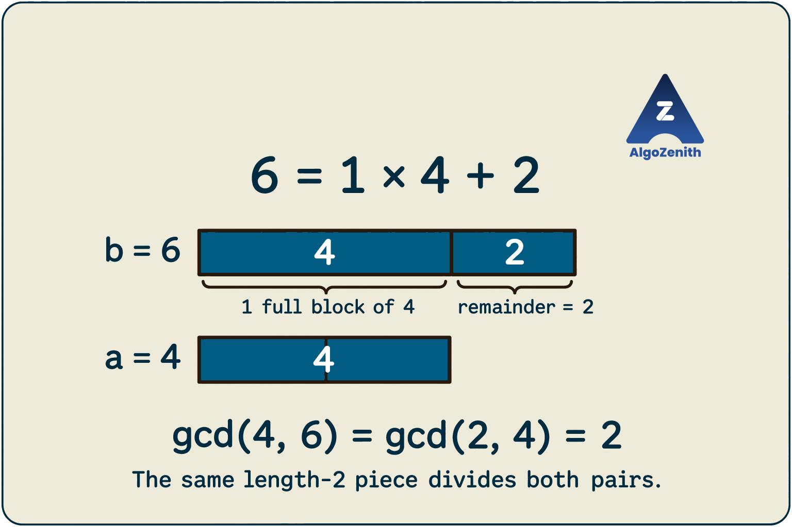
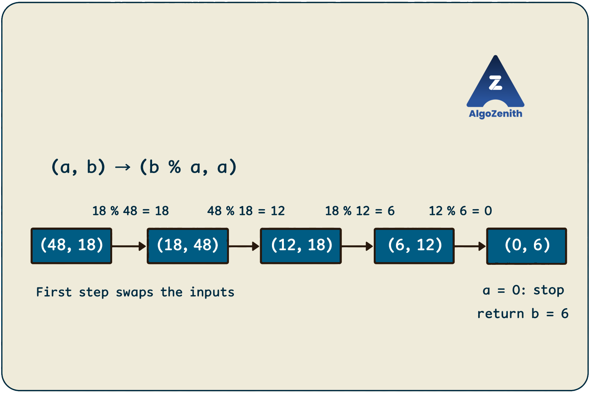
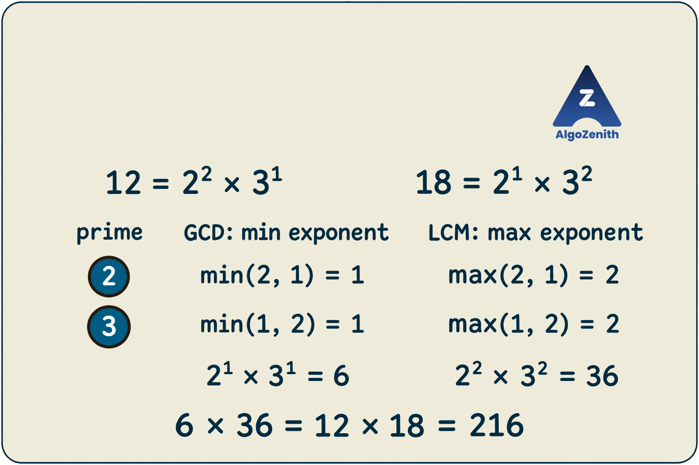
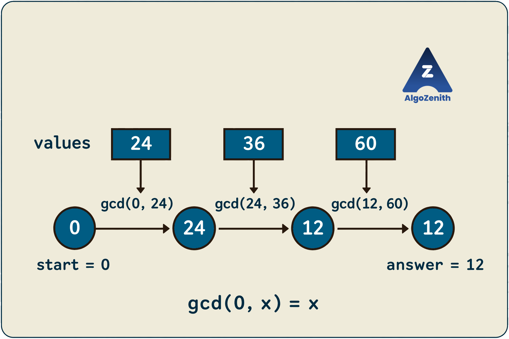

<READING_WIDGET>

# Euclidean Algorithm for GCD and LCM

Finding the greatest common divisor looks like a factor-search problem: list the factors of two numbers, find the common ones, and choose the largest. But we can compute the answer without listing any factors.

The **Euclidean algorithm** repeatedly replaces a pair of numbers with a smaller pair that has exactly the same common divisors. The key operation is taking a remainder.

We will build this idea from the factor-based approach, prove why the reduction works, implement it in C++, and use it to calculate LCMs and process arrays.

## 1. GCD and Coprime Numbers

For two positive integers $a$ and $b$, their **greatest common divisor**, written $\gcd(a,b)$, is the largest positive integer that divides both without leaving a remainder. It is also called the **highest common factor (HCF)**.

For example:

| Numbers | Common positive divisors | GCD |
| --- | --- | --- |
| $4,8$ | $1,2,4$ | $4$ |
| $4,5$ | $1$ | $1$ |
| $4,6$ | $1,2$ | $2$ |

If $\gcd(a,b)=1$, the numbers are **coprime**, or relatively prime.

Coprime numbers do not have to be prime individually. For example, $8$ and $9$ are both composite, but $\gcd(8,9)=1$.

### Conventions Used in This Lesson

The mathematical explanations start with positive integers. Our C++ functions accept **nonnegative `long long` values**, including zero:

- $\gcd(a,0)=\gcd(0,a)=a$.
- We use the programming convention $\gcd(0,0)=0$.
- We define $\operatorname{lcm}(a,0)=\operatorname{lcm}(0,a)=0$, including when both inputs are zero.

For signed mathematical inputs, GCD and LCM are taken to be nonnegative and can be computed using the inputs' absolute values. The custom implementations below assume the inputs have already been made nonnegative.

## 2. Starting Point: Search for Common Divisors

Every common divisor of two positive integers is at most $\min(a,b)$. A direct approach checks candidates from that value down to $1$ and returns the first one that divides both numbers.

### Shared C++ Headers

The implementations in this lesson use C++17. Combine the following headers with the functions you want to run:

```cpp
#include <algorithm>
#include <iostream>
#include <numeric>
#include <vector>
using namespace std;
```

### Brute-Force Implementation

```cpp
long long gcdBruteForce(long long a, long long b) {
    if (a == 0) return b;
    if (b == 0) return a;

    for (long long d = min(a, b); d >= 1; --d) {
        if (a % d == 0 && b % d == 0) {
            return d;
        }
    }

    return 1;
}
```

For positive inputs, the worst-case time complexity is **$O(\min(a,b))$**, with **$O(1)$ auxiliary space**. Consecutive numbers such as $10^9$ and $10^9-1$ are coprime, so this search checks every candidate down to $1$.

### Improving the Factor Search

Divisors occur in pairs. If $d$ divides $n$, then $n/d$ also divides $n$. At least one member of each pair is at most $\sqrt n$.

For $n=36$, the factor pairs are:

```text
(1, 36), (2, 18), (3, 12), (4, 9), (6, 6)
```

This lets us enumerate all factors of $n$ in $O(\sqrt n)$ time. For GCD, we only need to enumerate factor pairs of the **smaller number** and check which members also divide the larger number.

```cpp
long long gcdByFactors(long long a, long long b) {
    if (a == 0) return b;
    if (b == 0) return a;

    long long smaller = min(a, b);
    long long larger = max(a, b);
    long long answer = 1;

    for (long long d = 1; d <= smaller / d; ++d) {
        if (smaller % d != 0) continue;

        long long paired = smaller / d;

        if (larger % d == 0) {
            answer = max(answer, d);
        }
        if (larger % paired == 0) {
            answer = max(answer, paired);
        }
    }

    return answer;
}
```

The condition `d <= smaller / d` is equivalent to `d * d <= smaller` for positive `d`, but avoids overflowing the multiplication.

This version takes **$O(\sqrt{\min(a,b)})$ time** and **$O(1)$ auxiliary space**. We do not store the factors.

### How Many Factors Can a Number Have?

If $\tau(n)$ denotes the number of positive divisors of $n$, factor pairing gives the simple upper bound:

$$
\tau(n)\le 2\lfloor\sqrt n\rfloor.
$$

For a perfect square, the pair $(\sqrt n,\sqrt n)$ contributes only one distinct divisor, so we can subtract one from this bound. For example, $36$ has $9$ divisors, while the square-specific bound is $11$.

This is an **upper bound**, not an exact formula. Writing $O(2\sqrt n)$ is asymptotically the same as writing $O(\sqrt n)$.

If we enumerate factors of both $a$ and $b$, the enumeration costs $O(\sqrt a+\sqrt b)$. Comparing every factor of one list against every factor of the other would introduce up to $\tau(a)\tau(b)\le 4\sqrt{ab}$ comparisons. That product describes a naive nested comparison, not the cost of finding both factor lists. The implementation above avoids this comparison step entirely.

Can we improve further? Instead of searching for divisors, we can preserve them while shrinking the numbers.

## 3. The Key Identity: Replace a Number with a Remainder

Assume $0<a\le b$. Integer division gives:

$$
b=ka+r,\qquad 0\le r<a,
$$

where $k=\lfloor b/a\rfloor$ is the quotient and $r=b\bmod a$ is the remainder.

The Euclidean algorithm uses the identity:

$$
\boxed{\gcd(a,b)=\gcd(b\bmod a,a)}.
$$

For the lecture's example, $a=4$ and $b=6$:

$$
6=1\cdot4+2
\quad\Longrightarrow\quad
\gcd(4,6)=\gcd(2,4).
$$



### Why Does the Identity Hold?

We show that the two pairs have exactly the same common divisors.

**First direction:** Suppose $d$ divides both $a$ and $b$. It also divides their integer combination:

$$
b-ka=r.
$$

Therefore, $d$ divides both $r$ and $a$.

**Reverse direction:** Suppose $d$ divides both $r$ and $a$. It also divides:

$$
ka+r=b.
$$

Therefore, $d$ divides both $a$ and $b$.

The common divisors are unchanged, so their greatest member is unchanged too.

> **Interview insight:** The correctness argument has two parts: the remainder step preserves the GCD, and the remainder is smaller than the divisor. Preservation gives the right answer; decreasing values guarantee termination.

### Connection to Repeated Subtraction

For $b\ge a>0$, the same reasoning gives $\gcd(a,b)=\gcd(a,b-a)$. We could repeatedly subtract the smaller number from the larger one.

Modulo performs a whole batch of those subtractions at once. For example, reducing $(1,10^9)$ by one subtraction at a time requires roughly $10^9$ steps; `1000000000 % 1` immediately produces zero.

Use the **remainder-based algorithm** when claiming logarithmic time. The one-subtraction-at-a-time version can be linear in the larger input.

## 4. Recursive Euclidean Algorithm

Apply the identity until the first argument becomes zero:

$$
\gcd(a,b)=
\begin{cases}
b, & a=0,\\
\gcd(b\bmod a,a), & a>0.
\end{cases}
$$

```cpp
long long gcdRecursive(long long a, long long b) {
    if (a == 0) return b;
    return gcdRecursive(b % a, a);
}
```

The base case must be checked **before** evaluating `b % a`, because taking a remainder with a zero divisor is invalid.

### Dry Run: `gcdRecursive(4, 6)`

| Call | Remainder | Next action |
| --- | --- | --- |
| `gcdRecursive(4, 6)` | `6 % 4 = 2` | Call `gcdRecursive(2, 4)` |
| `gcdRecursive(2, 4)` | `4 % 2 = 0` | Call `gcdRecursive(0, 2)` |
| `gcdRecursive(0, 2)` | Not evaluated | Return `2` |

The value `2` then returns through the earlier calls:

$$
\gcd(4,6)\rightarrow\gcd(2,4)\rightarrow\gcd(0,2)=2.
$$

### Do We Need to Sort the Inputs?

No. The proof used $a\le b$ to make the division easy to discuss, but the code works in either order.

For example, if the first argument is larger:

```text
gcdRecursive(6, 4)
  -> gcdRecursive(4, 6)  // 4 % 6 = 4
  -> gcdRecursive(2, 4)
  -> gcdRecursive(0, 2)
  -> 2
```

The first call effectively swaps the arguments.

## 5. Iterative Euclidean Algorithm

We can perform the same reductions in a loop, avoiding the recursive call stack.

```cpp
long long gcdEuclidean(long long a, long long b) {
    while (a != 0) {
        long long remainder = b % a;
        b = a;
        a = remainder;
    }
    return b;
}
```

Each iteration changes $(a,b)$ into $(b\bmod a,a)$. Save the remainder before changing either argument so that it is calculated from the original pair.

### Dry Run: `gcdEuclidean(48, 18)`

| Current `a` | Current `b` | `b % a` | New pair `(a, b)` |
| --- | --- | --- | --- |
| `48` | `18` | `18` | `(18, 48)` |
| `18` | `48` | `12` | `(12, 18)` |
| `12` | `18` | `6` | `(6, 12)` |
| `6` | `12` | `0` | `(0, 6)` |

The loop stops and returns `6`, the last nonzero value.



The equivalent recurrence $\gcd(a,b)=\gcd(b,a\bmod b)$ is also common. With that ordering, stop when `b == 0` and return `a`. Keep the base case consistent with the argument used as the modulo divisor.

## 6. Why Is the Time Complexity Logarithmic?

A decreasing value alone does not prove logarithmic time: subtracting one also decreases a value. We need to show that Euclid's algorithm makes sufficiently large reductions.

Consider an ordered pair $0<a\le b$, and let $r=b\bmod a$.

- If $r\le a/2$, the smaller value has at least halved in one reduction.
- If $r>a/2$, the next remainder is $a\bmod r=a-r<a/2$.

Therefore, the smaller positive value falls to at most half its previous value within **at most two reductions**. Starting from $m=\min(a,b)$, it can halve only $O(\log m)$ times before reaching the base case.

For positive inputs, the usual bound is **$O(\log(\min(a,b)))$ time**. More precisely, $O(1+\log(\min(a,b)+1))$ also covers zero and one without special notation.

| Implementation | Time for positive inputs | Auxiliary space |
| --- | --- | --- |
| Descending divisor search | $O(\min(a,b))$ | $O(1)$ |
| Factor-pair search | $O(\sqrt{\min(a,b)})$ | $O(1)$ |
| Recursive Euclidean algorithm | $O(\log(\min(a,b)))$ | $O(\log(\min(a,b)))$ call stack |
| Iterative Euclidean algorithm | $O(\log(\min(a,b)))$ | $O(1)$ |

These bounds count arithmetic operations on machine-sized integers as constant-time operations. Arbitrary-precision integers require a separate analysis of arithmetic costs, so this is not a universal claim that Euclid is the fastest possible GCD algorithm in every computational model.

Consecutive Fibonacci numbers produce worst-case Euclidean step counts relative to input size. Their remainders move through earlier Fibonacci numbers:

```text
(13, 21) -> (8, 13) -> (5, 8) -> (3, 5)
         -> (2, 3) -> (1, 2) -> (0, 1)
```

## 7. Finding the LCM Using the GCD

For positive integers, the **least common multiple (LCM)** is the smallest positive integer divisible by both numbers.

For example:

```text
Multiples of 4: 4, 8, 12, 16, 20, 24, ...
Multiples of 6: 6, 12, 18, 24, 30, ...

lcm(4, 6) = 12
```

The relationship between GCD and LCM is:

$$
\gcd(a,b)\cdot\operatorname{lcm}(a,b)=a\cdot b,
$$

so:

$$
\boxed{\operatorname{lcm}(a,b)=\frac{a}{\gcd(a,b)}\cdot b}.
$$

### Why Does the Formula Work?

In prime factorizations, the GCD takes the **minimum** exponent of each prime, while the LCM takes the **maximum**. For any two exponents, their minimum plus their maximum equals their sum. Therefore, multiplying the GCD and LCM gives the same prime exponents as multiplying the original numbers.

For example:

$$
12=2^2\cdot3,\qquad18=2\cdot3^2.
$$

Their GCD is $2\cdot3=6$, and their LCM is $2^2\cdot3^2=36$. Indeed, $6\cdot36=12\cdot18=216$.

This explains the formula; we do not need to compute prime factorizations to use it.



### C++ Implementation

```cpp
// Preconditions: a and b are nonnegative;
// their LCM is representable in long long.
long long lcmEuclidean(long long a, long long b) {
    if (a == 0 || b == 0) return 0;

    long long g = gcdEuclidean(a, b);
    return (a / g) * b;
}
```

Handle zero first. In particular, directly evaluating the formula for `(0, 0)` would divide by `gcd(0, 0)`, which is zero.

The function takes **$O(\log(\min(a,b)))$ time** for positive inputs and **$O(1)$ auxiliary space**, using the iterative GCD function.

### Divide Before Multiplying

For $a=b=10^{12}$, the LCM is just $10^{12}$, but the intermediate product $a\cdot b=10^{24}$ does not fit in a typical 64-bit signed integer. Dividing by the GCD first avoids that unnecessary overflow.

However, **division first does not guarantee that the final LCM fits**. If the inputs are large and coprime, their LCM is their product.

For positive `b`, overflow can be checked before multiplying by comparing `a / g` with `numeric_limits<long long>::max() / b` from `<limits>`. If it is larger, the LCM cannot be stored in `long long`; handle that according to the problem's requirements.

Also choose the operand types before arithmetic. Assigning an overflowing `int` expression to a `long long` afterward does not repair it. Our function uses `long long` operands throughout.

## 8. GCD of an Array

GCD is associative:

$$
\gcd(a,b,c)=\gcd(\gcd(a,b),c).
$$

A number divides $a$, $b$, and $c$ exactly when it divides both $\gcd(a,b)$ and $c$. This lets us extend a running GCD one element at a time.

```cpp
long long gcdArray(const vector<long long>& values) {
    long long answer = 0;

    for (long long value : values) {
        answer = gcdEuclidean(answer, value);
        if (answer == 1) break;
    }

    return answer;
}
```

Starting with zero works because $\gcd(0,x)=x$. It also handles single-element and all-zero arrays naturally. This helper returns `0` for an empty array by convention.

### Dry Run

For `values = [24, 36, 60]`:

| Next element | Updated running GCD |
| --- | --- |
| `24` | `gcd(0, 24) = 24` |
| `36` | `gcd(24, 36) = 12` |
| `60` | `gcd(12, 60) = 12` |

The answer is `12`.



Once the running GCD becomes `1`, it cannot change: $\gcd(1,x)=1$ for every nonnegative integer $x$. Early stopping is therefore valid for this in-memory array. If reading a sequence from standard input, still consume any remaining values required by the input format.

For `n` elements bounded by $M$, a straightforward upper bound is **$O(n\log(M+1))$ time** for $M\ge1$, with **$O(1)$ auxiliary space**. An all-zero input takes $O(n)$ time.

## 9. LCM of an Array

LCM is associative too:

$$
\operatorname{lcm}(a,b,c)
=\operatorname{lcm}(\operatorname{lcm}(a,b),c).
$$

Use a running value initialized to `1`, since $\operatorname{lcm}(1,x)=x$.

```cpp
// Preconditions: values are nonnegative;
// for an array without zero, its LCM fits in long long.
long long lcmArray(const vector<long long>& values) {
    // A zero makes the answer zero. Check before building a
    // potentially overflowing LCM of an earlier positive prefix.
    for (long long value : values) {
        if (value == 0) return 0;
    }

    long long answer = 1;
    for (long long value : values) {
        answer = lcmEuclidean(answer, value);
    }
    return answer;
}
```

For `[4, 6, 10]`, the running values are:

```text
1 -> 4 -> 12 -> 60
```

This helper returns `1` for an empty array by convention. For positive inputs, each prefix LCM divides the final LCM, so if the final result fits, every intermediate result also fits when using division before multiplication.

The running LCM can grow much larger than the largest input. However, each GCD call still has one argument at most $M$, the maximum array value. Under the stated machine-integer assumptions, the loop has an **$O(n\log(M+1))$ upper bound** for $M\ge1$ and uses **$O(1)$ auxiliary space**.

## 10. Standard C++ Functions: `std::gcd` and `std::lcm`

C++17 provides both functions in `<numeric>`:

```cpp
long long g = std::gcd(48LL, 18LL); // 6
long long l = std::lcm(12LL, 18LL); // 36
```

`std::gcd` works with the absolute values of its arguments and returns zero for `(0, 0)`. Those absolute values must be representable in the arguments' common type. In particular, the magnitude of the minimum signed `long long` does not fit in a signed `long long`. See the [C++ specification for `std::gcd`](https://eel.is/c++draft/numeric.ops.gcd).

`std::lcm` returns zero if either argument is zero. Its input magnitudes and result must be representable in the common type; it does not provide an overflow-reporting interface. See the [C++ specification for `std::lcm`](https://eel.is/c++draft/numeric.ops.lcm).

Older competitive-programming code often uses `__gcd(a, b)`. This is a GNU library implementation detail, not a portable standard function. Prefer `std::gcd` in C++17 or later, or write Euclid's algorithm when a manual implementation is required.

Do not assume a library uses this exact recursive implementation; implementations can use alternatives such as binary GCD. The logarithmic analysis in this lesson proves the bound for our remainder-based code.

> **Interview insight:** Explain the remainder identity and its base case before reaching for a library function. Use the standard helper when allowed, but be ready to implement and justify the algorithm yourself.

## 11. Running the Implementations Together

Combine the shared headers, `gcdEuclidean`, `lcmEuclidean`, `gcdArray`, and `lcmArray` with this `main`:

```cpp
int main() {
    cout << gcdEuclidean(4, 6) << '\n';
    cout << gcdEuclidean(48, 18) << '\n';
    cout << lcmEuclidean(4, 6) << '\n';

    vector<long long> first = {24, 36, 60};
    vector<long long> second = {4, 6, 10};

    cout << gcdArray(first) << '\n';
    cout << lcmArray(second) << '\n';
    return 0;
}
```

Output:

```text
2
6
12
12
60
```

## 12. Interview and Competitive Programming Insights

### Reducing a Fraction

To reduce $a/b$, where $a\ge0$ and $b>0$, divide both by $g=\gcd(a,b)$.

For example, $42/30$ becomes $7/5$ after dividing by $6$. The reduced numerator and denominator are coprime.

### Recognizing GCD and LCM in a Problem

Use GCD when a value must **divide every quantity**, such as finding the largest equal piece length that can cut several ropes without waste.

Use LCM when a value must **be divisible by every quantity**, such as finding when periodic events next coincide after starting together. Events repeating every $4$ and $6$ minutes coincide again after $12$ minutes.

### An Array GCD of One Does Not Mean Pairwise Coprimality

For `[6, 10, 15]`, the GCD of all elements is `1`. However:

$$
\gcd(6,10)=2,\quad\gcd(6,15)=3,\quad\gcd(10,15)=5.
$$

**Pairwise coprime** means every pair has GCD `1`, which is a stronger requirement.

### GCD After Removing One Element

Associativity supports prefix and suffix GCD arrays. Define `prefix[i]` as the GCD before index `i`, and `suffix[i]` as the GCD from index `i` onward, with zero at the empty boundaries.

The GCD after removing `values[i]` is then:

```text
gcd(prefix[i], suffix[i + 1])
```

Each removal query combines two stored results using one GCD call. This avoids recomputing a GCD across the entire remaining array for every candidate removal.

### LCMs Under a Limit

Some problems only ask whether an LCM exceeds a limit $K$. For positive `b`, after finding `g = gcd(a, b)`, check whether `a / g > K / b` before multiplying.

If so, the LCM exceeds $K$, and the exact product is unnecessary. This is useful when LCMs grow beyond the range needed by the problem. Handle zero separately using the earlier convention.

## 13. Where the Extended Euclidean Algorithm Fits

The ordinary Euclidean algorithm finds $g=\gcd(a,b)$. The **extended Euclidean algorithm** also finds integers $x$ and $y$ such that:

$$
ax+by=g.
$$

For example:

$$
4(-1)+6(1)=2=\gcd(4,6).
$$

It tracks how the remainder steps express the GCD as a combination of the original inputs. This is useful for:

- **Linear Diophantine equations:** For positive $a,b$, the equation $ax+by=c$ has integer solutions exactly when $\gcd(a,b)$ divides $c$.
- **Modular inverses:** For a modulus $m>1$, an inverse of $a$ modulo $m$ exists exactly when $\gcd(a,m)=1$. If $ax+my=1$, then $x$, normalized modulo $m$, is such an inverse.

Extended Euclid is a separate extension. Ordinary GCD and LCM calculations need only the remainder-based algorithm developed here.

## 14. Edge Cases and Common Mistakes

| Case | Expected GCD | Expected LCM |
| --- | --- | --- |
| `(4, 8)` | `4` | `8` |
| `(4, 5)` | `1` | `20` |
| `(4, 6)` | `2` | `12` |
| `(7, 7)` | `7` | `7` |
| `(1, 25)` | `1` | `25` |
| `(0, 9)` or `(9, 0)` | `9` | `0` |
| `(0, 0)` | `0` by convention | `0` by convention |

- **Check the base case before modulo.** `b % a` requires `a != 0`.
- **Match the recurrence to its base case.** Our `(b % a, a)` version stops at `a == 0` and returns `b`.
- **Save the remainder before updating variables.** Otherwise, the second assignment may use an already changed value.
- **Include both members of a factor pair.** A common divisor can be larger than the smaller number's square root.
- **Count recursive stack space.** The recursive version has logarithmic auxiliary space; the iterative version uses constant space.
- **Keep LCM arithmetic within the chosen type.** Divide first, then multiply, and verify that the final result fits.
- **Respect the input domain.** The custom functions assume nonnegative values; blindly negating the minimum signed integer overflows its type.

## Quick Recap

- GCD is the greatest common divisor; numbers with GCD `1` are coprime.
- Divisors occur in pairs, giving a square-root factor search and a simple divisor-count upper bound.
- Euclid uses $\gcd(a,b)=\gcd(b\bmod a,a)$ until the first argument becomes zero.
- Each reduction preserves all common divisors, and the smaller value at least halves within two reductions.
- The iterative algorithm uses logarithmic time and constant auxiliary space.
- For positive inputs, $\operatorname{lcm}(a,b)=(a/\gcd(a,b))\cdot b$; handle zero before applying the formula.
- Associativity lets us extend both operations across arrays.
- In C++17 and later, `<numeric>` provides `std::gcd` and `std::lcm`; understand their mathematical basis and numeric limits.

</READING_WIDGET>
